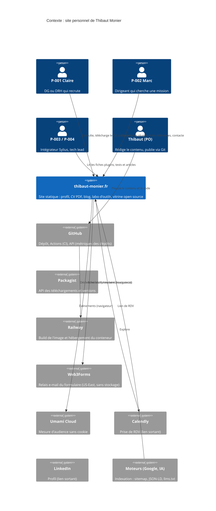
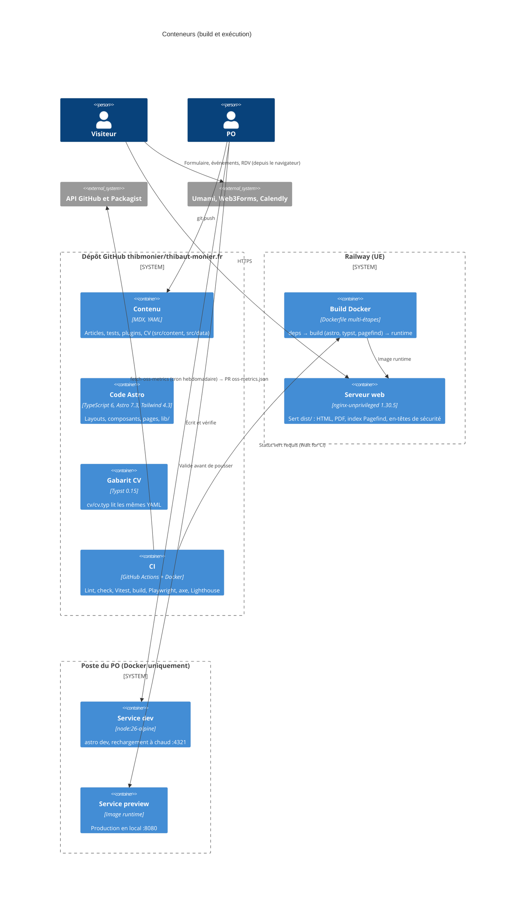
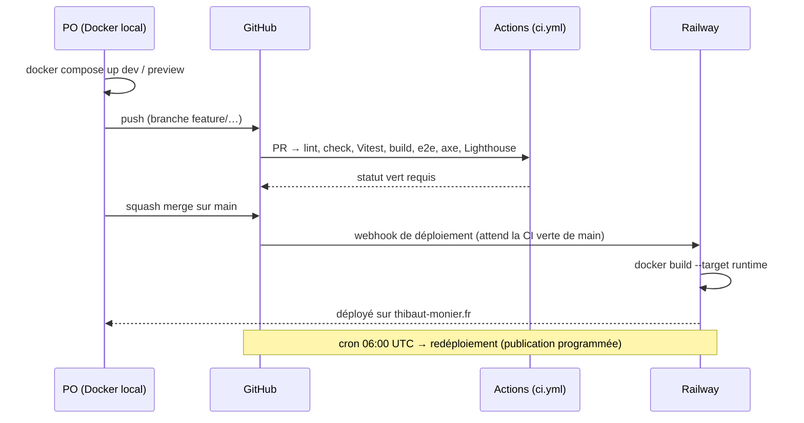

# Architecture C4

> Niveaux 1 à 3. Le site est statique : il n'y a ni serveur applicatif ni base de données. Le « système » se compose d'un **pipeline de build** et d'un **serveur de fichiers**. Décisions : ADR-0001 à ADR-0009 (`docs/adr/`).

## Niveau 1 : contexte système



## Niveau 2 : conteneurs



## Niveau 3 : composants (code Astro)

```mermaid
flowchart TB
  subgraph src["src/"]
    direction TB
    subgraph data["data et content (source de vérité)"]
      cv[(data/cv/*.yaml)]
      oss[(data/oss-metrics.json)]
      col[(content/blog, tools, tool-tests, plugins, projects)]
    end
    cfg[content.config.ts<br/>schémas Zod]
    subgraph lib["lib/ (logique testée, Vitest ≥ 80 %)"]
      privacy[privacy.ts<br/>liste blanche des données]
      filters[filters.ts<br/>filtres plugins et compétences]
      metrics[oss-metrics.ts<br/>fusion contenu et métriques]
      events[analytics-events.ts<br/>contrat des événements Umami]
      seo[seo.ts<br/>JSON-LD, canonical, hreflang]
      staleness[staleness.ts<br/>alerte des tests de plus de 6 mois]
    end
    subgraph ui["components/ et layouts/"]
      base[BaseLayout<br/>Header, Footer, ThemeToggle, Seo]
      cards[Timeline, PluginCard, ToolTestScore, CTAPair, ContactForm]
    end
    pages[pages/<br/>routes FR (EN au sprint 5)]
    gen[pages techniques<br/>rss.xml, llms.txt, robots.txt, og/*.png]
  end
  subgraph scripts["scripts/ (build)"]
    fetch[fetch-oss-metrics.ts]
    checks[post-build checks<br/>PDF, liens, canonical, correspondance]
  end
  typst[cv/cv.typ → thibaut-monier-cv.pdf]

  cv --> cfg --> pages
  col --> cfg
  oss --> metrics --> pages
  lib --> ui --> pages
  seo --> gen
  cv --> typst
  privacy --> checks
  fetch --> oss
```

## Flux de build et de déploiement


