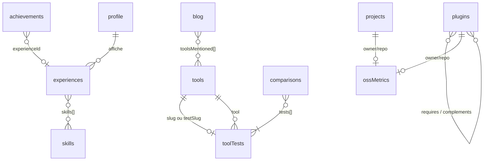

# Modèle de contenu (équivalent de l'ERD)
Site statique Astro 7.3.8, Content Layer, schémas Zod 4 (`import { z } from "astro/zod"`), sans base de données. Les collections et les URL de l'ADR-0008 font foi ; le YAML partagé avec Typst vient de l'ADR-0005, les métriques de l'ADR-0006. Implémentation dans `src/content.config.ts`.

## 1. Diagramme des collections


## 2. Conventions et briques communes
- **Slug** : nom de fichier en kebab-case ASCII, immuable après publication. Collections localisées (`{fr,en}/`) : id Astro `fr/<slug>`, références par **slug** (chaîne) vérifiées par le script du §4 ; `reference()` seulement vers `tools` (non localisée).
- **Dates** : `z.coerce.date()` ; périodes d'expérience en `AAAA-MM`. **Brouillons** : `draft` et `pubDate` future exclus de `getCollection`.
- **`z.strictObject`** partout : une clé inconnue (ex. `phone`) fait échouer le build.
```ts
// src/content/schemas/common.ts
import { z } from "astro/zod";
export const slug = z.string().regex(/^[a-z0-9]+(?:-[a-z0-9]+)*$/);
export const yearMonth = z.string().regex(/^\d{4}-(0[1-9]|1[0-2])$/);
export const httpsUrl = z.url({ protocol: /^https$/ });
export const repoRef = z.strictObject({ owner: z.string().min(1), name: z.string().min(1) });
// Motifs interdits : téléphone, âge, naissance (liste blanche, voir §4).
const PII = /(\+33|\b0[1-9](?:[ .]?\d{2}){4}\b|\b\d{1,3}\s?ans\b|date de naissance|née? le\b)/i;
export const safeText = z.string().refine((v) => !PII.test(v), "donnée personnelle interdite");
```

## 3. Collections
### 3.1 `experiences` (US-005, US-007)
`src/data/cv/experiences/*.yaml`, `glob({ pattern: "*.yaml", base: "./src/data/cv/experiences" })`, lu aussi par Typst (`yaml()`). Aucun champ téléphone, adresse, âge ou naissance.
```ts
const experiences = defineCollection({
  loader: glob({ pattern: "*.yaml", base: "./src/data/cv/experiences" }),
  schema: z.strictObject({
    company: z.string(), role: z.string(), start: yearMonth,
    end: yearMonth.nullable().default(null),       // null = poste en cours
    location: z.string().max(40).optional(),       // ville ou « remote », jamais d'adresse
    context: safeText.max(280),
    achievements: z.array(safeText.max(300)).min(1).max(8),
    skills: z.array(slug).default([]),
    featured: z.boolean(),                         // détaillé = 10 dernières années
    summaryOnly: safeText.max(160).optional(),     // bloc « Avant 2016 »
    clientsCited: z.boolean().default(false),      // accord de citation (US-005)
    order: z.number().int().optional(),            // départage deux postes d'un même employeur
  }).refine((e) => !e.end || e.end >= e.start, { path: ["end"], message: "end précède start" })
    .refine((e) => e.featured || e.summaryOnly, { path: ["summaryOnly"], message: "requis si non featured" }),
});
```

### 3.2 `profile`, `skills`, `achievements` (US-004, US-006)
`src/data/cv/{profile,skills,achievements}.yaml`, loader `file()`. `profile.yaml` est un objet indexé par langue (`fr:`, `en:` au sprint 5).
```ts
const domain = z.enum(["delivery", "architecture", "e-commerce", "donnees-migrations", "ia-appliquee"]);
const profile = defineCollection({ loader: file("./src/data/cv/profile.yaml"),
  schema: z.strictObject({
    name: z.literal("Thibaut Monier"), title: z.string().max(80),
    tagline: safeText.max(240), summary: safeText.max(600),
    email: z.email().optional(),                   // adresse publique dédiée uniquement
    links: z.array(z.strictObject({ kind: z.enum(["linkedin", "github", "packagist", "rss"]), url: httpsUrl })).default([]),
  }) });
const skills = defineCollection({ loader: file("./src/data/cv/skills.yaml"),
  schema: z.strictObject({ id: slug, label: z.string(), domain, level: z.enum(["expert", "avance", "pratique"]).optional() }) });
const achievements = defineCollection({ loader: file("./src/data/cv/achievements.yaml"),
  schema: z.strictObject({
    id: slug, title: safeText.max(120), domains: z.array(domain).min(1),
    clients: z.array(z.string()).default([]),      // vide = « Référence confidentielle »
    year: z.number().int().min(2000).max(2100), proofUrl: httpsUrl.optional(),
    experienceId: z.string().optional(), skills: z.array(slug).default([]),
  }) });
```

### 3.3 `blog` (US-009, US-010)
`src/content/blog/{fr,en}/*.mdx`, `glob({ pattern: "**/*.{md,mdx}", base: "./src/content/blog" })`. Seul `fr/` est publié. Reprend le frontmatter existant du dépôt `blog/`.
```ts
const blog = defineCollection({
  loader: glob({ pattern: "**/*.{md,mdx}", base: "./src/content/blog" }),
  schema: ({ image }) => z.strictObject({
    title: z.string(), description: z.string().min(50).max(170),
    pubDate: z.coerce.date(), updatedDate: z.coerce.date().optional(),
    author: z.string().default("Thibaut Monier"),
    image: image().optional(), imageAlt: z.string().min(1).optional(), // image() échoue si le fichier manque
    excerpt: z.string().optional(), tags: z.array(z.string()).default([]),
    category: z.enum(["Business", "Méthode", "Métiers", "Outils", "Pilotage"]),
    series: z.string().optional(), draft: z.boolean().default(false),
    faq: z.array(z.strictObject({ question: z.string(), answer: z.string() })).optional(),
    originalUrl: httpsUrl.optional(),              // URL agentic-agency.fr d'origine (US-010)
    originalPublishedAt: z.coerce.date().optional(),
    toolsMentioned: z.array(reference("tools")).default([]),
  }).refine((p) => Boolean(p.image) === Boolean(p.imageAlt), { path: ["imageAlt"], message: "image et imageAlt vont ensemble" })
    .refine((p) => !p.originalUrl || p.originalPublishedAt, { path: ["originalPublishedAt"], message: "requis avec originalUrl" })
    .refine((p) => !p.updatedDate || p.updatedDate >= p.pubDate, { path: ["updatedDate"], message: "updatedDate précède pubDate" }),
});
```

### 3.4 `tools` (US-016)
`src/content/tools/*.md` (57 fiches migrées), `glob({ pattern: "*.md", base: "./src/content/tools" })`. Le badge « testé » est **dérivé** (test de même slug ou `testSlug`).
```ts
const tools = defineCollection({
  loader: glob({ pattern: "*.md", base: "./src/content/tools" }),
  schema: z.strictObject({
    name: z.string(), description: z.string(), url: httpsUrl.optional(),
    context: z.enum(["cli", "app", "commande-native", "shell"]),
    platform: z.enum(["macos", "multiplateforme"]),
    category: z.string(),                          // 21 catégories conservées
    replaces: z.string().optional(), mustHave: z.boolean().default(false),
    pricing: z.enum(["gratuit", "freemium", "payant"]).default("gratuit"),
    tagline: z.string().optional(), draft: z.boolean().default(false),
    testSlug: slug.optional(),                     // seulement si le slug du test diffère
  }),
});
```

### 3.5 `toolTests` (US-014, US-015, US-017)
`src/content/tool-tests/{fr,en}/*.mdx`, `glob({ pattern: "**/*.mdx", base: "./src/content/tool-tests" })`. Le corps MDX porte la rédaction, le frontmatter les données du protocole.
```ts
const rating = z.number().min(1).max(5).multipleOf(0.5);
const toolTests = defineCollection({
  loader: glob({ pattern: "**/*.mdx", base: "./src/content/tool-tests" }),
  schema: z.strictObject({
    tool: reference("tools"), title: z.string(), description: z.string().min(50).max(170),
    need: z.string().min(1),
    environment: z.strictObject({ toolVersion: z.string(), os: z.string(), osVersion: z.string(), hardware: z.string() }),
    testedAt: z.coerce.date(), recheckedAt: z.coerce.date(),
    scenarios: z.array(z.strictObject({
      scenarioId: slug.optional(),                 // identique d'un test à l'autre = mesures comparables
      title: z.string(), steps: z.array(z.string()).min(1), expected: z.string(), observed: z.string(),
      measure: z.strictObject({ label: z.string(), value: z.number(), unit: z.string() }).optional(),
    })).min(2, "au moins 2 scénarios"),
    limits: z.array(z.string().min(1)).min(1, "au moins 1 limite"),
    verdict: z.string().min(1),
    ratings: z.strictObject({ installation: rating, fiabilite: rating, performance: rating, documentation: rating, maintenance: rating }),
    alternatives: z.array(z.strictObject({ tool: reference("tools").optional(), name: z.string(), comment: z.string() })).default([]),
    noAlternativeReason: z.string().optional(),
    draft: z.boolean().default(false),
  }).refine((t) => t.recheckedAt >= t.testedAt, { path: ["recheckedAt"], message: "la date de revérification précède la date de test" })
    .refine((t) => t.alternatives.length > 0 || t.noAlternativeReason, { path: ["alternatives"], message: "alternatives ou noAlternativeReason requis" }),
});
```

La note globale est **calculée** (moyenne arrondie à 0,5), jamais saisie.

### 3.6 `plugins` (US-019, US-020)
`src/content/plugins/{fr,en}/*.mdx` (20 plugins), `glob`. Le corps MDX contient le problème résolu et l'installation.
```ts
const plugins = defineCollection({
  loader: glob({ pattern: "**/*.mdx", base: "./src/content/plugins" }),
  schema: ({ image }) => z.strictObject({
    name: z.string(), tagline: z.string().max(140),
    theme: z.enum(["b2b", "conformite-ue", "back-office", "ia-integrations"]),
    repo: repoRef, packagist: z.string().regex(/^[a-z0-9_.-]+\/[a-z0-9_.-]+$/),
    features: z.array(z.string()).min(5).max(8),
    compatibility: z.strictObject({
      matrix: z.array(z.strictObject({ sylius: z.string(), php: z.string(), symfony: z.array(z.string()).min(1) })).min(1),
      databases: z.array(z.enum(["mysql", "mariadb", "postgresql"])).min(1),
    }),
    requires: z.array(slug).default([]), complements: z.array(slug).default([]), // slugs de plugins
    screenshots: z.array(z.strictObject({ src: image(), alt: z.string().min(10) })).default([]),
    configExcerpt: z.string().optional(),          // affiché sans capture
    license: z.string().default("MIT"), draft: z.boolean().default(false),
  }).refine((p) => !p.requires.some((r) => p.complements.includes(r)), { path: ["complements"], message: "requis et complémentaire à la fois" }),
});
```

### 3.7 `projects` (US-022, US-023)
`src/content/projects/{fr,en}/*.mdx` (`tailsfadmin`, `career-ops`), `glob`.
```ts
const projects = defineCollection({
  loader: glob({ pattern: "**/*.mdx", base: "./src/content/projects" }),
  schema: ({ image }) => z.strictObject({
    name: z.string(), kind: z.enum(["bundle", "contribution"]), summary: z.string().max(200),
    role: z.string(), repo: repoRef, packagist: z.string().optional(), license: z.string().optional(),
    screenshot: z.strictObject({ src: image(), alt: z.string().min(10) }).optional(),
    contributions: z.array(z.strictObject({
      number: z.number().int().positive(), type: z.enum(["pr", "issue"]), title: z.string(),
      problem: z.string(), fix: z.string(), tests: z.string(), url: httpsUrl,
      mergedAt: z.coerce.date().optional(), status: z.enum(["merged", "open", "closed"]),
    })).default([]),
    draft: z.boolean().default(false),
  }).refine((p) => p.kind !== "contribution" || p.contributions.length > 0, { path: ["contributions"], message: "au moins une contribution" }),
});
```

### 3.8 Fichiers de données hors contenu éditorial
Fichiers : `src/data/oss-metrics.json` (commité, ADR-0006), `src/data/tokens.json` (tokens partagés avec Typst, ADR-0005), `src/config/legal.ts` (US-029), `src/data/comparisons.yaml` (US-018, proposition).
```ts
const hex = z.string().regex(/^#[0-9a-f]{6}$/i);
const count = z.number().int().nonnegative();
const metric = z.strictObject({
  fetchedAt: z.coerce.date(),
  github: z.strictObject({ stars: count, pushedAt: z.coerce.date(),
    latestRelease: z.strictObject({ tag: z.string(), publishedAt: z.coerce.date() }).nullable() }).optional(),
  packagist: z.strictObject({ downloadsTotal: count, downloadsMonthly: count, latestVersion: z.string() }).optional(),
});
export const ossMetricsSchema = z.strictObject({
  generatedAt: z.coerce.date(), entries: z.record(z.string().regex(/^[\w.-]+\/[\w.-]+$/), metric), // « owner/repo »
});
export const tokensSchema = z.strictObject({
  color: z.record(z.string(), z.strictObject({ light: hex, dark: hex })),
  font: z.strictObject({ sans: z.string(), mono: z.string() }), space: z.record(z.string(), z.string()),
});
export const legalSchema = z.strictObject({        // pas d'adresse ni de téléphone pour l'éditeur (CR-3)
  editor: z.strictObject({ name: z.string(), contactUrl: z.string(), contactEmail: z.email().optional() }),
  publicationDirector: z.string(),
  host: z.strictObject({ name: z.string(), address: z.string(), phone: z.string().optional() }),
});
const comparisons = defineCollection({ loader: file("./src/data/comparisons.yaml"),
  schema: z.strictObject({ id: slug, category: z.string(), tests: z.array(slug).min(2), recommendation: z.string().min(1) }) });
```

## 4. Règles de validation transverses au build
Le script `scripts/check-content.ts` s'exécute avant `astro build` (CI et local) : il charge les collections et applique ces règles. Erreur = sortie non nulle, message citant fichier et champ.
| # | Règle | Sévérité |
|---|-------|----------|
| V1 | **Liste blanche** : `strictObject` + `safeText` sur `experiences`, `profile`, `achievements` ; contrôle `pdftotext` du PDF avec les mêmes motifs (ADR-0005) | Erreur |
| V3 | **Unicité des slugs** par collection et par langue ; slugs du blog comparés à la table d'US-010 | Erreur |
| V4 | **Références croisées** existantes : `skills`, `experienceId`, `requires`/`complements`, `testSlug`, `comparisons.tests` | Erreur |
| V5 | `requires` sans auto-référence ni cycle ; cohérence avec les `composer.json` réels (contrôle manuel) | Erreur / manuel |
| V6 | Comparatif : mêmes `category` d'outil et au moins un `scenarioId` commun | Erreur |
| V7 | Frise : toute expérience terminée après `année courante - 10` est `featured: true` | Erreur |
| V8 | Décomptes : 57 `tools`, 20 `plugins`, 28 articles, 8 `experiences` | Erreur (CI) |
| V9 | **Péremption** : `recheckedAt` de plus de 183 jours | **Avertissement** (bandeau, build non bloqué) |
| V10 | `fetchedAt` de plus de 7 jours, clé `repo` manquante | Avertissement |

## 5. Exemples minimaux valides
```yaml
# src/data/cv/experiences/gingerminds.yaml
{ company: GINGERMINDS, role: Delivery Manager / CTO, start: "2021-01", end: "2025-12", location: Nantes,
  context: "Agence de 3 M€ de budget annuel.", achievements: ["Pilotage de vingt projets simultanés."],
  skills: [delivery], featured: true }
# src/data/cv/profile.yaml (clé = langue), skills.yaml, achievements.yaml (tableaux)
fr: { name: Thibaut Monier, title: Directeur technique de transition, tagline: Je sécurise la livraison., summary: Quinze ans de delivery. }
- { id: delivery, label: Pilotage de delivery, domain: delivery }
- { id: migration-magento-sylius, title: Bascule de Magento vers Sylius, domains: [e-commerce, donnees-migrations], year: 2024 }
---
# src/content/blog/fr/mon-article.mdx (frontmatter)
{ title: Exemple d'article, description: "Une description d'au moins cinquante caractères pour le schéma du blog.",
  pubDate: 2026-01-15, category: Méthode, image: ./mon-article.webp, imageAlt: Schéma du delivery,
  originalUrl: "https://agentic-agency.fr/blog/mon-article", originalPublishedAt: 2026-01-15 }
# src/content/tools/ghostty.md
{ name: Ghostty, description: "Émulateur de terminal rapide et natif.", context: app, platform: multiplateforme, category: Terminal }
---
# src/content/tool-tests/fr/ghostty.mdx
{ tool: ghostty, title: Test de Ghostty, description: "Test reproductible de Ghostty sur macOS, avec scénarios et limites.",
  need: Remplacer iTerm2 sans perdre les raccourcis.,
  environment: { toolVersion: "1.2.0", os: macOS, osVersion: "15.4", hardware: MacBook Pro M3 },
  testedAt: 2026-10-14, recheckedAt: 2026-10-14,
  scenarios: [ { scenarioId: demarrage-a-froid, title: Démarrage à froid, steps: ["Relancer l'app"], expected: "< 1 s", observed: "0,4 s" },
               { title: Défilement de 100 000 lignes, steps: ["seq 100000"], expected: Fluide, observed: Fluide } ],
  limits: ["Pas de profils graphiques"], verdict: Excellent pour un usage quotidien.,
  ratings: { installation: 5, fiabilite: 4.5, performance: 5, documentation: 4, maintenance: 5 },
  noAlternativeReason: Voir le comparatif Terminal. }
---
# src/content/plugins/fr/company-accounts.mdx
{ name: Company Accounts, tagline: "Comptes entreprise pour Sylius 2.", theme: b2b,
  repo: { owner: thibmonier, name: sylius-company-accounts }, packagist: thibmonier/sylius-company-accounts,
  features: [Comptes, Rôles, Rattachement, Invitations, Audit],
  compatibility: { matrix: [{ sylius: "2.3", php: ">=8.3", symfony: ["6.4", "7.4", "8.0"] }], databases: [mysql, postgresql] },
  complements: [purchase-approval] }
# src/content/projects/fr/career-ops.mdx
{ name: career-ops, kind: contribution, summary: "Trois correctifs de défauts silencieux.", role: Contributeur,
  repo: { owner: career-ops-hq, name: career-ops },
  contributions: [{ number: 3496, type: pr, title: En-têtes, problem: Verdict faux, fix: Garde de type, tests: Régression,
    url: "https://github.com/career-ops-hq/career-ops/pull/3496", status: merged }] }
# src/data/oss-metrics.json (en JSON)
{ "generatedAt": "2026-10-14T06:00:00Z", "entries": { "thibmonier/sylius-company-accounts": {
  "fetchedAt": "2026-10-14T06:00:00Z", "github": { "stars": 12, "pushedAt": "2026-10-10T08:00:00Z", "latestRelease": null } } } }
```

## 6. Correspondance collections, pages et US
URL détaillées dans l'ADR-0008 (`trailingSlash: "always"`, FR sans préfixe, EN sous `/en/` au sprint 5).
| Collection / donnée | Pages (FR) | US |
|---------------------|------------|----|
| `experiences`, `profile`, `skills`, `achievements` | `/`, `/parcours/`, `/competences/`, `/thibaut-monier-cv.pdf` | US-004 à 007, 028 |
| `blog` | `/blog/`, `/blog/<slug>/`, `/blog/categorie/<c>/`, `/blog/tag/<t>/`, `/rss.xml` | US-009 à 013, 024 |
| `tools` | `/labo/` | US-016 |
| `toolTests` | `/labo/tests/<slug>/` | US-014, 015, 017 |
| `comparisons` | `/labo/comparatifs/<categorie>/` | US-018 |
| `plugins` | `/open-source/`, `/open-source/sylius/<plugin>/` | US-019, 020 |
| `projects` | `/open-source/tailsfadmin/`, `/open-source/career-ops/` | US-022, 023 |
| `oss-metrics.json` | fiches plugins et projets (« au <date> ») | US-021 |
| `tokens.json`, `legal.ts` | CSS, Typst ; `/mentions-legales/`, `/vie-privee/` | US-002, 007, 029 |

## 7. Points à trancher (incohérences relevées)
> **Arbitrages du 2026-10-14 (revue de conception)** : (1) `toolTests`, notes de 1 à 5 par pas de 0,5 (US-014 alignée) ; (2) `achievements` et `skills` sont des collections et `/competences/` est une page dédiée, avec un filtre client en amélioration progressive (ADR-0008 aligné) ; (3) tailsfadmin est dans `projects` (US-022 alignée) ; (4) `comparisons.yaml` est retenu (ADR-0008) ; (5) Smile : **fusion en une entrée à deux rôles** par défaut (de toute façon antérieure à 2016, donc résumée selon D-6), le PO peut revenir dessus ; (6) structure `{fr,en}/` conservée par uniformité, seul `fr/` publié pour le blog et le labo ; (7) `src/config/legal.ts` ajouté à l'ADR-0008.

Points relevés initialement :

1. **`tests` ou `toolTests`, notes 0-5 ou 1-5** : US-014 parle de collection `tests` et de notes de 0 à 5 ; l'ADR-0008 dit `toolTests` et le cadrage impose 1 à 5. Retenu ici : `toolTests`, 1 à 5 par pas de 0,5.
2. **`achievements` et `/competences`** : ADR-0005 liste `achievements.yaml`, pas l'ADR-0008 (collections ni URL). US-006 vise `/competences?domaine=`, or le filtre est côté client sur un site statique. Ce document suppose une section de `/parcours/` ; sinon ajouter `/competences/` à l'ADR-0008.
3. **tailsfadmin** : US-022 suggère une entrée `plugins` de type « bundle », l'ADR-0008 le met dans `projects`. Retenu : `projects` (le décompte de 20 plugins reste exact).
4. **Comparatifs** : US-018 propose un fichier déclaratif absent de l'ADR-0008 ; `comparisons.yaml` est une proposition (alternative : automatique dès 2 tests par catégorie).
5. **Smile** : US-005 annonce 8 entrées alors que le CV source compte 2 rôles chez Smile ; V8 suppose la fusion (à confirmer par le PO).
6. **Blog en `{fr,en}/`** alors que le blog reste en FR : `en/` inutilisé (retirable). Les catégories viennent d'US-009 ; le dépôt `blog/` les type en `z.string()` (à vérifier sur les 28 articles).
7. **Config légale** : absente de l'ADR-0008 ; US-029 prévoit `src/config/legal.ts` (TypeScript).
