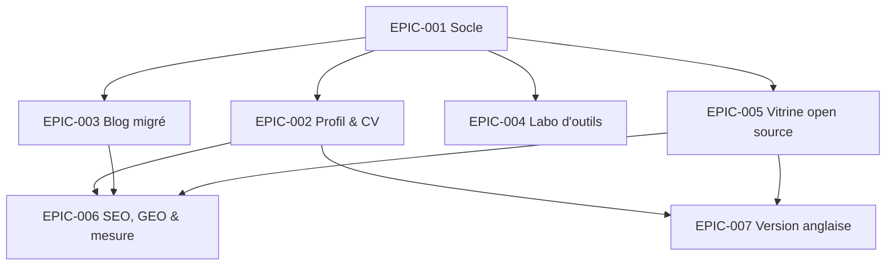
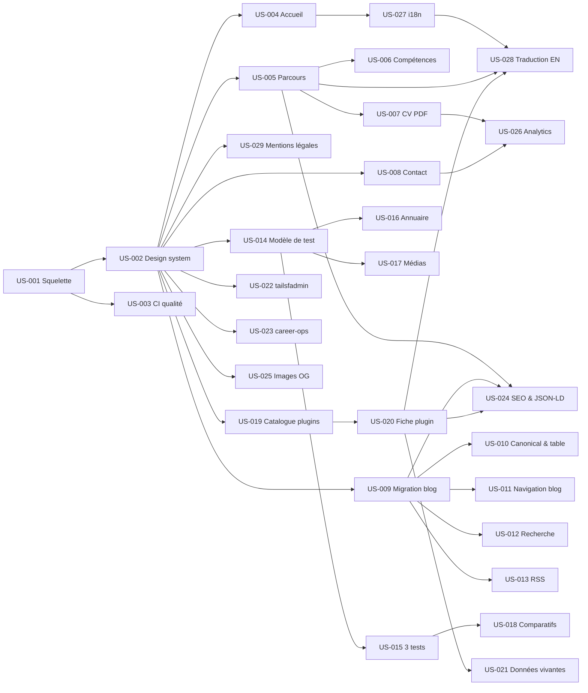

# Matrice des dépendances

## Graphe entre EPICs

## Tableau

| Epic | Dépend de | Bloque | Criticité |
|------|-----------|--------|-----------|
| EPIC-001 Socle | — | Tous | 🔴 Critique |
| EPIC-002 Profil & CV | EPIC-001 | EPIC-006, EPIC-007 | 🔴 Critique |
| EPIC-003 Blog migré | EPIC-001 | EPIC-006 | 🟠 Haute |
| EPIC-004 Labo d'outils | EPIC-001 | — | 🟡 Moyenne |
| EPIC-005 Vitrine open source | EPIC-001 | EPIC-006, EPIC-007 | 🟠 Haute |
| EPIC-006 SEO, GEO & mesure | EPIC-002, EPIC-003, EPIC-005 | — | 🟠 Haute |
| EPIC-007 Version anglaise | EPIC-002, EPIC-005 | — | 🟢 Basse |

## Chemin critique

EPIC-001 → EPIC-002 → EPIC-005 → EPIC-003 → EPIC-006

À l'échelle des US : US-001 → US-002 → US-005 → US-007 (CV PDF) et US-002 → US-019 → US-020 → US-024.

## Graphe inter-US

## Dépendances inter-US

| US source | US cible | Raison |
|-----------|----------|--------|
| US-001 | US-002, US-003 | Le projet et le déploiement doivent exister |
| US-002 | US-004, US-005, US-008, US-009, US-014, US-019, US-022, US-023, US-025, US-029 | Layout et design system communs |
| US-005 | US-006, US-007, US-024, US-028 | Collection « expériences » : source unique du CV |
| US-009 | US-010 à US-013, US-024 | Articles migrés requis |
| US-014 | US-015 à US-017 | Schéma du protocole de test |
| US-015 | US-018 | Il faut au moins 2 tests d'une même catégorie |
| US-019 | US-020 | Collection « plugins » |
| US-020 | US-021, US-024, US-028 | Fiche plugin à enrichir, décrire et traduire |
| US-007, US-008 | US-026 | Les conversions à mesurer doivent exister |
| US-004 | US-027 | Première page à rendre bilingue |
