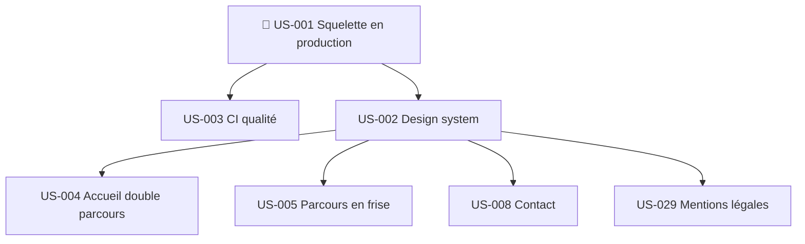

# Sprint 001 : dépendances

| US | Bloquée par | Bloque (dans le sprint) | Bloque (hors sprint) |
|----|-------------|-------------------------|----------------------|
| US-001 | — | US-002, US-003 | Tout le backlog |
| US-002 | US-001 | US-004, US-005, US-008, US-029 | US-009, US-014, US-019, US-022, US-023, US-025 |
| US-003 | US-001 | — | — |
| US-004 | US-002 | — | US-027 |
| US-005 | US-002 | — | US-006, US-007, US-024, US-028 |
| US-008 | US-002 | — | US-026 |
| US-029 | US-002 | — | — |

## Prérequis hors backlog
Détail et suivi : voir `pre-sprint-checklist.md`.

- [ ] Acheter le domaine thibaut-monier.fr / .com et configurer le DNS (non bloquant : sous-domaine `*.up.railway.app` provisoire)
- [x] Initialiser le dépôt git et créer le dépôt GitHub (thibmonier/thibaut-monier.fr, branche `feature/sprint-001-walking_skeleton`)
- [x] Hébergement selon l'ADR : Railway (CLI connecté ; service créé pendant US-001)
- [x] Outil de prise de RDV : Calendly (décision du 2026-10-14)
- [ ] Créer le compte Umami Cloud (`PUBLIC_UMAMI_WEBSITE_ID`) et le type d'événement Calendly « Échange découverte (30 min) » (`PUBLIC_CALENDLY_URL`)
- [ ] Créer la clé Web3Forms (`PUBLIC_WEB3FORMS_KEY`)
