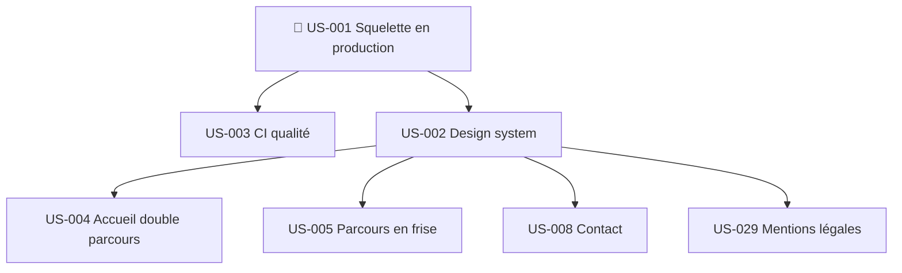

# Sprint 001 : dépendances

| US | Bloquée par | Bloque (dans le sprint) | Bloque (hors sprint) |
|----|-------------|-------------------------|----------------------|
| US-001 | — | US-002, US-003 | Tout le backlog |
| US-002 | US-001 | US-004, US-005, US-008, US-029 | US-009, US-014, US-019, US-022, US-023, US-025 |
| US-003 | US-001 | — | — |
| US-004 | US-002 | — | US-027 |
| US-005 | US-002 | — | US-006, US-007, US-024, US-028 |
| US-008 | US-002 | — | US-026 |
| US-029 | US-002 | — | — |

## Prérequis hors backlog (à lever avant ou pendant le Sprint Planning)
- [ ] Choisir le nom de domaine et configurer le DNS (question ouverte n° 1 du PRD)
- [ ] Initialiser le dépôt git et créer le dépôt GitHub
- [ ] Créer le service d'hébergement selon l'ADR (Railway ou Cloudflare Workers)
- [x] Outil de prise de RDV : Calendly (décision du 2026-10-14)
- [ ] Créer le compte Umami Cloud (région UE si disponible) et le type d'événement Calendly « Échange découverte (30 min) »
