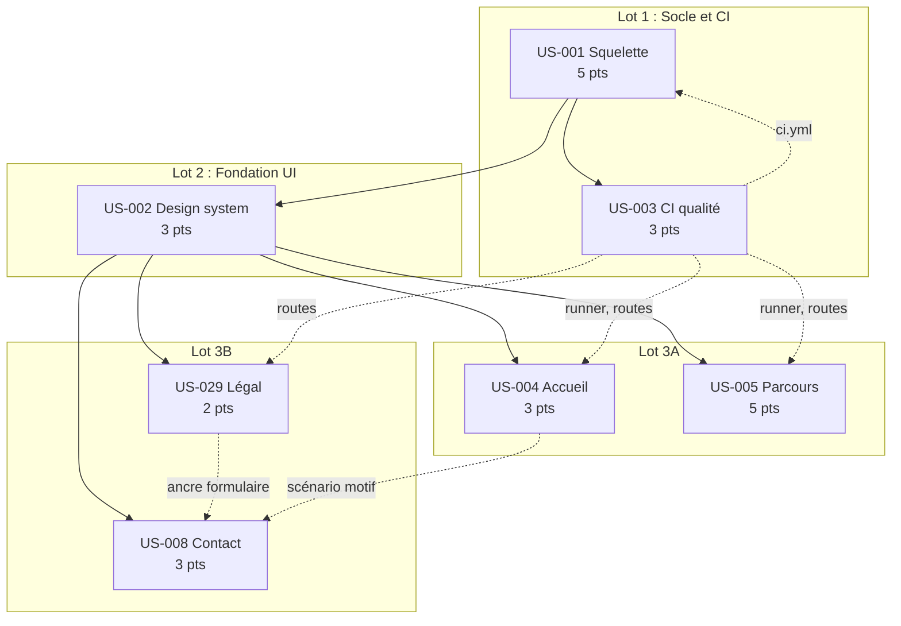

# Tâches du Sprint 001 : Walking skeleton

> Sprint Planning partie 2 (le COMMENT). Stack : site statique **Astro 7.3.8 / TypeScript 6.0.3 / Tailwind 4.3.3**, entièrement dockerisé (Dockerfile multi-étapes, `compose.yaml`, `Makefile`), nginx 1.30.5 sur Railway, CI GitHub Actions. Sources : `project-management/tech-spec.md`, `docs/adr/0001` à `0009`, `project-management/architecture/*`, `project-management/definition-of-done.md`.

## Adaptation de la méthode

| Type | Contenu | Remplace |
|------|---------|----------|
| `[OPS]` | Docker, compose, Makefile, nginx, CI GitHub Actions, Railway, scripts de contrôle | `[OPS]` |
| `[FE-WEB]` | Composants et pages Astro, CSS Tailwind, bibliothèques TypeScript pures (`src/lib/`), schémas Zod | `[FE-WEB]`, `[BE]`, `[DB]` |
| `[CONTENT]` | Contenu YAML/Markdown, rédaction, décisions éditoriales | `[DB]` (fixtures) |
| `[TEST]` | Vitest, Playwright, axe, Lighthouse, **écrits avant le code (TDD)** | `[TEST]` |
| `[DOC]` | README, guides `docs/guides/`, ADR, CHANGELOG | `[DOC]` |
| `[REV]` | Revue de code et de contenu | `[REV]` |

Pas de `[DB]`, `[BE]` ni `[FE-MOB]` : il n'y a ni base de données, ni API, ni application mobile. Chaque US reste une tranche verticale du site : contenu validé par schéma, page rendue, test de bout en bout, déploiement.

## Synthèse

| Indicateur | Valeur |
|------------|--------|
| User stories | 7 (24 points) |
| Tâches | **90** |
| Heures estimées | **236,5h** (dont 2h conditionnelles, T-001-17) |
| Chemin critique | 63h : T-001-02 → T-001-03 → T-001-04 → T-001-05 → T-001-06 → T-001-09 → T-001-10 → T-001-11 → T-001-13 → T-002-02 → T-002-04 → T-002-05 → T-002-06 → T-002-07 → T-002-08 → T-008-05 → T-008-06 → T-008-09 → T-008-10 → T-008-12 → T-008-13 |
| Taille des tâches | 0,5h à 6h (idéal 2-4h respecté) |

| US | Titre | Pts | Tâches | Heures | Lot | Fichier |
|----|-------|-----|--------|--------|-----|---------|
| US-001 | Squelette du site publié en production | 5 | 20 | 47h | 1 | [US-001-tasks.md](US-001-tasks.md) |
| US-003 | Pipeline CI qualité | 3 | 12 | 35h | 1 | [US-003-tasks.md](US-003-tasks.md) |
| US-002 | Design system et layout | 3 | 13 | 40,5h | 2 | [US-002-tasks.md](US-002-tasks.md) |
| US-004 | Page d'accueil : proposition de valeur et double parcours | 3 | 10 | 22h | 3A | [US-004-tasks.md](US-004-tasks.md) |
| US-005 | Parcours professionnel en frise | 5 | 12 | 36,5h | 3A | [US-005-tasks.md](US-005-tasks.md) |
| US-029 | Mentions légales et politique de vie privée | 2 | 10 | 21h | 3B | [US-029-tasks.md](US-029-tasks.md) |
| US-008 | Page contact avec motif, anti-spam et prise de RDV | 3 | 13 | 34,5h | 3B | [US-008-tasks.md](US-008-tasks.md) |
| **Total** | | **24** | **90** | **236,5h** | | |

| Type | Tâches | Heures |
|------|--------|--------|
| [OPS] | 23 | 62h |
| [FE-WEB] | 21 | 70,5h |
| [CONTENT] | 11 | 25h |
| [TEST] | 21 | 59h |
| [DOC] | 7 | 8h |
| [REV] | 7 | 12h |

Environ 9,9 h par point, au-dessus du gabarit de 7,8 h/point de la méthode : la charge supplémentaire vient du socle (Docker, nginx, CI, Railway) et de la pratique TDD complète sur du contenu et de l'infrastructure.

## Lots de travail (parallélisation en workers)

Les lots ne partagent **aucun fichier en écriture simultanée**, à l'exception d'une zone append-only (`src/content.config.ts`, voir plus bas).

| Lot | US | Heures | Worker | Démarre quand | Propriété exclusive de |
|-----|----|--------|--------|---------------|------------------------|
| **1 : Socle et CI** | US-001 puis US-003 (déploiement d'US-001 en fin de lot) | 82h | W1 | immédiatement | `Dockerfile`, `compose.yaml`, `Makefile`, `nginx.conf`, `nginx/`, `.github/`, `renovate.json`, `package.json`, `package-lock.json`, `.npmrc`, `eslint.config.js`, `scripts/`, `vitest.config.ts`, `playwright.config.ts`, `.env.example`, `README.md`, `railway.json` |
| **2 : Fondation UI** | US-002 | 40,5h | W2 | jalon J1 (T-001-13) | `src/layouts/`, `src/components/ui/{Header,Footer,MobileMenu,SkipLink,ThemeToggle}`, `src/components/seo/`, `src/styles/`, `src/config/site.ts`, `src/i18n/`, `src/data/tokens.json`, `public/fonts/`, `public/theme-init.js`, `astro.config.mjs` (bloc i18n), pages d'attente |
| **3A : Accueil et parcours** | US-004 puis US-005 | 58,5h | W3 | T-002-13 et T-003-05 terminées | `src/pages/index.astro`, `src/pages/parcours.astro`, `src/data/home.yaml`, `src/data/cv/`, `src/components/ui/{Hero,CtaPair,ProofList}`, `src/components/cv/`, `src/lib/{proofs,text,experiences}.ts` |
| **3B : Légal et contact** | US-029 puis US-008 | 55,5h | W4 | T-002-13 et T-003-05 terminées | `src/pages/{mentions-legales,vie-privee}.astro`, `src/pages/contact/`, `src/content/legal/`, `src/config/{legal,contact}.ts`, `src/components/contact/`, `src/components/ui/LegalDocument.astro`, `src/lib/contact.ts` |

Les lots 3A et 3B sont deux workers parallèles du « lot 3 ». Les RED des lots 3 (tâches `[TEST]`, `[CONTENT]` de cadrage) peuvent démarrer dès T-001-13 ; seules les tâches `[FE-WEB]` qui utilisent `BaseLayout` attendent T-002-08.

### Ordre d'exécution

1. **Phase 0** (PO, en parallèle de tout) : T-001-01 (prérequis), T-002-01, T-004-01, T-005-01, T-008-01, T-029-01 (décisions de contenu et de design sans dépendance technique).
2. **Phase 1** : W1 exécute US-001 jusqu'au **jalon J1 = T-001-13** (squelette buildable, testé en préproduction locale).
3. **Phase 2** : W1 enchaîne US-003 (CI branchée tôt, filet de sécurité) pendant que W2 réalise US-002. Aucun fichier commun. W1 termine ensuite US-001 (T-001-14 à 20 : Railway exige `ci.yml`, T-003-07).
4. **Phase 3** : à la fusion d'US-002 (T-002-13) et quand `scripts/checks/run.ts` et `tests/e2e/helpers/routes.ts` existent (T-003-03, T-003-05), W3 (US-004 puis US-005) et W4 (US-029 puis US-008) démarrent.
5. **Phase 4** : intégration (ordre de fusion 004, 005, 029, 008), T-008-11 (scénario accueil → contact), `/gate:validate-sprint 001`, mise en production, Sprint Review.

**Règles de fusion** : une PR par US (`feature/US-XXX-…`, squash merge, Conventional Commits) ; la CI doit être verte ; les fichiers de la zone append-only sont fusionnés dans l'ordre 004 → 005 → 029 → 008.

## Zones de fichiers partagées entre US

| Zone | US concernées | Règle |
|------|---------------|-------|
| `Dockerfile`, `compose.yaml`, `Makefile` | US-001, US-003 (cibles `lint`/`test`/`e2e`/`ci`, service `e2e`) | Lot 1 uniquement, strictement séquentiel. Gelés pour les lots 2 et 3 (US-008 n'a besoin que des variables `PUBLIC_*` déjà déclarées par T-001-03/04). |
| `nginx.conf`, `nginx/snippets/security-headers.conf` | US-001 (US-008 pourrait en dépendre) | US-001 seul. La CSP cible de security.md (Umami, Web3Forms) est écrite dès T-001-12. Si US-008 choisissait l'envoi natif (`form-action`), la modification est demandée à W1. |
| `.github/workflows/` | US-001 (`deploy.yml`, conditionnel), US-003 (`ci.yml`) | Un fichier par US, aucune édition croisée. `scheduled.yml`, `metrics.yml` : sprints suivants. |
| `package.json`, `package-lock.json`, `.npmrc` | US-001, puis US-003 | Écrivain unique par phase. **Gel des dépendances** dès J1 pour les lots 2 et 3 (aucune dépendance npm nouvelle prévue : polices en fichiers WOFF2, impression testée sans bibliothèque). Besoin imprévu : demande à l'orchestrateur. |
| `astro.config.mjs` | US-001 (création), US-002 (bloc i18n, T-002-09) | US-002 seule après J1. Les lots 3 ne la modifient pas. |
| `src/content.config.ts` | US-001 (création + `home`), US-005 (`experiences`), US-029 (`legal`) | **Zone append-only** : une ligne d'import et une clé par collection ; schémas dans `src/content/schemas/<nom>.ts`. Seul chevauchement entre lots 3A et 3B ; conflit trivial résolu par l'orchestrateur (ordre de fusion 005 avant 029). |
| `src/content/schemas/home.ts` | US-001 (minimal), US-004 (extension) | Séquentiel : US-004 démarre après J1. |
| `src/layouts/BaseLayout.astro`, `src/components/seo/Seo.astro` | US-001 (version minimale), US-002 (version finale) | Lecture seule pour les lots 3. Contrat de props de `Seo` figé en T-002-08 : `title`, `description`, `canonical?`, `noindex?`, `ogType?`. |
| `src/components/ui/` | US-002 (Header, Footer, MobileMenu, SkipLink, ThemeToggle), US-004 (Hero, CtaPair, ProofList), US-029 (LegalDocument) | Même dossier, **fichiers distincts**. `Footer.astro` appartient à US-002 seule (les liens légaux y sont déjà). |
| `src/styles/global.css` | US-001 (minimal), US-002 (final) | Les lots 3 n'y touchent pas : styles dans les composants (blocs `<style>` scopés, `@media print` compris). |
| `src/pages/*` | US-001 (`index`, `404`), US-002 (pages d'attente), US-004, US-005, US-008, US-029 | Un propriétaire par fichier. Les pages d'attente (`parcours`, `contact`, `mentions-legales`, `vie-privee`, `blog`) sont remplacées par leur US ; `blog/index.astro` reste jusqu'à US-009. |
| `src/config/` | US-002 (`site.ts`), US-008 (`contact.ts`), US-029 (`legal.ts`) | Fichiers distincts. |
| `src/lib/` | US-001 (`privacy.ts`), US-002 (`seo`, `theme`, `contrast`, `navigation`), US-004 (`proofs`, `text`), US-005 (`experiences`), US-008 (`contact`) | Fichiers distincts. `privacy.ts` est partagé en lecture (US-005, US-029). |
| `scripts/checks/` | US-003 (runner), US-004, US-005, US-029 (un contrôle chacun) | Convention : `<nom>.content.check.ts` (avant le build, sur les sources) et `<nom>.dist.check.ts` (après, sur `dist/`), découverts automatiquement par `run.ts`. Aucune liste centrale à éditer. |
| `tests/e2e/` | Un fichier par US ; `helpers/routes.ts` (US-003) | Aucun fichier partagé en écriture. Lighthouse et axe découvrent les pages (crawl des liens internes / `dist/`) : pas de liste de pages à maintenir. `contact.spec.ts` reçoit le scénario inter-US (T-008-11) par US-008 seule. |
| `public/` | US-001 (`50x.html`), US-002 (`fonts/`, `theme-init.js`) | Fichiers distincts. |
| `README.md`, `CHANGELOG.md`, `docs/guides/`, `docs/adr/` | Toutes | `README.md` : US-001 seule. Un guide par US dans `docs/guides/`. `CHANGELOG.md` : zone append-only (`[Unreleased]`). Numéros d'ADR réservés : **ADR-0010** (US-002, thème), **ADR-0011** (US-008, mode d'envoi). |
| `.env.example`, Railway, variables GitHub | US-001 (déclaration), US-008 (valeur de clé) | US-001 déclare `PUBLIC_WEB3FORMS_KEY` et `PUBLIC_UMAMI_WEBSITE_ID` ; US-008 vérifie seulement (T-008-10). |

## Contrats entre US

| Contrat | Producteur | Consommateur |
|---------|------------|--------------|
| Paramètre `?motif=` (valeurs mission, poste, autre) | US-008 (lecture) | US-004 (liens des CTA) ; scénario bout-en-bout en T-008-11 |
| Ancre `#formulaire` dans `/vie-privee/` | US-029 (T-029-06) | US-008 (T-008-08) ; vérifiée par le contrôle de liens et d'ancres de US-003 |
| Props de `Seo` et `BaseLayout` | US-002 (T-002-08) | US-004, US-005, US-008, US-029 |
| `detectPii`, `safeText` (liste blanche) | US-001 (T-001-06) | US-005, US-029 (US-004 pour le texte libre) |
| Runner `scripts/checks/run.ts`, `discoverRoutes` | US-003 (T-003-03, T-003-05) | US-004, US-005, US-029 |
| Liens du pied de page (`/mentions-legales/`, `/vie-privee/`) | US-002 (Footer) | US-029 (pages) |
| Pages d'attente `/parcours/`, `/contact/`, `/mentions-legales/`, `/vie-privee/`, `/blog/` | US-002 (T-002-10) | remplacées par US-005, US-008, US-029 ; `/blog/` par US-009 |

## Points d'attention et décisions à prendre

1. **Expression régulière de données personnelles trop large.** `content-model.md` §2 rejette `\b\d{1,3}\s?ans\b`, ce qui interdirait la preuve « 25 ans d'expérience » (US-004) et toute durée dans les expériences. T-001-05/06 écrit le test de la bonne règle (âge, naissance, téléphone, adresse ; pas les durées). Mettre à jour `content-model.md` (hors périmètre de ce sprint folder).
2. **Décompte et vocabulaire des expériences.** US-005 annonce **8** expériences, mais la liste en donne 7 après fusion de Smile (V8 attend 8). L'AC parle de `startDate`, le modèle de `start`. Un test e2e lit le nombre dans les données. Les « 7 jalons » doivent aussi s'entendre avec le bloc « Avant 2016 » (règle des 10 ans). À trancher en T-005-01.
3. **Formulaire sans JavaScript vs CSP.** US-008 demande un envoi natif sans JS ; security.md recommande `fetch` seul et `form-action 'self'`. Plan par défaut : `fetch` + `mailto` dans `<noscript>` ; l'option native imposerait d'ajouter l'origine Web3Forms à `form-action` (fichier d'US-001). Décision et ADR-0011 en T-008-01.
4. **Navigation : lien « Blog » sans page.** US-002 exige 4 liens dont Blog ; la page n'arrive qu'en sprint 3 (US-009). Les pages d'attente `noindex` (T-002-10) maintiennent le contrôle de liens vert ; à confirmer par le PO.
5. **Thème sans flash vs CSP sans script inline.** US-002 prévoit « un script inline minimal », la CSP l'interdit (security.md §3.1). Solution : `public/theme-init.js` synchrone, externe (T-002-06, ADR-0010).
6. **Railway : étape finale et « Wait for CI ».** Railway construit la dernière étape du Dockerfile : `runtime` doit rester la dernière. L'option *Wait for CI* est à vérifier (tech-spec §13) ; repli `deploy.yml` (T-001-17, conditionnelle). Railway termine le TLS : la redirection http→https s'appuie sur `X-Forwarded-Proto`.
7. **Lighthouse : CLI maison, pas `@lhci/cli`.** US-003 cite `@lhci/cli`, ADR-0007 retient la CLI `lighthouse` 13.5 pilotée par script. Le plan suit l'ADR. Pages découvertes dans `dist/` (6 pages types visées plus tard).
8. **Trivy et SBOM hors AC d'US-003.** Ajoutés en T-003-08 (ADR-0009, règle 11). Arbitrage PO possible : retirer 2,5h du sprint.
9. **Destinations provisoires des preuves de l'accueil.** Les pages plugins et career-ops arrivent au sprint 2. Au sprint 1, les preuves pointent vers des liens externes https vérifiables ou vers `/parcours/` (T-004-01).
10. **Origines Umami dans la CSP.** À confirmer dans l'onglet réseau (security.md §3.1) avant US-026 ; la CSP est déjà complète mais Umami n'est pas chargé au sprint 1.
11. **Prérequis hors backlog.** T-001-01 (PO) bloque T-001-14 : dépôt GitHub, Railway, DNS, Web3Forms, Umami, Calendly. À lever avant la fin de la phase 1.
12. **Durée de la CI.** Lighthouse × 3 par page + Playwright : risque de dépasser 8 minutes ; mesure et réglage du cache en T-003-10.

## Graphe de dépendances

### Vue par US

Traits pleins : dépendances du backlog. Pointillés : contrats techniques ajoutés par la décomposition (`US-003 → US-001` : Railway attend `ci.yml`).

### Vue par tâche

Les traits pointillés sont les dépendances entre US différentes.

```mermaid
graph TD
    subgraph SUS001["US-001 : Squelette du site publié en production"]
        T00101["T-001-01<br/>[OPS] Prérequis manuels"]
        T00102["T-001-02<br/>[OPS] Amorcer le projet Astro 7.3.8 en conteneur"]
        T00103["T-001-03<br/>[OPS] Dockerfile multi-étapes"]
        T00104["T-001-04<br/>[OPS] compose.yaml"]
        T00105["T-001-05<br/>[TEST] Configurer Vitest et Playwright ; écrire les..."]
        T00106["T-001-06<br/>[FE-WEB] Implémenter privacy.ts et les schémas communs..."]
        T00107["T-001-07<br/>[TEST] Écrire les tests e2e RED du squelette et des..."]
        T00108["T-001-08<br/>[TEST] Écrire le test RED du schéma home minimal"]
        T00109["T-001-09<br/>[FE-WEB] Créer content.config.ts et le schéma home..."]
        T00110["T-001-10<br/>[CONTENT] Renseigner home.yaml minimal"]
        T00111["T-001-11<br/>[FE-WEB] Layout racine minimal"]
        T00112["T-001-12<br/>[OPS] nginx.conf durci et snippet d'en-têtes de..."]
        T00113["T-001-13<br/>[OPS] Valider le squelette en préproduction locale"]
        T00114["T-001-14<br/>[OPS] Configurer Railway"]
        T00115["T-001-15<br/>[OPS] Script de contrôle de fumée post-déploiement"]
        T00116["T-001-16<br/>[OPS] Premier déploiement en production et..."]
        T00117["T-001-17<br/>[OPS] Workflow de déploiement de repli deploy.yml"]
        T00118["T-001-18<br/>[OPS] Renovate"]
        T00119["T-001-19<br/>[DOC] README"]
        T00120["T-001-20<br/>[REV] Revue d'US-001"]
    end
    subgraph SUS003["US-003 : Pipeline CI qualité"]
        T00301["T-003-01<br/>[TEST] Écrire les tests RED des scripts de contrôle"]
        T00302["T-003-02<br/>[OPS] ESLint"]
        T00303["T-003-03<br/>[OPS] Exécuteur de contrôles et vérification des..."]
        T00304["T-003-04<br/>[OPS] Script Lighthouse 13.5"]
        T00305["T-003-05<br/>[TEST] Test axe sur toutes les pages découvertes et..."]
        T00306["T-003-06<br/>[OPS] Makefile et scripts npm"]
        T00307["T-003-07<br/>[OPS] Workflow GitHub Actions ci.yml"]
        T00308["T-003-08<br/>[OPS] Hadolint"]
        T00309["T-003-09<br/>[OPS] Protection de main et PR de test à échec..."]
        T00310["T-003-10<br/>[OPS] Mesurer la durée de la CI et le gain du cache"]
        T00311["T-003-11<br/>[DOC] Guide qualité et CI"]
        T00312["T-003-12<br/>[REV] Revue d'US-003"]
    end
    subgraph SUS002["US-002 : Design system et layout"]
        T00201["T-002-01<br/>[CONTENT] Décisions de design"]
        T00202["T-002-02<br/>[TEST] Écrire les tests unitaires RED"]
        T00203["T-002-03<br/>[TEST] Écrire les tests e2e RED du layout"]
        T00204["T-002-04<br/>[FE-WEB] Implémenter les bibliothèques et la..."]
        T00205["T-002-05<br/>[FE-WEB] Feuille de style globale Tailwind 4"]
        T00206["T-002-06<br/>[FE-WEB] Script d'initialisation du thème externe et..."]
        T00207["T-002-07<br/>[FE-WEB] En-tête"]
        T00208["T-002-08<br/>[FE-WEB] Pied de page"]
        T00209["T-002-09<br/>[FE-WEB] Configuration i18n Astro et dictionnaire..."]
        T00210["T-002-10<br/>[FE-WEB] Pages d'attente pour les destinations de la..."]
        T00211["T-002-11<br/>[TEST] Vérification GREEN"]
        T00212["T-002-12<br/>[DOC] Guide du design system et ADR-0010"]
        T00213["T-002-13<br/>[REV] Revue d'US-002"]
    end
    subgraph SUS004["US-004 : Page d'accueil : proposition de valeur et double parcours"]
        T00401["T-004-01<br/>[CONTENT] Rédiger la proposition de valeur"]
        T00402["T-004-02<br/>[TEST] Écrire les tests unitaires RED"]
        T00403["T-004-03<br/>[TEST] Écrire les tests e2e RED de la page d'accueil"]
        T00404["T-004-04<br/>[FE-WEB] Étendre le schéma home et implémenter..."]
        T00405["T-004-05<br/>[OPS] Contrôle de build proof-links sur dist/"]
        T00406["T-004-06<br/>[CONTENT] Enregistrer les données de la page d'accueil..."]
        T00407["T-004-07<br/>[FE-WEB] Composants Hero"]
        T00408["T-004-08<br/>[TEST] Vérification GREEN"]
        T00409["T-004-09<br/>[DOC] Guide « modifier la page d'accueil » et..."]
        T00410["T-004-10<br/>[REV] Revue d'US-004"]
    end
    subgraph SUS005["US-005 : Parcours professionnel en frise"]
        T00501["T-005-01<br/>[CONTENT] Inventaire des expériences et décisions de..."]
        T00502["T-005-02<br/>[CONTENT] Rédiger les expériences détaillées"]
        T00503["T-005-03<br/>[CONTENT] Rédiger les expériences antérieures à 2016"]
        T00504["T-005-04<br/>[TEST] Écrire les tests unitaires RED"]
        T00505["T-005-05<br/>[TEST] Écrire les tests e2e RED de la page Parcours"]
        T00506["T-005-06<br/>[FE-WEB] Implémenter le schéma experiences et..."]
        T00507["T-005-07<br/>[OPS] Contrôle de build des expériences"]
        T00508["T-005-08<br/>[FE-WEB] Composants Timeline"]
        T00509["T-005-09<br/>[FE-WEB] Page /parcours/"]
        T00510["T-005-10<br/>[TEST] Vérification GREEN"]
        T00511["T-005-11<br/>[DOC] Guide « ajouter ou modifier une expérience »..."]
        T00512["T-005-12<br/>[REV] Revue d'US-005"]
    end
    subgraph SUS029["US-029 : Mentions légales et politique de vie privée"]
        T02901["T-029-01<br/>[CONTENT] Cadrage factuel des pages légales avec le PO"]
        T02902["T-029-02<br/>[TEST] Écrire les tests unitaires RED"]
        T02903["T-029-03<br/>[TEST] Écrire les tests e2e RED"]
        T02904["T-029-04<br/>[FE-WEB] Collection legal"]
        T02905["T-029-05<br/>[CONTENT] Rédiger mentions-legales.md"]
        T02906["T-029-06<br/>[CONTENT] Rédiger vie-privee.md"]
        T02907["T-029-07<br/>[OPS] Contrôle de build des pages légales"]
        T02908["T-029-08<br/>[TEST] Vérification GREEN"]
        T02909["T-029-09<br/>[DOC] Guide « mettre à jour les informations..."]
        T02910["T-029-10<br/>[REV] Revue d'US-029"]
    end
    subgraph SUS008["US-008 : Page contact avec motif, anti-spam et prise de RDV"]
        T00801["T-008-01<br/>[CONTENT] Décisions et textes du contact"]
        T00802["T-008-02<br/>[TEST] Écrire les tests unitaires RED"]
        T00803["T-008-03<br/>[TEST] Écrire les tests e2e RED du formulaire"]
        T00804["T-008-04<br/>[FE-WEB] Configuration du contact validée au build et..."]
        T00805["T-008-05<br/>[FE-WEB] Composant ContactForm accessible et lien de..."]
        T00806["T-008-06<br/>[FE-WEB] Script d'amélioration progressive"]
        T00807["T-008-07<br/>[FE-WEB] Pages /contact/ et /contact/merci/"]
        T00808["T-008-08<br/>[FE-WEB] Mention RGPD courte sous le formulaire"]
        T00809["T-008-09<br/>[TEST] Vérification GREEN"]
        T00810["T-008-10<br/>[OPS] Variables de build"]
        T00811["T-008-11<br/>[TEST] Scénario inter-US"]
        T00812["T-008-12<br/>[DOC] Guide du contact et ADR-0011"]
        T00813["T-008-13<br/>[REV] Revue d'US-008"]
    end
    T00102 --> T00103
    T00103 --> T00104
    T00104 --> T00105
    T00105 --> T00106
    T00105 --> T00107
    T00105 --> T00108
    T00106 --> T00109
    T00108 --> T00109
    T00109 --> T00110
    T00107 --> T00111
    T00109 --> T00111
    T00110 --> T00111
    T00103 --> T00112
    T00107 --> T00112
    T00104 --> T00113
    T00111 --> T00113
    T00112 --> T00113
    T00101 --> T00114
    T00113 --> T00114
    T00307 -.-> T00114
    T00112 --> T00115
    T00114 --> T00116
    T00115 --> T00116
    T00114 --> T00117
    T00102 --> T00118
    T00116 --> T00119
    T00118 --> T00120
    T00119 --> T00120
    T00105 -.-> T00301
    T00104 -.-> T00302
    T00301 --> T00303
    T00301 --> T00304
    T00113 -.-> T00304
    T00113 -.-> T00305
    T00302 --> T00306
    T00303 --> T00306
    T00304 --> T00306
    T00305 --> T00306
    T00306 --> T00307
    T00307 --> T00308
    T00307 --> T00309
    T00307 --> T00310
    T00309 --> T00311
    T00310 --> T00311
    T00308 --> T00312
    T00311 --> T00312
    T00113 -.-> T00202
    T00113 -.-> T00203
    T00201 --> T00204
    T00202 --> T00204
    T00201 --> T00205
    T00204 --> T00205
    T00204 --> T00206
    T00205 --> T00206
    T00203 --> T00207
    T00206 --> T00207
    T00207 --> T00208
    T00204 --> T00209
    T00208 --> T00210
    T00209 --> T00211
    T00210 --> T00211
    T00306 -.-> T00211
    T00211 --> T00212
    T00212 --> T00213
    T00113 -.-> T00402
    T00113 -.-> T00403
    T00402 --> T00404
    T00402 --> T00405
    T00303 -.-> T00405
    T00401 --> T00406
    T00404 --> T00406
    T00403 --> T00407
    T00406 --> T00407
    T00208 -.-> T00407
    T00407 --> T00408
    T00405 --> T00408
    T00408 --> T00409
    T00409 --> T00410
    T00501 --> T00502
    T00501 --> T00503
    T00113 -.-> T00504
    T00113 -.-> T00505
    T00504 --> T00506
    T00106 -.-> T00506
    T00504 --> T00507
    T00303 -.-> T00507
    T00505 --> T00508
    T00506 --> T00508
    T00208 -.-> T00508
    T00508 --> T00509
    T00502 --> T00509
    T00503 --> T00509
    T00509 --> T00510
    T00507 --> T00510
    T00510 --> T00511
    T00511 --> T00512
    T00113 -.-> T00802
    T00113 -.-> T00803
    T00801 --> T00804
    T00802 --> T00804
    T00803 --> T00805
    T00804 --> T00805
    T00208 -.-> T00805
    T00805 --> T00806
    T00805 --> T00807
    T00805 --> T00808
    T00806 --> T00809
    T00807 --> T00809
    T00808 --> T00809
    T02906 -.-> T00809
    T00809 --> T00810
    T00114 -.-> T00810
    T00807 --> T00811
    T00407 -.-> T00811
    T00810 --> T00812
    T00811 --> T00813
    T00812 --> T00813
    T00113 -.-> T02902
    T00113 -.-> T02903
    T00305 -.-> T02903
    T02902 --> T02904
    T00208 -.-> T02904
    T02901 --> T02905
    T02904 --> T02905
    T02901 --> T02906
    T02904 --> T02906
    T02902 --> T02907
    T00303 -.-> T02907
    T02905 --> T02908
    T02906 --> T02908
    T02907 --> T02908
    T02903 --> T02908
    T02908 --> T02909
    T02909 --> T02910
    classDef j1 fill:#ffe9a8,stroke:#c90
    class T001_13 j1
```

T-001-13 (surligné) est le jalon J1.

### Chemin critique

T-001-02 (3h) → T-001-03 (4h) → T-001-04 (3h) → T-001-05 (3,5h) → T-001-06 (2,5h) → T-001-09 (1,5h) → T-001-10 (0,5h) → T-001-11 (3h) → T-001-13 (2h) → T-002-02 (4h) → T-002-04 (4h) → T-002-05 (4h) → T-002-06 (3h) → T-002-07 (5h) → T-002-08 (4h) → T-008-05 (5h) → T-008-06 (4h) → T-008-09 (2,5h) → T-008-10 (1,5h) → T-008-12 (1h) → T-008-13 (2h)

Durée cumulée : 63h (hors parallélisme de ressources).

## Stratégie de tests (TDD) appliquée

- Pour chaque US, les tâches `[TEST]` RED précèdent le code `[FE-WEB]` ou `[OPS]` correspondant (dépendances explicites).
- Logique pure dans `src/lib/` (couverture ≥ 80 % lignes, ≥ 75 % branches), contrôles de build dans `scripts/checks/`, scénarios Gherkin des parcours en Playwright contre `preview`, axe sur toutes les pages découvertes, Lighthouse ≥ 95 (médiane de 3 exécutions).
- Chaque US se termine par une tâche `[TEST]` GREEN (`make ci`), une tâche `[DOC]` et une tâche `[REV]`.

## Definition of Done (rappel)

Voir `project-management/definition-of-done.md` : revue, schémas, tests, WCAG 2.2 AA, Lighthouse ≥ 95, en-têtes de sécurité conservés, 320-1920 px, documentation, Docker uniquement, déploiement par la CI avec contrôle de fumée et validation PO.

## Fichiers

- [US-001-tasks.md](US-001-tasks.md) : Squelette du site publié en production
- [US-003-tasks.md](US-003-tasks.md) : Pipeline CI qualité
- [US-002-tasks.md](US-002-tasks.md) : Design system et layout
- [US-004-tasks.md](US-004-tasks.md) : Page d'accueil : proposition de valeur et double parcours
- [US-005-tasks.md](US-005-tasks.md) : Parcours professionnel en frise
- [US-029-tasks.md](US-029-tasks.md) : Mentions légales et politique de vie privée
- [US-008-tasks.md](US-008-tasks.md) : Page contact avec motif, anti-spam et prise de RDV
- [../task-board.md](../task-board.md) : tableau Kanban

## Arbitrages de l'orchestrateur (2026-10-14, avant le gate)

| # | Écart | Décision |
|---|-------|----------|
| A1 | Le motif « N ans » de la liste blanche rejetterait « 25 ans d'expérience » | Le contrôle cible l'**âge** (`\b\d{2}\s?ans\b` **non suivi** de « d'expérience » ou « d'ancienneté », plus `âge`, `né le`, date de naissance). « 25 ans d'expérience » est autorisé ; test unitaire dédié (cas positifs et négatifs) |
| A2 | US-005 annonce 7 expériences, 7 après fusion de Smile | **7 entrées** (Smile fusionné en une entrée à deux rôles). Le contrôle de décompte attend 7. US-005 est mise à jour |
| A3 | Formulaire sans JS et CSP stricte | **Amélioration progressive** : `<form method="POST" action="https://api.web3forms.com/submit">` avec les champs cachés `redirect=/contact/merci/` et `botcheck` (fonctionne sans JS, CSP `form-action 'self' https://api.web3forms.com`), puis interception en JS (`fetch`) pour la validation en ligne, le délai anti-spam et l'événement Umami. Pas de `mailto` ; pas de nouvel ADR (dans le cadre de l'ADR-0004) |
| A4 | Lien « Blog » sans page avant le sprint 3 | **Pas de lien Blog ni Labo dans la navigation** tant que les pages n'existent pas (YAGNI, pas de page vide indexée). La navigation est pilotée par une configuration (`src/config/nav.ts`) avec un drapeau `enabled` |
| A5 | Initialisation du thème sans script inline | Script externe minimal `/theme-init.js` (moins de 1 Ko), chargé de façon **bloquante** dans `<head>` pour éviter le flash de thème ; autorisé par `script-src 'self'` |

**Capacité** : 236,5 h estimées pour 24 points, soit bien au-delà d'une capacité humaine sur 10 jours. L'exécution est **agentique** (workers parallèles), l'estimation horaire sert d'ordre de grandeur et de découpage, pas d'engagement de calendrier. À recalibrer en rétrospective (vélocité réelle en points).
