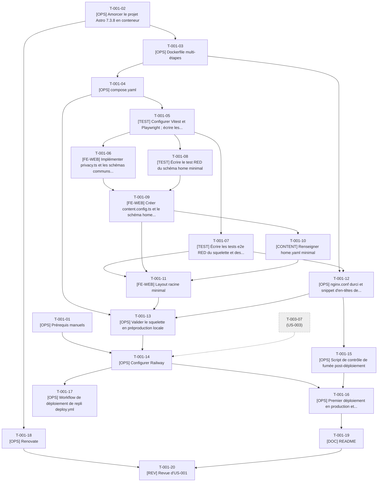

# Tâches - US-001 : Squelette du site publié en production

## Informations US
- **Epic** : EPIC-001 : Socle et walking skeleton
- **Persona** : P-001 : Claire, DG d'une scale-up qui recrute
- **Story Points** : 5
- **Sprint** : sprint-001-walking_skeleton
- **Lot de travail** : Lot 1 : Socle et CI (voir [README](README.md))
- **Fichier US** : `project-management/backlog/user-stories/` (US-001)

## Résumé de la US
**En tant que** P-001 : Claire, DG d'une scale-up qui recrute  
**Je veux** ouvrir le site en HTTPS depuis un lien reçu d'un cabinet et voir immédiatement une page qui se charge vite  
**Afin de** juger en moins de 2 minutes que le profil est sérieux, sans page d'erreur ni avertissement de sécurité

## Vue d'ensemble des tâches

| ID | Type | Tâche | Estimation | Responsable | Dépend de | Statut |
|----|------|-------|------------|-------------|-----------|--------|
| T-001-01 | [OPS] | Prérequis manuels : dépôt GitHub, service Railway, DNS, comptes tiers | 1,5h | PO | - | 🔲 |
| T-001-02 | [OPS] | Amorcer le projet Astro 7.3.8 en conteneur (package.json, lockfile, tsconfig, astro.config) | 3h | Dev | - | ✅ |
| T-001-03 | [OPS] | Dockerfile multi-étapes (base, deps, dev, build, test, runtime) | 4h | Dev | T-001-02 | ✅ |
| T-001-04 | [OPS] | compose.yaml (dev, preview, tools, e2e), Makefile de base et .env.example | 3h | Dev | T-001-03 | ✅ |
| T-001-05 | [TEST] | Configurer Vitest et Playwright ; écrire les tests RED de `privacy` et des schémas communs | 3,5h | Dev | T-001-04 | ✅ |
| T-001-06 | [FE-WEB] | Implémenter `privacy.ts` et les schémas communs Zod (GREEN) | 2,5h | Dev | T-001-05 | ✅ |
| T-001-07 | [TEST] | Écrire les tests e2e RED du squelette et des en-têtes de sécurité | 3h | Dev | T-001-05 | ✅ |
| T-001-08 | [TEST] | Écrire le test RED du schéma `home` minimal | 1h | Dev | T-001-05 | ✅ |
| T-001-09 | [FE-WEB] | Créer `content.config.ts` et le schéma `home` minimal (GREEN) | 1,5h | Dev | T-001-06, T-001-08 | ✅ |
| T-001-10 | [CONTENT] | Renseigner `home.yaml` minimal (nom, titre du profil, lien contact) | 0,5h | Dev | T-001-09 | ✅ |
| T-001-11 | [FE-WEB] | Layout racine minimal, page d'accueil, 404 et page 50x | 3h | Dev | T-001-07, T-001-09, T-001-10 | ✅ |
| T-001-12 | [OPS] | nginx.conf durci et snippet d'en-têtes de sécurité | 4h | Dev | T-001-03, T-001-07 | ✅ |
| T-001-13 | [OPS] | Valider le squelette en préproduction locale (jalon J1) | 2h | Dev | T-001-04, T-001-11, T-001-12 | 🔄 |
| T-001-14 | [OPS] | Configurer Railway : build du Dockerfile, variables, domaine, « Wait for CI » | 3h | Dev | T-001-01, T-001-13, T-003-07 | 🔲 |
| T-001-15 | [OPS] | Script de contrôle de fumée post-déploiement | 2h | Dev | T-001-12 | 🔲 |
| T-001-16 | [OPS] | Premier déploiement en production et vérification des scénarios | 2,5h | Dev | T-001-14, T-001-15 | 🔲 |
| T-001-17 | [OPS] | Workflow de déploiement de repli `deploy.yml` (conditionnel) | 2h | Dev | T-001-14 | 🔲 |
| T-001-18 | [OPS] | Renovate : configuration et épinglage des digests | 1h | Dev | T-001-02 | ✅ |
| T-001-19 | [DOC] | README, CHANGELOG et guide de développement | 2h | Dev | T-001-16 | 🔲 |
| T-001-20 | [REV] | Revue d'US-001 (DoD §1, §6, §9, §10) | 2h | Dev | T-001-18, T-001-19 | 🔲 |

**Total estimé** : 47h (20 tâches)

## Couverture des critères d'acceptance

| Scénario ou critère | Tâches |
|---------------------|--------|
| Page d'accueil minimale servie en HTTPS après fusion (nominal) | T-001-07, T-001-11, T-001-16 |
| Redirection HTTP vers HTTPS | T-001-07, T-001-12, T-001-16 |
| En-têtes de sécurité présents | T-001-07, T-001-12 |
| URL inexistante (404 sans fuite) | T-001-07, T-001-11, T-001-12 |
| Échec de build bloquant le déploiement | T-001-14, T-001-16 |
| Critères techniques : schéma `home` validé au build | T-001-08, T-001-09 |
| Critères techniques : environnement 100 % Docker, versions épinglées, Renovate | T-001-03, T-001-04, T-001-18, T-001-19 |

## Graphe de dépendances

---

## Détail des tâches

### T-001-01 : Prérequis manuels : dépôt GitHub, service Railway, DNS, comptes tiers
- **Type** : [OPS]
- **US** : US-001
- **Estimation** : 1,5h
- **Responsable** : PO
- **Dépend de** : -
- **Débloque** : T-001-14
- **Statut** : 🔲 À faire

**Description** :  
Lever les prérequis hors backlog (sprint-dependencies.md) : créer le dépôt public `thibmonier/thibaut-monier.fr` et configurer le remote, créer le projet et le service Railway (région UE), noter le domaine cible `thibaut-monier.fr` et préparer la redirection du `.com`/`www` éventuels, créer le compte Umami Cloud (website id), obtenir la clé publique Web3Forms, créer l'événement Calendly « Échange découverte (30 min) ».

**Fichiers visés** :
- (aucun fichier du dépôt ; consoles GitHub, Railway, DNS, Umami, Web3Forms, Calendly)

**Critère de fin vérifiable** :
- [ ] `gh repo view thibmonier/thibaut-monier.fr` répond (dépôt public)
- [ ] `git remote -v` affiche `origin`
- [ ] Service Railway créé (région UE) et visible dans la console
- [ ] Valeurs `PUBLIC_WEB3FORMS_KEY`, `PUBLIC_UMAMI_WEBSITE_ID` et URL Calendly communiquées à l'orchestrateur (hors dépôt, aucune dans l'historique git)

### T-001-02 : Amorcer le projet Astro 7.3.8 en conteneur (package.json, lockfile, tsconfig, astro.config)
- **Type** : [OPS]
- **US** : US-001
- **Estimation** : 3h
- **Responsable** : Dev
- **Dépend de** : -
- **Débloque** : T-001-03, T-001-18
- **Statut** : ✅ Fait

**Description** :  
Créer le squelette Node/Astro sans installer Node sur le poste : un `docker run` jetable sur `node:26-alpine` (digest épinglé) génère `package.json` et `package-lock.json`. Installer avec `save-exact=true` : astro 7.3.8, typescript 6.0.3, tailwindcss 4.3.3 + `@tailwindcss/vite`, `@astrojs/check`, vitest 5.0.4 (+ `@vitest/coverage-v8`), `@playwright/test` 1.64.1, `@axe-core/playwright` 4.13. Configurer `astro.config.mjs` : `site`, `output: 'static'`, `trailingSlash: 'always'`, `build.inlineStylesheets: 'never'`, `vite.build.assetsInlineLimit: 0`, plugin Tailwind. TypeScript strict. Le bloc `i18n` est laissé à US-002 (T-002-09).

**Fichiers visés** :
- `package.json`
- `package-lock.json`
- `.npmrc`
- `tsconfig.json`
- `astro.config.mjs`
- `.gitignore`
- `.dockerignore`

**Critère de fin vérifiable** :
- [ ] `package-lock.json` commité ; toutes les versions de `package.json` sont exactes (aucun `^` ni `~`)
- [ ] `.npmrc` contient `save-exact=true`
- [ ] `docker run --rm -v "$PWD":/app -w /app node:26-alpine npx astro --version` affiche 7.3.8
- [ ] `tsconfig.json` en mode `strict` ; `.gitignore` et `.dockerignore` excluent `node_modules`, `dist`, `.astro`, `.env`

### T-001-03 : Dockerfile multi-étapes (base, deps, dev, build, test, runtime)
- **Type** : [OPS]
- **US** : US-001
- **Estimation** : 4h
- **Responsable** : Dev
- **Dépend de** : T-001-02
- **Débloque** : T-001-04, T-001-12
- **Statut** : ✅ Fait

**Description** :  
Écrire le `Dockerfile` selon ADR-0003 : `base` (node:26-alpine@sha256, utilisateur `node`), `deps` (`npm ci --ignore-scripts`, cache BuildKit), `dev` (`astro dev --host 0.0.0.0 --port 4321`), `build`, `test` (lint + check + Vitest + build), `runtime` (`nginxinc/nginx-unprivileged:1.30.5-alpine@sha256`, `nginx.conf`, `dist/`). L'étape `typst` est reportée à US-007 (YAGNI). IMPORTANT : `runtime` doit être la **dernière étape** du fichier, car Railway construit l'étape finale par défaut. Déclarer `ARG PUBLIC_WEB3FORMS_KEY`, `ARG PUBLIC_UMAMI_WEBSITE_ID` dans l'étape `build` (aucune valeur par défaut secrète).

**Fichiers visés** :
- `Dockerfile`

**Critère de fin vérifiable** :
- [ ] `docker build --target dev -t tm-dev .` réussit
- [ ] `docker build -t tm-runtime .` (sans `--target`) produit l'image `runtime`
- [ ] `docker run --rm tm-runtime id -u` renvoie un UID ≠ 0
- [ ] Toutes les images de base portent tag + digest
- [ ] `docker run --rm -i hadolint/hadolint < Dockerfile` ne renvoie aucune erreur

### T-001-04 : compose.yaml (dev, preview, tools, e2e), Makefile de base et .env.example
- **Type** : [OPS]
- **US** : US-001
- **Estimation** : 3h
- **Responsable** : Dev
- **Dépend de** : T-001-03
- **Débloque** : T-001-05, T-001-13, T-003-02
- **Statut** : ✅ Fait

**Description** :  
Créer `compose.yaml` : `dev` (port 4321, sources montées, `node_modules` en volume nommé, polling Vite activable par variable), `preview` (image `runtime` construite localement, port 8080, build args `PUBLIC_*`), `tools` (profil, `npm` ponctuel), `e2e` (profil, image `mcr.microsoft.com/playwright:v1.64.1-noble`, cible `preview`). `Makefile` : `dev`, `preview`, `build`, `shell`, `down`, `clean`. `.env.example` documente les variables de build (aucune valeur secrète). Les cibles `lint`, `test`, `e2e`, `ci` sont ajoutées par US-003 (T-003-06).

**Fichiers visés** :
- `compose.yaml`
- `Makefile`
- `.env.example`

**Critère de fin vérifiable** :
- [ ] `make dev` sert http://localhost:4321 et recharge à chaud après modification d'un fichier source
- [ ] `make preview` sert http://localhost:8080 depuis l'image `runtime`
- [ ] `docker compose run --rm tools npm --version` fonctionne
- [ ] `docker compose config -q` ne renvoie aucune erreur
- [ ] Aucun outil Node requis sur le poste (`which node` non utilisé par les cibles)

### T-001-05 : Configurer Vitest et Playwright ; écrire les tests RED de `privacy` et des schémas communs
- **Type** : [TEST]
- **US** : US-001
- **Estimation** : 3,5h
- **Responsable** : Dev
- **Dépend de** : T-001-04
- **Débloque** : T-001-06, T-001-07, T-001-08, T-003-01
- **Statut** : ✅ Fait

**Description** :  
TDD : configurer `vitest.config.ts` (couverture v8, seuils 80 % lignes / 75 % branches sur `src/lib/`) et `playwright.config.ts` (baseURL `http://preview:8080`, projets desktop et mobile 375 px). Écrire les tests RED : `tests/unit/lib/privacy.test.ts` — `detectPii(texte)` renvoie des types `telephone | age | naissance | adresse` ; REJETTE « +33 6 12 34 56 78 », « 06 12 34 56 78 », « Âge : 47 ans », « âgé de 47 ans », « née le 12/03/1978 », « 12 rue de la Paix » ; ACCEPTE « 25 ans d'expérience », « pendant 3 ans » (voir point d'attention 1 du README) ; `tests/unit/content/common-schemas.test.ts` (`slug`, `yearMonth`, `httpsUrl`, `safeText`).

**Fichiers visés** :
- `vitest.config.ts`
- `playwright.config.ts`
- `tests/unit/lib/privacy.test.ts`
- `tests/unit/content/common-schemas.test.ts`

**Critère de fin vérifiable** :
- [ ] `docker compose run --rm tools npx vitest run` s'exécute et les tests de privacy/schémas échouent (RED) pour la bonne raison : module absent
- [ ] Les seuils de couverture figurent dans `vitest.config.ts`
- [ ] `docker compose run --rm tools npx playwright test --list` liste la config sans erreur

### T-001-06 : Implémenter `privacy.ts` et les schémas communs Zod (GREEN)
- **Type** : [FE-WEB]
- **US** : US-001
- **Estimation** : 2,5h
- **Responsable** : Dev
- **Dépend de** : T-001-05
- **Débloque** : T-001-09, T-005-06
- **Statut** : ✅ Fait

**Description** :  
Implémenter `src/lib/privacy.ts` (`detectPii`, `formatPiiError(fichier, type)` → « Donnée personnelle interdite détectée dans <fichier> : <type> ») et `src/content/schemas/common.ts` (`slug`, `yearMonth`, `httpsUrl`, `repoRef`, `safeText` adossé à `detectPii`), conformément à content-model.md §2, avec le correctif sur les « N ans ». Briques réutilisées par US-004, US-005 et US-029.

**Fichiers visés** :
- `src/lib/privacy.ts`
- `src/content/schemas/common.ts`

**Critère de fin vérifiable** :
- [ ] `npx vitest run tests/unit/lib/privacy.test.ts tests/unit/content/common-schemas.test.ts` : tous verts
- [ ] Couverture de `src/lib/privacy.ts` ≥ 90 %
- [ ] `npx astro check` : 0 erreur

### T-001-07 : Écrire les tests e2e RED du squelette et des en-têtes de sécurité
- **Type** : [TEST]
- **US** : US-001
- **Estimation** : 3h
- **Responsable** : Dev
- **Dépend de** : T-001-05
- **Débloque** : T-001-11, T-001-12
- **Statut** : ✅ Fait

**Description** :  
Traduire les scénarios Gherkin d'US-001 en Playwright (contre `preview`) : `tests/e2e/skeleton.spec.ts` (accueil 200, un seul `h1`, `lang="fr"`, `title`/`meta description`/`canonical` présents, texte « Thibaut Monier » + titre du profil + lien vers `/contact/`, 404 réel avec « Cette page n'existe pas » et « Retour à l'accueil », aucune pile ni version serveur) et `tests/e2e/headers.spec.ts` (CSP, HSTS max-age ≥ 31536000, `nosniff`, Referrer-Policy `strict-origin-when-cross-origin`, Permissions-Policy, COOP, CORP, `X-Frame-Options`, absence de COEP et de version dans `Server`, `POST` → 405, `/.git/config` et `/.env` → 404, requête avec `X-Forwarded-Proto: http` → 301 vers https, `Cache-Control` immutable sur `/_astro/*`, aucun cookie).

**Fichiers visés** :
- `tests/e2e/skeleton.spec.ts`
- `tests/e2e/headers.spec.ts`

**Critère de fin vérifiable** :
- [ ] `make e2e` exécute les 2 fichiers et ils échouent (RED) faute d'implémentation
- [ ] Chaque scénario Gherkin d'US-001 est référencé par un `test.describe` portant son titre
- [ ] Aucun test n'est commenté ni ignoré

### T-001-08 : Écrire le test RED du schéma `home` minimal
- **Type** : [TEST]
- **US** : US-001
- **Estimation** : 1h
- **Responsable** : Dev
- **Dépend de** : T-001-05
- **Débloque** : T-001-09
- **Statut** : ✅ Fait

**Description** :  
`tests/unit/content/home-schema.test.ts` : le schéma minimal (`name`, `title`, `contactLink`) accepte une entrée valide et rejette l'absence de chaque champ avec un message citant le fichier et le champ (« Champ 'title' requis dans la collection home »).

**Fichiers visés** :
- `tests/unit/content/home-schema.test.ts`

**Critère de fin vérifiable** :
- [ ] Le test échoue (RED) car `src/content/schemas/home.ts` n'existe pas
- [ ] Un cas par champ obligatoire manquant

### T-001-09 : Créer `content.config.ts` et le schéma `home` minimal (GREEN)
- **Type** : [FE-WEB]
- **US** : US-001
- **Estimation** : 1,5h
- **Responsable** : Dev
- **Dépend de** : T-001-06, T-001-08
- **Débloque** : T-001-10, T-001-11
- **Statut** : ✅ Fait

**Description** :  
Créer `src/content.config.ts` (point d'enregistrement unique des collections : une ligne d'import et une clé par collection, zone append-only) et `src/content/schemas/home.ts` (schéma minimal, étendu par US-004). Loader `file('./src/data/home.yaml')`. Messages d'erreur en français via `errorMap`.

**Fichiers visés** :
- `src/content.config.ts`
- `src/content/schemas/home.ts`

**Critère de fin vérifiable** :
- [ ] `npx vitest run tests/unit/content/home-schema.test.ts` vert
- [ ] Retirer `title` de `home.yaml` fait échouer `astro build` avec un message citant le fichier et le champ

### T-001-10 : Renseigner `home.yaml` minimal (nom, titre du profil, lien contact)
- **Type** : [CONTENT]
- **US** : US-001
- **Estimation** : 0,5h
- **Responsable** : Dev
- **Dépend de** : T-001-09
- **Débloque** : T-001-11
- **Statut** : ✅ Fait

**Description** :  
Créer `src/data/home.yaml` : name « Thibaut Monier », title du profil (version courte validée par le PO), `contactLink: /contact/`. Le contenu riche arrive avec US-004.

**Fichiers visés** :
- `src/data/home.yaml`

**Critère de fin vérifiable** :
- [ ] `astro build` valide la collection `home`
- [ ] Le titre du profil est validé par le PO (commentaire de PR)

### T-001-11 : Layout racine minimal, page d'accueil, 404 et page 50x
- **Type** : [FE-WEB]
- **US** : US-001
- **Estimation** : 3h
- **Responsable** : Dev
- **Dépend de** : T-001-07, T-001-09, T-001-10
- **Débloque** : T-001-13
- **Statut** : ✅ Fait

**Description** :  
Créer `BaseLayout.astro` minimal (`lang="fr"`, `title`, `meta description`, `canonical` absolue avec barre finale, viewport, landmarks `main`), `index.astro` (un `h1`, nom, titre, lien vers `/contact/`), `404.astro` (« Cette page n'existe pas », lien « Retour à l'accueil »), `public/50x.html` statique sans détail technique, `src/styles/global.css` (`@import "tailwindcss"`, focus visible, pas de défilement horizontal 320–1920 px). BaseLayout est réécrit par US-002.

**Fichiers visés** :
- `src/layouts/BaseLayout.astro`
- `src/pages/index.astro`
- `src/pages/404.astro`
- `public/50x.html`
- `src/styles/global.css`

**Critère de fin vérifiable** :
- [ ] `tests/e2e/skeleton.spec.ts` : scénarios page d'accueil et 404 verts (hors en-têtes)
- [ ] `dist/404.html` et `dist/50x.html` générés
- [ ] Un seul `h1` ; aucun défilement horizontal à 320 px

### T-001-12 : nginx.conf durci et snippet d'en-têtes de sécurité
- **Type** : [OPS]
- **US** : US-001
- **Estimation** : 4h
- **Responsable** : Dev
- **Dépend de** : T-001-03, T-001-07
- **Débloque** : T-001-13, T-001-15
- **Statut** : ✅ Fait

**Description** :  
Implémenter la configuration de security.md §3 : `nginx.conf` (utilisateur non root, port 8080, `server_tokens off`, GET/HEAD seuls, dotfiles et fichiers source en 404, `error_page 404 /404.html` et `5xx /50x.html`, cache : `/_astro/` immutable 1 an, HTML `no-cache`, médias 30 j, `gzip_static`, journal sans IP) et `nginx/snippets/security-headers.conf` (CSP complète avec Umami et Web3Forms déjà déclarés, HSTS preload, nosniff, X-Frame-Options, Referrer-Policy, Permissions-Policy, COOP, CORP, pas de COEP). Ajouter la redirection 301 http→https pilotée par `X-Forwarded-Proto` (Railway termine le TLS). Copier ces fichiers dans l'étape `runtime`.

**Fichiers visés** :
- `nginx.conf`
- `nginx/snippets/security-headers.conf`
- `Dockerfile` (COPY dans `runtime`, relecture seule si déjà prévu)

**Critère de fin vérifiable** :
- [ ] `docker run --rm tm-runtime nginx -t` : syntaxe valide
- [ ] `tests/e2e/headers.spec.ts` entièrement vert contre `preview`
- [ ] Chaque `location` qui ajoute un en-tête inclut le snippet (aucun en-tête perdu)
- [ ] `curl -sI http://localhost:8080/` n'expose pas de numéro de version nginx

### T-001-13 : Valider le squelette en préproduction locale (jalon J1)
- **Type** : [OPS]
- **US** : US-001
- **Estimation** : 2h
- **Responsable** : Dev
- **Dépend de** : T-001-04, T-001-11, T-001-12
- **Débloque** : T-001-14, T-003-04, T-003-05, T-002-02, T-002-03, T-004-02, T-004-03, T-005-04, T-005-05, T-008-02, T-008-03, T-029-02, T-029-03
- **Statut** : 🔄 En cours

**Description** :  
Construire l'image de production, lancer `make preview` puis `make e2e` : toute la suite doit être verte. Mesurer à la main Lighthouse (mobile) sur `/` pour vérifier LCP < 1,5 s et ≥ 95 sur 4 axes. Corriger les écarts. **Jalon J1 : le squelette buildable et testé est fusionnable ; US-002 et US-003 peuvent démarrer.**

**Fichiers visés** :
- (corrections éventuelles dans les fichiers des tâches T-001-02 à T-001-12)

**Critère de fin vérifiable** :
- [ ] `make preview && make e2e` : 100 % vert
- [ ] Lighthouse mobile local ≥ 95 sur les 4 axes sur `/`
- [ ] Console navigateur sans violation CSP
- [ ] Changements fusionnables (branche `feature/US-001-squelette`)

### T-001-14 : Configurer Railway : build du Dockerfile, variables, domaine, « Wait for CI »
- **Type** : [OPS]
- **US** : US-001
- **Estimation** : 3h
- **Responsable** : Dev
- **Dépend de** : T-001-01, T-001-13, T-003-07
- **Débloque** : T-001-16, T-001-17, T-008-10
- **Statut** : 🔲 À faire

**Description** :  
Dans Railway : source GitHub (branche `main`), build du `Dockerfile` (étape finale = `runtime`), variables de build `PUBLIC_*`, port 8080, healthcheck sur `/`, domaine personnalisé `thibaut-monier.fr` avec certificat, option *Wait for CI* branchée sur le statut `ci.yml`. Si l'option n'existe pas ou ne se comporte pas comme attendu, déclencher T-001-17 (risque tech-spec §13). Consigner la configuration (sans secret) dans `docs/guides/deploiement.md`.

**Fichiers visés** :
- `docs/guides/deploiement.md`
- `railway.json` (si nécessaire pour fixer le Dockerfile et le healthcheck)

**Critère de fin vérifiable** :
- [ ] Un déploiement test sur le sous-domaine Railway répond 200
- [ ] Le certificat TLS du domaine personnalisé est émis
- [ ] Un push dont la CI est rouge ne déclenche pas de déploiement (ou T-001-17 décidé)
- [ ] Aucune valeur secrète dans le dépôt

### T-001-15 : Script de contrôle de fumée post-déploiement
- **Type** : [OPS]
- **US** : US-001
- **Estimation** : 2h
- **Responsable** : Dev
- **Dépend de** : T-001-12
- **Débloque** : T-001-16
- **Statut** : 🔲 À faire

**Description** :  
Écrire `scripts/smoke.mjs` (Node dans le conteneur `tools`) : statut 200 sur `/`, 404 réel sur une URL inexistante, présence de l'en-tête CSP, redirection 301 http→https quand l'URL est publique. Cible `make smoke URL=…`. Sera réutilisé par `scheduled.yml` (sprint ultérieur).

**Fichiers visés** :
- `scripts/smoke.mjs`
- `Makefile` (cible `smoke`)

**Critère de fin vérifiable** :
- [ ] `make smoke URL=http://localhost:8080` : sortie 0
- [ ] Le script sort en code ≠ 0 si la CSP est absente (test sur un serveur factice)

### T-001-16 : Premier déploiement en production et vérification des scénarios
- **Type** : [OPS]
- **US** : US-001
- **Estimation** : 2,5h
- **Responsable** : Dev
- **Dépend de** : T-001-14, T-001-15
- **Débloque** : T-001-19
- **Statut** : 🔲 À faire

**Description** :  
Fusionner sur `main`, mesurer le délai fusion → HTTP 200 en HTTPS (< 10 min), exécuter `make smoke` sur le domaine public, vérifier la redirection http→https (301 < 1 s) et les en-têtes avec `curl -sI`. Vérifier le scénario d'échec : un build volontairement cassé (branche ou service de test, jamais sur la production) laisse la version précédente en ligne et l'échec est visible dans les journaux en moins de 5 min. Contrôler securityheaders.com et Mozilla Observatory (information).

**Fichiers visés** :
- (aucun fichier ; preuves dans la description de PR)

**Critère de fin vérifiable** :
- [ ] `curl -sI https://thibaut-monier.fr/` : 200 et CSP/HSTS présents
- [ ] `curl -sI http://thibaut-monier.fr/` : 301 vers https
- [ ] Délai mesuré < 10 min consigné dans la PR
- [ ] Build cassé : version précédente toujours servie (preuve : capture ou journal)
- [ ] Validation PO sur la production

### T-001-17 : Workflow de déploiement de repli `deploy.yml` (conditionnel)
- **Type** : [OPS]
- **US** : US-001
- **Estimation** : 2h
- **Responsable** : Dev
- **Dépend de** : T-001-14
- **Débloque** : -
- **Statut** : 🔲 À faire

**Description** :  
**Conditionnelle** : à réaliser seulement si l'option *Wait for CI* de Railway est absente ou peu fiable. Créer `.github/workflows/deploy.yml` déclenché par `workflow_run` sur le succès de `ci.yml` (branche `main`), qui exécute `railway up` avec `RAILWAY_TOKEN`. Actions épinglées par SHA, `permissions: contents: read`. Désactiver le déclencheur automatique de Railway.

**Fichiers visés** :
- `.github/workflows/deploy.yml`

**Critère de fin vérifiable** :
- [ ] Un push `main` avec CI verte déploie ; avec CI rouge ne déploie pas
- [ ] Les actions sont épinglées par SHA complet
- [ ] Si non nécessaire : tâche marquée « Non applicable » avec justification dans la PR

### T-001-18 : Renovate : configuration et épinglage des digests
- **Type** : [OPS]
- **US** : US-001
- **Estimation** : 1h
- **Responsable** : Dev
- **Dépend de** : T-001-02
- **Débloque** : T-001-20
- **Statut** : ✅ Fait

**Description** :  
Créer `renovate.json` : preset de base, `pinDigests` pour Docker, `helpers:pinGitHubActionDigests`, regroupement des mises à jour mineures, ouverture de PR validées par `ci.yml`. Installer l'application Renovate sur le dépôt (action du PO).

**Fichiers visés** :
- `renovate.json`

**Critère de fin vérifiable** :
- [ ] `renovate.json` valide (`docker run --rm renovate/renovate renovate-config-validator`)
- [ ] L'application Renovate est installée sur le dépôt (PR « Configure Renovate » ou tableau de bord visible)

### T-001-19 : README, CHANGELOG et guide de développement
- **Type** : [DOC]
- **US** : US-001
- **Estimation** : 2h
- **Responsable** : Dev
- **Dépend de** : T-001-16
- **Débloque** : T-001-20
- **Statut** : 🔲 À faire

**Description** :  
Créer `README.md` (prérequis : Docker uniquement ; commandes `make` ; tableau des variables de build ; relevé de versions daté du 2026-10-14 ; procédure de déploiement et de retour arrière), `CHANGELOG.md` (Keep a Changelog, zone `[Unreleased]` append-only) et `docs/guides/README.md` (index des guides par US, un fichier par US pour éviter les conflits).

**Fichiers visés** :
- `README.md`
- `CHANGELOG.md`
- `docs/guides/README.md`

**Critère de fin vérifiable** :
- [ ] Un nouveau contributeur lance `docker compose up dev` en suivant uniquement le README
- [ ] Le relevé de versions correspond à ADR-0001
- [ ] `CHANGELOG.md` contient l'entrée US-001

### T-001-20 : Revue d'US-001 (DoD §1, §6, §9, §10)
- **Type** : [REV]
- **US** : US-001
- **Estimation** : 2h
- **Responsable** : Dev
- **Dépend de** : T-001-18, T-001-19
- **Débloque** : -
- **Statut** : 🔲 À faire

**Description** :  
Revue de code et d'infrastructure : SOLID/KISS, Dockerfile (hadolint, non root, digests), nginx (A02/A03 OWASP), secrets, lockfile, absence d'outil requis hors Docker, conformité à la DoD.

**Fichiers visés** :
- (revue ; aucun fichier produit)

**Critère de fin vérifiable** :
- [ ] Checklist DoD §1, §6, §9, §10 cochée dans la PR
- [ ] Commentaires de revue traités
- [ ] Aucune dette non tracée

