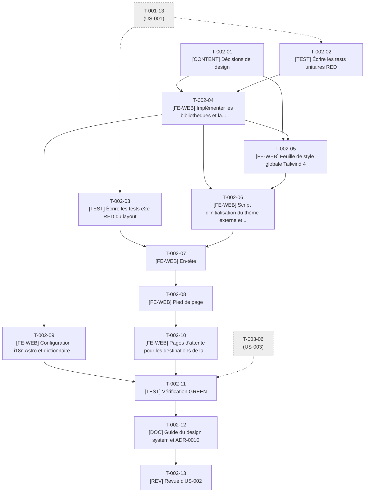

# Tâches - US-002 : Design system et layout

## Informations US
- **Epic** : EPIC-001 : Socle et walking skeleton
- **Persona** : P-001 : Claire, DG d'une scale-up qui recrute
- **Story Points** : 3
- **Sprint** : sprint-001-walking_skeleton
- **Lot de travail** : Lot 2 : Fondation UI (voir [README](README.md))
- **Fichier US** : `project-management/backlog/user-stories/` (US-002)

## Résumé de la US
**En tant que** P-001 : Claire, DG d'une scale-up qui recrute  
**Je veux** un site lisible, cohérent et navigable (en-tête, menu, pied de page, thème clair ou sombre) sur mobile comme sur ordinateur  
**Afin de** me repérer sans effort entre deux réunions et conclure en moins de 2 minutes que le profil est soigné

## Vue d'ensemble des tâches

| ID | Type | Tâche | Estimation | Responsable | Dépend de | Statut |
|----|------|-------|------------|-------------|-----------|--------|
| T-002-01 | [CONTENT] | Décisions de design : palette, typographie, tokens clair et sombre | 3h | Dev | - | ✅ |
| T-002-02 | [TEST] | Écrire les tests unitaires RED : contraste, tokens, SEO, navigation, thème, config du site | 4h | Dev | T-001-13 | ✅ |
| T-002-03 | [TEST] | Écrire les tests e2e RED du layout (clavier, thème, no-JS, mouvement réduit) | 4h | Dev | T-001-13 | ✅ |
| T-002-04 | [FE-WEB] | Implémenter les bibliothèques et la configuration du site (GREEN) | 4h | Dev | T-002-01, T-002-02 | ✅ |
| T-002-05 | [FE-WEB] | Feuille de style globale Tailwind 4 : tokens, polices, focus, mouvement réduit | 4h | Dev | T-002-01, T-002-04 | ✅ |
| T-002-06 | [FE-WEB] | Script d'initialisation du thème externe et `ThemeToggle` | 3h | Dev | T-002-04, T-002-05 | ✅ |
| T-002-07 | [FE-WEB] | En-tête, menu mobile accessible et lien d'évitement | 5h | Dev | T-002-03, T-002-06 | ✅ |
| T-002-08 | [FE-WEB] | Pied de page, composant `Seo` et `BaseLayout` final | 4h | Dev | T-002-07 | ✅ |
| T-002-09 | [FE-WEB] | Configuration i18n Astro et dictionnaire d'interface minimal | 2h | Dev | T-002-04 | ✅ |
| T-002-10 | [FE-WEB] | Pages d'attente pour les destinations de la navigation et du pied de page | 1,5h | Dev | T-002-08 | 🔲 |
| T-002-11 | [TEST] | Vérification GREEN : responsive, JS désactivé, mouvement réduit, axe, Lighthouse | 2,5h | Dev | T-002-09, T-002-10, T-003-06 | 🔄 |
| T-002-12 | [DOC] | Guide du design system et ADR-0010 | 1,5h | Dev | T-002-11 | 🔄 |
| T-002-13 | [REV] | Revue d'US-002 (DoD §1, §4, §5, §7) | 2h | Dev | T-002-12 | 🔲 |

**Total estimé** : 40,5h (13 tâches)

## Couverture des critères d'acceptance

| Scénario ou critère | Tâches |
|---------------------|--------|
| Layout commun affiché sur chaque page (4 liens, pied de page, aria-current) | T-002-03, T-002-07, T-002-08 |
| Thème sombre selon la préférence système, sans flash, contraste ≥ 4,5:1 | T-002-02, T-002-03, T-002-05, T-002-06 |
| Menu mobile, piège du focus, Échap, cibles ≥ 24 px | T-002-03, T-002-07 |
| JavaScript désactivé | T-002-03, T-002-07, T-002-11 |
| Mouvement réduit | T-002-03, T-002-05, T-002-11 |
| Critères techniques : schéma de config du site, gabarit SEO, i18n sans préfixe, tokens | T-002-02, T-002-04, T-002-08, T-002-09 |

## Graphe de dépendances

---

## Détail des tâches

### T-002-01 : Décisions de design : palette, typographie, tokens clair et sombre
- **Type** : [CONTENT]
- **US** : US-002
- **Estimation** : 3h
- **Responsable** : Dev
- **Dépend de** : -
- **Débloque** : T-002-04, T-002-05
- **Statut** : ✅ Done

**Description** :  
Proposer au PO deux jeux de tokens sobres « direction technique » (couleurs clair/sombre, échelle d'espacements, deux familles de polices libres, OFL de préférence — proposition : une sans-serif variable + une mono, sous-ensemble latin WOFF2) puis figer le choix. Rédiger `src/data/tokens.json` conforme à `tokensSchema` (content-model §3.8) : source unique partagée avec Typst (US-007). Préparer les fichiers de polices.

**Fichiers visés** :
- `src/data/tokens.json`
- `public/fonts/*.woff2`

**Critère de fin vérifiable** :
- [ ] Choix de palette et de polices validé par le PO (commentaire de PR)
- [ ] `src/data/tokens.json` contient `color`, `font`, `space`, valeurs claires et sombres pour chaque couleur
- [ ] Licences des polices notées dans `docs/guides/design-system.md` (T-002-12)
- [ ] Fichiers `.woff2` (latin) présents et < 100 Ko chacun

### T-002-02 : Écrire les tests unitaires RED : contraste, tokens, SEO, navigation, thème, config du site
- **Type** : [TEST]
- **US** : US-002
- **Estimation** : 4h
- **Responsable** : Dev
- **Dépend de** : T-001-13
- **Débloque** : T-002-04
- **Statut** : ✅ Done

**Description** :  
TDD : `tests/unit/lib/contrast.test.ts` (ratio WCAG ; toutes les paires texte/fond de `tokens.json` ≥ 4,5:1 en clair et en sombre, composants UI ≥ 3:1), `tests/unit/lib/tokens.test.ts` (validation par `tokensSchema` + parité avec les variables de `global.css`), `tests/unit/lib/seo.test.ts` (`buildTitle` ≤ 60 caractères, `canonicalUrl` absolue avec barre finale, métadonnées Open Graph), `tests/unit/lib/navigation.test.ts` (`isActive` : `aria-current="page"` sur l'URL exacte et les sous-chemins), `tests/unit/lib/theme.test.ts` (`resolveTheme(stored, systemDark)`), `tests/unit/config/site.test.ts` (schéma : nom, 4 liens de navigation, LinkedIn et GitHub).

**Fichiers visés** :
- `tests/unit/lib/contrast.test.ts`
- `tests/unit/lib/tokens.test.ts`
- `tests/unit/lib/seo.test.ts`
- `tests/unit/lib/navigation.test.ts`
- `tests/unit/lib/theme.test.ts`
- `tests/unit/config/site.test.ts`

**Critère de fin vérifiable** :
- [ ] `npx vitest run tests/unit/lib tests/unit/config` : nouveaux tests rouges (RED) pour modules absents
- [ ] Les scénarios de contraste couvrent les deux thèmes

### T-002-03 : Écrire les tests e2e RED du layout (clavier, thème, no-JS, mouvement réduit)
- **Type** : [TEST]
- **US** : US-002
- **Estimation** : 4h
- **Responsable** : Dev
- **Dépend de** : T-001-13
- **Débloque** : T-002-07
- **Statut** : ✅ Done

**Description** :  
`tests/e2e/layout.spec.ts` : en-tête avec nom + 4 liens (Accueil, Parcours, Blog, Contact) et `aria-current="page"` ; pied de page avec mentions légales, vie privée, LinkedIn, GitHub ; thème sombre via `emulateMedia({colorScheme:'dark'})` sans flash (attribut/fond relevés avant le premier rendu) ; menu à 375 px : ouverture, Tab piégé, Échap referme, cibles ≥ 24 × 24 px ; `javaScriptEnabled:false` : liens visibles et thème selon la préférence ; `reducedMotion:'reduce'` : durées de transition à 0 ; aucun défilement horizontal à 320, 768, 1280, 1920 px.

**Fichiers visés** :
- `tests/e2e/layout.spec.ts`

**Critère de fin vérifiable** :
- [ ] `make e2e` : `layout.spec.ts` échoue (RED) sur le squelette minimal
- [ ] Un `test.describe` par scénario Gherkin d'US-002

### T-002-04 : Implémenter les bibliothèques et la configuration du site (GREEN)
- **Type** : [FE-WEB]
- **US** : US-002
- **Estimation** : 4h
- **Responsable** : Dev
- **Dépend de** : T-002-01, T-002-02
- **Débloque** : T-002-05, T-002-06, T-002-09
- **Statut** : ✅ Done

**Description** :  
Implémenter `src/lib/contrast.ts`, `src/lib/seo.ts`, `src/lib/navigation.ts`, `src/lib/theme.ts` (fonctions pures) et `src/config/site.ts` validé par un schéma Zod au build (nom, navigation, réseaux ; données de navigation en source unique). Ajouter `tokensSchema` dans `src/content/schemas/tokens.ts`.

**Fichiers visés** :
- `src/lib/contrast.ts`
- `src/lib/seo.ts`
- `src/lib/navigation.ts`
- `src/lib/theme.ts`
- `src/config/site.ts`
- `src/content/schemas/tokens.ts`

**Critère de fin vérifiable** :
- [ ] Les tests de T-002-02 sont verts
- [ ] Couverture `src/lib/` ≥ 80 % lignes et 75 % branches
- [ ] Retirer un lien de navigation obligatoire fait échouer le build avec un message clair

### T-002-05 : Feuille de style globale Tailwind 4 : tokens, polices, focus, mouvement réduit
- **Type** : [FE-WEB]
- **US** : US-002
- **Estimation** : 4h
- **Responsable** : Dev
- **Dépend de** : T-002-01, T-002-04
- **Débloque** : T-002-06
- **Statut** : ✅ Done

**Description** :  
Réécrire `src/styles/global.css` : `@import "tailwindcss"`, `@theme` alimenté par les tokens (variables CSS), thème clair par défaut et sombre via `prefers-color-scheme` ET `[data-theme]`, `@font-face` auto-hébergés (WOFF2 latin, `font-display: swap`), préchargement de la police principale, `:focus-visible` marqué, `@media (prefers-reduced-motion: reduce)` qui neutralise animations et transitions, cibles tactiles ≥ 24 px. Les étapes suivantes n'éditent plus ce fichier (styles dans les composants).

**Fichiers visés** :
- `src/styles/global.css`
- `public/fonts/*.woff2` (références)

**Critère de fin vérifiable** :
- [ ] `tests/unit/lib/tokens.test.ts` et `contrast.test.ts` verts
- [ ] Aucun CSS ni police externe : requêtes uniquement vers `'self'`
- [ ] Taille du CSS < 15 Ko compressé

### T-002-06 : Script d'initialisation du thème externe et `ThemeToggle`
- **Type** : [FE-WEB]
- **US** : US-002
- **Estimation** : 3h
- **Responsable** : Dev
- **Dépend de** : T-002-04, T-002-05
- **Débloque** : T-002-07
- **Statut** : ✅ Done

**Description** :  
La CSP interdit les scripts inline (security.md §3.1) : l'initialisation du thème s'écrit donc dans `public/theme-init.js` chargé en `<script src>` synchrone dans le `<head>` (lit `localStorage` sous try/catch, pose `data-theme` et la classe `js`). Créer `ThemeToggle.astro` (bouton, `aria-pressed`, libellé explicite, choix mémorisé, masqué sans JavaScript). Décision consignée dans ADR-0010.

**Fichiers visés** :
- `public/theme-init.js`
- `src/components/ui/ThemeToggle.astro`
- `docs/adr/0010-theme-script-externe.md`

**Critère de fin vérifiable** :
- [ ] Aucun `<script>` sans `src` dans `dist/` (`grep -L` vérifié par le test de build de sécurité)
- [ ] Pas de flash de thème à l'ouverture en mode sombre (test e2e vert)
- [ ] Le choix survit à un rechargement ; `localStorage` indisponible n'interrompt pas la page

### T-002-07 : En-tête, menu mobile accessible et lien d'évitement
- **Type** : [FE-WEB]
- **US** : US-002
- **Estimation** : 5h
- **Responsable** : Dev
- **Dépend de** : T-002-03, T-002-06
- **Débloque** : T-002-08
- **Statut** : ✅ Done

**Description** :  
Créer `Header.astro` (nom du site, navigation depuis `site.ts`, `aria-current`), `MobileMenu` (îlot JavaScript < 5 Ko : bouton « Menu », `aria-expanded`, piège du focus, Échap, retour du focus), `SkipLink.astro` (« Aller au contenu »). Sans JavaScript, la navigation reste visible et utilisable (amélioration progressive).

**Fichiers visés** :
- `src/components/ui/Header.astro`
- `src/components/ui/MobileMenu.astro`
- `src/components/ui/SkipLink.astro`

**Critère de fin vérifiable** :
- [ ] `layout.spec.ts` : scénarios en-tête, menu mobile, no-JS verts
- [ ] Cibles tactiles ≥ 24 × 24 px
- [ ] Script du menu < 5 Ko gzip, chargé en module externe

### T-002-08 : Pied de page, composant `Seo` et `BaseLayout` final
- **Type** : [FE-WEB]
- **US** : US-002
- **Estimation** : 4h
- **Responsable** : Dev
- **Dépend de** : T-002-07
- **Débloque** : T-002-10, T-004-07, T-005-08, T-008-05, T-029-04
- **Statut** : ✅ Done

**Description** :  
Créer `Footer.astro` (liens `/mentions-legales/` et `/vie-privee/`, LinkedIn, GitHub avec `rel="noopener noreferrer"`), `src/components/seo/Seo.astro` (props : `title`, `description`, `canonical?`, `noindex?`, `ogType?` ; Open Graph, canonical absolue) et réécrire `BaseLayout.astro` (landmarks `header`/`main`/`footer`, `lang="fr"`, thème, Seo, SkipLink). Ce contrat de props est figé pour les lots 3A/3B.

**Fichiers visés** :
- `src/components/ui/Footer.astro`
- `src/components/seo/Seo.astro`
- `src/layouts/BaseLayout.astro`

**Critère de fin vérifiable** :
- [ ] `layout.spec.ts` entièrement vert
- [ ] `BaseLayout` ne dépasse pas 150 lignes
- [ ] Le contrat de props de `Seo` est documenté dans le fichier (TSDoc)

### T-002-09 : Configuration i18n Astro et dictionnaire d'interface minimal
- **Type** : [FE-WEB]
- **US** : US-002
- **Estimation** : 2h
- **Responsable** : Dev
- **Dépend de** : T-002-04
- **Débloque** : T-002-11
- **Statut** : ✅ Done

**Description** :  
Ajouter à `astro.config.mjs` le bloc i18n d'ADR-0008 (`locales: [fr, en]`, `defaultLocale: fr`, `prefixDefaultLocale: false`, `fallback: {en: fr}`) et créer `src/i18n/{fr.ts,en.ts,utils.ts}` (libellés d'interface actuels ; `en.ts` vide de traduction, structure seulement ; aucune page `/en/` générée).

**Fichiers visés** :
- `astro.config.mjs`
- `src/i18n/fr.ts`
- `src/i18n/en.ts`
- `src/i18n/utils.ts`
- `tests/unit/lib/i18n.test.ts`

**Critère de fin vérifiable** :
- [ ] `dist/` ne contient aucun dossier `en/`
- [ ] Les routes françaises restent sans préfixe
- [ ] Test unitaire de `utils.ts` vert

### T-002-10 : Pages d'attente pour les destinations de la navigation et du pied de page
- **Type** : [FE-WEB]
- **US** : US-002
- **Estimation** : 1,5h
- **Responsable** : Dev
- **Dépend de** : T-002-08
- **Débloque** : T-002-11
- **Statut** : 🔲 À faire (non réalisé : arbitrage A4, pages remplacées par des drapeaux `enabled` dans `src/config/nav.ts`)

**Description** :  
Pour que `main` reste verte (vérification de liens de US-003) : créer des pages minimales `noindex` (« Page en cours de construction ») pour `/parcours/`, `/contact/`, `/mentions-legales/`, `/vie-privee/` et `/blog/`. Les US-005, US-008 et US-029 remplacent leur page ; `/blog/` reste jusqu'à US-009 (sprint 3). Point d'attention n°4 du README.

**Fichiers visés** :
- `src/pages/parcours.astro`
- `src/pages/contact/index.astro`
- `src/pages/mentions-legales.astro`
- `src/pages/vie-privee.astro`
- `src/pages/blog/index.astro`

**Critère de fin vérifiable** :
- [ ] `npm run checks:dist` : 0 lien interne cassé
- [ ] Chaque page porte `<meta name="robots" content="noindex">`

### T-002-11 : Vérification GREEN : responsive, JS désactivé, mouvement réduit, axe, Lighthouse
- **Type** : [TEST]
- **US** : US-002
- **Estimation** : 2,5h
- **Responsable** : Dev
- **Dépend de** : T-002-09, T-002-10, T-003-06
- **Débloque** : T-002-12
- **Statut** : 🔄 En cours (e2e 102/102, axe, Lighthouse 1,00 sur 4 axes ; `make ci` complet et captures de PR restent à faire)

**Description** :  
Exécuter `make ci` : layout, axe et Lighthouse sur toutes les pages (accueil + 5 pages d'attente). Contrôle manuel du rendu clair/sombre à 360, 768, 1280 px et sans JavaScript. Corriger les écarts.

**Fichiers visés** :
- (corrections dans les fichiers des tâches T-002-04 à T-002-10)

**Critère de fin vérifiable** :
- [ ] `make ci` vert
- [ ] Lighthouse ≥ 95 sur 4 axes pour chaque page
- [ ] Captures clair/sombre ajoutées à la PR

### T-002-12 : Guide du design system et ADR-0010
- **Type** : [DOC]
- **US** : US-002
- **Estimation** : 1,5h
- **Responsable** : Dev
- **Dépend de** : T-002-11
- **Débloque** : T-002-13
- **Statut** : ✅ Done

**Description** :  
Rédiger `docs/guides/design-system.md` (tokens, thème, composants, contrat `Seo`, règle « pas de script inline ») et finaliser ADR-0010. Entrée CHANGELOG (append-only).

**Fichiers visés** :
- `docs/guides/design-system.md`
- `docs/adr/0010-theme-script-externe.md`
- `CHANGELOG.md`

**Critère de fin vérifiable** :
- [ ] ADR-0010 au statut « Accepté »
- [ ] Le guide décrit l'ajout d'un token et d'un composant

### T-002-13 : Revue d'US-002 (DoD §1, §4, §5, §7)
- **Type** : [REV]
- **US** : US-002
- **Estimation** : 2h
- **Responsable** : Dev
- **Dépend de** : T-002-12
- **Débloque** : -
- **Statut** : 🔲 À faire

**Description** :  
Revue du code, de l'accessibilité (clavier, contrastes, landmarks, mouvement réduit), de la CSP (aucun inline) et de la taille JS.

**Fichiers visés** :
- (revue ; aucun fichier produit)

**Critère de fin vérifiable** :
- [ ] Checklist DoD §1, §4, §5, §7 cochée
- [ ] Commentaires traités
- [ ] US-002 fusionnée : le lot 3 peut démarrer

