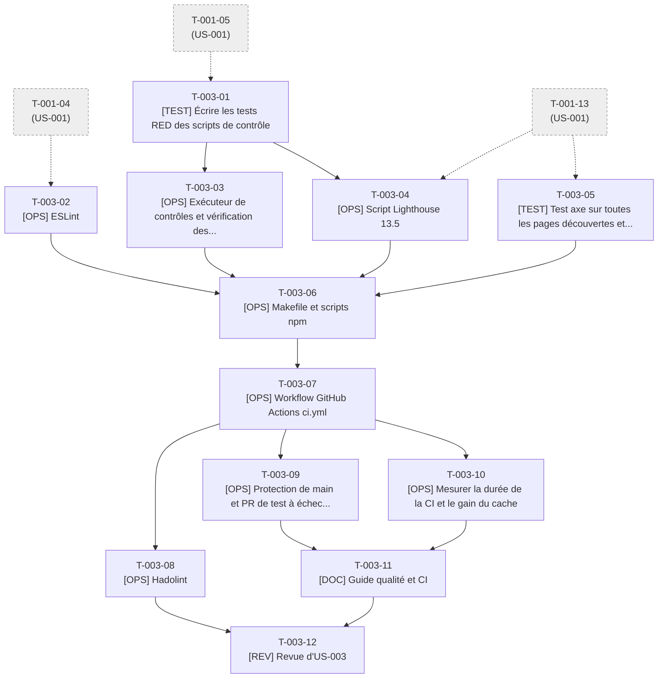

# Tâches - US-003 : Pipeline CI qualité

## Informations US
- **Epic** : EPIC-001 : Socle et walking skeleton
- **Persona** : P-004 : Sophie, tech lead qui pratique l'agentic engineering
- **Story Points** : 3
- **Sprint** : sprint-001-walking_skeleton
- **Lot de travail** : Lot 1 : Socle et CI (voir [README](README.md))
- **Fichier US** : `project-management/backlog/user-stories/` (US-003)

## Résumé de la US
**En tant que** P-004 : Sophie, tech lead qui pratique l'agentic engineering  
**Je veux** que chaque modification du site soit contrôlée automatiquement (lint, build avec schémas, liens, Lighthouse)  
**Afin de** constater que le site, lui-même une preuve, applique la rigueur qu'il revendique (Lighthouse ≥ 95, schémas typés, aucun lien mort)

## Vue d'ensemble des tâches

| ID | Type | Tâche | Estimation | Responsable | Dépend de | Statut |
|----|------|-------|------------|-------------|-----------|--------|
| T-003-01 | [TEST] | Écrire les tests RED des scripts de contrôle (liens, ancres, Lighthouse, découverte des pages) | 3,5h | Dev | T-001-05 | 🔲 |
| T-003-02 | [OPS] | ESLint, Prettier et `astro check` en mode vérification | 3h | Dev | T-001-04 | 🔲 |
| T-003-03 | [OPS] | Exécuteur de contrôles et vérification des liens internes et des ancres (GREEN) | 4h | Dev | T-003-01 | 🔲 |
| T-003-04 | [OPS] | Script Lighthouse 13.5 : 3 exécutions, médiane, seuil 0,95 sur 4 axes | 5h | Dev | T-003-01, T-001-13 | 🔲 |
| T-003-05 | [TEST] | Test axe sur toutes les pages découvertes et assistant de découverte des routes | 2,5h | Dev | T-001-13 | 🔲 |
| T-003-06 | [OPS] | Makefile et scripts npm : cibles lint, test, build-check, lighthouse, e2e, ci | 2,5h | Dev | T-003-02, T-003-03, T-003-04, T-003-05 | 🔲 |
| T-003-07 | [OPS] | Workflow GitHub Actions `ci.yml` | 5h | Dev | T-003-06 | 🔲 |
| T-003-08 | [OPS] | Hadolint, Trivy et SBOM CycloneDX dans la CI | 2,5h | Dev | T-003-07 | 🔲 |
| T-003-09 | [OPS] | Protection de `main` et PR de test à échec volontaire | 3h | Dev | T-003-07 | 🔲 |
| T-003-10 | [OPS] | Mesurer la durée de la CI et le gain du cache | 1,5h | Dev | T-003-07 | 🔲 |
| T-003-11 | [DOC] | Guide qualité et CI, CHANGELOG | 1h | Dev | T-003-09, T-003-10 | 🔲 |
| T-003-12 | [REV] | Revue d'US-003 (DoD §1, §3, §6) | 1,5h | Dev | T-003-08, T-003-11 | 🔲 |

**Total estimé** : 35h (12 tâches)

## Couverture des critères d'acceptance

| Scénario ou critère | Tâches |
|---------------------|--------|
| Pull request conforme validée par la CI (< 8 min, Lighthouse ≥ 95) | T-003-04, T-003-07, T-003-10 |
| Cache de dépendances (gain ≥ 30 %) | T-003-07, T-003-10 |
| Lien externe indisponible (avertissement, pas d'échec) | T-003-01, T-003-03 |
| Schéma de contenu invalide (message fichier + champ) | T-003-09 (test d'échec volontaire), T-001-08 |
| Score Lighthouse sous le seuil (« Accessibility score 0.92 < 0.95 ») | T-003-01, T-003-04, T-003-09 |
| Liens internes et ancres, axe, lint, protection de `main` | T-003-02, T-003-03, T-003-05, T-003-09 |

## Graphe de dépendances

---

## Détail des tâches

### T-003-01 : Écrire les tests RED des scripts de contrôle (liens, ancres, Lighthouse, découverte des pages)
- **Type** : [TEST]
- **US** : US-003
- **Estimation** : 3,5h
- **Responsable** : Dev
- **Dépend de** : T-001-05
- **Débloque** : T-003-03, T-003-04
- **Statut** : 🔲 À faire

**Description** :  
TDD des fonctions pures des scripts : `tests/unit/checks/links.test.ts` (extraction des liens/ancres d'un dossier `dist` factice ; lien interne cassé et ancre manquante détectés ; lien externe ignoré en bloquant, 503 externe → avertissement sans échec), `tests/unit/checks/lighthouse-assert.test.ts` (médiane de 3 runs ; message exact « Accessibility score 0.92 < 0.95 » ; 4 axes), `tests/unit/checks/dist-routes.test.ts` (découverte des routes depuis `dist/**/index.html`, exclusion de `404` et `/contact/merci/`), `tests/unit/checks/runner.test.ts` (découverte de `*.content.check.ts` et `*.dist.check.ts`, code de sortie).

**Fichiers visés** :
- `tests/unit/checks/links.test.ts`
- `tests/unit/checks/lighthouse-assert.test.ts`
- `tests/unit/checks/dist-routes.test.ts`
- `tests/unit/checks/runner.test.ts`
- `tests/fixtures/dist-sample/**`

**Critère de fin vérifiable** :
- [ ] `npx vitest run tests/unit/checks` : tests rouges (RED) pour module absent
- [ ] Chaque message d'erreur attendu par les Gherkin d'US-003 figure dans un test

### T-003-02 : ESLint, Prettier et `astro check` en mode vérification
- **Type** : [OPS]
- **US** : US-003
- **Estimation** : 3h
- **Responsable** : Dev
- **Dépend de** : T-001-04
- **Débloque** : T-003-06
- **Statut** : 🔲 À faire

**Description** :  
Configurer ESLint 10.12 (flat config, `eslint-plugin-astro` 3.2, `typescript-eslint` 8.71), Prettier 3.9 (+ plugin Astro, version relevée avec `npm view` dans `tools`), `.prettierignore`. Scripts npm : `lint`, `format:check`, `check` (`astro check`). Couvre JS/TS, Astro, CSS et Markdown (Prettier). Corriger les écarts du code existant. Installer les dépendances via `tools` (package.json en écriture exclusive de ce lot).

**Fichiers visés** :
- `eslint.config.js`
- `.prettierrc`
- `.prettierignore`
- `package.json`
- `package-lock.json`

**Critère de fin vérifiable** :
- [ ] `docker compose run --rm tools npm run lint` : 0 erreur
- [ ] `... npm run format:check` : vert
- [ ] `... npm run check` : 0 erreur, 0 avertissement bloquant
- [ ] Une erreur de style volontaire fait échouer `lint`

### T-003-03 : Exécuteur de contrôles et vérification des liens internes et des ancres (GREEN)
- **Type** : [OPS]
- **US** : US-003
- **Estimation** : 4h
- **Responsable** : Dev
- **Dépend de** : T-003-01
- **Débloque** : T-003-06, T-004-05, T-005-07, T-029-07
- **Statut** : 🔲 À faire

**Description** :  
Implémenter `scripts/checks/run.ts` (option `--phase=content|dist` ; découvre `scripts/checks/*.content.check.ts` — avant `astro build`, sur les sources — et `*.dist.check.ts` — après build, sur `dist/`), `scripts/checks/lib/dist-routes.ts` et `scripts/checks/internal-links.dist.check.ts` (liens `href` internes + ancres sur `dist/`, liens externes en avertissement avec délai d'attente, jamais bloquants). Les US suivantes ajoutent leurs contrôles en déposant un fichier, sans toucher au runner.

**Fichiers visés** :
- `scripts/checks/run.ts`
- `scripts/checks/lib/dist-routes.ts`
- `scripts/checks/internal-links.dist.check.ts`

**Critère de fin vérifiable** :
- [ ] `npx vitest run tests/unit/checks` : vert
- [ ] `npm run checks:dist` échoue avec la liste des liens cassés sur un `dist` factice cassé
- [ ] Un lien externe en 503 produit un avertissement et un code de sortie 0

### T-003-04 : Script Lighthouse 13.5 : 3 exécutions, médiane, seuil 0,95 sur 4 axes
- **Type** : [OPS]
- **US** : US-003
- **Estimation** : 5h
- **Responsable** : Dev
- **Dépend de** : T-003-01, T-001-13
- **Débloque** : T-003-06
- **Statut** : 🔲 À faire

**Description** :  
Écrire `scripts/checks/lighthouse.ts` : pilote la CLI `lighthouse` 13.5 dans l'image Playwright (Chromium inclus) contre `preview`, profil mobile, 3 exécutions par page et médiane, pages **découvertes dans `dist/`** (aucune liste à maintenir, donc aucune édition partagée), assertions ≥ 0,95 sur Performance, Accessibilité, Bonnes pratiques, SEO, message « <Axe> score 0.92 < 0.95 », rapports HTML/JSON en artefact. ADR-0007 retient la CLI maison plutôt que `@lhci/cli` (la formulation d'US-003 est dépassée).

**Fichiers visés** :
- `scripts/checks/lighthouse.ts`
- `.gitignore` (ajout de `reports/`)

**Critère de fin vérifiable** :
- [ ] `make lighthouse` : tableau des scores par page et sortie 0 sur le squelette
- [ ] Une page dont l'accessibilité est simulée à 0,92 fait échouer le script avec le message exact attendu
- [ ] Rapports écrits dans `reports/lighthouse/` (ignoré par git)

### T-003-05 : Test axe sur toutes les pages découvertes et assistant de découverte des routes
- **Type** : [TEST]
- **US** : US-003
- **Estimation** : 2,5h
- **Responsable** : Dev
- **Dépend de** : T-001-13
- **Débloque** : T-003-06, T-029-03
- **Statut** : 🔲 À faire

**Description** :  
Créer `tests/e2e/helpers/routes.ts` (parcours en largeur des liens internes à partir de `/`, sans liste à maintenir ; réutilisé par US-029) et `tests/e2e/a11y.spec.ts` (@axe-core/playwright 4.13, WCAG 2.2 AA, thèmes clair et sombre, échec sur toute violation `serious` ou `critical`).

**Fichiers visés** :
- `tests/e2e/helpers/routes.ts`
- `tests/e2e/a11y.spec.ts`

**Critère de fin vérifiable** :
- [ ] `make e2e` exécute `a11y.spec.ts` sur toutes les pages découvertes
- [ ] Une violation volontaire (image sans alt) fait échouer le test
- [ ] Le helper expose `discoverRoutes(baseURL)`

### T-003-06 : Makefile et scripts npm : cibles lint, test, build-check, lighthouse, e2e, ci
- **Type** : [OPS]
- **US** : US-003
- **Estimation** : 2,5h
- **Responsable** : Dev
- **Dépend de** : T-003-02, T-003-03, T-003-04, T-003-05
- **Débloque** : T-003-07, T-002-11
- **Statut** : 🔲 À faire

**Description** :  
Ajouter au `Makefile` : `lint`, `format`, `check`, `test`, `checks`, `lighthouse`, `e2e`, `ci` (enchaîne exactement les étapes de la CI). Scripts npm : `checks:content`, `checks:dist`, `build` = `checks:content && astro build && checks:dist`. Service `e2e` de compose exécute Playwright puis Lighthouse. Fichiers `Makefile`, `package.json` et `compose.yaml` réservés à ce lot.

**Fichiers visés** :
- `Makefile`
- `package.json`
- `compose.yaml`

**Critère de fin vérifiable** :
- [ ] `make ci` : vert sur le squelette, en local, sans Node sur le poste
- [ ] `make ci` échoue si un test, un lint, un schéma ou un lien est cassé
- [ ] `npm run build` exécute les contrôles de contenu avant `astro build` et les contrôles de `dist` après

### T-003-07 : Workflow GitHub Actions `ci.yml`
- **Type** : [OPS]
- **US** : US-003
- **Estimation** : 5h
- **Responsable** : Dev
- **Dépend de** : T-003-06
- **Débloque** : T-001-14, T-003-08, T-003-09, T-003-10
- **Statut** : 🔲 À faire

**Description** :  
Créer `.github/workflows/ci.yml` (PR et `main`) : `permissions: contents: read`, `persist-credentials: false`, actions épinglées par SHA complet avec commentaire de version, `concurrency`, pas de `pull_request_target`, cache BuildKit en mode GitHub Actions (clé liée au `package-lock.json`). Jobs : `quality` (cible Docker `test` : lint, check, Vitest + couverture, build + contrôles), puis `e2e` (preview + Playwright + axe + Lighthouse). Rapports Lighthouse publiés en artefact. L'utilisation de Node sur le runner est interdite : tout passe par Docker.

**Fichiers visés** :
- `.github/workflows/ci.yml`

**Critère de fin vérifiable** :
- [ ] Le workflow s'exécute sur une PR de test et passe en vert
- [ ] Aucune action non épinglée (`grep -E 'uses: .*@v?[0-9]' .github/workflows/ci.yml` ne renvoie rien)
- [ ] Les rapports Lighthouse sont téléchargeables
- [ ] Le statut `ci` est disponible pour la protection de branche et Railway

### T-003-08 : Hadolint, Trivy et SBOM CycloneDX dans la CI
- **Type** : [OPS]
- **US** : US-003
- **Estimation** : 2,5h
- **Responsable** : Dev
- **Dépend de** : T-003-07
- **Débloque** : T-003-12
- **Statut** : 🔲 À faire

**Description** :  
Issu d'ADR-0009 et de la règle 11 (hors critères d'acceptance d'US-003, arbitrage PO possible) : ajouter à `ci.yml` un job `supply-chain` (hadolint sur le Dockerfile, `trivy image` bloquant sur HIGH/CRITICAL corrigeables, SBOM CycloneDX en artefact, rétention 90 jours).

**Fichiers visés** :
- `.github/workflows/ci.yml`

**Critère de fin vérifiable** :
- [ ] Le job échoue si un Dockerfile non conforme est introduit (test volontaire)
- [ ] L'artefact SBOM est publié
- [ ] Aucune vulnérabilité HIGH/CRITICAL corrigeable sur l'image du squelette

### T-003-09 : Protection de `main` et PR de test à échec volontaire
- **Type** : [OPS]
- **US** : US-003
- **Estimation** : 3h
- **Responsable** : Dev
- **Dépend de** : T-003-07
- **Débloque** : T-003-11
- **Statut** : 🔲 À faire

**Description** :  
Activer la protection de `main` : CI requise, PR obligatoire, squash merge uniquement, branche à jour. Ouvrir 3 PR jetables : (1) erreur de lint, (2) champ obligatoire retiré de `home.yaml`, (3) régression d'accessibilité simulée à 0,92. Vérifier que chacune bloque la fusion avec le message attendu, puis fermer les PR.

**Fichiers visés** :
- (configuration GitHub ; aucun fichier hormis les PR jetables)

**Critère de fin vérifiable** :
- [ ] `gh api repos/thibmonier/thibaut-monier.fr/branches/main/protection` montre la CI requise
- [ ] Les 3 PR jetables sont bloquées avec : message de schéma citant fichier + champ ; « Accessibility score 0.92 < 0.95 » ; erreur ESLint
- [ ] Preuves (liens des runs) dans la description de PR

### T-003-10 : Mesurer la durée de la CI et le gain du cache
- **Type** : [OPS]
- **US** : US-003
- **Estimation** : 1,5h
- **Responsable** : Dev
- **Dépend de** : T-003-07
- **Débloque** : T-003-11
- **Statut** : 🔲 À faire

**Description** :  
Exécuter la CI deux fois de suite sur le même `package-lock.json` : durée totale < 8 min, gain du second passage ≥ 30 %. Ajuster le cache BuildKit si nécessaire (risque : Lighthouse × 3 par page). Consigner les mesures.

**Fichiers visés** :
- `.github/workflows/ci.yml` (réglages de cache si besoin)

**Critère de fin vérifiable** :
- [ ] Durée du run froid et du run chaud consignée
- [ ] Durée du run chaud < 8 min
- [ ] Gain ≥ 30 % démontré

### T-003-11 : Guide qualité et CI, CHANGELOG
- **Type** : [DOC]
- **US** : US-003
- **Estimation** : 1h
- **Responsable** : Dev
- **Dépend de** : T-003-09, T-003-10
- **Débloque** : T-003-12
- **Statut** : 🔲 À faire

**Description** :  
Rédiger `docs/guides/qualite-ci.md` : commandes `make`, convention d'ajout d'un contrôle (`*.content.check.ts`, `*.dist.check.ts`), seuils, lecture des rapports, procédure en cas d'échec. Entrée CHANGELOG (zone append-only).

**Fichiers visés** :
- `docs/guides/qualite-ci.md`
- `CHANGELOG.md`

**Critère de fin vérifiable** :
- [ ] Un contributeur ajoute un contrôle sans modifier `run.ts` en suivant le guide
- [ ] CHANGELOG mis à jour

### T-003-12 : Revue d'US-003 (DoD §1, §3, §6)
- **Type** : [REV]
- **US** : US-003
- **Estimation** : 1,5h
- **Responsable** : Dev
- **Dépend de** : T-003-08, T-003-11
- **Débloque** : -
- **Statut** : 🔲 À faire

**Description** :  
Revue du workflow (permissions, SHA, secrets), des scripts (KISS, tests, couverture) et de la conformité aux ADR-0007/0009.

**Fichiers visés** :
- (revue ; aucun fichier produit)

**Critère de fin vérifiable** :
- [ ] Checklist DoD §1, §3, §6 cochée
- [ ] Commentaires traités

