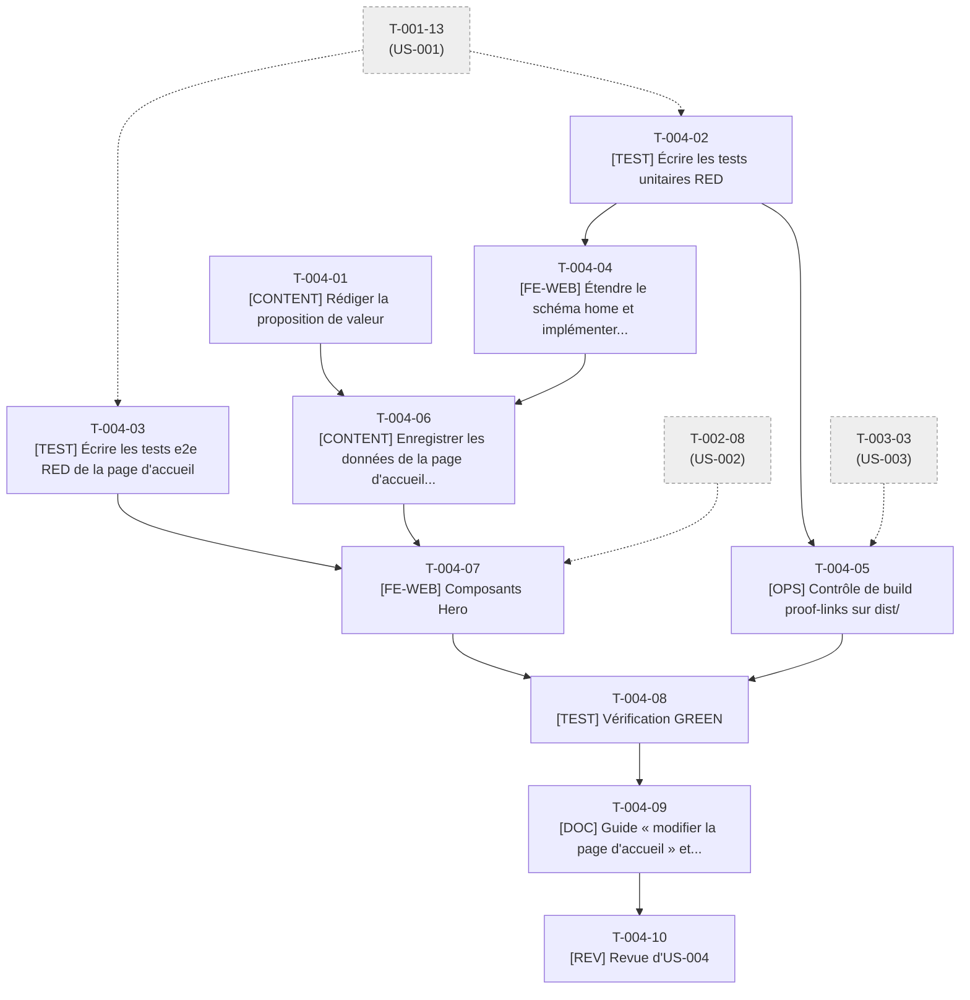

# Tâches - US-004 : Page d'accueil : proposition de valeur et double parcours

## Informations US
- **Epic** : EPIC-002 : Profil et CV
- **Persona** : P-001 : Claire, DG d'une scale-up qui recrute
- **Story Points** : 3
- **Sprint** : sprint-001-walking_skeleton
- **Lot de travail** : Lot 3A : Accueil et parcours (voir [README](README.md))
- **Fichier US** : `project-management/backlog/user-stories/` (US-004)

## Résumé de la US
**En tant que** P-001 : Claire, DG d'une scale-up qui recrute  
**Je veux** comprendre dès l'écran d'accueil qui est Thibaut Monier, ce qu'il apporte, et choisir « Me recruter » ou « Me confier une mission »  
**Afin de** décider en moins de 2 minutes si le profil mérite un entretien, sans défiler ni subir de jargon

## Vue d'ensemble des tâches

| ID | Type | Tâche | Estimation | Responsable | Dépend de | Statut |
|----|------|-------|------------|-------------|-----------|--------|
| T-004-01 | [CONTENT] | Rédiger la proposition de valeur, les CTA et les 4 preuves | 2,5h | PO | - | 👀 |
| T-004-02 | [TEST] | Écrire les tests unitaires RED : preuves, schéma `home`, nombre de mots | 2,5h | Dev | T-001-13 | ✅ |
| T-004-03 | [TEST] | Écrire les tests e2e RED de la page d'accueil | 3h | Dev | T-001-13 | ✅ |
| T-004-04 | [FE-WEB] | Étendre le schéma `home` et implémenter `proofs.ts` / `text.ts` (GREEN) | 3h | Dev | T-004-02 | ✅ |
| T-004-05 | [OPS] | Contrôle de build `proof-links` sur `dist/` | 2h | Dev | T-004-02, T-003-03 | ✅ |
| T-004-06 | [CONTENT] | Enregistrer les données de la page d'accueil dans `home.yaml` | 1h | Dev | T-004-01, T-004-04 | ✅ |
| T-004-07 | [FE-WEB] | Composants `Hero`, `CtaPair`, `ProofList` et page d'accueil | 4h | Dev | T-004-03, T-004-06, T-002-08 | ✅ |
| T-004-08 | [TEST] | Vérification GREEN : e2e, axe, Lighthouse, contrôle des preuves | 1,5h | Dev | T-004-07, T-004-05 | ✅ |
| T-004-09 | [DOC] | Guide « modifier la page d'accueil » et CHANGELOG | 1h | Dev | T-004-08 | ✅ |
| T-004-10 | [REV] | Revue d'US-004 (DoD §1, §2, §4, §5) | 1,5h | Dev | T-004-09 | 👀 |

**Total estimé** : 22h (10 tâches)

## Couverture des critères d'acceptance

| Scénario ou critère | Tâches |
|---------------------|--------|
| Proposition de valeur et 4 preuves visibles sans défilement (1280 × 720) | T-004-03, T-004-07, T-004-08 |
| Parcours « Me recruter » → contact avec motif Poste | T-004-03, T-008-11 |
| Affichage mobile (375 × 667) : boutons visibles, preuves en une colonne | T-004-03, T-004-07 |
| Preuve sans destination (« Lien de preuve invalide : <id> ») | T-004-02, T-004-05 |
| Champ obligatoire manquant (« Champ 'headline' requis dans la collection home ») | T-004-02, T-004-04 |

## Graphe de dépendances

---

## Détail des tâches

### T-004-01 : Rédiger la proposition de valeur, les CTA et les 4 preuves
- **Type** : [CONTENT]
- **US** : US-004
- **Estimation** : 2,5h
- **Responsable** : PO
- **Dépend de** : -
- **Débloque** : T-004-06
- **Statut** : 👀 Review

**Description** :  
Proposer et faire valider : `headline`, phrase de valeur ≤ 25 mots, libellés « Me confier une mission » / « Me recruter », statut de disponibilité (question ouverte n°5), `title` ≤ 60 et `description` ≤ 160 caractères. Les 4 preuves (20 plugins Sylius 2, PR mergées sur career-ops, ERP de 12 modules livré en agentique, 25 ans d'expérience) : libellé, valeur, **source consultable** et destination. Destinations provisoires au sprint 1 : liens externes https (profil Packagist, PR GitHub) ou `/parcours/` ; aucune preuve vers une 404.

**Fichiers visés** :
- (brouillon repris dans `src/data/home.yaml` par T-004-06)

**Critère de fin vérifiable** :
- [ ] Texte validé par le PO
- [ ] Chaque chiffre est relié à une source (note de contenu dans la PR)
- [ ] `valueProp` compte au plus 25 mots
- [ ] Aucune donnée personnelle (téléphone, âge, adresse)

### T-004-02 : Écrire les tests unitaires RED : preuves, schéma `home`, nombre de mots
- **Type** : [TEST]
- **US** : US-004
- **Estimation** : 2,5h
- **Responsable** : Dev
- **Dépend de** : T-001-13
- **Débloque** : T-004-04, T-004-05
- **Statut** : ✅ Done

**Description** :  
`tests/unit/lib/proofs.test.ts` : `validateProofs` (exactement 4 preuves ; lien interne ∈ routes connues ; lien externe en https ; message « Lien de preuve invalide : <identifiant> »), `tests/unit/lib/text.test.ts` (`countWords`), `tests/unit/content/home-schema.test.ts` étendu (headline, valueProp ≤ 25 mots, ctas[2], proofs[4] ; message « Champ 'headline' requis dans la collection home »).

**Fichiers visés** :
- `tests/unit/lib/proofs.test.ts`
- `tests/unit/lib/text.test.ts`
- `tests/unit/content/home-schema.test.ts`

**Critère de fin vérifiable** :
- [ ] Tests rouges (RED) pour fonctions absentes
- [ ] Chaque message Gherkin d'erreur d'US-004 est vérifié

### T-004-03 : Écrire les tests e2e RED de la page d'accueil
- **Type** : [TEST]
- **US** : US-004
- **Estimation** : 3h
- **Responsable** : Dev
- **Dépend de** : T-001-13
- **Débloque** : T-004-07
- **Statut** : ✅ Done

**Description** :  
`tests/e2e/home.spec.ts` : à 1280 × 720, `h1`, phrase de valeur, 2 boutons et 4 preuves entièrement visibles sans défilement (bas de boîte ≤ 720 px) ; à 375 × 667, boutons visibles, preuves en une colonne, aucun défilement horizontal ; hauteur des boutons ≥ 44 px ; `href` = `/contact/?motif=poste` et `/contact/?motif=mission` ; un seul `h1` ; `title` ≤ 60, description ≤ 160. Le clic bout-en-bout vers le formulaire est testé dans T-008-11.

**Fichiers visés** :
- `tests/e2e/home.spec.ts`

**Critère de fin vérifiable** :
- [ ] `make e2e` : `home.spec.ts` échoue (RED)
- [ ] Contrat de motif consigné : valeurs `mission | poste | autre`

### T-004-04 : Étendre le schéma `home` et implémenter `proofs.ts` / `text.ts` (GREEN)
- **Type** : [FE-WEB]
- **US** : US-004
- **Estimation** : 3h
- **Responsable** : Dev
- **Dépend de** : T-004-02
- **Débloque** : T-004-06
- **Statut** : ✅ Done

**Description** :  
Étendre `src/content/schemas/home.ts` (headline, valueProp, ctas[2], proofs[4] avec libellé, valeur, lien), messages d'erreur en français ; implémenter `src/lib/proofs.ts` et `src/lib/text.ts`.

**Fichiers visés** :
- `src/content/schemas/home.ts`
- `src/lib/proofs.ts`
- `src/lib/text.ts`

**Critère de fin vérifiable** :
- [ ] Les tests de T-004-02 sont verts
- [ ] Couverture des deux modules ≥ 90 %
- [ ] `astro check` : 0 erreur

### T-004-05 : Contrôle de build `proof-links` sur `dist/`
- **Type** : [OPS]
- **US** : US-004
- **Estimation** : 2h
- **Responsable** : Dev
- **Dépend de** : T-004-02, T-003-03
- **Débloque** : T-004-08
- **Statut** : ✅ Done

**Description** :  
Écrire `scripts/checks/proof-links.dist.check.ts` : lit `src/data/home.yaml`, vérifie que chaque lien interne de preuve correspond à une route de `dist/` et que chaque lien externe est en https. Utilise `validateProofs` de T-004-04. Message : « Lien de preuve invalide : <identifiant> ».

**Fichiers visés** :
- `scripts/checks/proof-links.dist.check.ts`
- `tests/unit/checks/proof-links.test.ts`

**Critère de fin vérifiable** :
- [ ] `npm run checks:dist` vert avec les données finales
- [ ] Une preuve pointant vers `/inexistant/` fait échouer le contrôle avec le message attendu

### T-004-06 : Enregistrer les données de la page d'accueil dans `home.yaml`
- **Type** : [CONTENT]
- **US** : US-004
- **Estimation** : 1h
- **Responsable** : Dev
- **Dépend de** : T-004-01, T-004-04
- **Débloque** : T-004-07
- **Statut** : ✅ Done

**Description** :  
Reporter le contenu validé de T-004-01 dans `src/data/home.yaml` (headline, valueProp, 2 CTA, 4 preuves) en respectant le schéma étendu. Typographie française (espaces insécables avant `: ; ? !`).

**Fichiers visés** :
- `src/data/home.yaml`

**Critère de fin vérifiable** :
- [ ] `astro build` valide la collection
- [ ] Relecture orthographique faite (accents, espaces insécables)

### T-004-07 : Composants `Hero`, `CtaPair`, `ProofList` et page d'accueil
- **Type** : [FE-WEB]
- **US** : US-004
- **Estimation** : 4h
- **Responsable** : Dev
- **Dépend de** : T-004-03, T-004-06, T-002-08
- **Débloque** : T-004-08, T-008-11
- **Statut** : ✅ Done

**Description** :  
Créer `Hero.astro`, `CtaPair.astro` (boutons ≥ 44 px, libellés explicites, liens `/contact/?motif=…`), `ProofList.astro` (une colonne mobile, grille ≥ 768 px, chaque preuve cliquable) et recomposer `src/pages/index.astro`. Aucune image bloquante ; `Seo` avec title/description de `home.yaml`. Chaque composant < 150 lignes.

**Fichiers visés** :
- `src/components/ui/Hero.astro`
- `src/components/ui/CtaPair.astro`
- `src/components/ui/ProofList.astro`
- `src/pages/index.astro`

**Critère de fin vérifiable** :
- [ ] `tests/e2e/home.spec.ts` vert
- [ ] Un seul `h1`, contraste ≥ 4,5:1 (axe vert)
- [ ] LCP < 1,5 s sur Lighthouse mobile local

### T-004-08 : Vérification GREEN : e2e, axe, Lighthouse, contrôle des preuves
- **Type** : [TEST]
- **US** : US-004
- **Estimation** : 1,5h
- **Responsable** : Dev
- **Dépend de** : T-004-07, T-004-05
- **Débloque** : T-004-09
- **Statut** : ✅ Done

**Description** :  
`make ci` complet ; contrôle visuel à 360, 768, 1280 px, thème clair et sombre. Corriger les écarts.

**Fichiers visés** :
- (corrections dans les fichiers des tâches T-004-04 à T-004-07)

**Critère de fin vérifiable** :
- [ ] `make ci` vert
- [ ] Lighthouse ≥ 95 sur `/` (4 axes)

### T-004-09 : Guide « modifier la page d'accueil » et CHANGELOG
- **Type** : [DOC]
- **US** : US-004
- **Estimation** : 1h
- **Responsable** : Dev
- **Dépend de** : T-004-08
- **Débloque** : T-004-10
- **Statut** : ✅ Done

**Description** :  
`docs/guides/page-accueil.md` : schéma `home`, règles des preuves (sourcées, lien valide), contrat du motif de contact. Entrée CHANGELOG.

**Fichiers visés** :
- `docs/guides/page-accueil.md`
- `CHANGELOG.md`

**Critère de fin vérifiable** :
- [ ] Le guide permet de changer une preuve sans lire le code
- [ ] CHANGELOG à jour

### T-004-10 : Revue d'US-004 (DoD §1, §2, §4, §5)
- **Type** : [REV]
- **US** : US-004
- **Estimation** : 1,5h
- **Responsable** : Dev
- **Dépend de** : T-004-09
- **Débloque** : -
- **Statut** : 👀 Review

**Description** :  
Revue du code, du contenu (preuves sourcées, accents, aucune donnée personnelle), de l'accessibilité et des performances.

**Fichiers visés** :
- (revue ; aucun fichier produit)

**Critère de fin vérifiable** :
- [ ] Checklist DoD §1, §2, §4, §5 cochée
- [ ] Commentaires traités

