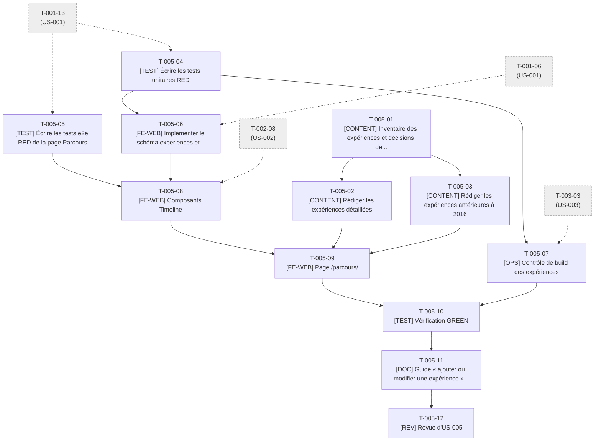

# Tâches - US-005 : Parcours professionnel en frise

## Informations US
- **Epic** : EPIC-002 : Profil et CV
- **Persona** : P-001 : Claire, DG d'une scale-up qui recrute
- **Story Points** : 5
- **Sprint** : sprint-001-walking_skeleton
- **Lot de travail** : Lot 3A : Accueil et parcours (voir [README](README.md))
- **Fichier US** : `project-management/backlog/user-stories/` (US-005)

## Résumé de la US
**En tant que** P-001 : Claire, DG d'une scale-up qui recrute  
**Je veux** parcourir une frise de 7 expériences avec rôle, période, contexte et réalisations chiffrées  
**Afin de** vérifier la cohérence du parcours de direction et l'expérience de pilotage, de SQLI à aujourd'hui

## Vue d'ensemble des tâches

| ID | Type | Tâche | Estimation | Responsable | Dépend de | Statut |
|----|------|-------|------------|-------------|-----------|--------|
| T-005-01 | [CONTENT] | Inventaire des expériences et décisions de contenu avec le PO | 2h | PO | - | 👀 |
| T-005-02 | [CONTENT] | Rédiger les expériences détaillées (`featured`) en YAML | 5h | Dev | T-005-01 | ✅ |
| T-005-03 | [CONTENT] | Rédiger les expériences antérieures à 2016 (`summaryOnly`) | 2h | Dev | T-005-01 | ✅ |
| T-005-04 | [TEST] | Écrire les tests unitaires RED : tri, fenêtre de 10 ans, période, schéma, données interdites | 3,5h | Dev | T-001-13 | ✅ |
| T-005-05 | [TEST] | Écrire les tests e2e RED de la page Parcours | 3,5h | Dev | T-001-13 | ✅ |
| T-005-06 | [FE-WEB] | Implémenter le schéma `experiences` et `experiences.ts` (GREEN) | 4h | Dev | T-005-04, T-001-06 | ✅ |
| T-005-07 | [OPS] | Contrôle de build des expériences : données personnelles, règle des 10 ans, décompte | 2,5h | Dev | T-005-04, T-003-03 | ✅ |
| T-005-08 | [FE-WEB] | Composants `Timeline`, `ExperienceCard`, `EarlierCareer` et styles d'impression | 6h | Dev | T-005-05, T-005-06, T-002-08 | ✅ |
| T-005-09 | [FE-WEB] | Page `/parcours/` (remplace la page d'attente) | 2,5h | Dev | T-005-08, T-005-02, T-005-03 | ✅ |
| T-005-10 | [TEST] | Vérification GREEN : e2e, axe, Lighthouse, impression, responsive | 2,5h | Dev | T-005-09, T-005-07 | ✅ |
| T-005-11 | [DOC] | Guide « ajouter ou modifier une expérience » et CHANGELOG | 1h | Dev | T-005-10 | ✅ |
| T-005-12 | [REV] | Revue d'US-005 (code, contenu, confidentialité) | 2h | Dev | T-005-11 | 👀 |

**Total estimé** : 36,5h (12 tâches)

## Couverture des critères d'acceptance

| Scénario ou critère | Tâches |
|---------------------|--------|
| Frise complète (ordre décroissant, champs, ≥ 2 réalisations) | T-005-04, T-005-05, T-005-08, T-005-09 |
| Dépliage d'une expérience (aria-expanded) | T-005-05, T-005-08 |
| Impression sur 2 pages A4 maximum, tout déplié | T-005-05, T-005-08, T-005-10 |
| Expérience sans période (erreur de build citant fichier et champ) | T-005-04, T-005-06 |
| Donnée personnelle présente (« Donnée personnelle interdite détectée dans <fichier> ») | T-005-04, T-005-07 |

## Graphe de dépendances

---

## Détail des tâches

### T-005-01 : Inventaire des expériences et décisions de contenu avec le PO
- **Type** : [CONTENT]
- **US** : US-005
- **Estimation** : 2h
- **Responsable** : PO
- **Dépend de** : -
- **Débloque** : T-005-02, T-005-03
- **Statut** : 👀 Review

**Description** :  
À partir du CV source : lister les expériences, lever les ambiguïtés (point d'attention n°2 du README) — décompte attendu **8** alors que la liste d'US-005 en cite 7 après fusion de Smile ; fusion de Smile ; fenêtre « 10 dernières années » (règle V7) et expériences `featured` ; entrées antérieures à 2016 en `summaryOnly` ; accord de citation des clients (`clientsCited`) ; sources des réalisations chiffrées. Ne jamais importer téléphone, âge ni adresse.

**Fichiers visés** :
- (décisions reportées dans la PR et dans T-005-02/03)

**Critère de fin vérifiable** :
- [ ] Tableau « expérience → featured / summaryOnly / clientsCited / source » validé par le PO
- [ ] Décompte final tranché et reporté dans la constante `EXPECTED_EXPERIENCES` de T-005-07
- [ ] Smile : décision fusion ou séparation consignée

### T-005-02 : Rédiger les expériences détaillées (`featured`) en YAML
- **Type** : [CONTENT]
- **US** : US-005
- **Estimation** : 5h
- **Responsable** : Dev
- **Dépend de** : T-005-01
- **Débloque** : T-005-09
- **Statut** : ✅ Done

**Description** :  
Créer un fichier `src/data/cv/experiences/<slug>.yaml` par expérience des 10 dernières années : `company`, `role`, `start`/`end` (AAAA-MM), `location` (ville ou « remote »), `context` ≤ 280 caractères, ≥ 2 `achievements` chiffrées et sourcées, `skills`, `featured: true`, `order` pour départager. Ordre décroissant respecté. Français soigné, espaces insécables.

**Fichiers visés** :
- `src/data/cv/experiences/*.yaml` (expériences des 10 dernières années)

**Critère de fin vérifiable** :
- [ ] Chaque fichier valide le schéma de T-005-06
- [ ] Chaque expérience porte ≥ 2 réalisations
- [ ] Relecture orthographique faite ; PO valide le fond

### T-005-03 : Rédiger les expériences antérieures à 2016 (`summaryOnly`)
- **Type** : [CONTENT]
- **US** : US-005
- **Estimation** : 2h
- **Responsable** : Dev
- **Dépend de** : T-005-01
- **Débloque** : T-005-09
- **Statut** : ✅ Done

**Description** :  
Créer les fichiers des expériences antérieures (rôles et employeurs, résumé ≤ 160 caractères, `featured: false`) destinés au bloc « Avant 2016 » repliable. Relecture manuelle anti-donnée personnelle.

**Fichiers visés** :
- `src/data/cv/experiences/*.yaml` (expériences antérieures)

**Critère de fin vérifiable** :
- [ ] Chaque fichier valide le schéma (summaryOnly présent, featured false)
- [ ] Aucune date de naissance ni âge dans les fichiers

### T-005-04 : Écrire les tests unitaires RED : tri, fenêtre de 10 ans, période, schéma, données interdites
- **Type** : [TEST]
- **US** : US-005
- **Estimation** : 3,5h
- **Responsable** : Dev
- **Dépend de** : T-001-13
- **Débloque** : T-005-06, T-005-07
- **Statut** : ✅ Done

**Description** :  
`tests/unit/lib/experiences.test.ts` : tri décroissant (poste en cours d'abord, départage par `order`), `splitFeatured` avec horloge injectée (règle V7 : toute expérience terminée après année-10 est `featured`), `formatPeriod('2019-03','2023-06')` → « mars 2019 – juin 2023 », schéma `experiences` (champ manquant → message `experiences/<fichier> : champ '<champ>' requis`, `strictObject` rejette `phone`, `end` ≥ `start`, `summaryOnly` requis si non featured). Note : l'AC cite `startDate`, le modèle de contenu `start` ; le test suit le modèle (point d'attention n°2).

**Fichiers visés** :
- `tests/unit/lib/experiences.test.ts`
- `tests/unit/content/experiences-schema.test.ts`

**Critère de fin vérifiable** :
- [ ] Tests rouges (RED)
- [ ] Chaque message d'erreur d'US-005 est vérifié

### T-005-05 : Écrire les tests e2e RED de la page Parcours
- **Type** : [TEST]
- **US** : US-005
- **Estimation** : 3,5h
- **Responsable** : Dev
- **Dépend de** : T-001-13
- **Débloque** : T-005-08
- **Statut** : ✅ Done

**Description** :  
`tests/e2e/parcours.spec.ts` : liste ordonnée `ol`, jalons du plus récent au plus ancien (nombre attendu lu depuis les données), chaque jalon avec rôle, entreprise, période, contexte, ≥ 2 réalisations ; dépliage au clavier et au toucher, `aria-expanded` à `true` ; bloc « Avant 2016 » repliable ; impression : tous les jalons dépliés sur ≤ 2 pages A4 (`page.pdf()` et décompte des pages) ; colonne unique sous 768 px ; fonctionne sans JavaScript.

**Fichiers visés** :
- `tests/e2e/parcours.spec.ts`

**Critère de fin vérifiable** :
- [ ] `make e2e` : `parcours.spec.ts` échoue (RED)
- [ ] Le test n'a aucun nombre en dur : il lit la collection (robuste à la décision de décompte)

### T-005-06 : Implémenter le schéma `experiences` et `experiences.ts` (GREEN)
- **Type** : [FE-WEB]
- **US** : US-005
- **Estimation** : 4h
- **Responsable** : Dev
- **Dépend de** : T-005-04, T-001-06
- **Débloque** : T-005-08
- **Statut** : ✅ Done

**Description** :  
Créer `src/content/schemas/experiences.ts` (content-model §3.1 : `strictObject`, `safeText`, refinements), enregistrer la collection dans `src/content.config.ts` (loader `glob` sur `src/data/cv/experiences`, ajout d'une ligne en zone append-only) et implémenter `src/lib/experiences.ts` (tri, fenêtre de 10 ans, format de période en français).

**Fichiers visés** :
- `src/content/schemas/experiences.ts`
- `src/content.config.ts`
- `src/lib/experiences.ts`

**Critère de fin vérifiable** :
- [ ] Tests de T-005-04 verts
- [ ] Couverture `src/lib/experiences.ts` ≥ 90 %
- [ ] Retirer `start` d'un YAML fait échouer le build en citant fichier et champ

### T-005-07 : Contrôle de build des expériences : données personnelles, règle des 10 ans, décompte
- **Type** : [OPS]
- **US** : US-005
- **Estimation** : 2,5h
- **Responsable** : Dev
- **Dépend de** : T-005-04, T-003-03
- **Débloque** : T-005-10
- **Statut** : ✅ Done

**Description** :  
Écrire `scripts/checks/experiences.content.check.ts` (phase `content`, avant `astro build`) : `detectPii` sur chaque YAML (message « Donnée personnelle interdite détectée dans <fichier> »), règle V7, décompte V8 (`EXPECTED_EXPERIENCES` issu de T-005-01), unicité des slugs.

**Fichiers visés** :
- `scripts/checks/experiences.content.check.ts`
- `tests/unit/checks/experiences-check.test.ts`

**Critère de fin vérifiable** :
- [ ] `npm run checks:content` vert avec les données finales
- [ ] Un YAML contenant « 06 12 34 56 78 » fait échouer avec le message attendu
- [ ] Un YAML avec « 47 ans » dans un champ d'état civil est rejeté ; « 25 ans d'expérience » est accepté

### T-005-08 : Composants `Timeline`, `ExperienceCard`, `EarlierCareer` et styles d'impression
- **Type** : [FE-WEB]
- **US** : US-005
- **Estimation** : 6h
- **Responsable** : Dev
- **Dépend de** : T-005-05, T-005-06, T-002-08
- **Débloque** : T-005-09
- **Statut** : ✅ Done

**Description** :  
Créer `src/components/cv/Timeline.astro` (`ol`, ligne verticale, une colonne sous 768 px), `ExperienceCard.astro` (`details`/`summary` « Voir le détail » avec petit script qui synchronise `aria-expanded`, fonctionne sans JavaScript), `EarlierCareer.astro` (`details` « Avant 2016 »). `@media print` dans les styles scopés des composants : tout déplié, 2 pages A4 maximum. Chaque composant < 150 lignes. Ne pas modifier `global.css`.

**Fichiers visés** :
- `src/components/cv/Timeline.astro`
- `src/components/cv/ExperienceCard.astro`
- `src/components/cv/EarlierCareer.astro`

**Critère de fin vérifiable** :
- [ ] `parcours.spec.ts` : dépliage et clavier verts
- [ ] Script d'amélioration < 2 Ko
- [ ] Aucun script inline

### T-005-09 : Page `/parcours/` (remplace la page d'attente)
- **Type** : [FE-WEB]
- **US** : US-005
- **Estimation** : 2,5h
- **Responsable** : Dev
- **Dépend de** : T-005-08, T-005-02, T-005-03
- **Débloque** : T-005-10
- **Statut** : ✅ Done

**Description** :  
Remplacer `src/pages/parcours.astro` : `getCollection('experiences')`, tri/partition via `experiences.ts`, `Seo` (title et description propres), `h1`, introduction courte. Données prêtes pour le JSON-LD de US-024 (aucun JSON-LD ici).

**Fichiers visés** :
- `src/pages/parcours.astro`

**Critère de fin vérifiable** :
- [ ] `parcours.spec.ts` entièrement vert
- [ ] `title` et `description` propres à la page

### T-005-10 : Vérification GREEN : e2e, axe, Lighthouse, impression, responsive
- **Type** : [TEST]
- **US** : US-005
- **Estimation** : 2,5h
- **Responsable** : Dev
- **Dépend de** : T-005-09, T-005-07
- **Débloque** : T-005-11
- **Statut** : ✅ Done

**Description** :  
`make ci` complet ; contrôle visuel à 360, 768, 1280 px ; impression sur 2 pages A4 vérifiée ; correction des écarts.

**Fichiers visés** :
- (corrections dans les fichiers des tâches T-005-06 à T-005-09)

**Critère de fin vérifiable** :
- [ ] `make ci` vert
- [ ] Lighthouse ≥ 95 sur `/parcours/`
- [ ] Impression ≤ 2 pages A4 prouvée (test + capture)

### T-005-11 : Guide « ajouter ou modifier une expérience » et CHANGELOG
- **Type** : [DOC]
- **US** : US-005
- **Estimation** : 1h
- **Responsable** : Dev
- **Dépend de** : T-005-10
- **Débloque** : T-005-12
- **Statut** : ✅ Done

**Description** :  
`docs/guides/parcours-experiences.md` : schéma, règle des 10 ans, `summaryOnly`, liste blanche de données, procédure de validation. Entrée CHANGELOG.

**Fichiers visés** :
- `docs/guides/parcours-experiences.md`
- `CHANGELOG.md`

**Critère de fin vérifiable** :
- [ ] Un nouveau fichier d'expérience se rédige en suivant le guide seul
- [ ] CHANGELOG à jour

### T-005-12 : Revue d'US-005 (code, contenu, confidentialité)
- **Type** : [REV]
- **US** : US-005
- **Estimation** : 2h
- **Responsable** : Dev
- **Dépend de** : T-005-11
- **Débloque** : -
- **Statut** : 👀 Review

**Description** :  
Revue du code, de l'accessibilité (liste ordonnée, boutons), de la liste blanche (aucune donnée personnelle), de l'accord de citation des clients et de la relecture du français.

**Fichiers visés** :
- (revue ; aucun fichier produit)

**Critère de fin vérifiable** :
- [ ] Checklist DoD §1, §2, §4, §5 cochée
- [ ] PO valide le contenu publié
- [ ] Commentaires traités

