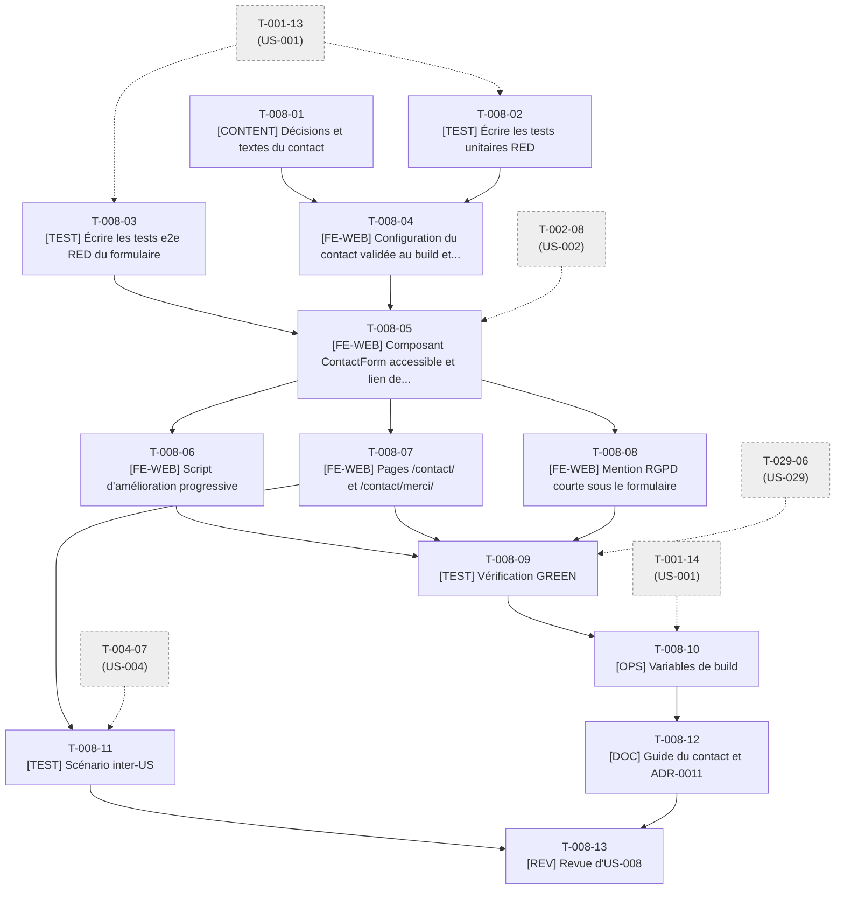

# Tâches - US-008 : Page contact avec motif, anti-spam et prise de RDV

## Informations US
- **Epic** : EPIC-002 : Profil et CV
- **Persona** : P-002 : Marc, dirigeant e-commerce B2B qui cherche un expert en mission
- **Story Points** : 3
- **Sprint** : sprint-001-walking_skeleton
- **Lot de travail** : Lot 3B : Légal et contact (voir [README](README.md))
- **Fichier US** : `project-management/backlog/user-stories/` (US-008)

## Résumé de la US
**En tant que** P-002 : Marc, dirigeant e-commerce B2B qui cherche un expert en mission  
**Je veux** envoyer un message en indiquant mon motif (mission, poste, autre) ou réserver directement un créneau  
**Afin de** qualifier mon besoin avec Thibaut en moins de 5 minutes, sans attendre une réponse par e-mail

## Vue d'ensemble des tâches

| ID | Type | Tâche | Estimation | Responsable | Dépend de | Statut |
|----|------|-------|------------|-------------|-----------|--------|
| T-008-01 | [CONTENT] | Décisions et textes du contact : motifs, messages, repli, mode d'envoi | 2h | PO | - | 🔄 |
| T-008-02 | [TEST] | Écrire les tests unitaires RED : validation, anti-spam, payload, gestion des réponses | 4h | Dev | T-001-13 | ✅ |
| T-008-03 | [TEST] | Écrire les tests e2e RED du formulaire (Web3Forms simulé par `page.route`) | 4h | Dev | T-001-13 | ✅ |
| T-008-04 | [FE-WEB] | Configuration du contact validée au build et `contact.ts` (GREEN) | 4h | Dev | T-008-01, T-008-02 | ✅ |
| T-008-05 | [FE-WEB] | Composant `ContactForm` accessible et lien de RDV | 5h | Dev | T-008-03, T-008-04, T-002-08 | ✅ |
| T-008-06 | [FE-WEB] | Script d'amélioration progressive : validation, envoi `fetch`, états | 4h | Dev | T-008-05 | ✅ |
| T-008-07 | [FE-WEB] | Pages `/contact/` et `/contact/merci/` (remplacent la page d'attente) | 2,5h | Dev | T-008-05 | ✅ |
| T-008-08 | [FE-WEB] | Mention RGPD courte sous le formulaire | 1h | Dev | T-008-05 | ✅ |
| T-008-09 | [TEST] | Vérification GREEN : e2e, axe, Lighthouse, envoi réel unique | 2,5h | Dev | T-008-06, T-008-07, T-008-08, T-029-06 | ✅ |
| T-008-10 | [OPS] | Variables de build, CSP et console propre | 1,5h | Dev | T-008-09, T-001-14 | 🔄 |
| T-008-11 | [TEST] | Scénario inter-US : de l'accueil au formulaire avec le motif « Poste » | 1h | Dev | T-008-07, T-004-07 | 🔄 |
| T-008-12 | [DOC] | Guide du contact et ADR-0011 | 1h | Dev | T-008-10 | ✅ |
| T-008-13 | [REV] | Revue d'US-008 (DoD §1, §3, §4, §6) | 2h | Dev | T-008-11, T-008-12 | 🔄 |

**Total estimé** : 34,5h (13 tâches)

## Couverture des critères d'acceptance

| Scénario ou critère | Tâches |
|---------------------|--------|
| Envoi d'un message avec motif (message de succès < 3 s) | T-008-02, T-008-03, T-008-06, T-008-07 |
| Motif pré-sélectionné depuis `?motif=poste` | T-008-03, T-008-04, T-008-05 |
| Prise de RDV directe (nouvel onglet, noopener noreferrer) | T-008-03, T-008-05 |
| Champ obligatoire manquant (message, focus, aucun envoi) | T-008-02, T-008-03, T-008-06 |
| Envoi détecté comme robot (honeypot, < 3 s) : faux succès | T-008-02, T-008-03, T-008-06 |
| Service indisponible (message + mailto + saisie conservée) | T-008-02, T-008-03, T-008-06 |
| Mention RGPD et lien `/vie-privee/#formulaire` | T-008-08, T-008-09 |
| Parcours depuis l'accueil (inter-US) | T-008-11 |

## Graphe de dépendances

---

## Détail des tâches

### T-008-01 : Décisions et textes du contact : motifs, messages, repli, mode d'envoi
- **Type** : [CONTENT]
- **US** : US-008
- **Estimation** : 2h
- **Responsable** : PO
- **Dépend de** : -
- **Débloque** : T-008-04
- **Statut** : 🔄 En cours

**Description** :  
Figer : motifs `mission | poste | autre` et libellés ; messages exacts (« Veuillez renseigner votre adresse e-mail. », « Merci, votre message est bien envoyé. Réponse sous 48 h ouvrées. », « L'envoi a échoué. Écrivez-moi directement à l'adresse ci-dessous. ») ; adresse e-mail publique de repli (dédiée) ; URL Calendly ; libellé « Réserver un créneau de 30 min ». **Décision à trancher** (point d'attention n°3) : envoi par `fetch` seul (recommandé par security.md, `form-action 'self'`) avec repli `mailto` dans `<noscript>`, au lieu d'un envoi natif sans JavaScript (qui exigerait `form-action https://api.web3forms.com`). Rédiger ADR-0011.

**Fichiers visés** :
- `docs/adr/0011-mode-envoi-formulaire.md`
- (textes repris par T-008-04)

**Critère de fin vérifiable** :
- [ ] Décision « fetch seul » ou « envoi natif » validée par le PO et consignée dans ADR-0011
- [ ] Textes validés, accents et espaces insécables corrects
- [ ] Aucun téléphone ni adresse postale

### T-008-02 : Écrire les tests unitaires RED : validation, anti-spam, payload, gestion des réponses
- **Type** : [TEST]
- **US** : US-008
- **Estimation** : 4h
- **Responsable** : Dev
- **Dépend de** : T-001-13
- **Débloque** : T-008-04
- **Statut** : ✅ Done

**Description** :  
`tests/unit/lib/contact.test.ts` : `validateContact` (messages exacts par champ, e-mail invalide), `parseMotif` (valeurs connues, défaut), `isBot` (champ piège rempli ou délai < 3 s, horloge injectée), `buildPayload` (access_key, name, email, motif, message, botcheck vide, `subject` préfixé `[Mission]`/`[Poste]`/`[Autre]`), `interpretResponse` (200 succès ; 4xx message du service ; réseau/5xx → repli e-mail), `tests/unit/config/contact.test.ts` (schéma : motifs, URL de RDV https, e-mail de repli).

**Fichiers visés** :
- `tests/unit/lib/contact.test.ts`
- `tests/unit/config/contact.test.ts`

**Critère de fin vérifiable** :
- [ ] Tests rouges (RED)
- [ ] Chaque scénario d'erreur de Gherkin est couvert par au moins un cas

### T-008-03 : Écrire les tests e2e RED du formulaire (Web3Forms simulé par `page.route`)
- **Type** : [TEST]
- **US** : US-008
- **Estimation** : 4h
- **Responsable** : Dev
- **Dépend de** : T-001-13
- **Débloque** : T-008-05
- **Statut** : ✅ Done

**Description** :  
`tests/e2e/contact.spec.ts` : envoi nominal (requête simulée 200, redirection vers `/contact/merci/?motif=mission`, message de succès affiché en < 3 s) ; `?motif=poste` pré-sélectionne « Poste » ; lien RDV avec `target="_blank"` et `rel="noopener noreferrer"` ; champ e-mail vide : message sous le champ, focus sur le champ, aucune requête ; champ piège rempli ou envoi < 3 s : aucune requête, faux succès ; réponse 503 ou réseau coupé : message + lien `mailto` + saisie conservée ; étiquettes liées, `aria-describedby` ; mention RGPD avec lien `/vie-privee/#formulaire` ; aucune requête tierce au chargement ; cibles ≥ 44 px.

**Fichiers visés** :
- `tests/e2e/contact.spec.ts`

**Critère de fin vérifiable** :
- [ ] `make e2e` : `contact.spec.ts` échoue (RED)
- [ ] Aucun appel réel à Web3Forms dans la suite

### T-008-04 : Configuration du contact validée au build et `contact.ts` (GREEN)
- **Type** : [FE-WEB]
- **US** : US-008
- **Estimation** : 4h
- **Responsable** : Dev
- **Dépend de** : T-008-01, T-008-02
- **Débloque** : T-008-05
- **Statut** : ✅ Done

**Description** :  
Implémenter `src/config/contact.ts` (schéma Zod : motifs, URL Calendly, e-mail de repli ; clé `PUBLIC_WEB3FORMS_KEY` lue via `import.meta.env`, build en échec si absente en production) et `src/lib/contact.ts` (fonctions pures de T-008-02).

**Fichiers visés** :
- `src/config/contact.ts`
- `src/lib/contact.ts`

**Critère de fin vérifiable** :
- [ ] Tests de T-008-02 verts ; couverture `src/lib/contact.ts` ≥ 90 %
- [ ] Build en échec explicite si la clé est absente (variable documentée dans `.env.example`)

### T-008-05 : Composant `ContactForm` accessible et lien de RDV
- **Type** : [FE-WEB]
- **US** : US-008
- **Estimation** : 5h
- **Responsable** : Dev
- **Dépend de** : T-008-03, T-008-04, T-002-08
- **Débloque** : T-008-06, T-008-07, T-008-08
- **Statut** : ✅ Done

**Description** :  
Créer `src/components/contact/ContactForm.astro` : champs Nom, E-mail, Motif (liste), Message ; étiquettes liées, zone d'erreur `aria-live`, `autocomplete` adapté, champ piège masqué (`aria-hidden`, `tabindex=-1`), horodatage d'ouverture, cibles ≥ 44 px, repli `<noscript>` avec `mailto` (selon ADR-0011) ; `RdvLink.astro` (nouvel onglet, `noopener noreferrer`, libellé « Réserver un créneau de 30 min »). Composants < 150 lignes.

**Fichiers visés** :
- `src/components/contact/ContactForm.astro`
- `src/components/contact/RdvLink.astro`

**Critère de fin vérifiable** :
- [ ] Aucune erreur axe ; étiquettes et `aria-describedby` corrects
- [ ] Aucun script tiers au chargement
- [ ] `href` du RDV lu depuis la configuration

### T-008-06 : Script d'amélioration progressive : validation, envoi `fetch`, états
- **Type** : [FE-WEB]
- **US** : US-008
- **Estimation** : 4h
- **Responsable** : Dev
- **Dépend de** : T-008-05
- **Débloque** : T-008-09
- **Statut** : ✅ Done

**Description** :  
Écrire `src/components/contact/contact-form.ts` (module externe) : validation côté client avec focus sur le premier champ en erreur, anti-spam (champ piège, délai 3 s → faux succès sans envoi), `fetch` JSON vers `https://api.web3forms.com/submit`, redirection vers `/contact/merci/?motif=…`, gestion des erreurs 4xx/5xx/réseau avec repli, saisie conservée. Pas d'événement de mesure ici (US-026).

**Fichiers visés** :
- `src/components/contact/contact-form.ts`

**Critère de fin vérifiable** :
- [ ] Scénarios Gherkin d'erreur de `contact.spec.ts` verts
- [ ] Script < 5 Ko gzip
- [ ] Aucune violation CSP en console

### T-008-07 : Pages `/contact/` et `/contact/merci/` (remplacent la page d'attente)
- **Type** : [FE-WEB]
- **US** : US-008
- **Estimation** : 2,5h
- **Responsable** : Dev
- **Dépend de** : T-008-05
- **Débloque** : T-008-09, T-008-11
- **Statut** : ✅ Done

**Description** :  
Remplacer `src/pages/contact/index.astro` (h1, formulaire, RDV, motif pré-sélectionné via `?motif=`) et créer `src/pages/contact/merci/index.astro` (message de succès exact, `noindex`, motif relu dans l'URL). `Seo` avec title/description propres.

**Fichiers visés** :
- `src/pages/contact/index.astro`
- `src/pages/contact/merci/index.astro`

**Critère de fin vérifiable** :
- [ ] Le motif `?motif=poste` pré-sélectionne « Poste »
- [ ] La page de remerciement affiche le message exact et n'est pas indexable

### T-008-08 : Mention RGPD courte sous le formulaire
- **Type** : [FE-WEB]
- **US** : US-008
- **Estimation** : 1h
- **Responsable** : Dev
- **Dépend de** : T-008-05
- **Débloque** : T-008-09
- **Statut** : ✅ Done

**Description** :  
Créer `PrivacyNotice.astro` : finalité, sous-traitant Web3Forms (États-Unis), durée de conservation, lien « En savoir plus » vers `/vie-privee/#formulaire`. Textes alignés sur ceux de T-029-06 (contrat : ancre `formulaire`).

**Fichiers visés** :
- `src/components/contact/PrivacyNotice.astro`

**Critère de fin vérifiable** :
- [ ] La mention est visible avant l'envoi
- [ ] Le lien pointe vers `/vie-privee/#formulaire` (ancre présente après T-029-06)

### T-008-09 : Vérification GREEN : e2e, axe, Lighthouse, envoi réel unique
- **Type** : [TEST]
- **US** : US-008
- **Estimation** : 2,5h
- **Responsable** : Dev
- **Dépend de** : T-008-06, T-008-07, T-008-08, T-029-06
- **Débloque** : T-008-10
- **Statut** : ✅ Done

**Description** :  
`make ci` complet (y compris vérification des ancres `#formulaire`). Un envoi réel unique avec la vraie clé depuis `preview` pour valider la bout-en-bout (réception de l'e-mail). Corriger les écarts.

**Fichiers visés** :
- (corrections dans les fichiers des tâches T-008-04 à T-008-08)

**Critère de fin vérifiable** :
- [ ] `make ci` vert
- [ ] Lighthouse ≥ 95 sur `/contact/`
- [ ] E-mail de test reçu (capture)

### T-008-10 : Variables de build, CSP et console propre
- **Type** : [OPS]
- **US** : US-008
- **Estimation** : 1,5h
- **Responsable** : Dev
- **Dépend de** : T-008-09, T-001-14
- **Débloque** : T-008-12
- **Statut** : 🔄 En cours

**Description** :  
Vérifier `PUBLIC_WEB3FORMS_KEY` dans Railway et dans GitHub (variable, non secrète), dans `.env.example`, et que le conteneur `preview` n'émet aucune violation CSP (`connect-src` Web3Forms). Si un ajustement de la CSP est nécessaire, le signaler à l'orchestrateur (fichier réservé à US-001).

**Fichiers visés** :
- `.env.example` (relecture)

**Critère de fin vérifiable** :
- [ ] Variable présente dans Railway et GitHub
- [ ] 0 `securitypolicyviolation` pendant un envoi simulé et réel

### T-008-11 : Scénario inter-US : de l'accueil au formulaire avec le motif « Poste »
- **Type** : [TEST]
- **US** : US-008
- **Estimation** : 1h
- **Responsable** : Dev
- **Dépend de** : T-008-07, T-004-07
- **Débloque** : T-008-13
- **Statut** : 🔄 En cours

**Description** :  
Ajouter à `contact.spec.ts` le scénario Gherkin « Parcours Me recruter » : clic sur « Me recruter » sur `/` → `/contact/` avec « Poste » pré-sélectionné en < 1 s. À exécuter une fois US-004 intégrée.

**Fichiers visés** :
- `tests/e2e/contact.spec.ts`

**Critère de fin vérifiable** :
- [ ] Scénario vert sur la branche intégrée
- [ ] Délai de navigation < 1 s mesuré

### T-008-12 : Guide du contact et ADR-0011
- **Type** : [DOC]
- **US** : US-008
- **Estimation** : 1h
- **Responsable** : Dev
- **Dépend de** : T-008-10
- **Débloque** : T-008-13
- **Statut** : ✅ Done

**Description** :  
`docs/guides/contact.md` : services (Web3Forms, Calendly), variables, anti-spam, test local, procédure en cas de clé révoquée. Finaliser ADR-0011. Entrée CHANGELOG.

**Fichiers visés** :
- `docs/guides/contact.md`
- `docs/adr/0011-mode-envoi-formulaire.md`
- `CHANGELOG.md`

**Critère de fin vérifiable** :
- [ ] ADR-0011 « Accepté »
- [ ] Guide testé par application des commandes

### T-008-13 : Revue d'US-008 (DoD §1, §3, §4, §6)
- **Type** : [REV]
- **US** : US-008
- **Estimation** : 2h
- **Responsable** : Dev
- **Dépend de** : T-008-11, T-008-12
- **Débloque** : -
- **Statut** : 🔄 En cours

**Description** :  
Revue du code, de la sécurité (A05/A07 : aucun secret, honeypot, validation, CSP), de l'accessibilité du formulaire et du RGPD.

**Fichiers visés** :
- (revue ; aucun fichier produit)

**Critère de fin vérifiable** :
- [ ] Checklist DoD §1, §3, §4, §6 cochée
- [ ] Commentaires traités

