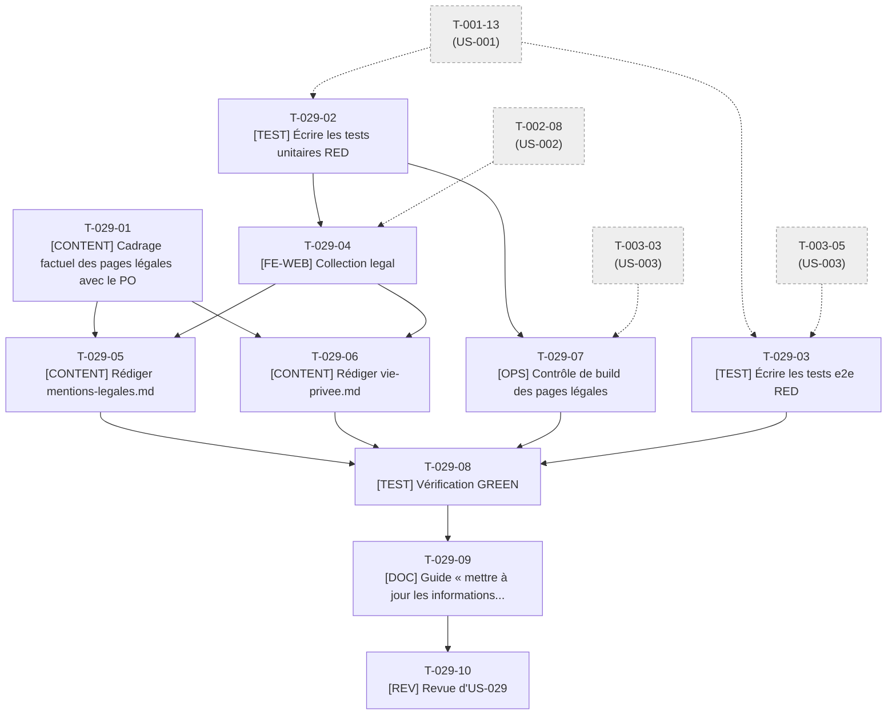

# Tâches - US-029 : Mentions légales et politique de vie privée

## Informations US
- **Epic** : EPIC-001 : Socle et walking skeleton
- **Persona** : P-002 : Marc, dirigeant e-commerce B2B qui cherche un expert en mission
- **Story Points** : 2
- **Sprint** : sprint-001-walking_skeleton
- **Lot de travail** : Lot 3B : Légal et contact (voir [README](README.md))
- **Fichier US** : `project-management/backlog/user-stories/` (US-029)

## Résumé de la US
**En tant que** P-002 : Marc, dirigeant e-commerce B2B qui cherche un expert en mission  
**Je veux** savoir qui édite le site, qui l'héberge et ce que deviennent les données que je saisis dans le formulaire de contact  
**Afin de** prendre contact en confiance, avec un prestataire qui applique lui-même les obligations légales (LCEN, RGPD) qu'il conseille à ses clients

## Vue d'ensemble des tâches

| ID | Type | Tâche | Estimation | Responsable | Dépend de | Statut |
|----|------|-------|------------|-------------|-----------|--------|
| T-029-01 | [CONTENT] | Cadrage factuel des pages légales avec le PO | 2h | PO | - | 🔄 |
| T-029-02 | [TEST] | Écrire les tests unitaires RED : config légale, frontmatter, données interdites | 2,5h | Dev | T-001-13 | ✅ |
| T-029-03 | [TEST] | Écrire les tests e2e RED : contenus légaux et liens du pied de page | 3h | Dev | T-001-13, T-003-05 | ✅ |
| T-029-04 | [FE-WEB] | Collection `legal`, configuration `legal.ts`, composant et pages (remplacent les pages d'attente) | 4h | Dev | T-029-02, T-002-08 | ✅ |
| T-029-05 | [CONTENT] | Rédiger `mentions-legales.md` | 2h | Dev | T-029-01, T-029-04 | ✅ |
| T-029-06 | [CONTENT] | Rédiger `vie-privee.md` (section `#formulaire`, droits, cookies) | 3h | Dev | T-029-01, T-029-04 | ✅ |
| T-029-07 | [OPS] | Contrôle de build des pages légales : données personnelles interdites | 1,5h | Dev | T-029-02, T-003-03 | ✅ |
| T-029-08 | [TEST] | Vérification GREEN : e2e, axe, Lighthouse, ancres | 1,5h | Dev | T-029-05, T-029-06, T-029-07, T-029-03 | ✅ |
| T-029-09 | [DOC] | Guide « mettre à jour les informations légales » et CHANGELOG | 0,5h | Dev | T-029-08 | ✅ |
| T-029-10 | [REV] | Revue d'US-029 (juridique, DoD §1, §2, §6) | 1h | Dev | T-029-09 | 🔄 |

**Total estimé** : 21h (10 tâches)

## Couverture des critères d'acceptance

| Scénario ou critère | Tâches |
|---------------------|--------|
| Consultation des mentions légales (éditeur, directeur de publication, hébergeur) | T-029-03, T-029-05 |
| Information RGPD sous le formulaire (renvoi `#formulaire`) | T-029-03, T-029-06, T-008-08 |
| Exercice des droits, CNIL, « Ce site ne dépose aucun cookie » | T-029-03, T-029-06 |
| Donnée personnelle interdite dans les pages légales | T-029-02, T-029-07 |
| Lien légal manquant (« Liens légaux absents sur <URL> ») | T-029-03 |

## Graphe de dépendances

---

## Détail des tâches

### T-029-01 : Cadrage factuel des pages légales avec le PO
- **Type** : [CONTENT]
- **US** : US-029
- **Estimation** : 2h
- **Responsable** : PO
- **Dépend de** : -
- **Débloque** : T-029-05, T-029-06
- **Statut** : 🔄 En cours

**Description** :  
Réunir les informations : statut de l'éditeur (particulier ou portage salarial) et moyen de contact **sans adresse ni téléphone** (`contactUrl`), directeur de la publication, hébergeur Railway (raison sociale, adresse, téléphone publics), finalité et base légale du formulaire, durée de conservation des e-mails, sous-traitants (Web3Forms, Umami Cloud, Calendly), contact pour exercer les droits. Prévoir la relecture par la société de portage.

**Fichiers visés** :
- (informations reportées dans T-029-04, T-029-05, T-029-06)

**Critère de fin vérifiable** :
- [ ] Tableau d'informations validé par le PO
- [ ] Aucune adresse personnelle ni téléphone personnel dans les réponses
- [ ] Source citée pour les données de l'hébergeur

### T-029-02 : Écrire les tests unitaires RED : config légale, frontmatter, données interdites
- **Type** : [TEST]
- **US** : US-029
- **Estimation** : 2,5h
- **Responsable** : Dev
- **Dépend de** : T-001-13
- **Débloque** : T-029-04, T-029-07
- **Statut** : ✅ Done

**Description** :  
`tests/unit/config/legal.test.ts` (`legalSchema` : éditeur sans adresse ni téléphone, `host` requis), `tests/unit/content/legal-schema.test.ts` (frontmatter : `title`, `description`, `updatedDate` obligatoires), `tests/unit/checks/legal-pii.test.ts` (message « Donnée personnelle interdite dans <fichier> : <type> » pour téléphone, adresse).

**Fichiers visés** :
- `tests/unit/config/legal.test.ts`
- `tests/unit/content/legal-schema.test.ts`
- `tests/unit/checks/legal-pii.test.ts`

**Critère de fin vérifiable** :
- [ ] Tests rouges (RED)
- [ ] Types de données détectés cohérents avec `detectPii` de T-001-06

### T-029-03 : Écrire les tests e2e RED : contenus légaux et liens du pied de page
- **Type** : [TEST]
- **US** : US-029
- **Estimation** : 3h
- **Responsable** : Dev
- **Dépend de** : T-001-13, T-003-05
- **Débloque** : T-029-08
- **Statut** : ✅ Done

**Description** :  
`tests/e2e/legal.spec.ts` : sur toutes les routes découvertes (`discoverRoutes`), les liens « Mentions légales » et « Vie privée » sont présents (message « Liens légaux absents sur <URL> ») ; `/mentions-legales/` affiche éditeur, directeur de la publication, hébergeur ; `/vie-privee/` affiche droits, lien CNIL, « Ce site ne dépose aucun cookie », ancre `#formulaire`, `dateModified` visible ; pages indexables (pas de `noindex`) ; hiérarchie des titres.

**Fichiers visés** :
- `tests/e2e/legal.spec.ts`

**Critère de fin vérifiable** :
- [ ] `make e2e` : `legal.spec.ts` échoue (RED)
- [ ] Le message d'erreur exact est présent dans l'assertion

### T-029-04 : Collection `legal`, configuration `legal.ts`, composant et pages (remplacent les pages d'attente)
- **Type** : [FE-WEB]
- **US** : US-029
- **Estimation** : 4h
- **Responsable** : Dev
- **Dépend de** : T-029-02, T-002-08
- **Débloque** : T-029-05, T-029-06
- **Statut** : ✅ Done

**Description** :  
Créer `src/content/schemas/legal.ts` et enregistrer la collection `legal` (loader `glob` sur `src/content/legal`, ajout d'une ligne dans `content.config.ts`, zone append-only) ; `src/config/legal.ts` validé par `legalSchema` (éditeur, directeur de publication, hébergeur) ; `src/components/ui/LegalDocument.astro` (rendu Markdown, ancres de titres, « Mis à jour le … ») ; remplacer `mentions-legales.astro` et `vie-privee.astro`. Le pied de page est déjà fourni par US-002 : ne pas le modifier.

**Fichiers visés** :
- `src/content/schemas/legal.ts`
- `src/content.config.ts`
- `src/config/legal.ts`
- `src/components/ui/LegalDocument.astro`
- `src/pages/mentions-legales.astro`
- `src/pages/vie-privee.astro`

**Critère de fin vérifiable** :
- [ ] Les tests de T-029-02 sont verts
- [ ] `astro build` valide le frontmatter (échec si `updatedDate` absent)
- [ ] Les deux routes répondent et ne sont plus des pages d'attente

### T-029-05 : Rédiger `mentions-legales.md`
- **Type** : [CONTENT]
- **US** : US-029
- **Estimation** : 2h
- **Responsable** : Dev
- **Dépend de** : T-029-01, T-029-04
- **Débloque** : T-029-08
- **Statut** : ✅ Done

**Description** :  
Rédiger `src/content/legal/mentions-legales.md` : éditeur, directeur de la publication, hébergeur (raison sociale, adresse, téléphone de l'hébergeur), propriété intellectuelle, contact. Frontmatter avec `updatedDate`. Français juridique clair, accents et espaces insécables.

**Fichiers visés** :
- `src/content/legal/mentions-legales.md`

**Critère de fin vérifiable** :
- [ ] Contenu conforme aux obligations LCEN du cadrage
- [ ] Aucun téléphone ni adresse de l'éditeur
- [ ] Relecture PO (et société de portage si applicable)

### T-029-06 : Rédiger `vie-privee.md` (section `#formulaire`, droits, cookies)
- **Type** : [CONTENT]
- **US** : US-029
- **Estimation** : 3h
- **Responsable** : Dev
- **Dépend de** : T-029-01, T-029-04
- **Débloque** : T-008-09, T-029-08
- **Statut** : ✅ Done

**Description** :  
Rédiger `src/content/legal/vie-privee.md` : finalité, base légale, sous-traitants (Web3Forms aux États-Unis, Umami Cloud sans cookie, Calendly lien sortant), durée de conservation, droits (accès, rectification, effacement), contact, recours CNIL, « Ce site ne dépose aucun cookie ». Section titrée de sorte que l'ancre **`#formulaire`** existe (contrat avec T-008-08).

**Fichiers visés** :
- `src/content/legal/vie-privee.md`

**Critère de fin vérifiable** :
- [ ] Ancre `#formulaire` présente dans `dist/vie-privee/index.html`
- [ ] Mention de l'absence de cookie présente
- [ ] Relecture PO (et société de portage si applicable)

### T-029-07 : Contrôle de build des pages légales : données personnelles interdites
- **Type** : [OPS]
- **US** : US-029
- **Estimation** : 1,5h
- **Responsable** : Dev
- **Dépend de** : T-029-02, T-003-03
- **Débloque** : T-029-08
- **Statut** : ✅ Done

**Description** :  
Écrire `scripts/checks/legal-pii.content.check.ts` : scan de `src/content/legal/*.md` et `src/config/legal.ts` avec `detectPii`, message « Donnée personnelle interdite dans <fichier> : <type> ». Les coordonnées publiques de l'hébergeur (clé `host`) sont explicitement exclues du scan.

**Fichiers visés** :
- `scripts/checks/legal-pii.content.check.ts`

**Critère de fin vérifiable** :
- [ ] `npm run checks:content` vert avec le contenu final
- [ ] Un numéro de mobile ajouté dans `mentions-legales.md` fait échouer le contrôle avec le message attendu

### T-029-08 : Vérification GREEN : e2e, axe, Lighthouse, ancres
- **Type** : [TEST]
- **US** : US-029
- **Estimation** : 1,5h
- **Responsable** : Dev
- **Dépend de** : T-029-05, T-029-06, T-029-07, T-029-03
- **Débloque** : T-029-09
- **Statut** : ✅ Done

**Description** :  
`make ci` complet : `legal.spec.ts` vert, axe, Lighthouse ≥ 95 sur les deux pages, LCP < 1,5 s, vérification de l'ancre `#formulaire`.

**Fichiers visés** :
- (corrections dans les fichiers des tâches T-029-04 à T-029-07)

**Critère de fin vérifiable** :
- [ ] `make ci` vert
- [ ] Lighthouse ≥ 95 sur `/mentions-legales/` et `/vie-privee/`

### T-029-09 : Guide « mettre à jour les informations légales » et CHANGELOG
- **Type** : [DOC]
- **US** : US-029
- **Estimation** : 0,5h
- **Responsable** : Dev
- **Dépend de** : T-029-08
- **Débloque** : T-029-10
- **Statut** : ✅ Done

**Description** :  
`docs/guides/pages-legales.md` : où modifier `legal.ts` et les Markdown, règle de `updatedDate`, rappel de relecture. Entrée CHANGELOG.

**Fichiers visés** :
- `docs/guides/pages-legales.md`
- `CHANGELOG.md`

**Critère de fin vérifiable** :
- [ ] Guide présent
- [ ] CHANGELOG à jour

### T-029-10 : Revue d'US-029 (juridique, DoD §1, §2, §6)
- **Type** : [REV]
- **US** : US-029
- **Estimation** : 1h
- **Responsable** : Dev
- **Dépend de** : T-029-09
- **Débloque** : -
- **Statut** : 🔄 En cours

**Description** :  
Revue du contenu (LCEN, RGPD, cohérence avec les intégrations réelles : Web3Forms, Umami, Calendly), de l'absence de donnée personnelle et de l'accessibilité.

**Fichiers visés** :
- (revue ; aucun fichier produit)

**Critère de fin vérifiable** :
- [ ] Checklist DoD §1, §2, §6 cochée
- [ ] Validation PO avant mise en production

