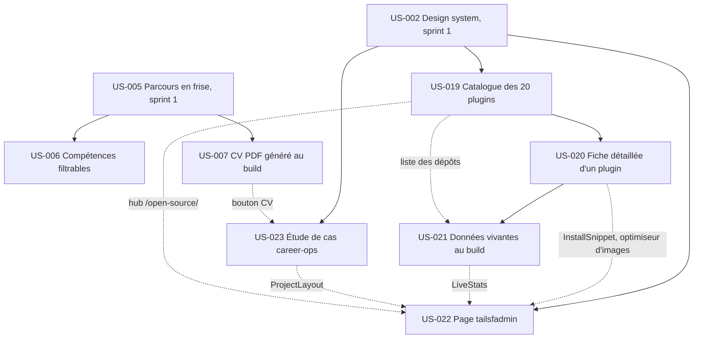

# Sprint 002 : dépendances

Le détail par tâche (graphe Mermaid, chemin critique, contrats entre lots) est dans `tasks/README.md`.

Traits pleins : dépendances du backlog. Pointillés : contrats techniques ajoutés à la décomposition (aucun cycle).

| US | Bloquée par | Bloque (dans le sprint) | Bloque (hors sprint) |
|----|-------------|-------------------------|----------------------|
| US-006 | US-005 (sprint 1) | — | — |
| US-007 | US-005 (sprint 1) | — (contrat souple : bouton CV repris par US-023) | US-026 |
| US-019 | US-002 (sprint 1) | US-020 | US-024 |
| US-020 | US-019 (livrée et déployée avec elle, E3) | US-021 | US-024, US-028 |
| US-021 | US-020 (contrat souple avec la liste des dépôts d'US-019) | — (contrat souple : `LiveStats` repris par US-022) | — |
| US-022 | US-002 (sprint 1) ; liens souples avec US-020, US-021, US-023, US-019 | — | US-024 |
| US-023 | US-002 (sprint 1) | — | US-024 |

## Ordre d'exécution

- **Lot 1 (W1)** : US-007, US-006.
- **Lot 2 (W2)** : US-019, puis US-020, puis l'affichage d'US-021. US-019 et US-020 forment une branche groupée, déployée et passée à « Done » ensemble.
- **Lot 3 (W3)** : US-023 et la collecte d'US-021 (script, JSON, `metrics.yml`), puis US-022.
- Ordre de fusion des zones partagées : 007, 006, 019+020, 021 (collecte puis affichage), 023, 022.

## Report vers le sprint 3

JSON-LD (`ItemList`, `SoftwareSourceCode`, `BreadcrumbList`, `Article`) reporté à US-024 pour US-019, US-020, US-022 et US-023 (E15). Recherche par Pagefind avec US-012 (E16).

## Prérequis hors backlog

Détail et suivi : voir `pre-sprint-checklist.md`.

- [ ] Validation PO de US-001 et US-029 (`done-pending-po`)
- [ ] Domaine, clé Web3Forms, compte Umami, Calendly, `RAILWAY_TOKEN` et `SMOKE_URL` (repli documenté pour chacun)
- [ ] Jeton GitHub à portée limitée pour la collecte des métriques, ou réouverture manuelle de la PR (E13, choix en T-021-01)
- [ ] Capture de l'application de démo tailsfadmin fournie par le PO (facultative : sans elle, page sans image, E18)
- [ ] Publication de `sylius-agentic-feeds-plugin` sur Packagist (sans elle, fiche sans lien Packagist ni métrique, E20)
- [ ] Liste des clients citables validée par le PO en T-006-01 (sans elle, références anonymisées, E12)
- [ ] Confirmation PO de l'exclusion de Punchout cXML (20 plugins, E4)
