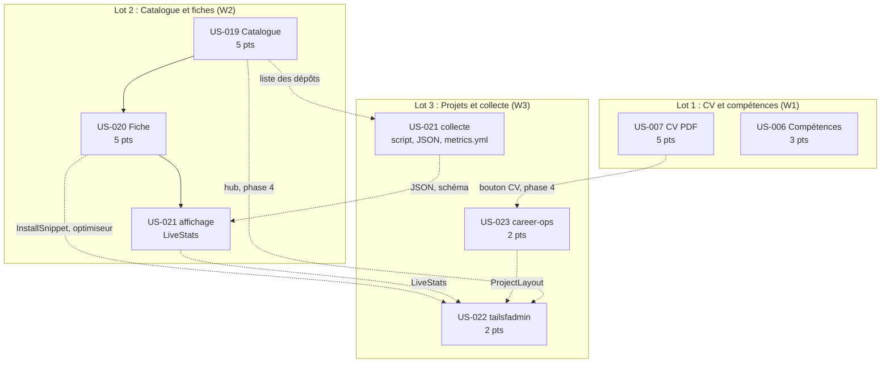

# Tâches du Sprint 002 : Preuves : profil complet et open source

> Sprint Planning partie 2 (le COMMENT). Le sprint 1 est livré sur `main` : la décomposition part de l’existant et ne replanifie rien de ce qui existe. Stack : site statique Astro 7.3.8 / TypeScript 6.0.3 / Tailwind 4.3.3, entièrement dockerisé, nginx 1.30.5 sur Railway, CI GitHub Actions. Sources faisant foi : `project-management/tech-spec.md`, `docs/adr/0001` à `0010` (surtout 0005 Typst, 0006 métriques, 0008 URL et collections), `project-management/architecture/content-model.md`, `project-management/definition-of-done.md`, format et arbitrages du sprint 1.

## Existant réutilisé (non replanifié)

| Élément livré au sprint 1 | Usage dans ce sprint |
|---------------------------|----------------------|
| Étape `typst` du `Dockerfile` (binaire seul, `ghcr.io/typst/typst:0.15.1`, digest épinglé), `runtime` dernière étape | US-007 la prolonge (copie du binaire dans `deps`, extraction de texte) sans toucher à `runtime` |
| Collection `experiences` (7 entrées), `lib/experiences.ts` (tri, règle des 10 ans), `src/data/tokens.json` | Source unique du CV Typst (US-007) ; tri et partition réutilisés (DRY) |
| `src/content.config.ts` (zone append-only), `src/content/schemas/common.ts` (`safeText`, `slug`, `httpsUrl`, `repoRef`) | Chaque US ajoute une collection ; briques de validation réutilisées |
| `src/lib/privacy.ts` (`detectPii`, arbitrage A1 : « 25 ans d’expérience » autorisé) | Contrôle du texte du PDF (US-007) et des contenus (US-006, 019 à 023) |
| `scripts/checks/run.ts` et `lib/runner.ts` (découverte `*.content.check.ts` / `*.dist.check.ts`) | Un contrôle par US, sans liste centrale à éditer |
| `scripts/checks/internal-links.dist.check.ts` (liens internes bloquants, externes en avertissement), `placeholders.dist.check.ts`, `proof-links.dist.check.ts` | Gardent les pages du sprint ; les liens externes de la vitrine deviennent bloquants dans un job séparé (E14) |
| `src/config/nav.ts` (liens pilotés par `enabled`, arbitrage A4) | Entrées `competences` et `open-source` ajoutées par leur US |
| `tests/e2e/` (a11y, pages-matrix, headers ; `helpers/routes.ts` explore les liens internes), `E2E_EXPECT_FULL_CONFIG` | Une page non liée n’est ni testée par axe ni par la matrice : chaque page est liée depuis la navigation ou le hub |
| `scripts/checks/lighthouse.ts` (pages découvertes dans `dist/`), `smoke.ts` (`OK_PATHS`) | Nouvelles pages couvertes automatiquement ; `OK_PATHS` étendu en phase 4 |
| `nginx.conf` : bloc `.pdf` en cache 30 jours, snippet d’en-têtes à réinclure dans chaque `location` | À corriger pour le CV (revalidation), E9 |
| `.github/workflows/ci.yml` (jobs `quality`, `e2e`, `dockerfile`, `supply-chain`, `ci`), `scheduled.yml` | `ci.yml` reçoit un job de liens externes ; `metrics.yml` créé |
| Guides `docs/guides/*`, `CHANGELOG.md` (ajout seul), ADR 0001 à 0010 | Un guide par sujet ; pas de nouvel ADR attendu (amendements courts d’ADR-0005 et ADR-0006) |

## Adaptation de la méthode

Mêmes types que le sprint 1 : pas de `[DB]`, `[BE]` ni `[FE-MOB]` (ni base de données, ni API, ni application mobile).

| Type | Contenu |
|------|---------|
| `[OPS]` | Dockerfile, nginx, Makefile, CI, scripts de build et de contrôle (`scripts/`) |
| `[FE-WEB]` | Pages, composants et scripts Astro, schémas Zod, bibliothèques TypeScript pures (`src/lib/`), gabarit Typst |
| `[CONTENT]` | YAML, MDX, rédaction, vérification des faits, captures |
| `[TEST]` | Vitest, Playwright, axe ; **écrits avant le code (RED)**, e2e **stricts** (aucun `test.skip` inattendu) |
| `[DOC]` | Guides, ADR (amendements), CHANGELOG |
| `[REV]` | Revue de code et de contenu |

Chaque US reste une tranche verticale : contenu validé par schéma, page rendue, test de bout en bout, déploiement. Les tâches « Phase 4 » rattachées à une US (`T-019-14`, `T-023-14`, `T-023-15`, `T-022-11`) modifient des fichiers d’autres lots et s’exécutent après leur fusion.

## Synthèse

| Indicateur | Valeur |
|------------|--------|
| User stories | 7 (25 points) |
| Tâches | **109** (dont 7 transverses, voir `technical-tasks.md`) |
| Heures estimées | **303h** |
| Chemin critique de dépendances | 44h : T-019-01 → T-019-02 → T-019-05 → T-020-01 → T-020-03 → T-020-09 → T-020-12 → T-021-07 → T-022-07 → T-022-11 → T-900-02 → T-900-03 → T-900-04 → T-900-06 |
| Chemin critique de ressources | lot 2 (114,5h) : plus long que la chaîne de dépendances, voir « Lots » |
| Taille des tâches | 0,5h à 6h (idéal 2-4h) |

| US | Titre | Pts | Tâches | Heures | Lot | Fichier |
|----|-------|-----|--------|--------|-----|---------|
| US-007 | CV PDF téléchargeable généré au build | 5 | 16 | 45h | 1 | [US-007-tasks.md](US-007-tasks.md) |
| US-006 | Compétences et réalisations filtrables par domaine | 3 | 13 | 37h | 1 | [US-006-tasks.md](US-006-tasks.md) |
| US-019 | Catalogue des 20 plugins Sylius 2 filtrable par thème | 5 | 14 | 39,5h | 2 | [US-019-tasks.md](US-019-tasks.md) |
| US-020 | Fiche détaillée d’un plugin | 5 | 21 | 70,5h | 2 | [US-020-tasks.md](US-020-tasks.md) |
| US-021 | Données vivantes au build avec cache et repli | 3 | 12 | 33,5h | 3 (collecte) et 2 (affichage) | [US-021-tasks.md](US-021-tasks.md) |
| US-023 | Étude de cas des contributions career-ops | 2 | 15 | 37h | 3 | [US-023-tasks.md](US-023-tasks.md) |
| US-022 | Page du bundle Symfony tailsfadmin | 2 | 11 | 24,5h | 3 | [US-022-tasks.md](US-022-tasks.md) |
| Transverse | Phase 0 et phase 4 | - | 7 | 16h | 0 et 4 | [technical-tasks.md](technical-tasks.md) |
| **Total** | | **25** | **109** | **303h** | | |

| Type | Tâches | Heures |
|------|--------|--------|
| [CONTENT] | 22 | 59h |
| [TEST] | 25 | 75h |
| [OPS] | 19 | 53,5h |
| [FE-WEB] | 27 | 87h |
| [DOC] | 8 | 11,5h |
| [REV] | 8 | 17h |

Environ 12,12 h par point (sprint 1 : 9,9 h). L’écart vient du volume éditorial (20 fiches de plugins, 15 réalisations, 2 pages de projet) et du traitement des captures. Comme au sprint 1, l’exécution est agentique : l’estimation horaire sert d’ordre de grandeur et de découpage, pas d’engagement de calendrier.

## Lots de travail (parallélisation en workers)

Les lots ne partagent **aucun fichier en écriture simultanée**, à l’exception des zones append-only listées plus bas (résolues par l’orchestrateur). Workers en worktrees créés par l’orchestrateur, sans `git`, avec `COMPOSE_PROJECT_NAME` et ports hôte distincts (surcharge locale non versionnée `compose.override.yaml` : `ports: !override`, par exemple 4322/8081 pour W1, 4323/8082 pour W2, 4324/8083 pour W3). Pas d’image Playwright en local (disque) : les tests e2e se vérifient avec le Chromium système (`PW_CHROMIUM_PATH`) ou dans la CI.

| Lot | US | Heures | Worker | Démarre quand | Propriété exclusive de |
|-----|----|--------|--------|---------------|------------------------|
| **1 : CV et compétences** | US-007 puis US-006 | 82h | W1 | immédiatement (T-007-02 et T-007-03 sans prérequis) | `cv/`, `Dockerfile`, `.dockerignore`, `.gitignore`, `nginx.conf`, `scripts/build-cv.ts`, `scripts/checks/{cv-pdf,achievements}*` et `lib/{pdf-privacy,achievements}.ts`, `src/data/cv/{profile,skills,achievements}.yaml`, `src/content/schemas/{profile,skills,achievements}.ts`, `src/lib/{cv-data,filters}.ts`, `src/components/cv/{CvDownload,AchievementCard,DomainFilter}.astro`, `src/scripts/skill-filter.ts`, `src/pages/competences/`, `src/pages/parcours.astro`, `src/pages/contact/index.astro`, `tests/e2e/{cv-pdf,competences}.spec.ts`, `docs/guides/{cv-pdf,competences}.md` |
| **2 : Catalogue et fiches Sylius** | US-019 + US-020 (branche groupée), puis affichage d’US-021 | 114,5h | W2 | immédiatement | `src/content/plugins/`, `src/assets/plugins/`, `src/content/schemas/plugins.ts`, `src/lib/{plugins,plugin-deps,install}.ts`, `src/components/oss/{PluginCard,PluginGrid,ThemeFilter,CompatMatrix,PluginDeps,InstallSnippet,Gallery,LiveStats}.astro`, `src/layouts/PluginLayout.astro`, `src/pages/open-source/{index.astro,sylius/}`, `src/scripts/{plugin-filter,copy-command}.ts`, `scripts/checks/plugins*`, `astro.config.mjs`, dépendances de `package.json` et `package-lock.json`, `tests/e2e/{open-source,plugin-detail,oss-metrics}.spec.ts`, `docs/guides/{plugins-sylius,donnees-open-source}.md` |
| **3 : Projets et collecte** | US-023, collecte d’US-021, puis US-022 | 85,5h | W3 | immédiatement ; US-022 après T-020-10 et T-021-07 | `src/content/projects/`, `src/assets/projects/`, `src/content/schemas/{projects,oss-metrics}.ts`, `src/lib/{projects,oss-metrics}.ts`, `src/data/oss-metrics.json`, `src/components/oss/{ContributionCard,ProjectCard}.astro`, `src/layouts/ProjectLayout.astro`, `src/pages/open-source/{career-ops,tailsfadmin}/`, `scripts/{fetch-oss-metrics.ts,optimize-captures.ts}`, `scripts/lib/`, `scripts/checks/{projects,oss-metrics,external-links,plugin-images}*`, `.github/workflows/{ci.yml,metrics.yml}`, `compose.yaml`, `.env.example`, `tests/e2e/{career-ops,tailsfadmin}.spec.ts`, `docs/guides/projets-open-source.md` |
| **Phase 4 : intégration** | tâches « Phase 4 » et T-900-xx | 21h | orchestrateur ou W final | après fusion des lots 1 à 3 | `src/data/home.yaml`, `src/pages/parcours.astro` (mention), `src/pages/open-source/index.astro` (section projets), `scripts/checks/lib/smoke.ts`, `tests/e2e/sprint-002.spec.ts` |

Option d’équilibrage : le lot 2 est le plus chargé. Un quatrième worker W2b peut prendre les tâches `[CONTENT]` des 20 fiches (T-019-07 et T-020-13 à T-020-17, environ 26 h, fichiers `src/content/plugins/fr/*.mdx` et `src/assets/plugins/` disjoints du code) dès que T-019-05 et T-020-03 (schémas) sont fusionnés dans sa branche ; W2 conserve alors environ 88 h. Le plan reste valable à trois workers.

### Ordre d’exécution

1. **Phase 0** (PO, en parallèle de tout) : T-900-00 (prérequis Packagist et dépôts), T-007-01, T-006-01, T-019-01, T-021-01, T-023-01, T-022-01 (décisions et faits, sans dépendance technique).
2. **Phase 1** : W1 exécute US-007 (RED en premier : T-007-02, T-007-03) ; W2 démarre US-019 (T-019-02, dépendances MDX, d’abord) ; W3 exécute US-023 puis la collecte d’US-021 (T-021-02 à T-021-05).
3. **Phase 2** : W1 enchaîne US-006 ; W2 réalise US-020 en livrant d’abord ce que W3 attend (T-020-10 `InstallSnippet`), puis T-021-07 `LiveStats` dès que T-021-06 (JSON commité) est fusionné ; W3 termine la collecte (`metrics.yml`, contrôle de contenu).
4. **Phase 3** : W3 réalise US-022 (après T-020-06, T-020-10, T-021-07, T-023-09) ; W2 clôt US-020 et US-021 (GREEN, DOC, REV).
5. **Phase 4** : intégration dans l’ordre T-019-14, T-023-15, T-023-14, T-022-11, T-900-01, T-900-02 ; `/gate:validate-sprint 002` (T-900-03), build Railway et déploiement (T-900-04), revue transverse et validation du PO (T-900-06), Sprint Review.

**Règles de fusion** : une PR par US (`feature/US-XXX-…`, squash merge, Conventional Commits), CI verte. US-019 et US-020 forment une branche groupée déployée ensemble (E3). Ordre de fusion des zones append-only : 007, 006, 019+020, 021 (collecte puis affichage), 023, 022.

## Zones de fichiers partagées entre lots et US

| Zone | Lots / US concernés | Règle |
|------|---------------------|-------|
| `src/content.config.ts` | L1 (`profile`, `skills`, `achievements`), L2 (`plugins`), L3 (`projects`) | **Append-only** : un import et une clé par collection ; schémas dans `src/content/schemas/<nom>.ts`. Conflit trivial résolu par l’orchestrateur dans l’ordre de fusion. |
| `src/config/nav.ts` | L1 (`competences`), L2 (`open-source`) | Append-only : une ligne par lien, `enabled: true` seulement quand la page existe. Les pages tailsfadmin et career-ops ne sont pas dans la navigation (accès par le hub). |
| `package.json`, `package-lock.json` | L1 (scripts `build`, `build:cv`), L2 (dépendances `@astrojs/mdx`, éventuellement `sharp`), L3 (scripts `metrics`, `optimize-captures`, `checks:external`) | Hunks distincts. **Le lockfile n’est écrit que par L2** (T-019-02). Aucune autre dépendance npm n’est prévue : besoin imprévu = demande à l’orchestrateur. |
| `Makefile` | L1 (`cv`), L3 (`metrics`, `external-links`) | Append-only (cibles distinctes, ajoutées à `.PHONY`). |
| `Dockerfile`, `.dockerignore` | L1 seul | Gelés pour L2 et L3 (aucune de leurs tâches n’en a besoin). `runtime` reste la dernière étape ; l’image `runtime` ne reçoit ni Typst ni poppler. |
| `nginx.conf`, `nginx/snippets/` | L1 seul (bloc du PDF) | Réinclure le snippet d’en-têtes dans tout `location` qui ajoute un en-tête. |
| `.github/workflows/ci.yml`, `metrics.yml` | L3 seul | Un fichier par sujet ; `ci.yml` reçoit le job `external-links`, ajouté aux `needs` du job `ci`. |
| `compose.yaml`, `.env.example` | L3 seul (jeton `GITHUB_TOKEN` du service `tools`) | Surcharge de ports par worker via un fichier local non versionné. |
| `astro.config.mjs` | L2 seul (intégration MDX) | L1 et L3 ne le modifient pas. |
| `src/pages/parcours.astro`, `src/pages/contact/index.astro` | L1 (bouton CV) ; phase 4 (mention career-ops) | L3 attend la fusion de L1 (T-023-14). |
| `src/pages/open-source/index.astro` | L2 (catalogue) ; phase 4 (section projets) | Édité après fusion de L2 (T-022-11). |
| `src/data/home.yaml` | Phase 4 seulement (T-019-14 puis T-023-15) | Aucun lot ne le touche avant l’intégration. |
| `src/components/oss/`, `src/layouts/` | L2 (composants de plugins, `PluginLayout`), L3 (`ContributionCard`, `ProjectCard`, `ProjectLayout`) | Même dossier, **fichiers distincts**. |
| `src/content/schemas/` | Un fichier par collection | Fichiers distincts ; `projects.ts` est étendu par US-022 après US-023 (même lot, séquentiel). |
| `scripts/checks/` | Un contrôle par US | Convention `<nom>.content.check.ts` / `<nom>.dist.check.ts` ; aucune liste centrale. |
| `tests/e2e/` | Un fichier par US ; `helpers/routes.ts` | Lecture seule pour tous. `sprint-002.spec.ts` (inter-US) en phase 4. |
| `README.md`, `CHANGELOG.md`, `docs/guides/README.md` | Toutes | Append-only ; un guide par sujet (`cv-pdf`, `competences`, `plugins-sylius`, `donnees-open-source`, `projets-open-source`). |
| `docs/adr/` | L1 (amendement d’ADR-0005), phase 4 (ADR-0006) | Pas de nouvel ADR prévu : les décisions structurantes de ce sprint figurent déjà aux ADR 0005, 0006 et 0008. |

## Contrats entre lots et US

| Contrat | Producteur | Consommateur |
|---------|------------|--------------|
| Schéma `plugins` noyau puis extension (`src/content/schemas/plugins.ts`) | US-019 (T-019-05) | US-020 (T-020-03, resserré en T-020-18) |
| Slugs de plugins (nom du dépôt sans `sylius-` ni `-plugin`) et URL `/open-source/sylius/<slug>/` | US-019 (T-019-01) | US-020, US-021 (clé `owner/repo`), tests e2e |
| `src/data/oss-metrics.json` + `ossMetricsSchema` + `lib/oss-metrics.ts` | Lot 3 (T-021-04, T-021-06) | Lot 2 (`LiveStats`, T-021-07), US-022 |
| `InstallSnippet`, `LiveStats`, `scripts/optimize-captures.ts` | Lot 2 (T-020-10, T-021-07) et lot 3 (T-020-06) | US-022 (T-022-05, T-022-07) |
| `ProjectLayout`, `ContributionCard`, schéma `projects` | US-023 (T-023-04, T-023-09) | US-022 (T-022-04, T-022-07), hub (T-022-11) |
| Collections `skills`, `achievements`, `profile` | US-006, US-007 | Typst (`cv-data`), `/competences/` |
| Libellé « Télécharger mon CV (PDF, 2 pages) » et `data-cv-download` | US-007 (T-007-13) | Contrôle `cv-pdf` (nombre de pages), US-026 (sprint 3) |
| Pages `/open-source/` et `/open-source/career-ops/` | US-019, US-023 | Preuves de l’accueil (T-019-14, T-023-15), contrôle `proof-links` |
| Job CI `external-links` (liens externes bloquants de `/open-source/**`) | US-023 (T-023-07) | US-019 à US-022 (liens GitHub et Packagist des fiches) |

## Écarts et décisions à trancher par l’orchestrateur

Chaque ligne indique la proposition retenue par la décomposition ; les tâches `[CONTENT]` de phase 0 les consignent dans les guides.

| # | Écart constaté | Proposition |
|---|----------------|-------------|
| E1 | URL des fiches : US-020 écrit `/open-source/purchase-approval/`, l’ADR-0008 (engageante) écrit `/open-source/sylius/<plugin>/`. | Suivre l’ADR-0008 : `/open-source/sylius/<slug>/`. Mettre à jour les scénarios d’US-020. |
| E2 | Page du catalogue : l’ADR-0008 ne prévoit que `/open-source/`, sans page intermédiaire `/open-source/sylius/`. | `/open-source/` est le hub : catalogue filtrable des 20 plugins puis section « Autres projets » (T-022-11). Pas de page `/open-source/sylius/`. |
| E3 | US-019 n’est pas déployable seule : ses 20 cartes pointent vers des fiches qui n’existent qu’avec US-020 (liens morts, ou lien provisoire interdit par le sprint 1). | Branche groupée US-019 + US-020, déployée ensemble ; les statuts passent à « Done » ensemble. |
| E4 | Le dossier `sylius_plugins` contient 21 dépôts : `sylius-punchout-cxml-plugin` n’est ni au catalogue du 2026-10-14 ni dans les 20 de l’US-019 (V8 attend 20). | Exclure Punchout cXML (20 plugins). À confirmer par le PO ; s’il doit paraître, ajouter 1 fiche, un thème B2B à 10 et modifier le décompte V8. |
| E5 | Vendor Packagist `tmonier/*` différent de l’organisation GitHub `thibmonier` ; noms de dépôt en `sylius-<nom>-plugin`. L’exemple de `content-model.md` écrit `thibmonier/sylius-company-accounts`, ce qui est faux. | Slug = nom du dépôt sans `sylius-` ni `-plugin` (`company-accounts`, `facturx`, `gpsr`, `b2b-mcp`), immuable. `repo` = `thibmonier/<dépôt>`, `packagist` = `tmonier/<dépôt>`. Corriger l’exemple du modèle de contenu (T-900-05, fichier hors dossier du sprint). |
| E6 | Dépendances réelles : `purchase-approval` requiert `company-accounts` et `order-hold` ; `trade-credit` requiert `order-hold` ; les autres liens sont des `suggest`. Des dépendances externes existent (`sylius/invoicing-plugin` pour Factur-X, `sylius/mcp-server-plugin` pour B2B MCP) et le schéma ne sait pas les représenter. | `requires` = `require` Composer entre plugins, `complements` = `suggest` ; champ optionnel `externalRequires: string[]` à ajouter au schéma (T-020-03) et au modèle de contenu. |
| E7 | Typst 0.15 ne lit pas le WOFF2 : les polices du site (Inter, JetBrains Mono) sont inutilisables telles quelles. | Ajouter Inter en TTF statique (licence OFL) dans `cv/fonts/` (T-007-07). Repli : polices embarquées de Typst. |
| E8 | ADR-0005 demande `pdftotext` ; l’image Node Alpine ne l’a pas et l’utilisateur est non root. | Installer `poppler-utils` épinglé dans l’étape `deps` (visible de `dev`, `tools`, `build`), jamais dans `runtime`. Repli sans paquet système : bibliothèque Node d’extraction (nouvelle dépendance npm, à arbitrer). |
| E9 | PDF : `nginx.conf` met les `.pdf` en cache 30 jours (un CV mis à jour resterait périmé) ; `X-Robots-Tag` « à décider » ; la tech-spec affiche le poids du fichier alors que l’AC fixe le libellé « (PDF, 2 pages) ». | Revalidation (`no-cache`) pour ce fichier ; `X-Robots-Tag: noindex` proposé (la page Parcours reste la version indexée) ; libellé statique, nombre de pages et poids vérifiés par le contrôle de build ; le poids n’est pas affiché. |
| E10 | US-007 parle de 8 expériences ; l’arbitrage A2 du sprint 1 fixe 7 (Smile fusionné). | 7 expériences dans les tests et les contrôles ; mettre à jour l’AC. |
| E11 | Domaines : l’AC écrit `/competences?domaine=ia` (sans barre finale), le modèle fixe l’énumération `ia-appliquee`. | URL `/competences/?domaine=ia-appliquee` (barre finale obligatoire, ADR-0008) ; paramètre inconnu = liste complète avec message. |
| E12 | Références clients : l’accord de citation n’est pas confirmé (US-006) ; le CV source nomme Gémo, Brittany Ferries, Lescuyer, Pileje, etc. | Par défaut, anonymiser (« Référence confidentielle ») ; ne citer que la liste validée par le PO en T-006-01. |
| E13 | Métriques : l’ADR-0006 prévoit un script avant `astro build` et un JSON commité (build Railway sans réseau, PR hebdomadaire), l’US-021 décrit une collecte à chaque build et un cron quotidien sans commit. Une PR ouverte avec `GITHUB_TOKEN` ne déclenche pas la CI. | ADR-0006 : le build lit seulement le JSON ; `make metrics` et `metrics.yml` (hebdomadaire) ouvrent une PR. Pour que la CI s’exécute sur cette PR : jeton à portée limitée dédié, ou fermeture et réouverture manuelle (à choisir en T-021-01). |
| E14 | Liens externes : le contrôle du sprint 1 les traite en avertissements ; US-021 et US-023 exigent un échec de la CI. Un blocage dans le build Docker ferait dépendre le déploiement Railway d’un site tiers. | Job CI séparé `external-links` sur `/open-source/**`, échec seulement sur 404 et 410 (reprises, 429 et 5xx en avertissement), absent du build Docker. |
| E15 | JSON-LD (`ItemList`, `SoftwareSourceCode`, `BreadcrumbList`, `Article`) « à confirmer avec EPIC-006 ». | Reporté à US-024 (sprint 3) ; title, description, canonical et fil d’Ariane visibles sont livrés maintenant. |
| E16 | La recherche par mot-clé suppose Pagefind, qui n’arrive qu’avec US-012 (sprint 3). | Filtre JavaScript léger sur les cartes (normalisation des accents, classement), script < 5 Ko, sans dépendance. |
| E17 | Captures : 49 fichiers (5,1 Mo) pour 9 plugins, dont 3 `matrix-*` non rattachés (1440 × 2155 px) ; 11 plugins n’ont aucune capture ; les listes d’administration peuvent montrer des données réelles. | Revue visuelle et sélection (max. 4 par fiche) en T-020-07 ; WebP ≤ 200 Ko sans EXIF commités sous `src/assets/plugins/` ; `configExcerpt` pour les plugins sans capture ; contrôle de build du poids et des métadonnées. |
| E18 | tailsfadmin : aucune capture de la démo n’existe (seulement des captures d’échecs de tests dans `demo/var`, à ne pas utiliser) ; démo en ligne inconnue ; la version courante est v1.6.2 (l’US dit 1.6) ; prérequis PHP ≥ 8.5. | Le PO produit la capture (T-022-05) ; version lue à la rédaction ; décision sur la démo en ligne en T-022-01. |
| E19 | `@astrojs/mdx` (ADR-0001, 8.0.3) n’est pas installé alors que les collections `plugins` et `projects` sont en `.mdx` ; `sharp` n’est pas déclaré. | T-019-02 ajoute `@astrojs/mdx` (et vérifie `sharp` avec `--ignore-scripts`) ; seul écrivain du lockfile. |
| E20 | Publication non prouvée : le sondage de Packagist depuis ce poste a répondu 405 pour 3 paquets. Si un paquet n’est pas publié, le lien Packagist d’une fiche est mort et la CI échoue. | T-900-00 (PO) en phase 0 ; sinon fiche sans lien Packagist et sans métriques de téléchargements. |
| E21 | Deux sources de présentation : `profile.yaml` (ADR-0005, créé par US-007) et `home.yaml` (US-004). | Pas de fusion ce sprint (risque de régression du sprint 1) : le profil du CV est distinct de l’accroche web ; à reconsidérer au sprint 5 (EN). |
| E22 | Charge : 114,5 h sur le lot 2 contre environ 82 h sur le lot 1 et 85,5 h sur le lot 3. | Option W2b (contenu des fiches) décrite dans « Lots ». |

## Points d’attention techniques

- **Ordre du build** : `checks:content` → `astro build` → `build:cv` (PDF dans `dist/`) → `checks:dist`. Le contrôle des liens internes verra donc le PDF ; en développement (`make dev`) le lien du CV mène à un 404 tant que `make cv` n’a pas été lancé (documenté dans le guide).
- **Typst et le reste de l’image** : le binaire est copié dans `deps` ; le build Railway construit toujours l’étape finale `runtime`. Vérifier le chemin du binaire dans l’image officielle avec `docker create` + `docker cp` (T-007-04).
- **PDF balisé** : à vérifier sur Typst 0.15.1 (`--pdf-standard ua-1`), `pdfinfo` doit afficher `Tagged: yes` ; repli documenté par l’ADR-0005 (lien vers la page HTML accessible).
- **Filtres sans JavaScript** : les contrôles de filtre sont rendus `hidden` puis révélés par le script ; toutes les entrées restent visibles sans JavaScript (ADR-0008).
- **Confidentialité** : contrôle `cv-pdf` (texte extrait), `safeText` sur tout texte publié, revue visuelle des captures et suppression des EXIF (contrôle `plugin-images`), jeton GitHub jamais journalisé.
- **Aucun marqueur provisoire publié** : le contrôle `placeholders` s’applique aux nouvelles pages ; les preuves de l’accueil quittent leurs liens externes provisoires en phase 4 (T-019-14, T-023-15).
- **Durée de la CI** : trois exécutions Lighthouse par page sur environ 30 pages (20 fiches) allongent le job `e2e` (limite 20 min) ; mesure en T-900-03 et, si besoin, échantillonnage des fiches par Lighthouse (une fiche par thème) sans toucher à axe.
- **Disque et environnement** (pre-sprint-checklist §4.3) : 5 Gio libres seulement ; pas d’image Playwright locale ; images `typst` et `tools` rebâties une fois par worker (`COMPOSE_PROJECT_NAME` distinct), nettoyage `docker system df` avant les builds ; le jeton GitHub n’entre jamais dans une image (build Docker hors ligne, E13).
- **Statut marketplace Sylius** : non affiché (YAGNI, US-019).

## Graphe de dépendances

### Vue par US et par lot

Traits pleins : dépendances du backlog. Pointillés : contrats techniques ajoutés par la décomposition.

### Vue par tâche

Pointillés : dépendances entre US différentes. Surlignées : tâches du chemin critique de dépendances.

```mermaid
graph TD
    subgraph SUS007["US-007 : CV PDF téléchargeable généré au build"]
        T00701["T-007-01<br/>[CONTENT] Cadrer le CV public et trancher les choix de forme"]
        T00702["T-007-02<br/>[TEST] Écrire les tests unitaires RED : assemblage des don…"]
        T00703["T-007-03<br/>[TEST] Écrire les tests e2e RED : lien de téléchargement e…"]
        T00704["T-007-04<br/>[OPS] Dockerfile : binaire Typst et extraction de texte d…"]
        T00705["T-007-05<br/>[FE-WEB] Schéma profile, enregistrement de la collection et…"]
        T00706["T-007-06<br/>[CONTENT] Rédiger profile.yaml (titre, accroche, résumé, lien…"]
        T00707["T-007-07<br/>[CONTENT] Ajouter les polices Inter statiques (TTF) du CV et…"]
        T00708["T-007-08<br/>[FE-WEB] Gabarit Typst cv/cv.typ : structure et contenu sur…"]
        T00709["T-007-09<br/>[FE-WEB] Gabarit Typst : charte du site, métadonnées et bali…"]
        T00710["T-007-10<br/>[OPS] Intégrer la génération au build : build-cv.ts, scri…"]
        T00711["T-007-11<br/>[OPS] Contrôle de build cv-pdf sur dist/ (texte, pages, t…"]
        T00712["T-007-12<br/>[OPS] nginx : revalidation et en-têtes dédiés du PDF"]
        T00713["T-007-13<br/>[FE-WEB] Composant CvDownload et intégration à /parcours/ et…"]
        T00714["T-007-14<br/>[TEST] Vérification GREEN : make ci et contrôle manuel du…"]
        T00715["T-007-15<br/>[DOC] Guide du CV PDF, amendement d’ADR-0005, CHANGELOG"]
        T00716["T-007-16<br/>[REV] Revue d’US-007"]
    end
    subgraph SUS006["US-006 : Compétences et réalisations filtrables par domaine"]
        T00601["T-006-01<br/>[CONTENT] Arbitrages et sélection des réalisations"]
        T00602["T-006-02<br/>[TEST] Écrire les tests unitaires RED : schémas et filters…"]
        T00603["T-006-03<br/>[TEST] Écrire les tests e2e RED de /competences/"]
        T00604["T-006-04<br/>[FE-WEB] Schémas skills et achievements, filters.ts, enregis…"]
        T00605["T-006-05<br/>[OPS] Contrôle de contenu achievements"]
        T00606["T-006-06<br/>[CONTENT] Rédiger skills.yaml"]
        T00607["T-006-07<br/>[CONTENT] Rédiger achievements.yaml (10 à 15 réalisations)"]
        T00608["T-006-08<br/>[FE-WEB] Composants AchievementCard et DomainFilter"]
        T00609["T-006-09<br/>[FE-WEB] Script de filtrage skill-filter.ts (< 3 Ko)"]
        T00610["T-006-10<br/>[FE-WEB] Page /competences/, entrée de navigation et SEO"]
        T00611["T-006-11<br/>[TEST] Vérification GREEN"]
        T00612["T-006-12<br/>[DOC] Guide « ajouter une réalisation ou une compétence »"]
        T00613["T-006-13<br/>[REV] Revue d’US-006"]
    end
    subgraph SUS019["US-019 : Catalogue des 20 plugins Sylius 2 filtrable par thème"]
        T01901["T-019-01<br/>[CONTENT] Trancher les décisions du catalogue (slugs, thèmes,…"]
        T01902["T-019-02<br/>[OPS] Ajouter @astrojs/mdx (et sharp si nécessaire) et l’…"]
        T01903["T-019-03<br/>[TEST] Écrire les tests unitaires RED : schéma core et plu…"]
        T01904["T-019-04<br/>[TEST] Écrire les tests e2e RED du catalogue"]
        T01905["T-019-05<br/>[FE-WEB] Schéma plugins (noyau), collection et lib/plugins.ts"]
        T01906["T-019-06<br/>[OPS] Contrôle de contenu plugins (décompte, thèmes, slug…"]
        T01907["T-019-07<br/>[CONTENT] Renseigner le noyau des 20 plugins (nom, accroche,…"]
        T01908["T-019-08<br/>[FE-WEB] Composants PluginCard et PluginGrid (groupés par th…"]
        T01909["T-019-09<br/>[FE-WEB] Filtre par thème et recherche (ThemeFilter, plugin-…"]
        T01910["T-019-10<br/>[FE-WEB] Page /open-source/ (catalogue), entrée de navigatio…"]
        T01911["T-019-11<br/>[TEST] Vérification GREEN"]
        T01912["T-019-12<br/>[DOC] Guide « ajouter ou modifier un plugin »"]
        T01913["T-019-13<br/>[REV] Revue d’US-019"]
        T01914["T-019-14<br/>[CONTENT] Phase 4 : re-pointer la preuve « plugins-sylius » d…"]
    end
    subgraph SUS020["US-020 : Fiche détaillée d’un plugin"]
        T02001["T-020-01<br/>[TEST] Écrire les tests unitaires RED : schéma étendu, dép…"]
        T02002["T-020-02<br/>[TEST] Écrire les tests e2e RED des fiches"]
        T02003["T-020-03<br/>[FE-WEB] Étendre le schéma plugins (champs optionnels) et le…"]
        T02004["T-020-04<br/>[OPS] Étendre le contrôle de contenu : références, dépend…"]
        T02005["T-020-05<br/>[TEST] Écrire les tests RED du contrôle dist des images de…"]
        T02006["T-020-06<br/>[OPS] Contrôle dist des images et script d’optimisation d…"]
        T02007["T-020-07<br/>[CONTENT] Revoir et sélectionner les captures (49 fichiers, 5…"]
        T02008["T-020-08<br/>[OPS] Optimiser et enregistrer les captures retenues"]
        T02009["T-020-09<br/>[FE-WEB] Composants CompatMatrix et PluginDeps"]
        T02010["T-020-10<br/>[FE-WEB] Composant InstallSnippet et script de copie (< 1 Ko)"]
        T02011["T-020-11<br/>[FE-WEB] Composant Gallery (captures optimisées)"]
        T02012["T-020-12<br/>[FE-WEB] PluginLayout et page /open-source/sylius/[slug]/"]
        T02013["T-020-13<br/>[CONTENT] Fiches B2B (1/2) : Company Accounts, Order Hold, Pu…"]
        T02014["T-020-14<br/>[CONTENT] Fiches B2B (2/2) : Quick Order, Tier Pricing, Conta…"]
        T02015["T-020-15<br/>[CONTENT] Fiches conformité UE : Factur-X, GPSR, Withdrawal"]
        T02016["T-020-16<br/>[CONTENT] Fiches back-office : Admin Order Creation, Audit Lo…"]
        T02017["T-020-17<br/>[CONTENT] Fiches IA et intégrations : Agentic Feeds, AI Catal…"]
        T02018["T-020-18<br/>[FE-WEB] Resserrer le schéma : champs de fiche obligatoires"]
        T02019["T-020-19<br/>[TEST] Vérification GREEN : make ci, axe sur 20 fiches, Li…"]
        T02020["T-020-20<br/>[DOC] Compléter le guide des plugins (fiche, captures, dé…"]
        T02021["T-020-21<br/>[REV] Revue d’US-020 : code et relecture éditoriale des 2…"]
    end
    subgraph SUS021["US-021 : Données vivantes au build avec cache et repli"]
        T02101["T-021-01<br/>[CONTENT] Décisions : jeton, rythme de rafraîchissement, list…"]
        T02102["T-021-02<br/>[TEST] Écrire les tests unitaires RED : collecte, repli et…"]
        T02103["T-021-03<br/>[TEST] Écrire les tests e2e RED : bloc de métriques d’une…"]
        T02104["T-021-04<br/>[FE-WEB] Schéma oss-metrics, lib de lecture et de présentati…"]
        T02105["T-021-05<br/>[OPS] Script fetch-oss-metrics.ts : collecte, délais, rep…"]
        T02106["T-021-06<br/>[OPS] Première collecte réelle et enregistrement du JSON"]
        T02107["T-021-07<br/>[FE-WEB] Composant LiveStats et branchement dans PluginLayout"]
        T02108["T-021-08<br/>[OPS] Workflow metrics.yml : collecte planifiée et PR aut…"]
        T02109["T-021-09<br/>[OPS] Contrôle de contenu oss-metrics (schéma, péremption…"]
        T02110["T-021-10<br/>[TEST] Vérification GREEN"]
        T02111["T-021-11<br/>[DOC] Guide des données open source et variables"]
        T02112["T-021-12<br/>[REV] Revue d’US-021 (sécurité du jeton et des permission…"]
    end
    subgraph SUS023["US-023 : Étude de cas des contributions career-ops"]
        T02301["T-023-01<br/>[CONTENT] Vérifier les faits au jour de la rédaction et rédig…"]
        T02302["T-023-02<br/>[TEST] Écrire les tests unitaires RED : schéma projects (c…"]
        T02303["T-023-03<br/>[TEST] Écrire les tests e2e RED de l’étude de cas"]
        T02304["T-023-04<br/>[FE-WEB] Schéma projects, collection et lib projects.ts"]
        T02305["T-023-05<br/>[OPS] Contrôle de contenu projects"]
        T02306["T-023-06<br/>[TEST] Écrire les tests RED du contrôle de liens externes…"]
        T02307["T-023-07<br/>[OPS] Contrôle externe bloquant et job CI external-links"]
        T02308["T-023-08<br/>[CONTENT] Rédiger l’étude de cas career-ops.mdx"]
        T02309["T-023-09<br/>[FE-WEB] Composant ContributionCard et ProjectLayout"]
        T02310["T-023-10<br/>[FE-WEB] Page /open-source/career-ops/"]
        T02311["T-023-11<br/>[TEST] Vérification GREEN"]
        T02312["T-023-12<br/>[DOC] Guide des pages de projets open source"]
        T02313["T-023-13<br/>[REV] Revue d’US-023"]
        T02314["T-023-14<br/>[FE-WEB] Phase 4 : mention « Contributeur career-ops » sur /…"]
        T02315["T-023-15<br/>[CONTENT] Phase 4 : re-pointer la preuve « pr-career-ops » de…"]
    end
    subgraph SUS022["US-022 : Page du bundle Symfony tailsfadmin"]
        T02201["T-022-01<br/>[CONTENT] Rassembler les faits du bundle et planifier la capt…"]
        T02202["T-022-02<br/>[TEST] Écrire les tests unitaires RED : schéma projects (b…"]
        T02203["T-022-03<br/>[TEST] Écrire les tests e2e RED de la page tailsfadmin"]
        T02204["T-022-04<br/>[FE-WEB] Étendre le schéma projects pour les bundles"]
        T02205["T-022-05<br/>[CONTENT] Produire et optimiser la capture de la démo"]
        T02206["T-022-06<br/>[CONTENT] Rédiger tailsfadmin.mdx"]
        T02207["T-022-07<br/>[FE-WEB] Page /open-source/tailsfadmin/"]
        T02208["T-022-08<br/>[TEST] Vérification GREEN"]
        T02209["T-022-09<br/>[DOC] Compléter le guide des projets et CHANGELOG"]
        T02210["T-022-10<br/>[REV] Revue d’US-022"]
        T02211["T-022-11<br/>[FE-WEB] Phase 4 : section « Autres projets » sur /open-sour…"]
    end
    subgraph ST900["Transverse : phase 0 et phase 4"]
        T90000["T-900-00<br/>[OPS] Phase 0 : prérequis hors backlog (publication Packa…"]
        T90001["T-900-01<br/>[OPS] Phase 4 : contrôle de fumée étendu (PDF, vitrine, c…"]
        T90002["T-900-02<br/>[TEST] Phase 4 : scénarios e2e inter-US"]
        T90003["T-900-03<br/>[TEST] Phase 4 : porte du sprint (/gate:validate-sprint 00…"]
        T90004["T-900-04<br/>[OPS] Phase 4 : build Railway (Typst, poppler, images) et…"]
        T90005["T-900-05<br/>[DOC] Phase 4 : README, index des guides, CHANGELOG, mise…"]
        T90006["T-900-06<br/>[REV] Phase 4 : revue transverse et validation du PO sur…"]
    end
    T00701 --> T00704
    T00702 --> T00705
    T00701 --> T00706
    T00705 --> T00706
    T00701 --> T00707
    T00704 --> T00708
    T00705 --> T00708
    T00707 --> T00708
    T00708 --> T00709
    T00705 --> T00710
    T00709 --> T00710
    T00704 --> T00710
    T00702 --> T00711
    T00710 --> T00711
    T00703 --> T00712
    T00703 --> T00713
    T00710 --> T00713
    T00711 --> T00714
    T00712 --> T00714
    T00713 --> T00714
    T00714 --> T00715
    T00715 --> T00716
    T00602 --> T00604
    T00602 --> T00605
    T00604 --> T00605
    T00601 --> T00606
    T00604 --> T00606
    T00601 --> T00607
    T00604 --> T00607
    T00603 --> T00608
    T00606 --> T00608
    T00607 --> T00608
    T00603 --> T00609
    T00608 --> T00609
    T00608 --> T00610
    T00609 --> T00610
    T00605 --> T00611
    T00610 --> T00611
    T00611 --> T00612
    T00612 --> T00613
    T01901 --> T01902
    T01902 --> T01905
    T01903 --> T01905
    T01903 --> T01906
    T01905 --> T01906
    T01901 --> T01907
    T01905 --> T01907
    T01904 --> T01908
    T01907 --> T01908
    T01908 --> T01909
    T01909 --> T01910
    T01906 --> T01911
    T01910 --> T01911
    T01911 --> T01912
    T01912 --> T01913
    T01913 --> T01914
    T01905 -.-> T02001
    T01905 -.-> T02002
    T02001 --> T02003
    T02001 --> T02004
    T02003 --> T02004
    T01902 -.-> T02006
    T02005 --> T02006
    T01901 -.-> T02007
    T02006 --> T02008
    T02007 --> T02008
    T02002 --> T02009
    T02003 --> T02009
    T02002 --> T02010
    T02003 --> T02010
    T02002 --> T02011
    T02008 --> T02011
    T02009 --> T02012
    T02010 --> T02012
    T02011 --> T02012
    T02003 --> T02013
    T02008 --> T02013
    T02003 --> T02014
    T02008 --> T02014
    T02003 --> T02015
    T02003 --> T02016
    T02003 --> T02017
    T02008 --> T02017
    T02013 --> T02018
    T02014 --> T02018
    T02015 --> T02018
    T02016 --> T02018
    T02017 --> T02018
    T02004 --> T02019
    T02012 --> T02019
    T02018 --> T02019
    T02019 --> T02020
    T02020 --> T02021
    T02102 --> T02104
    T02101 --> T02105
    T02102 --> T02105
    T02104 --> T02105
    T02105 --> T02106
    T01907 -.-> T02106
    T02103 --> T02107
    T02104 --> T02107
    T02106 --> T02107
    T02012 -.-> T02107
    T02105 --> T02108
    T02104 --> T02109
    T02107 --> T02110
    T02108 --> T02110
    T02109 --> T02110
    T02110 --> T02111
    T02111 --> T02112
    T02302 --> T02304
    T02302 --> T02305
    T02304 --> T02305
    T02306 --> T02307
    T02301 --> T02308
    T02304 --> T02308
    T02303 --> T02309
    T02308 --> T02309
    T02309 --> T02310
    T02305 --> T02311
    T02307 --> T02311
    T02310 --> T02311
    T02311 --> T02312
    T02312 --> T02313
    T02310 --> T02314
    T00713 -.-> T02314
    T02310 --> T02315
    T01914 -.-> T02315
    T02304 -.-> T02202
    T02202 --> T02204
    T02201 --> T02205
    T02006 -.-> T02205
    T02201 --> T02206
    T02204 --> T02206
    T02203 --> T02207
    T02205 --> T02207
    T02206 --> T02207
    T02309 -.-> T02207
    T02010 -.-> T02207
    T02107 -.-> T02207
    T02207 --> T02208
    T02208 --> T02209
    T02209 --> T02210
    T01910 -.-> T02211
    T02207 --> T02211
    T02310 -.-> T02211
    T00712 -.-> T90001
    T01910 -.-> T90001
    T00610 -.-> T90001
    T00713 -.-> T90002
    T01914 -.-> T90002
    T02314 -.-> T90002
    T02315 -.-> T90002
    T02211 -.-> T90002
    T90001 --> T90003
    T90002 --> T90003
    T00716 -.-> T90003
    T00613 -.-> T90003
    T01913 -.-> T90003
    T02021 -.-> T90003
    T02112 -.-> T90003
    T02313 -.-> T90003
    T02210 -.-> T90003
    T90003 --> T90004
    T90003 --> T90005
    T90004 --> T90006
    T90005 --> T90006
    classDef cp fill:#ffe9a8,stroke:#c90
    class T01901,T01902,T01905,T02001,T02003,T02009,T02012,T02107,T02207,T02211,T90002,T90003,T90004,T90006 cp
```

### Chemin critique

T-019-01 (2h) → T-019-02 (2,5h) → T-019-05 (3,5h) → T-020-01 (4h) → T-020-03 (4h) → T-020-09 (3,5h) → T-020-12 (4h) → T-021-07 (3,5h) → T-022-07 (3,5h) → T-022-11 (2,5h) → T-900-02 (3,5h) → T-900-03 (3h) → T-900-04 (2,5h) → T-900-06 (2h)

Durée cumulée : 44h (hors contrainte de ressources). Le chemin réel est borné par la charge du lot 2 (114,5h) tant que W2b n’est pas affecté.

## Stratégie de tests (TDD) appliquée

- Pour chaque US, les tâches `[TEST]` RED précèdent le code correspondant (dépendances explicites) ; les tests e2e sont **stricts** : aucun `test.skip` sauf motif de projet explicite, configuration absente = échec (`E2E_EXPECT_FULL_CONFIG`).
- Logique pure dans `src/lib/` et `scripts/**/lib/` (couverture ≥ 80 % lignes, ≥ 75 % branches), contrôles de build dans `scripts/checks/` (confidentialité du PDF, décompte des plugins, références croisées, poids et EXIF des images, liens externes), scénarios Gherkin en Playwright contre `preview`, axe sur toutes les pages découvertes, Lighthouse ≥ 95 (médiane de 3).
- Chaque US se termine par une tâche `[TEST]` GREEN (`make ci`), une tâche `[DOC]` et une tâche `[REV]`.
- Les tests de collecte (US-021) simulent le réseau (client injecté) : aucun appel réel dans la CI.

## Definition of Done (rappel)

Voir `project-management/definition-of-done.md` : revue, schémas, tests, WCAG 2.2 AA, Lighthouse ≥ 95, en-têtes de sécurité conservés, 320-1920 px, documentation, Docker uniquement, déploiement par la CI avec contrôle de fumée et validation PO.

## Fichiers

- [US-007-tasks.md](US-007-tasks.md) : CV PDF téléchargeable généré au build
- [US-006-tasks.md](US-006-tasks.md) : Compétences et réalisations filtrables par domaine
- [US-019-tasks.md](US-019-tasks.md) : Catalogue des 20 plugins Sylius 2 filtrable par thème
- [US-020-tasks.md](US-020-tasks.md) : Fiche détaillée d’un plugin
- [US-021-tasks.md](US-021-tasks.md) : Données vivantes au build avec cache et repli
- [US-023-tasks.md](US-023-tasks.md) : Étude de cas des contributions career-ops
- [US-022-tasks.md](US-022-tasks.md) : Page du bundle Symfony tailsfadmin
- [technical-tasks.md](technical-tasks.md) : tâches transverses (phase 0 et phase 4)
- [../task-board.md](../task-board.md) : tableau Kanban

## Arbitrages de l'orchestrateur (2026-10-14, avant le gate)

Toutes les résolutions proposées pour E1 à E22 sont **retenues**, avec les précisions suivantes :

| # | Décision |
|---|----------|
| E4 | Punchout cXML **exclu** : pas de dépôt distant et absent du catalogue. Vitrine de 20 plugins |
| E5 | Slug = nom du dépôt sans `sylius-` ni `-plugin`. Vendor Packagist `tmonier/…`, organisation GitHub `thibmonier/…` (vérifié). `content-model.md` est corrigé par T-019-02 |
| E12 | **Anonymisation par défaut** (« Référence confidentielle »), cohérente avec `clientsCited: false` du sprint 1. Le PO pourra fournir une liste de clients citables plus tard |
| E18 | Sans capture fournie par le PO, la page tailsfadmin est publiée **sans image** (aucun visuel provisoire). Version lue à la rédaction (v1.6.2) |
| E20 | **Vérifié sur l'API Packagist le 2026-10-14** : 19 plugins sur 20 publiés sous `tmonier/`, plus `tailsfadmin/tailsfadmin-bundle`. **`sylius-agentic-feeds-plugin` n'est pas publié** : sa fiche n'a ni lien Packagist ni métrique de téléchargement (repli prévu, testé) |
| E22 | 3 workers (W1, W2, W3) ; W2 garde le contenu des fiches, sans W2b |
