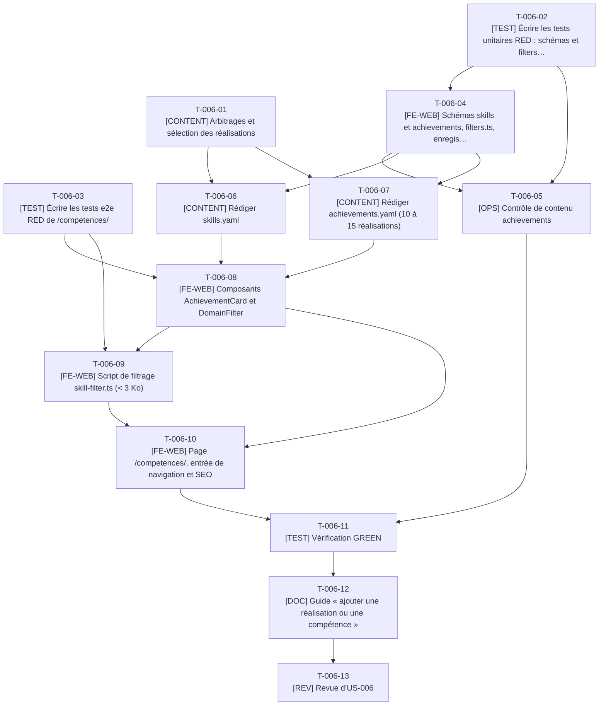

# Tâches - US-006 : Compétences et réalisations filtrables par domaine

## Informations US
- **Epic** : EPIC-002 : Profil et CV
- **Persona** : P-002 : Marc, dirigeant e-commerce B2B
- **Story Points** : 3
- **Sprint** : sprint-002-preuves_profil_open_source
- **Lot** : 1
- **Dépendances externes au lot** : Aucune bloquante (US-005 livrée). Même lot qu’US-007 : fichiers partagés `content.config.ts` et `nav.ts` en ajout seul.

## Résumé de la US
**En tant que** P-002 : Marc
**Je veux** filtrer les compétences et réalisations par domaine et voir les références clients associées
**Afin de** vérifier en moins de 2 minutes que Thibaut a déjà résolu un besoin proche du mien

## Vue d’ensemble des tâches

| ID | Type | Tâche | Estimation | Dépend de | Lot | Statut |
|----|------|-------|------------|-----------|-----|--------|
| T-006-01 | [CONTENT] | Arbitrages et sélection des réalisations | 2h | - | 1 | 👀 |
| T-006-02 | [TEST] | Écrire les tests unitaires RED : schémas et `filters.ts` | 3h | - | 1 | ✅ |
| T-006-03 | [TEST] | Écrire les tests e2e RED de `/competences/` | 4h | - | 1 | ✅ |
| T-006-04 | [FE-WEB] | Schémas `skills` et `achievements`, `filters.ts`, enregistrement des collections | 3,5h | T-006-02 | 1 | ✅ |
| T-006-05 | [OPS] | Contrôle de contenu `achievements` | 2,5h | T-006-02, T-006-04 | 1 | ✅ |
| T-006-06 | [CONTENT] | Rédiger `skills.yaml` | 2,5h | T-006-01, T-006-04 | 1 | ✅ |
| T-006-07 | [CONTENT] | Rédiger `achievements.yaml` (10 à 15 réalisations) | 4h | T-006-01, T-006-04 | 1 | ✅ |
| T-006-08 | [FE-WEB] | Composants `AchievementCard` et `DomainFilter` | 4h | T-006-03, T-006-06, T-006-07 | 1 | ✅ |
| T-006-09 | [FE-WEB] | Script de filtrage `skill-filter.ts` (< 3 Ko) | 3h | T-006-03, T-006-08 | 1 | ✅ |
| T-006-10 | [FE-WEB] | Page `/competences/`, entrée de navigation et SEO | 3h | T-006-08, T-006-09 | 1 | ✅ |
| T-006-11 | [TEST] | Vérification GREEN | 2h | T-006-05, T-006-10 | 1 | ✅ |
| T-006-12 | [DOC] | Guide « ajouter une réalisation ou une compétence » | 1,5h | T-006-11 | 1 | ✅ |
| T-006-13 | [REV] | Revue d’US-006 | 2h | T-006-12 | 1 | 👀 |

**Total estimé** : 37h (13 tâches)

| Type | Tâches | Heures |
|------|--------|--------|
| [CONTENT] | 3 | 8,5h |
| [TEST] | 3 | 9h |
| [FE-WEB] | 4 | 13,5h |
| [OPS] | 1 | 2,5h |
| [DOC] | 1 | 1,5h |
| [REV] | 1 | 2h |

---

## Graphe de dépendances

---

## Détail des tâches

#### T-006-01 : [CONTENT] Arbitrages et sélection des réalisations
- **Type** : [CONTENT]
- **Estimation** : 2h
- **Dépend de** : -
- **Lot** : 1

**Description** :
Avec le PO : liste des 10 à 15 réalisations tirées de « Key Achievements » (`career-ops/cv.md`), domaines de chacune (5 valeurs), clients citables (accord de citation) ou « Référence confidentielle », libellés français des domaines, comportement d'un paramètre inconnu.

**Fichiers à créer/modifier** :
- `docs/guides/competences.md (section Décisions)`

**Critères de validation** :
- [ ] Liste des réalisations et domaines validée
- [ ] Liste des clients citables écrite (à défaut : anonymisation)
- [ ] Aucune donnée personnelle

#### T-006-02 : [TEST] Écrire les tests unitaires RED : schémas et `filters.ts`
- **Type** : [TEST]
- **Estimation** : 3h
- **Dépend de** : -
- **Lot** : 1

**Description** :
Domaine hors liste refusé (message en français), `strictObject`, `clients` vide = confidentiel, parsing de `?domaine=` (valide, inconnu, vide), filtrage, libellé du compteur (« 1 réalisation », « 6 réalisations », 0), messages « Domaine inconnu… » et « Aucune réalisation… ».

**Fichiers à créer/modifier** :
- `tests/unit/lib/filters.test.ts`
- `tests/unit/content/achievements.test.ts`

**Critères de validation** :
- [ ] RED constaté
- [ ] Singulier et pluriel du compteur testés
- [ ] Cas domaine sans résultat testé

#### T-006-03 : [TEST] Écrire les tests e2e RED de `/competences/`
- **Type** : [TEST]
- **Estimation** : 4h
- **Dépend de** : -
- **Lot** : 1

**Description** :
Scénarios Gherkin : filtre « E-commerce » (compteur exact, cartes filtrées), réinitialisation, lien partagé `?domaine=ia-appliquee` (bouton `aria-pressed=true`), domaine inconnu (liste complète, message annoncé), filtre sans résultat (lien « Voir toutes les réalisations »), JavaScript désactivé (tout visible), taille du script < 3 Ko, 360 px sans débordement, axe.

**Fichiers à créer/modifier** :
- `tests/e2e/competences.spec.ts`

**Critères de validation** :
- [ ] Aucun test ignoré
- [ ] Compteur testé via `aria-live`
- [ ] RED constaté

#### T-006-04 : [FE-WEB] Schémas `skills` et `achievements`, `filters.ts`, enregistrement des collections
- **Type** : [FE-WEB]
- **Estimation** : 3,5h
- **Dépend de** : T-006-02
- **Lot** : 1

**Description** :
Schémas du modèle de contenu §3.2 (domaine en enum de 5 valeurs, `strictObject`, `safeText`), loaders `file()` sur `skills.yaml` et `achievements.yaml` (append dans `content.config.ts`), `src/lib/filters.ts` en fonctions pures.

**Fichiers à créer/modifier** :
- `src/content/schemas/skills.ts`
- `src/content/schemas/achievements.ts`
- `src/lib/filters.ts`
- `src/content.config.ts (append)`

**Critères de validation** :
- [ ] Tests de T-006-02 verts
- [ ] Domaine hors liste = build en échec

#### T-006-05 : [OPS] Contrôle de contenu `achievements`
- **Type** : [OPS]
- **Estimation** : 2,5h
- **Dépend de** : T-006-02, T-006-04
- **Lot** : 1

**Description** :
`achievements.content.check.ts` : références croisées (V4 : `skills[]`, `experienceId`), unicité des slugs, 10 à 15 réalisations, liste blanche de données personnelles, messages citant fichier et champ.

**Fichiers à créer/modifier** :
- `scripts/checks/achievements.content.check.ts`
- `scripts/checks/lib/achievements.ts`
- `tests/unit/checks/achievements.test.ts`

**Critères de validation** :
- [ ] Référence inexistante = échec avec message précis
- [ ] Découvert automatiquement par `run.ts`

#### T-006-06 : [CONTENT] Rédiger `skills.yaml`
- **Type** : [CONTENT]
- **Estimation** : 2,5h
- **Dépend de** : T-006-01, T-006-04
- **Lot** : 1

**Description** :
Compétences par domaine à partir de Core Competencies et Technical Skills du CV source ; niveau facultatif ; identifiants kebab-case réutilisables par `experiences[].skills`.

**Fichiers à créer/modifier** :
- `src/data/cv/skills.yaml`

**Critères de validation** :
- [ ] Validé par le schéma
- [ ] Chaque domaine a au moins une compétence

#### T-006-07 : [CONTENT] Rédiger `achievements.yaml` (10 à 15 réalisations)
- **Type** : [CONTENT]
- **Estimation** : 4h
- **Dépend de** : T-006-01, T-006-04
- **Lot** : 1

**Description** :
Réalisations factuelles, chiffrées quand c'est vérifiable, domaines multiples autorisés, clients selon la liste validée, `proofUrl` seulement si le lien est public et stable. Ne rien inventer.

**Fichiers à créer/modifier** :
- `src/data/cv/achievements.yaml`

**Critères de validation** :
- [ ] Validé par le schéma et le contrôle T-006-05
- [ ] Relecture typographique
- [ ] Aucun nom de client non autorisé

#### T-006-08 : [FE-WEB] Composants `AchievementCard` et `DomainFilter`
- **Type** : [FE-WEB]
- **Estimation** : 4h
- **Dépend de** : T-006-03, T-006-06, T-006-07
- **Lot** : 1

**Description** :
Carte (titre, année, domaines, références ou « Référence confidentielle », lien preuve) ; groupe de boutons à bascule rendu `hidden` et révélé par le script (aucun contrôle inerte sans JavaScript) ; compteur `aria-live="polite"` ; liste défilante sous 768 px.

**Fichiers à créer/modifier** :
- `src/components/cv/AchievementCard.astro`
- `src/components/cv/DomainFilter.astro`

**Critères de validation** :
- [ ] Toutes les cartes rendues au build
- [ ] Focus visible, cibles ≥ 44 px

#### T-006-09 : [FE-WEB] Script de filtrage `skill-filter.ts` (< 3 Ko)
- **Type** : [FE-WEB]
- **Estimation** : 3h
- **Dépend de** : T-006-03, T-006-08
- **Lot** : 1

**Description** :
Lit `?domaine=`, applique le filtre, met à jour `aria-pressed`, le compteur, l'URL (`history.replaceState`) et les messages (inconnu, vide), via `filters.ts`.

**Fichiers à créer/modifier** :
- `src/scripts/skill-filter.ts`

**Critères de validation** :
- [ ] Taille du script émis < 3 Ko
- [ ] Scénarios de filtre verts

#### T-006-10 : [FE-WEB] Page `/competences/`, entrée de navigation et SEO
- **Type** : [FE-WEB]
- **Estimation** : 3h
- **Dépend de** : T-006-08, T-006-09
- **Lot** : 1

**Description** :
`src/pages/competences/index.astro` avec `Seo` (title, description, canonical), entrée `competences` activée dans `nav.ts` (append), lien vers `/parcours/`.

**Fichiers à créer/modifier** :
- `src/pages/competences/index.astro`
- `src/config/nav.ts (append)`

**Critères de validation** :
- [ ] Page découverte par axe et Lighthouse
- [ ] Lien actif dans l'en-tête

#### T-006-11 : [TEST] Vérification GREEN
- **Type** : [TEST]
- **Estimation** : 2h
- **Dépend de** : T-006-05, T-006-10
- **Lot** : 1

**Description** :
`make ci` ; contrôle manuel clavier et lecteur d'écran du filtre ; preuve des scénarios Gherkin dans la PR.

**Critères de validation** :
- [ ] CI verte, aucun test ignoré
- [ ] Lighthouse ≥ 95 sur `/competences/`

#### T-006-12 : [DOC] Guide « ajouter une réalisation ou une compétence »
- **Type** : [DOC]
- **Estimation** : 1,5h
- **Dépend de** : T-006-11
- **Lot** : 1

**Description** :
Guide, index des guides, CHANGELOG.

**Fichiers à créer/modifier** :
- `docs/guides/competences.md`
- `docs/guides/README.md (append)`
- `CHANGELOG.md (append)`

**Critères de validation** :
- [ ] Procédure reproductible
- [ ] Décisions de T-006-01 consignées

#### T-006-13 : [REV] Revue d’US-006
- **Type** : [REV]
- **Estimation** : 2h
- **Dépend de** : T-006-12
- **Lot** : 1

**Description** :
Revue de code et de contenu (clients, chiffres, accessibilité du filtre).

**Critères de validation** :
- [ ] Checklist DoD cochée
- [ ] Commentaires traités
