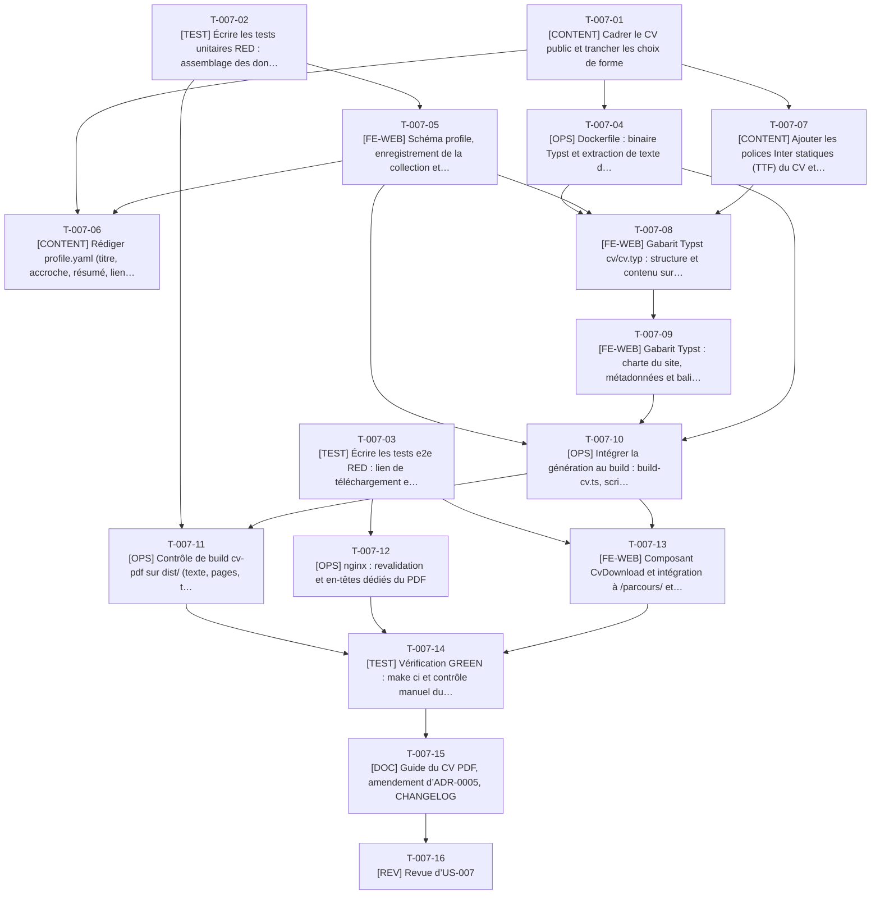

# Tâches - US-007 : CV PDF téléchargeable généré au build

## Informations US
- **Epic** : EPIC-002 : Profil et CV
- **Persona** : P-001 : Claire, DG d’une scale-up qui recrute
- **Story Points** : 5
- **Sprint** : sprint-002-preuves_profil_open_source
- **Lot** : 1
- **Dépendances externes au lot** : Aucune dans le sprint (collection `experiences` livrée au sprint 1).

## Résumé de la US
**En tant que** P-001 : Claire
**Je veux** télécharger en un clic un CV PDF propre, à jour et transmissible tel quel au comité
**Afin de** partager le profil sans retaper d’information et sans exposer de données personnelles (téléphone, âge)

## Vue d’ensemble des tâches

| ID | Type | Tâche | Estimation | Dépend de | Lot | Statut |
|----|------|-------|------------|-----------|-----|--------|
| T-007-01 | [CONTENT] | Cadrer le CV public et trancher les choix de forme | 1,5h | - | 1 | 👀 |
| T-007-02 | [TEST] | Écrire les tests unitaires RED : assemblage des données du CV, schéma profile, contrôle de confidentialité du PDF | 3,5h | - | 1 | ✅ |
| T-007-03 | [TEST] | Écrire les tests e2e RED : lien de téléchargement et en-têtes du PDF | 3,5h | - | 1 | ✅ |
| T-007-04 | [OPS] | Dockerfile : binaire Typst et extraction de texte dans l’image des dépendances | 3h | T-007-01 | 1 | ✅ |
| T-007-05 | [FE-WEB] | Schéma `profile`, enregistrement de la collection et assemblage des données du CV (`cv-data`) | 4h | T-007-02 | 1 | ✅ |
| T-007-06 | [CONTENT] | Rédiger `profile.yaml` (titre, accroche, résumé, liens) | 1h | T-007-01, T-007-05 | 1 | ✅ |
| T-007-07 | [CONTENT] | Ajouter les polices Inter statiques (TTF) du CV et leur licence | 1h | T-007-01 | 1 | ✅ |
| T-007-08 | [FE-WEB] | Gabarit Typst `cv/cv.typ` : structure et contenu sur 2 pages A4 | 5h | T-007-04, T-007-05, T-007-07 | 1 | ✅ |
| T-007-09 | [FE-WEB] | Gabarit Typst : charte du site, métadonnées et balisage du PDF | 4h | T-007-08 | 1 | ✅ |
| T-007-10 | [OPS] | Intégrer la génération au build : `build-cv.ts`, script npm, cible `make cv` | 3,5h | T-007-05, T-007-09, T-007-04 | 1 | ✅ |
| T-007-11 | [OPS] | Contrôle de build `cv-pdf` sur `dist/` (texte, pages, taille, métadonnées) | 3,5h | T-007-02, T-007-10 | 1 | ✅ |
| T-007-12 | [OPS] | nginx : revalidation et en-têtes dédiés du PDF | 1,5h | T-007-03 | 1 | ✅ |
| T-007-13 | [FE-WEB] | Composant `CvDownload` et intégration à `/parcours/` et `/contact/` | 3h | T-007-03, T-007-10 | 1 | ✅ |
| T-007-14 | [TEST] | Vérification GREEN : `make ci` et contrôle manuel du PDF | 3h | T-007-11, T-007-12, T-007-13 | 1 | ✅ |
| T-007-15 | [DOC] | Guide du CV PDF, amendement d’ADR-0005, CHANGELOG | 2h | T-007-14 | 1 | ✅ |
| T-007-16 | [REV] | Revue d’US-007 | 2h | T-007-15 | 1 | 👀 |

**Total estimé** : 45h (16 tâches)

| Type | Tâches | Heures |
|------|--------|--------|
| [CONTENT] | 3 | 3,5h |
| [TEST] | 3 | 10h |
| [OPS] | 4 | 11,5h |
| [FE-WEB] | 4 | 16h |
| [DOC] | 1 | 2h |
| [REV] | 1 | 2h |

---

## Graphe de dépendances

---

## Détail des tâches

#### T-007-01 : [CONTENT] Cadrer le CV public et trancher les choix de forme
- **Type** : [CONTENT]
- **Estimation** : 1,5h
- **Dépend de** : -
- **Lot** : 1

**Description** :
Avec le PO : titre et accroche du CV, présence ou non d'une adresse e-mail publique, liens (LinkedIn, GitHub, Packagist), décision sur `X-Robots-Tag` du PDF, choix des polices (TTF Inter) et du moteur d'extraction de texte (poppler ou bibliothèque Node). Consigner les décisions dans le guide du CV.

**Fichiers à créer/modifier** :
- `docs/guides/cv-pdf.md (section Décisions)`

**Critères de validation** :
- [ ] Les 5 décisions sont écrites (e-mail, liens, X-Robots-Tag, polices, extraction de texte)
- [ ] Aucun téléphone, âge ni adresse dans le périmètre retenu

#### T-007-02 : [TEST] Écrire les tests unitaires RED : assemblage des données du CV, schéma profile, contrôle de confidentialité du PDF
- **Type** : [TEST]
- **Estimation** : 3,5h
- **Dépend de** : -
- **Lot** : 1

**Description** :
Tests Vitest avant le code : `buildCvData` (liste blanche de champs, ordre de la frise, séparation détaillé / « Avant 2016 », 7 expériences, métadonnées dont la date de génération), schéma `profile` (clé inconnue refusée, `safeText`), `findForbiddenPatterns` sur un texte extrait (téléphone, âge, adresse refusés ; « 25 ans d'expérience » accepté, arbitrage A1) et messages d'erreur exacts de l'US.

**Fichiers à créer/modifier** :
- `tests/unit/lib/cv-data.test.ts`
- `tests/unit/content/profile.test.ts`
- `tests/unit/checks/cv-pdf.test.ts`

**Critères de validation** :
- [ ] Les tests échouent faute d'implémentation (RED constaté)
- [ ] Message « CV public : donnée personnelle interdite (téléphone, âge ou adresse) » testé
- [ ] Cas « 25 ans d'expérience » autorisé testé

#### T-007-03 : [TEST] Écrire les tests e2e RED : lien de téléchargement et en-têtes du PDF
- **Type** : [TEST]
- **Estimation** : 3,5h
- **Dépend de** : -
- **Lot** : 1

**Description** :
Playwright (sans test ignoré) : lien « Télécharger mon CV (PDF, 2 pages) » présent sur `/parcours/` et `/contact/`, cible ≥ 44 px, attribut `download`, téléchargement de `thibaut-monier-cv.pdf` (en-tête `%PDF`, moins de 500 Ko, `Content-Type: application/pdf`), revalidation du cache, `X-Robots-Tag` selon décision, CSP présente. Scénarios Gherkin nominal et alternatifs de l'US.

**Fichiers à créer/modifier** :
- `tests/e2e/cv-pdf.spec.ts`

**Critères de validation** :
- [ ] Aucun `test.skip` ; échec franc si la configuration manque
- [ ] Le test échoue tant que le lien et le PDF n'existent pas (RED)
- [ ] Axe sans violation sur la zone du lien

#### T-007-04 : [OPS] Dockerfile : binaire Typst et extraction de texte dans l’image des dépendances
- **Type** : [OPS]
- **Estimation** : 3h
- **Dépend de** : T-007-01
- **Lot** : 1

**Description** :
Copier le binaire depuis l'étape `typst` existante vers `deps` (visible de `dev`, `tools`, `build`), installer l'outil d'extraction retenu (poppler-utils épinglé, installé en root puis retour à l'utilisateur 1000) et vérifier le chemin du binaire dans l'image officielle `ghcr.io/typst/typst:0.15.1` (`docker create` + `docker cp`, pas d'exécution dans l'image). `runtime` reste la dernière étape.

**Fichiers à créer/modifier** :
- `Dockerfile`
- `.dockerignore`

**Critères de validation** :
- [ ] `typst --version` affiche 0.15.1 dans le service `tools`
- [ ] `pdftotext -v` disponible dans `tools`
- [ ] Hadolint vert ; `runtime` dernière étape ; image `runtime` inchangée (ni Typst ni poppler)

#### T-007-05 : [FE-WEB] Schéma `profile`, enregistrement de la collection et assemblage des données du CV (`cv-data`)
- **Type** : [FE-WEB]
- **Estimation** : 4h
- **Dépend de** : T-007-02
- **Lot** : 1

**Description** :
Créer `src/content/schemas/profile.ts` (strictObject, `safeText`), enregistrer `profile` dans `content.config.ts` (zone append-only), et `src/lib/cv-data.ts` : fonction pure qui assemble profil, expériences (tri et partition de `lib/experiences.ts`, DRY avec la frise), jetons de `tokens.json` et métadonnées en un objet JSON validé que Typst lit avec `json()`.

**Fichiers à créer/modifier** :
- `src/content/schemas/profile.ts`
- `src/content.config.ts (append)`
- `src/lib/cv-data.ts`

**Critères de validation** :
- [ ] Tests de T-007-02 verts
- [ ] Aucun champ hors liste blanche dans la sortie
- [ ] Réutilise `sortExperiences` / `splitFeatured` (aucune logique de tri dupliquée)

#### T-007-06 : [CONTENT] Rédiger `profile.yaml` (titre, accroche, résumé, liens)
- **Type** : [CONTENT]
- **Estimation** : 1h
- **Dépend de** : T-007-01, T-007-05
- **Lot** : 1

**Description** :
Contenu public du CV : titre (80 car. max), accroche (240), résumé (600), liens https. Source : `career-ops/cv.md` (Summary), sans donnée personnelle.

**Fichiers à créer/modifier** :
- `src/data/cv/profile.yaml`

**Critères de validation** :
- [ ] Validé par le schéma
- [ ] Relecture typographique (espaces insécables avant `: ; ? !`)
- [ ] Localisation « Nantes (France) » uniquement

#### T-007-07 : [CONTENT] Ajouter les polices Inter statiques (TTF) du CV et leur licence
- **Type** : [CONTENT]
- **Estimation** : 1h
- **Dépend de** : T-007-01
- **Lot** : 1

**Description** :
Typst ne lit pas le WOFF2 du site : ajouter Inter Regular, Medium, SemiBold, Bold (TTF, licence OFL) dans `cv/fonts/` avec le fichier de licence ; mono facultative. Les polices sont intégrées en sous-ensemble dans le PDF.

**Fichiers à créer/modifier** :
- `cv/fonts/*.ttf`
- `cv/fonts/OFL.txt`

**Critères de validation** :
- [ ] Licence OFL présente à côté des fichiers
- [ ] Poids du dépôt ajouté documenté (< 2 Mo)

#### T-007-08 : [FE-WEB] Gabarit Typst `cv/cv.typ` : structure et contenu sur 2 pages A4
- **Type** : [FE-WEB]
- **Estimation** : 5h
- **Dépend de** : T-007-04, T-007-05, T-007-07
- **Lot** : 1

**Description** :
Lire le JSON de T-007-05 : en-tête (nom, titre, localisation, liens), résumé, expériences détaillées (réalisations), bloc « Avant 2016 » résumé, gabarit réutilisable pour des variantes (opportunité O-04). Pas de logique métier dans Typst.

**Fichiers à créer/modifier** :
- `cv/cv.typ`
- `cv/lib/*.typ (si découpé)`

**Critères de validation** :
- [ ] `typst compile` produit un PDF de 2 pages A4 avec les 7 expériences
- [ ] Aucune donnée saisie en dur dans le gabarit

#### T-007-09 : [FE-WEB] Gabarit Typst : charte du site, métadonnées et balisage du PDF
- **Type** : [FE-WEB]
- **Estimation** : 4h
- **Dépend de** : T-007-08
- **Lot** : 1

**Description** :
Couleurs et polices lues dans `tokens.json`, typographie française (césure, espaces insécables), métadonnées (titre, auteur, langue `fr`, date de génération), PDF balisé : tenter `--pdf-standard ua-1` avec Typst 0.15.1, sinon repli documenté (lien vers la page HTML accessible, ADR-0005).

**Fichiers à créer/modifier** :
- `cv/cv.typ`
- `docs/adr/0005-cv-pdf-typst.md (note)`

**Critères de validation** :
- [ ] `pdfinfo` : Tagged oui (ou repli documenté), Title, langue fr
- [ ] PDF < 500 Ko
- [ ] Rendu cohérent avec la charte (revue visuelle)

#### T-007-10 : [OPS] Intégrer la génération au build : `build-cv.ts`, script npm, cible `make cv`
- **Type** : [OPS]
- **Estimation** : 3,5h
- **Dépend de** : T-007-05, T-007-09, T-007-04
- **Lot** : 1

**Description** :
Script `scripts/build-cv.ts` : écrit le JSON, lance `typst compile` (délai 60 s) vers `dist/thibaut-monier-cv.pdf`, supprime tout PDF obsolète et échoue avec « Génération du CV PDF impossible : <cause> ». Brancher dans `npm run build` après `astro build` et avant `checks:dist` ; cible `make cv` ; ignorer les fichiers générés.

**Fichiers à créer/modifier** :
- `scripts/build-cv.ts`
- `package.json (scripts)`
- `Makefile (append)`
- `.gitignore`

**Critères de validation** :
- [ ] `make build` produit le PDF dans `dist/`
- [ ] Typst indisponible : build en échec, aucun PDF obsolète publié
- [ ] Génération < 60 s

#### T-007-11 : [OPS] Contrôle de build `cv-pdf` sur `dist/` (texte, pages, taille, métadonnées)
- **Type** : [OPS]
- **Estimation** : 3,5h
- **Dépend de** : T-007-02, T-007-10
- **Lot** : 1

**Description** :
`scripts/checks/cv-pdf.dist.check.ts` + `lib/pdf-privacy.ts` : extrait le texte, applique `detectPii` (arbitrage A1), vérifie ≤ 500 Ko, 2 pages (cohérent avec le libellé du lien lu dans le HTML), présence des 7 entreprises, titre et langue.

**Fichiers à créer/modifier** :
- `scripts/checks/cv-pdf.dist.check.ts`
- `scripts/checks/lib/pdf-privacy.ts`

**Critères de validation** :
- [ ] Un PDF contenant un téléphone fait échouer le build avec le message de l'US
- [ ] Contrôle découvert automatiquement par `run.ts`
- [ ] Couverture ≥ 80 % de la lib

#### T-007-12 : [OPS] nginx : revalidation et en-têtes dédiés du PDF
- **Type** : [OPS]
- **Estimation** : 1,5h
- **Dépend de** : T-007-03
- **Lot** : 1

**Description** :
Le bloc `.pdf` actuel met en cache 30 jours : un CV mis à jour resterait périmé. Ajouter un `location = /thibaut-monier-cv.pdf` en `no-cache` (ETag), `X-Robots-Tag` selon T-007-01, en réinjectant le snippet d'en-têtes de sécurité.

**Fichiers à créer/modifier** :
- `nginx.conf`

**Critères de validation** :
- [ ] `headers.spec.ts` et `cv-pdf.spec.ts` verts
- [ ] Tous les en-têtes de sécurité présents sur le PDF

#### T-007-13 : [FE-WEB] Composant `CvDownload` et intégration à `/parcours/` et `/contact/`
- **Type** : [FE-WEB]
- **Estimation** : 3h
- **Dépend de** : T-007-03, T-007-10
- **Lot** : 1

**Description** :
Lien « Télécharger mon CV (PDF, 2 pages) » (cible ≥ 44 px, `download`, focus visible, `data-cv-download` pour US-026). Pas de poids affiché : l'étiquette est statique et vérifiée par T-007-11.

**Fichiers à créer/modifier** :
- `src/components/cv/CvDownload.astro`
- `src/pages/parcours.astro`
- `src/pages/contact/index.astro`

**Critères de validation** :
- [ ] Tests e2e de T-007-03 verts
- [ ] Lien présent aux deux endroits
- [ ] Impression de `/parcours/` inchangée (2 pages)

#### T-007-14 : [TEST] Vérification GREEN : `make ci` et contrôle manuel du PDF
- **Type** : [TEST]
- **Estimation** : 3h
- **Dépend de** : T-007-11, T-007-12, T-007-13
- **Lot** : 1

**Description** :
`make ci`, puis contrôle manuel : copier-coller du texte, ordre de lecture, `pdfinfo`, comparaison page Parcours / PDF (même texte), 7 expériences, aucune donnée personnelle.

**Fichiers à créer/modifier** :
- `reports/ (artefacts)`

**Critères de validation** :
- [ ] CI verte, aucun test ignoré
- [ ] Les 3 scénarios Gherkin de l'US vérifiés avec preuve dans la PR

#### T-007-15 : [DOC] Guide du CV PDF, amendement d’ADR-0005, CHANGELOG
- **Type** : [DOC]
- **Estimation** : 2h
- **Dépend de** : T-007-14
- **Lot** : 1

**Description** :
Guide « modifier le CV » (source unique, `make cv`, contrôles), polices et licence, décisions de T-007-01 ; note dans ADR-0005 (extraction, polices TTF, X-Robots-Tag) ; CHANGELOG (ajout seul) et index des guides.

**Fichiers à créer/modifier** :
- `docs/guides/cv-pdf.md`
- `docs/guides/README.md (append)`
- `docs/adr/0005-cv-pdf-typst.md`
- `CHANGELOG.md (append)`

**Critères de validation** :
- [ ] Une personne peut modifier le CV sans aide
- [ ] Pas de duplication du contenu de l'ADR

#### T-007-16 : [REV] Revue d’US-007
- **Type** : [REV]
- **Estimation** : 2h
- **Dépend de** : T-007-15
- **Lot** : 1

**Description** :
Revue de code et de contenu : confidentialité du PDF, conteneur, nginx, DoD.

**Critères de validation** :
- [ ] Checklist DoD cochée
- [ ] Aucun marqueur provisoire
- [ ] Commentaires traités
