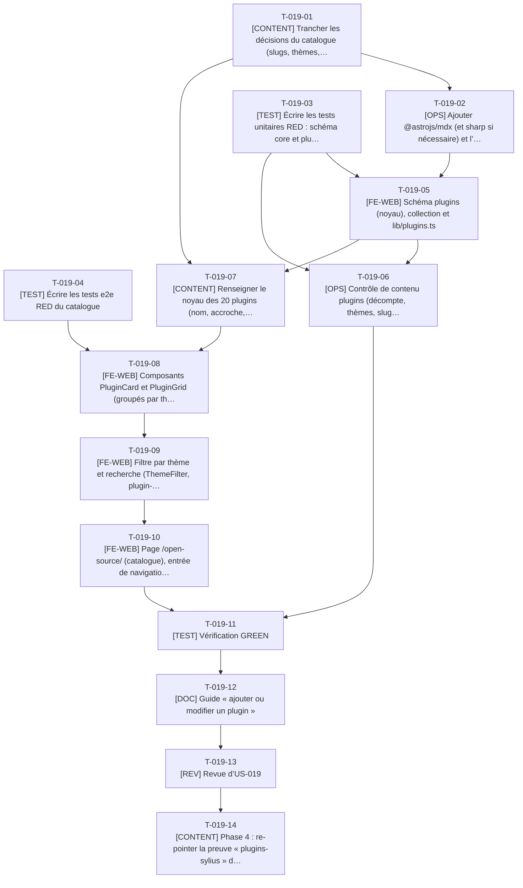

# Tâches - US-019 : Catalogue des 20 plugins Sylius 2 filtrable par thème

## Informations US
- **Epic** : EPIC-005 : Vitrine open source
- **Persona** : P-003 : Julien, lead développeur Sylius
- **Story Points** : 5
- **Sprint** : sprint-002-preuves_profil_open_source
- **Lot** : 2
- **Dépendances externes au lot** : US-002 livrée. Livrable seulement avec US-020 (les cartes pointent vers les fiches), écart E3.

## Résumé de la US
**En tant que** P-003 : Julien
**Je veux** parcourir les 20 plugins et les filtrer par thème (B2B, conformité UE, back-office, IA et intégrations)
**Afin de** trouver en moins de 30 secondes le plugin qui couvre mon besoin avant de réécrire quoi que ce soit

## Vue d’ensemble des tâches

| ID | Type | Tâche | Estimation | Dépend de | Lot | Statut |
|----|------|-------|------------|-----------|-----|--------|
| T-019-01 | [CONTENT] | Trancher les décisions du catalogue (slugs, thèmes, hub, captures) | 2h | - | 2 | ✅ |
| T-019-02 | [OPS] | Ajouter `@astrojs/mdx` (et `sharp` si nécessaire) et l’intégration Astro | 2,5h | T-019-01 | 2 | ✅ |
| T-019-03 | [TEST] | Écrire les tests unitaires RED : schéma core et `plugins.ts` | 3,5h | - | 2 | ✅ |
| T-019-04 | [TEST] | Écrire les tests e2e RED du catalogue | 4h | - | 2 | ✅ |
| T-019-05 | [FE-WEB] | Schéma `plugins` (noyau), collection et `lib/plugins.ts` | 3,5h | T-019-02, T-019-03 | 2 | ✅ |
| T-019-06 | [OPS] | Contrôle de contenu `plugins` (décompte, thèmes, slugs, références) | 3h | T-019-03, T-019-05 | 2 | ✅ |
| T-019-07 | [CONTENT] | Renseigner le noyau des 20 plugins (nom, accroche, thème, dépôt, paquet) | 4h | T-019-01, T-019-05 | 2 | ✅ |
| T-019-08 | [FE-WEB] | Composants `PluginCard` et `PluginGrid` (groupés par thème) | 3,5h | T-019-04, T-019-07 | 2 | ✅ |
| T-019-09 | [FE-WEB] | Filtre par thème et recherche (`ThemeFilter`, `plugin-filter.ts`) | 4,5h | T-019-08 | 2 | ✅ |
| T-019-10 | [FE-WEB] | Page `/open-source/` (catalogue), entrée de navigation et SEO | 3h | T-019-09 | 2 | ✅ |
| T-019-11 | [TEST] | Vérification GREEN | 2h | T-019-06, T-019-10 | 2 | ✅ |
| T-019-12 | [DOC] | Guide « ajouter ou modifier un plugin » | 1,5h | T-019-11 | 2 | ✅ |
| T-019-13 | [REV] | Revue d’US-019 | 2h | T-019-12 | 2 | 👀 |
| T-019-14 | [CONTENT] | Phase 4 : re-pointer la preuve « plugins-sylius » de l’accueil vers `/open-source/` | 0,5h | T-019-13 | 4 | ✅ |

**Total estimé** : 39,5h (14 tâches)

| Type | Tâches | Heures |
|------|--------|--------|
| [CONTENT] | 3 | 6,5h |
| [OPS] | 2 | 5,5h |
| [TEST] | 3 | 9,5h |
| [FE-WEB] | 4 | 14,5h |
| [DOC] | 1 | 1,5h |
| [REV] | 1 | 2h |

---

## Graphe de dépendances

---

## Détail des tâches

#### T-019-01 : [CONTENT] Trancher les décisions du catalogue (slugs, thèmes, hub, captures)
- **Type** : [CONTENT]
- **Estimation** : 2h
- **Dépend de** : -
- **Lot** : 2

**Description** :
Avec le PO : slug = nom du dépôt sans `sylius-` ni `-plugin` (immuable), libellés des 4 thèmes, répartition 9/3/5/3 revérifiée contre le catalogue du 2026-10-14 (le 21e dépôt `sylius-punchout-cxml-plugin` est hors catalogue : exclu), `/open-source/` comme page d'ensemble, tri alphabétique, pas de statut marketplace (YAGNI), JSON-LD reporté à US-024, nombre maximal de captures par fiche.

**Fichiers à créer/modifier** :
- `docs/guides/plugins-sylius.md (section Décisions)`

**Critères de validation** :
- [ ] Liste de 20 slugs figée
- [ ] Tableau thème → plugins validé
- [ ] Écarts E1 à E6 tranchés (voir README)

#### T-019-02 : [OPS] Ajouter `@astrojs/mdx` (et `sharp` si nécessaire) et l’intégration Astro
- **Type** : [OPS]
- **Estimation** : 2,5h
- **Dépend de** : T-019-01
- **Lot** : 2

**Description** :
Dépendances exactes (MDX 8.0.3 selon ADR-0001), lockfile régénéré dans `tools`, intégration dans `astro.config.mjs`, vérification que `sharp` est fourni par Astro avec `--ignore-scripts` (sinon l’ajouter épinglé), CSP et `inlineStylesheets: never` inchangés. Seul écrivain de `package.json` pour les dépendances.

**Fichiers à créer/modifier** :
- `package.json (dependencies)`
- `package-lock.json`
- `astro.config.mjs`

**Critères de validation** :
- [ ] `make build` vert avec un `.mdx` de test
- [ ] Aucun script inline émis
- [ ] `npm audit` sans HIGH corrigeable

#### T-019-03 : [TEST] Écrire les tests unitaires RED : schéma core et `plugins.ts`
- **Type** : [TEST]
- **Estimation** : 3,5h
- **Dépend de** : -
- **Lot** : 2

**Description** :
Thème inconnu : « Plugin « {slug} » invalide : thème doit valoir b2b, conformite-ue, back-office ou ia-integrations » ; `strictObject` ; slug, dépôt, paquet ; regroupement par thème ; décomptes ; parsing de `?theme=` ; recherche normalisée (accents, casse) avec classement (« facture » place Factur-X en premier) ; message sans résultat.

**Fichiers à créer/modifier** :
- `tests/unit/content/plugins.test.ts`
- `tests/unit/lib/plugins.test.ts`

**Critères de validation** :
- [ ] RED constaté
- [ ] Message d’erreur exact de l’US testé
- [ ] Cas « blockchain » testé

#### T-019-04 : [TEST] Écrire les tests e2e RED du catalogue
- **Type** : [TEST]
- **Estimation** : 4h
- **Dépend de** : -
- **Lot** : 2

**Description** :
Gherkin : 20 cartes, filtre B2B (9 cartes, « 9 plugins », URL `?theme=b2b` rechargée à l’identique), recherche « facture », « blockchain » (message), sans JavaScript (20 plugins regroupés par thème avec ancres), `aria-pressed` et `aria-live`, 1 à 3 colonnes selon la largeur, axe, aucun appel réseau tiers.

**Fichiers à créer/modifier** :
- `tests/e2e/open-source.spec.ts`

**Critères de validation** :
- [ ] Aucun test ignoré
- [ ] Décomptes par thème : 9, 3, 5, 3
- [ ] RED constaté

#### T-019-05 : [FE-WEB] Schéma `plugins` (noyau), collection et `lib/plugins.ts`
- **Type** : [FE-WEB]
- **Estimation** : 3,5h
- **Dépend de** : T-019-02, T-019-03
- **Lot** : 2

**Description** :
Schéma strict du noyau (name, tagline ≤ 140, theme, repo, packagist, license, draft), loader `glob` sur `src/content/plugins/fr/*.mdx` (append dans `content.config.ts`), fonctions pures de regroupement, de filtrage et de recherche.

**Fichiers à créer/modifier** :
- `src/content/schemas/plugins.ts`
- `src/content.config.ts (append)`
- `src/lib/plugins.ts`

**Critères de validation** :
- [ ] Tests de T-019-03 verts
- [ ] Schéma exporté en deux parties (noyau, extension d’US-020)

#### T-019-06 : [OPS] Contrôle de contenu `plugins` (décompte, thèmes, slugs, références)
- **Type** : [OPS]
- **Estimation** : 3h
- **Dépend de** : T-019-03, T-019-05
- **Lot** : 2

**Description** :
`plugins.content.check.ts` : exactement 20 plugins publiés (V8), répartition par thème, unicité des slugs, références `requires`/`complements` existantes sans auto-référence ni cycle (V4, V5), messages citant fichier et champ.

**Fichiers à créer/modifier** :
- `scripts/checks/plugins.content.check.ts`
- `scripts/checks/lib/plugins.ts`
- `tests/unit/checks/plugins.test.ts`

**Critères de validation** :
- [ ] 19 ou 21 plugins = échec
- [ ] Cycle détecté = échec
- [ ] Découvert par `run.ts`

#### T-019-07 : [CONTENT] Renseigner le noyau des 20 plugins (nom, accroche, thème, dépôt, paquet)
- **Type** : [CONTENT]
- **Estimation** : 4h
- **Dépend de** : T-019-01, T-019-05
- **Lot** : 2

**Description** :
20 fichiers `.mdx` à partir du catalogue et des `composer.json` : accroche d’une phrase (140 car.), dépôt `thibmonier/<repo>`, paquet Packagist `tmonier/<repo>` (le vendor Packagist diffère de l’organisation GitHub), licence lue dans `composer.json`.

**Fichiers à créer/modifier** :
- `src/content/plugins/fr/*.mdx (20 fichiers)`

**Critères de validation** :
- [ ] 20 fichiers valides
- [ ] Paquets conformes aux `composer.json`
- [ ] Relecture typographique des accroches

#### T-019-08 : [FE-WEB] Composants `PluginCard` et `PluginGrid` (groupés par thème)
- **Type** : [FE-WEB]
- **Estimation** : 3,5h
- **Dépend de** : T-019-04, T-019-07
- **Lot** : 2

**Description** :
Carte (nom, accroche, thème, versions Sylius supportées lues dans le noyau, lien vers la fiche), grille de 1 à 3 colonnes, sections par thème avec ancres de navigation (rendu sans JavaScript).

**Fichiers à créer/modifier** :
- `src/components/oss/PluginCard.astro`
- `src/components/oss/PluginGrid.astro`

**Critères de validation** :
- [ ] 20 cartes rendues au build
- [ ] Titres h2/h3 cohérents, focus visible

#### T-019-09 : [FE-WEB] Filtre par thème et recherche (`ThemeFilter`, `plugin-filter.ts`)
- **Type** : [FE-WEB]
- **Estimation** : 4,5h
- **Dépend de** : T-019-08
- **Lot** : 2

**Description** :
Boutons à bascule `aria-pressed` révélés par le script, champ de recherche libellé, compteur `aria-live`, URL `?theme=` partageable, message sans résultat, via `lib/plugins.ts` ; script < 5 Ko ; pas de dépendance (Pagefind arrive en sprint 3).

**Fichiers à créer/modifier** :
- `src/components/oss/ThemeFilter.astro`
- `src/scripts/plugin-filter.ts`

**Critères de validation** :
- [ ] Scénarios de filtre et de recherche verts
- [ ] Script < 5 Ko

#### T-019-10 : [FE-WEB] Page `/open-source/` (catalogue), entrée de navigation et SEO
- **Type** : [FE-WEB]
- **Estimation** : 3h
- **Dépend de** : T-019-09
- **Lot** : 2

**Description** :
`src/pages/open-source/index.astro` : title « Plugins Sylius 2 open source : B2B, conformité UE, back-office, IA », description, canonical, introduction brève (encadré non technique), catalogue ; entrée `open-source` dans `nav.ts` (append). Les cartes pointent vers les fiches : US-019 ne se déploie qu’avec US-020 (écart E3).

**Fichiers à créer/modifier** :
- `src/pages/open-source/index.astro`
- `src/config/nav.ts (append)`

**Critères de validation** :
- [ ] Scénarios e2e de T-019-04 verts
- [ ] Page découverte par axe et Lighthouse

#### T-019-11 : [TEST] Vérification GREEN
- **Type** : [TEST]
- **Estimation** : 2h
- **Dépend de** : T-019-06, T-019-10
- **Lot** : 2

**Description** :
`make ci` (hors liens vers fiches tant que US-020 n’est pas fusionnée : la vérification finale se fait sur la branche groupée), preuves des scénarios Gherkin.

**Critères de validation** :
- [ ] Tests verts
- [ ] Lighthouse ≥ 95 sur `/open-source/`

#### T-019-12 : [DOC] Guide « ajouter ou modifier un plugin »
- **Type** : [DOC]
- **Estimation** : 1,5h
- **Dépend de** : T-019-11
- **Lot** : 2

**Description** :
Création du guide (schéma, slugs, contrôles, filtre) ; US-020 le complète. Index des guides et CHANGELOG.

**Fichiers à créer/modifier** :
- `docs/guides/plugins-sylius.md`
- `docs/guides/README.md (append)`
- `CHANGELOG.md (append)`

**Critères de validation** :
- [ ] Procédure d’ajout d’un plugin décrite

#### T-019-13 : [REV] Revue d’US-019
- **Type** : [REV]
- **Estimation** : 2h
- **Dépend de** : T-019-12
- **Lot** : 2

**Description** :
Revue de code et de contenu (accroches, thèmes, accessibilité du filtre).

**Critères de validation** :
- [ ] Checklist DoD cochée
- [ ] Commentaires traités

#### T-019-14 : [CONTENT] Phase 4 : re-pointer la preuve « plugins-sylius » de l’accueil vers `/open-source/`
- **Type** : [CONTENT]
- **Estimation** : 0,5h
- **Dépend de** : T-019-13
- **Lot** : 4

**Description** :
Remplacer le lien externe provisoire de la preuve `plugins-sylius` dans `home.yaml` par `/open-source/` ; le contrôle `proof-links` vérifie la route. Édition séquentielle de `home.yaml` avec T-023-15.

**Fichiers à créer/modifier** :
- `src/data/home.yaml`

**Critères de validation** :
- [ ] `proof-links` vert
- [ ] Aucun lien externe provisoire restant pour cette preuve
