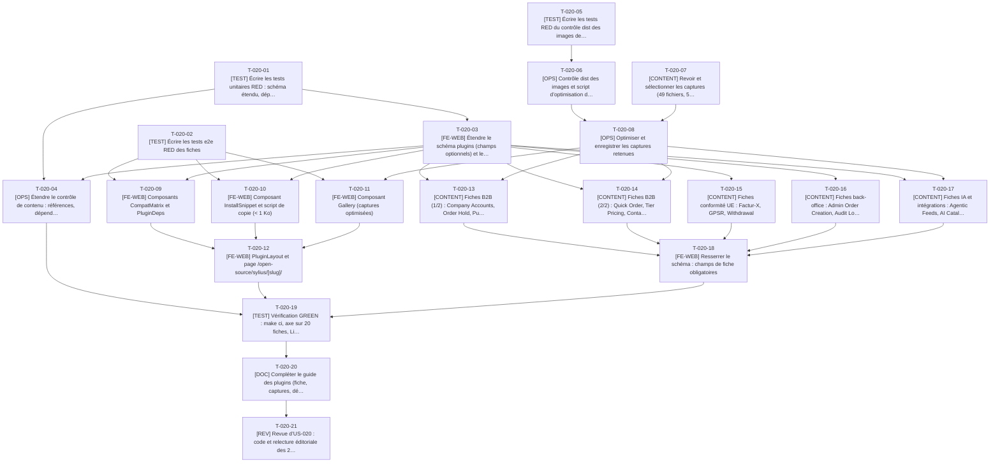

# Tâches - US-020 : Fiche détaillée d’un plugin

## Informations US
- **Epic** : EPIC-005 : Vitrine open source
- **Persona** : P-003 : Julien, lead développeur Sylius
- **Story Points** : 5
- **Sprint** : sprint-002-preuves_profil_open_source
- **Lot** : 2
- **Dépendances externes au lot** : US-019 (schéma noyau, T-019-05 ; catalogue).

## Résumé de la US
**En tant que** P-003 : Julien
**Je veux** une fiche par plugin avec le problème résolu, les fonctionnalités, la matrice de compatibilité, les dépendances, l’installation et les liens GitHub et Packagist
**Afin de** décider en moins de 2 minutes si je l’installe sur ma boutique Sylius 2

## Vue d’ensemble des tâches

| ID | Type | Tâche | Estimation | Dépend de | Lot | Statut |
|----|------|-------|------------|-----------|-----|--------|
| T-020-01 | [TEST] | Écrire les tests unitaires RED : schéma étendu, dépendances, installation | 4h | T-019-05 | 2 | ✅ |
| T-020-02 | [TEST] | Écrire les tests e2e RED des fiches | 4,5h | T-019-05 | 2 | ✅ |
| T-020-03 | [FE-WEB] | Étendre le schéma `plugins` (champs optionnels) et les libs `plugin-deps`, `install` | 4h | T-020-01 | 2 | ✅ |
| T-020-04 | [OPS] | Étendre le contrôle de contenu : références, dépendances, messages de l’US | 2,5h | T-020-01, T-020-03 | 2 | ✅ |
| T-020-05 | [TEST] | Écrire les tests RED du contrôle dist des images de plugins | 2h | - | 3 | 🔲 |
| T-020-06 | [OPS] | Contrôle dist des images et script d’optimisation des captures (`sharp`) | 4,5h | T-019-02, T-020-05 | 3 | 🔲 |
| T-020-07 | [CONTENT] | Revoir et sélectionner les captures (49 fichiers, 5,1 Mo), rédiger les textes alternatifs | 3h | T-019-01 | 2 | ✅ |
| T-020-08 | [OPS] | Optimiser et enregistrer les captures retenues | 1,5h | T-020-06, T-020-07 | 2 | ✅ |
| T-020-09 | [FE-WEB] | Composants `CompatMatrix` et `PluginDeps` | 3,5h | T-020-02, T-020-03 | 2 | ✅ |
| T-020-10 | [FE-WEB] | Composant `InstallSnippet` et script de copie (< 1 Ko) | 3h | T-020-02, T-020-03 | 2 | ✅ |
| T-020-11 | [FE-WEB] | Composant `Gallery` (captures optimisées) | 2,5h | T-020-02, T-020-08 | 2 | ✅ |
| T-020-12 | [FE-WEB] | `PluginLayout` et page `/open-source/sylius/[slug]/` | 4h | T-020-09, T-020-10, T-020-11 | 2 | ✅ |
| T-020-13 | [CONTENT] | Fiches B2B (1/2) : Company Accounts, Order Hold, Purchase Approval, Trade Credit, Quote Request | 5,5h | T-020-03, T-020-08 | 2 | ✅ |
| T-020-14 | [CONTENT] | Fiches B2B (2/2) : Quick Order, Tier Pricing, Container Fill, B2B MCP | 5h | T-020-03, T-020-08 | 2 | ✅ |
| T-020-15 | [CONTENT] | Fiches conformité UE : Factur-X, GPSR, Withdrawal | 3h | T-020-03 | 2 | ✅ |
| T-020-16 | [CONTENT] | Fiches back-office : Admin Order Creation, Audit Log, Bulk Actions, Command Palette, Timeline | 5h | T-020-03 | 2 | ✅ |
| T-020-17 | [CONTENT] | Fiches IA et intégrations : Agentic Feeds, AI Catalog Copilot, Webhook Outbox | 3h | T-020-03, T-020-08 | 2 | ✅ |
| T-020-18 | [FE-WEB] | Resserrer le schéma : champs de fiche obligatoires | 1h | T-020-13, T-020-14, T-020-15, T-020-16, T-020-17 | 2 | ✅ |
| T-020-19 | [TEST] | Vérification GREEN : `make ci`, axe sur 20 fiches, Lighthouse | 3,5h | T-020-04, T-020-12, T-020-18 | 2 | ✅ |
| T-020-20 | [DOC] | Compléter le guide des plugins (fiche, captures, dépendances) | 1,5h | T-020-19 | 2 | ✅ |
| T-020-21 | [REV] | Revue d’US-020 : code et relecture éditoriale des 20 fiches | 4h | T-020-20 | 2 | 👀 |

**Total estimé** : 70,5h (21 tâches)

| Type | Tâches | Heures |
|------|--------|--------|
| [TEST] | 4 | 14h |
| [FE-WEB] | 6 | 18h |
| [OPS] | 3 | 8,5h |
| [CONTENT] | 6 | 24,5h |
| [DOC] | 1 | 1,5h |
| [REV] | 1 | 4h |

---

## Graphe de dépendances

Dépendances vers d’autres US : T-020-01 dépend de T-019-05, T-020-02 dépend de T-019-05, T-020-06 dépend de T-019-02, T-020-07 dépend de T-019-01.

---

## Détail des tâches

#### T-020-01 : [TEST] Écrire les tests unitaires RED : schéma étendu, dépendances, installation
- **Type** : [TEST]
- **Estimation** : 4h
- **Dépend de** : T-019-05
- **Lot** : 2

**Description** :
Messages exacts (« compatibilité.php est requis », « la dépendance « sylius-inconnu » n’existe pas dans la collection »), matrice, bases de données, `externalRequires`, calcul « Nécessite / Complété par / Utilisé par » (Order Hold utilisé par Trade Credit et Purchase Approval), génération de `composer require` depuis le paquet.

**Fichiers à créer/modifier** :
- `tests/unit/content/plugins-extended.test.ts`
- `tests/unit/lib/plugin-deps.test.ts`
- `tests/unit/lib/install.test.ts`

**Critères de validation** :
- [ ] RED constaté
- [ ] Cas « Aucune dépendance » testé

#### T-020-02 : [TEST] Écrire les tests e2e RED des fiches
- **Type** : [TEST]
- **Estimation** : 4,5h
- **Dépend de** : T-019-05
- **Lot** : 2

**Description** :
Fiche Purchase Approval (matrice visible sans défilement à 1440 × 900, « Nécessite : Company Accounts, Order Hold » avec liens, liens GitHub et Packagist en nouvel onglet `rel="noopener"`, copie de la commande et annonce « Commande copiée », permission presse-papiers accordée), Tier Pricing sans dépendance, navigation Trade Credit → Order Hold → « Utilisé par », matrice défilable à 360 px, 20 fiches en 200, axe, absence de métriques sans erreur.

**Fichiers à créer/modifier** :
- `tests/e2e/plugin-detail.spec.ts`

**Critères de validation** :
- [ ] Aucun test ignoré
- [ ] Les 20 fiches sont parcourues par le crawl
- [ ] RED constaté

#### T-020-03 : [FE-WEB] Étendre le schéma `plugins` (champs optionnels) et les libs `plugin-deps`, `install`
- **Type** : [FE-WEB]
- **Estimation** : 4h
- **Dépend de** : T-020-01
- **Lot** : 2

**Description** :
Extension du schéma : features (5 à 8), compatibility (matrice, bases), requires, complements, `externalRequires` (écart E6), screenshots (alt ≥ 10 car.), `configExcerpt`. Champs d’abord optionnels (resserrés en T-020-18). Libs pures : dépendances et dépendants inverses, commande d’installation.

**Fichiers à créer/modifier** :
- `src/content/schemas/plugins.ts`
- `src/lib/plugin-deps.ts`
- `src/lib/install.ts`

**Critères de validation** :
- [ ] Tests de T-020-01 verts
- [ ] Le build reste vert avec le noyau seul

#### T-020-04 : [OPS] Étendre le contrôle de contenu : références, dépendances, messages de l’US
- **Type** : [OPS]
- **Estimation** : 2,5h
- **Dépend de** : T-020-01, T-020-03
- **Lot** : 2

**Description** :
Dépendance inexistante, auto-référence, cycle, `requires` et `complements` exclusifs, captures référencées présentes, messages français citant le plugin.

**Fichiers à créer/modifier** :
- `scripts/checks/lib/plugins.ts`
- `tests/unit/checks/plugins.test.ts`

**Critères de validation** :
- [ ] Messages conformes à l’US
- [ ] Couverture ≥ 80 %

#### T-020-05 : [TEST] Écrire les tests RED du contrôle dist des images de plugins
- **Type** : [TEST]
- **Estimation** : 2h
- **Dépend de** : -
- **Lot** : 3

**Description** :
Sur `dist/` : chaque image de `/open-source/` pèse ≤ 200 Ko, n’a aucune métadonnée EXIF/GPS, a un `alt` non vide, des dimensions explicites ; fixtures de réussite et d’échec.

**Fichiers à créer/modifier** :
- `tests/unit/checks/plugin-images.test.ts`

**Critères de validation** :
- [ ] RED constaté
- [ ] Cas EXIF et poids testés

#### T-020-06 : [OPS] Contrôle dist des images et script d’optimisation des captures (`sharp`)
- **Type** : [OPS]
- **Estimation** : 4,5h
- **Dépend de** : T-019-02, T-020-05
- **Lot** : 3

**Description** :
`scripts/optimize-captures.ts` (exécuté dans `tools`) : redimensionne à 1200 px de large au plus, WebP, métadonnées supprimées, budget ≤ 200 Ko, sortie dans `src/assets/plugins/<slug>/`. Contrôle `plugin-images.dist.check.ts`. Réutilisé par US-022 pour la capture de tailsfadmin.

**Fichiers à créer/modifier** :
- `scripts/optimize-captures.ts`
- `scripts/checks/plugin-images.dist.check.ts`
- `scripts/checks/lib/plugin-images.ts`
- `package.json (scripts)`

**Critères de validation** :
- [ ] Tests de T-020-05 verts
- [ ] Une image > 200 Ko fait échouer le build
- [ ] Script idempotent

#### T-020-07 : [CONTENT] Revoir et sélectionner les captures (49 fichiers, 5,1 Mo), rédiger les textes alternatifs
- **Type** : [CONTENT]
- **Estimation** : 3h
- **Dépend de** : T-019-01
- **Lot** : 2

**Description** :
Ouvrir chaque capture de `sylius_plugins/captures-2026-10-12/` : rattacher les 3 `matrix-*` à leur plugin, écarter les doublons (max. de la décision T-019-01), vérifier l’absence de données personnelles ou de clients réels dans les listes d’administration, rédiger un alt français descriptif (≥ 10 car.). Livrable : tableau fichier → plugin → alt.

**Fichiers à créer/modifier** :
- `docs/guides/plugins-sylius.md (section Captures)`

**Critères de validation** :
- [ ] Aucune capture avec donnée personnelle retenue
- [ ] Chaque capture retenue a un alt
- [ ] 11 plugins sans capture prévus avec `configExcerpt`

#### T-020-08 : [OPS] Optimiser et enregistrer les captures retenues
- **Type** : [OPS]
- **Estimation** : 1,5h
- **Dépend de** : T-020-06, T-020-07
- **Lot** : 2

**Description** :
Exécuter le script sur la sélection, vérifier visuellement la lisibilité, enregistrer les WebP sous `src/assets/plugins/`.

**Fichiers à créer/modifier** :
- `src/assets/plugins/**`

**Critères de validation** :
- [ ] Toutes les images ≤ 200 Ko
- [ ] Lisibles à 1200 px

#### T-020-09 : [FE-WEB] Composants `CompatMatrix` et `PluginDeps`
- **Type** : [FE-WEB]
- **Estimation** : 3,5h
- **Dépend de** : T-020-02, T-020-03
- **Lot** : 2

**Description** :
Tableau sémantique (caption, en-têtes de colonnes) dans une région défilable focalisable ; listes « Nécessite », « Complété par », « Utilisé par » avec liens, message « Aucune dépendance sur un autre plugin de la collection », dépendances externes.

**Fichiers à créer/modifier** :
- `src/components/oss/CompatMatrix.astro`
- `src/components/oss/PluginDeps.astro`

**Critères de validation** :
- [ ] Matrice visible sans défilement à 1440 × 900
- [ ] Défilable à 360 px sans casser la page

#### T-020-10 : [FE-WEB] Composant `InstallSnippet` et script de copie (< 1 Ko)
- **Type** : [FE-WEB]
- **Estimation** : 3h
- **Dépend de** : T-020-02, T-020-03
- **Lot** : 2

**Description** :
Bloc de commande avec bouton « Copier la commande » étiqueté, annonce « Commande copiée » en `aria-live`, repli si le presse-papiers est indisponible (texte sélectionnable). Réutilisé par US-022.

**Fichiers à créer/modifier** :
- `src/components/oss/InstallSnippet.astro`
- `src/scripts/copy-command.ts`

**Critères de validation** :
- [ ] Copie vérifiée en e2e
- [ ] Aucun script inline (CSP)

#### T-020-11 : [FE-WEB] Composant `Gallery` (captures optimisées)
- **Type** : [FE-WEB]
- **Estimation** : 2,5h
- **Dépend de** : T-020-02, T-020-08
- **Lot** : 2

**Description** :
`astro:assets` ou `` à dimensions explicites, chargement différé sous la ligne de flottaison, `figcaption` = alt, repli `configExcerpt` quand il n’y a pas de capture.

**Fichiers à créer/modifier** :
- `src/components/oss/Gallery.astro`

**Critères de validation** :
- [ ] CLS < 0,05
- [ ] Alt présents

#### T-020-12 : [FE-WEB] `PluginLayout` et page `/open-source/sylius/[slug]/`
- **Type** : [FE-WEB]
- **Estimation** : 4h
- **Dépend de** : T-020-09, T-020-10, T-020-11
- **Lot** : 2

**Description** :
`getStaticPaths` sur la collection, mise en page (problème résolu, fonctionnalités, compatibilité, dépendances, installation, captures, liens GitHub et Packagist avec `rel="noopener"`, licence), title unique, description, canonical, fil d’Ariane, emplacement optionnel pour les métriques d’US-021 (la fiche s’affiche sans elles).

**Fichiers à créer/modifier** :
- `src/layouts/PluginLayout.astro`
- `src/pages/open-source/sylius/[slug]/index.astro`

**Critères de validation** :
- [ ] 20 fiches générées
- [ ] Scénarios de T-020-02 verts sauf contenu

#### T-020-13 : [CONTENT] Fiches B2B (1/2) : Company Accounts, Order Hold, Purchase Approval, Trade Credit, Quote Request
- **Type** : [CONTENT]
- **Estimation** : 5,5h
- **Dépend de** : T-020-03, T-020-08
- **Lot** : 2

**Description** :
Problème résolu (3 phrases), 5 à 8 fonctionnalités, matrice depuis README « Requirements » et `composer.json`, dépendances vérifiées (Purchase Approval requiert Company Accounts et Order Hold ; Trade Credit requiert Order Hold), installation (activation du bundle, migrations), captures, corps `.mdx` en français correct.

**Fichiers à créer/modifier** :
- `src/content/plugins/fr/{company-accounts,order-hold,purchase-approval,trade-credit,quote-request}.mdx`

**Critères de validation** :
- [ ] Validées par le schéma
- [ ] Dépendances = `composer.json`
- [ ] Pas de marqueur provisoire

#### T-020-14 : [CONTENT] Fiches B2B (2/2) : Quick Order, Tier Pricing, Container Fill, B2B MCP
- **Type** : [CONTENT]
- **Estimation** : 5h
- **Dépend de** : T-020-03, T-020-08
- **Lot** : 2

**Description** :
Même gabarit. B2B MCP : dépendance externe `sylius/mcp-server-plugin` en `externalRequires`, compléments en `complements`. Container Fill : captures et `matrix-*` rattachées.

**Fichiers à créer/modifier** :
- `src/content/plugins/fr/{quick-order,tier-pricing,container-fill,b2b-mcp}.mdx`

**Critères de validation** :
- [ ] Validées par le schéma
- [ ] Dépendances = `composer.json`

#### T-020-15 : [CONTENT] Fiches conformité UE : Factur-X, GPSR, Withdrawal
- **Type** : [CONTENT]
- **Estimation** : 3h
- **Dépend de** : T-020-03
- **Lot** : 2

**Description** :
Même gabarit ; Factur-X : dépendance externe `sylius/invoicing-plugin` ; références réglementaires exactes (EN 16931, UE 2023/988, directive 2023/2673) reprises du catalogue.

**Fichiers à créer/modifier** :
- `src/content/plugins/fr/{facturx,gpsr,withdrawal}.mdx`

**Critères de validation** :
- [ ] Références réglementaires exactes
- [ ] Pas de capture : `configExcerpt` fourni

#### T-020-16 : [CONTENT] Fiches back-office : Admin Order Creation, Audit Log, Bulk Actions, Command Palette, Timeline
- **Type** : [CONTENT]
- **Estimation** : 5h
- **Dépend de** : T-020-03
- **Lot** : 2

**Description** :
Même gabarit ; pas de capture disponible, extraits de configuration utiles et courts.

**Fichiers à créer/modifier** :
- `src/content/plugins/fr/{admin-order-creation,audit-log,bulk-actions,command-palette,timeline}.mdx`

**Critères de validation** :
- [ ] Validées par le schéma
- [ ] Compléments déclarés cohérents avec les README

#### T-020-17 : [CONTENT] Fiches IA et intégrations : Agentic Feeds, AI Catalog Copilot, Webhook Outbox
- **Type** : [CONTENT]
- **Estimation** : 3h
- **Dépend de** : T-020-03, T-020-08
- **Lot** : 2

**Description** :
Même gabarit ; Agentic Feeds : captures disponibles ; compléments (Webhook Outbox, Audit Log) selon `composer.json`.

**Fichiers à créer/modifier** :
- `src/content/plugins/fr/{agentic-feeds,ai-catalog-copilot,webhook-outbox}.mdx`

**Critères de validation** :
- [ ] Validées par le schéma

#### T-020-18 : [FE-WEB] Resserrer le schéma : champs de fiche obligatoires
- **Type** : [FE-WEB]
- **Estimation** : 1h
- **Dépend de** : T-020-13, T-020-14, T-020-15, T-020-16, T-020-17
- **Lot** : 2

**Description** :
Rendre obligatoires `features`, `compatibility`, `screenshots` ou `configExcerpt` (l’un des deux), une fois les 20 fiches complètes ; erreur « compatibilité.php est requis » vérifiée.

**Fichiers à créer/modifier** :
- `src/content/schemas/plugins.ts`

**Critères de validation** :
- [ ] Build vert avec les 20 fiches
- [ ] Une fiche incomplète fait échouer le build

#### T-020-19 : [TEST] Vérification GREEN : `make ci`, axe sur 20 fiches, Lighthouse
- **Type** : [TEST]
- **Estimation** : 3,5h
- **Dépend de** : T-020-04, T-020-12, T-020-18
- **Lot** : 2

**Description** :
`make ci` ; vérification manuelle des dépendances contre les `composer.json` réels (V5) ; Lighthouse ≥ 95 sur le catalogue et deux fiches types (avec et sans captures).

**Critères de validation** :
- [ ] CI verte
- [ ] Dépendances validées par échantillon complet (20/20)

#### T-020-20 : [DOC] Compléter le guide des plugins (fiche, captures, dépendances)
- **Type** : [DOC]
- **Estimation** : 1,5h
- **Dépend de** : T-020-19
- **Lot** : 2

**Description** :
Gabarit de fiche, procédure d’ajout de capture, vérification des dépendances, CHANGELOG.

**Fichiers à créer/modifier** :
- `docs/guides/plugins-sylius.md`
- `CHANGELOG.md (append)`

**Critères de validation** :
- [ ] Une fiche peut être ajoutée sans aide

#### T-020-21 : [REV] Revue d’US-020 : code et relecture éditoriale des 20 fiches
- **Type** : [REV]
- **Estimation** : 4h
- **Dépend de** : T-020-20
- **Lot** : 2

**Description** :
Revue de code, relecture française (orthographe, espaces insécables), exactitude technique contre les README.

**Critères de validation** :
- [ ] Checklist DoD cochée
- [ ] 20 fiches relues
