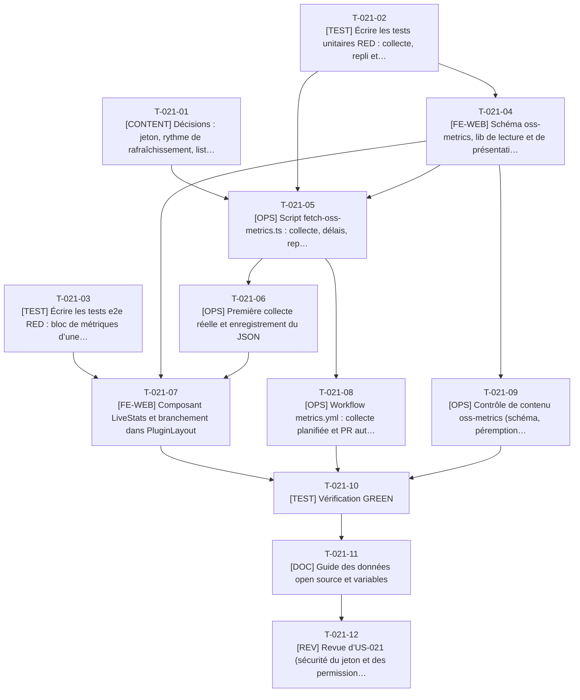

# Tâches - US-021 : Données vivantes au build avec cache et repli

## Informations US
- **Epic** : EPIC-005 : Vitrine open source
- **Persona** : P-003 : Julien, lead développeur Sylius
- **Story Points** : 3
- **Sprint** : sprint-002-preuves_profil_open_source
- **Lot** : 3 (collecte) et 2 (affichage)
- **Dépendances externes au lot** : US-020 pour l’affichage (T-020-12) ; liste des dépôts issue de T-019-07 pour la première collecte. La collecte (lot 3) ne dépend pas des fiches.

## Résumé de la US
**En tant que** P-003 : Julien
**Je veux** voir sur chaque fiche la dernière version, la date de release, les étoiles GitHub et les téléchargements Packagist
**Afin de** m’assurer que le plugin est maintenu avant de l’installer en production

## Vue d’ensemble des tâches

| ID | Type | Tâche | Estimation | Dépend de | Lot | Statut |
|----|------|-------|------------|-----------|-----|--------|
| T-021-01 | [CONTENT] | Décisions : jeton, rythme de rafraîchissement, liste des dépôts | 1h | - | 3 | 🔲 |
| T-021-02 | [TEST] | Écrire les tests unitaires RED : collecte, repli et schéma des métriques | 5h | - | 3 | 🔲 |
| T-021-03 | [TEST] | Écrire les tests e2e RED : bloc de métriques d’une fiche | 2,5h | - | 2 | ✅ |
| T-021-04 | [FE-WEB] | Schéma `oss-metrics`, lib de lecture et de présentation | 3h | T-021-02 | 3 | 🔲 |
| T-021-05 | [OPS] | Script `fetch-oss-metrics.ts` : collecte, délais, repli, cible `make metrics` | 6h | T-021-01, T-021-02, T-021-04 | 3 | 🔲 |
| T-021-06 | [OPS] | Première collecte réelle et enregistrement du JSON | 1,5h | T-021-05, T-019-07 | 3 | 🔲 |
| T-021-07 | [FE-WEB] | Composant `LiveStats` et branchement dans `PluginLayout` | 3,5h | T-021-03, T-021-04, T-021-06, T-020-12 | 2 | ✅ |
| T-021-08 | [OPS] | Workflow `metrics.yml` : collecte planifiée et PR automatique | 3,5h | T-021-05 | 3 | 🔲 |
| T-021-09 | [OPS] | Contrôle de contenu `oss-metrics` (schéma, péremption, clés manquantes) | 2h | T-021-04 | 3 | 🔲 |
| T-021-10 | [TEST] | Vérification GREEN | 2h | T-021-07, T-021-08, T-021-09 | 2 | ✅ |
| T-021-11 | [DOC] | Guide des données open source et variables | 1,5h | T-021-10 | 2 | ✅ |
| T-021-12 | [REV] | Revue d’US-021 (sécurité du jeton et des permissions) | 2h | T-021-11 | 2 | 👀 |

**Total estimé** : 33,5h (12 tâches)

| Type | Tâches | Heures |
|------|--------|--------|
| [CONTENT] | 1 | 1h |
| [TEST] | 3 | 9,5h |
| [FE-WEB] | 2 | 6,5h |
| [OPS] | 4 | 13h |
| [DOC] | 1 | 1,5h |
| [REV] | 1 | 2h |

---

## Graphe de dépendances

Dépendances vers d’autres US : T-021-06 dépend de T-019-07, T-021-07 dépend de T-020-12.

---

## Détail des tâches

#### T-021-01 : [CONTENT] Décisions : jeton, rythme de rafraîchissement, liste des dépôts
- **Type** : [CONTENT]
- **Estimation** : 1h
- **Dépend de** : -
- **Lot** : 3

**Description** :
ADR-0006 prime : le build lit le JSON commité et ne fait aucun appel réseau ; la collecte est un script séparé, planifié (hebdomadaire) avec PR automatique. Trancher l’écart E13 (PR du bot sans CI), la liste des clés `owner/repo` (20 plugins + tailsfadmin) et le package Packagist de chaque dépôt.

**Fichiers à créer/modifier** :
- `docs/guides/donnees-open-source.md (section Décisions)`

**Critères de validation** :
- [ ] Rythme, jeton et mécanisme de PR décidés
- [ ] Liste de 21 clés figée

#### T-021-02 : [TEST] Écrire les tests unitaires RED : collecte, repli et schéma des métriques
- **Type** : [TEST]
- **Estimation** : 5h
- **Dépend de** : -
- **Lot** : 3

**Description** :
Client simulé (`fetch` injecté) : succès ; Packagist 503 avec cache de 2 jours (valeur conservée, `fetchedAt` ancien) ; GitHub 403 (aucune requête après le premier 403, cache) ; JSON sans `downloads` (masquage de cette métrique seule) ; pas de cache ni API (« Métrique « stars » indisponible pour « {slug} » : bloc masqué ») ; délai 10 s, 2 nouvelles tentatives ; jeton jamais écrit dans les journaux ; schéma `ossMetricsSchema` ; formatage « Données au {date} » ; péremption (V10).

**Fichiers à créer/modifier** :
- `tests/unit/oss-metrics/fetch.test.ts`
- `tests/unit/oss-metrics/schema.test.ts`
- `tests/unit/lib/oss-metrics.test.ts`

**Critères de validation** :
- [ ] RED constaté
- [ ] Chaque scénario d’erreur de l’US a un test
- [ ] Le build ne peut pas échouer à cause d’une métrique (test)

#### T-021-03 : [TEST] Écrire les tests e2e RED : bloc de métriques d’une fiche
- **Type** : [TEST]
- **Estimation** : 2,5h
- **Dépend de** : -
- **Lot** : 2

**Description** :
Sur une fiche : version, date de release, étoiles, téléchargements et « Données au … » visibles avec libellés textuels ; aucune requête réseau sortante de la page ; fiche sans bloc quand les données manquent (cas piloté par une fiche dont l’entrée est volontairement absente du JSON de test, ou test unitaire de rendu).

**Fichiers à créer/modifier** :
- `tests/e2e/oss-metrics.spec.ts`

**Critères de validation** :
- [ ] Aucun test ignoré
- [ ] Requêtes tierces = 0

#### T-021-04 : [FE-WEB] Schéma `oss-metrics`, lib de lecture et de présentation
- **Type** : [FE-WEB]
- **Estimation** : 3h
- **Dépend de** : T-021-02
- **Lot** : 3

**Description** :
Schéma du modèle de contenu §3.8, import du JSON validé, accesseur par clé `owner/repo`, formatage des dates et nombres (fr), calcul de péremption. Aucune dépendance au réseau.

**Fichiers à créer/modifier** :
- `src/content/schemas/oss-metrics.ts`
- `src/lib/oss-metrics.ts`
- `src/data/oss-metrics.json (squelette valide)`

**Critères de validation** :
- [ ] Tests de T-021-02 (schéma, lib) verts

#### T-021-05 : [OPS] Script `fetch-oss-metrics.ts` : collecte, délais, repli, cible `make metrics`
- **Type** : [OPS]
- **Estimation** : 6h
- **Dépend de** : T-021-01, T-021-02, T-021-04
- **Lot** : 3

**Description** :
Module `scripts/lib/fetch-metrics.ts` (GitHub REST, Packagist, délai 10 s, 2 reprises, arrêt GitHub après un 403, fusion avec le cache), script d’entrée écrivant `oss-metrics.json`, `GITHUB_TOKEN` lu dans l’environnement (jamais journalisé), scripts npm et cible `make metrics` ; passage de la variable au service `tools` dans `compose.yaml`.

**Fichiers à créer/modifier** :
- `scripts/fetch-oss-metrics.ts`
- `scripts/lib/fetch-metrics.ts`
- `package.json (scripts)`
- `Makefile (append)`
- `compose.yaml`
- `.env.example`

**Critères de validation** :
- [ ] Tests unitaires verts
- [ ] Aucune fuite du jeton dans les journaux
- [ ] Code de sortie 0 en cas de panne réseau

#### T-021-06 : [OPS] Première collecte réelle et enregistrement du JSON
- **Type** : [OPS]
- **Estimation** : 1,5h
- **Dépend de** : T-021-05, T-019-07
- **Lot** : 3

**Description** :
Lancer `make metrics` avec un jeton en lecture seule (`gh auth token`) pour les 21 dépôts, vérifier la durée ≤ 60 s et la validité, enregistrer `oss-metrics.json`. Dépend du noyau des 20 plugins (liste des dépôts) et de la publication Packagist (prérequis T-900-00).

**Fichiers à créer/modifier** :
- `src/data/oss-metrics.json`

**Critères de validation** :
- [ ] 21 entrées ou avertissements explicites
- [ ] Durée ≤ 60 s mesurée

#### T-021-07 : [FE-WEB] Composant `LiveStats` et branchement dans `PluginLayout`
- **Type** : [FE-WEB]
- **Estimation** : 3,5h
- **Dépend de** : T-021-03, T-021-04, T-021-06, T-020-12
- **Lot** : 2

**Description** :
Liste de définitions avec libellés textuels (version, date, étoiles, téléchargements mensuels) et « Données au {date} » ; masquage métrique par métrique ; aucune donnée dans le JSON-LD ; réutilisable par la page tailsfadmin.

**Fichiers à créer/modifier** :
- `src/components/oss/LiveStats.astro`
- `src/layouts/PluginLayout.astro`

**Critères de validation** :
- [ ] Tests de T-021-03 verts
- [ ] Fiche sans métriques = pas de bloc, build vert

#### T-021-08 : [OPS] Workflow `metrics.yml` : collecte planifiée et PR automatique
- **Type** : [OPS]
- **Estimation** : 3,5h
- **Dépend de** : T-021-05
- **Lot** : 3

**Description** :
Cron hebdomadaire + `workflow_dispatch`, Node via Docker (ADR-0003), `GITHUB_TOKEN`, permissions minimales (`contents: write`, `pull-requests: write` sur ce seul workflow), actions épinglées par SHA, création de la PR avec `gh` (pas d’action tierce), branche `chore/metrics-<date>`. Traiter l’écart E13 : une PR ouverte avec `GITHUB_TOKEN` ne déclenche pas la CI.

**Fichiers à créer/modifier** :
- `.github/workflows/metrics.yml`

**Critères de validation** :
- [ ] Exécution manuelle réussie en dépôt de test
- [ ] Aucun secret en clair
- [ ] PR sans modification = aucune PR

#### T-021-09 : [OPS] Contrôle de contenu `oss-metrics` (schéma, péremption, clés manquantes)
- **Type** : [OPS]
- **Estimation** : 2h
- **Dépend de** : T-021-04
- **Lot** : 3

**Description** :
`oss-metrics.content.check.ts` : échec seulement si le schéma est invalide ; avertissements (jamais bloquants) pour `fetchedAt` > 7 jours et clé absente (V10).

**Fichiers à créer/modifier** :
- `scripts/checks/oss-metrics.content.check.ts`
- `tests/unit/checks/oss-metrics-check.test.ts`

**Critères de validation** :
- [ ] Une métrique manquante ne fait jamais échouer le build

#### T-021-10 : [TEST] Vérification GREEN
- **Type** : [TEST]
- **Estimation** : 2h
- **Dépend de** : T-021-07, T-021-08, T-021-09
- **Lot** : 2

**Description** :
`make ci` ; vérification que le build est reproductible hors ligne (réseau coupé) ; lecture des journaux : aucun jeton.

**Critères de validation** :
- [ ] CI verte
- [ ] Build hors ligne OK

#### T-021-11 : [DOC] Guide des données open source et variables
- **Type** : [DOC]
- **Estimation** : 1,5h
- **Dépend de** : T-021-10
- **Lot** : 2

**Description** :
Guide (rafraîchir les métriques, jeton, lecture du JSON, repli), README (cible `make metrics`), `.env.example`, CHANGELOG.

**Fichiers à créer/modifier** :
- `docs/guides/donnees-open-source.md`
- `README.md (append)`
- `docs/guides/README.md (append)`
- `CHANGELOG.md (append)`

**Critères de validation** :
- [ ] Procédure de rafraîchissement reproductible

#### T-021-12 : [REV] Revue d’US-021 (sécurité du jeton et des permissions)
- **Type** : [REV]
- **Estimation** : 2h
- **Dépend de** : T-021-11
- **Lot** : 2

**Description** :
Revue de code, du workflow et de la gestion du jeton (règle 11).

**Critères de validation** :
- [ ] Checklist DoD cochée
- [ ] Permissions du workflow minimales
