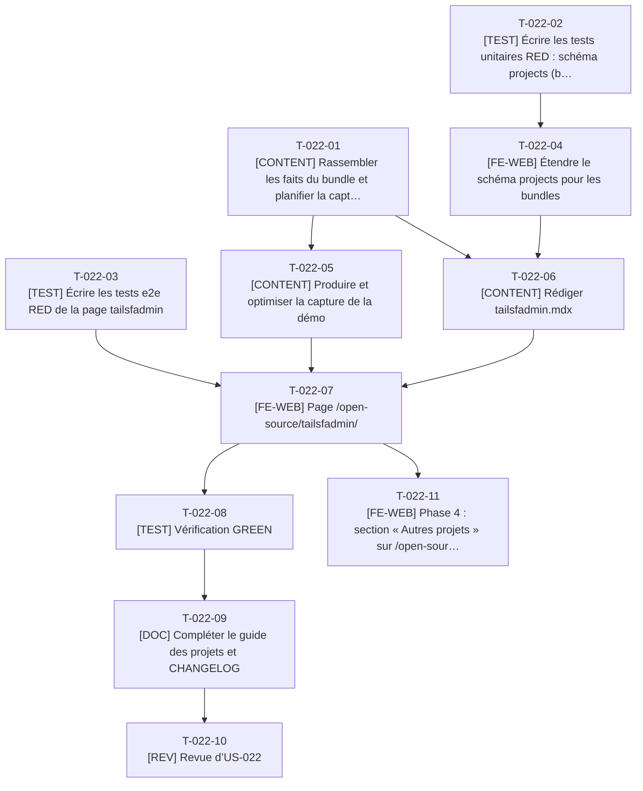

# Tâches - US-022 : Page du bundle Symfony tailsfadmin

## Informations US
- **Epic** : EPIC-005 : Vitrine open source
- **Persona** : P-003 : Julien, lead développeur Symfony
- **Story Points** : 2
- **Sprint** : sprint-002-preuves_profil_open_source
- **Lot** : 3
- **Dépendances externes au lot** : Composants du lot 2 (`InstallSnippet` T-020-10, `LiveStats` T-021-07, script d’optimisation T-020-06) et `ProjectLayout` (T-023-09).

## Résumé de la US
**En tant que** P-003 : Julien
**Je veux** une page présentant le bundle tailsfadmin : ce qu’il apporte, comment l’installer et le configurer, et où trouver la démo et le code
**Afin de** savoir en 2 minutes si ce thème d’administration Tailwind v4 convient à mon projet Symfony

## Vue d’ensemble des tâches

| ID | Type | Tâche | Estimation | Dépend de | Lot | Statut |
|----|------|-------|------------|-----------|-----|--------|
| T-022-01 | [CONTENT] | Rassembler les faits du bundle et planifier la capture | 3h | - | 3 | ✅ |
| T-022-02 | [TEST] | Écrire les tests unitaires RED : schéma `projects` (bundle) | 2h | T-023-04 | 3 | ✅ |
| T-022-03 | [TEST] | Écrire les tests e2e RED de la page tailsfadmin | 3h | - | 3 | ✅ |
| T-022-04 | [FE-WEB] | Étendre le schéma `projects` pour les bundles | 2h | T-022-02 | 3 | ✅ |
| T-022-05 | [CONTENT] | Produire et optimiser la capture de la démo | 1,5h | T-022-01, T-020-06 | 3 | ✅ |
| T-022-06 | [CONTENT] | Rédiger `tailsfadmin.mdx` | 3h | T-022-01, T-022-04 | 3 | ✅ |
| T-022-07 | [FE-WEB] | Page `/open-source/tailsfadmin/` | 3,5h | T-022-03, T-022-05, T-022-06, T-023-09, T-020-10, T-021-07 | 3 | ✅ |
| T-022-08 | [TEST] | Vérification GREEN | 1,5h | T-022-07 | 3 | ✅ |
| T-022-09 | [DOC] | Compléter le guide des projets et CHANGELOG | 1h | T-022-08 | 3 | ✅ |
| T-022-10 | [REV] | Revue d’US-022 | 1,5h | T-022-09 | 3 | 👀 |
| T-022-11 | [FE-WEB] | Phase 4 : section « Autres projets » sur `/open-source/` | 2,5h | T-019-10, T-022-07, T-023-10 | 4 | 🔲 |

**Total estimé** : 24,5h (11 tâches)

| Type | Tâches | Heures |
|------|--------|--------|
| [CONTENT] | 3 | 7,5h |
| [TEST] | 3 | 6,5h |
| [FE-WEB] | 3 | 8h |
| [DOC] | 1 | 1h |
| [REV] | 1 | 1,5h |

---

## Graphe de dépendances

Dépendances vers d’autres US : T-022-02 dépend de T-023-04, T-022-05 dépend de T-020-06, T-022-07 dépend de T-023-09, T-022-07 dépend de T-020-10, T-022-07 dépend de T-021-07, T-022-11 dépend de T-019-10, T-022-11 dépend de T-023-10.

---

## Détail des tâches

#### T-022-01 : [CONTENT] Rassembler les faits du bundle et planifier la capture
- **Type** : [CONTENT]
- **Estimation** : 3h
- **Dépend de** : -
- **Lot** : 3

**Description** :
Depuis `tailsfadmin/README.md` et Packagist : version courante (tag v1.6.2 relevé, l’US dit 1.6), licence MIT, prérequis (PHP ≥ 8.5, Symfony ≥ 7.3 ou 8), installation en 4 étapes, existence d’une démo en ligne. Aucune capture de la démo n’existe (seules des captures d’échecs de tests dans `demo/var`) : prévoir sa production (écart E18).

**Fichiers à créer/modifier** :
- `docs/guides/projets-open-source.md (section tailsfadmin)`

**Critères de validation** :
- [ ] Faits datés
- [ ] Décision capture et démo en ligne prise avec le PO

#### T-022-02 : [TEST] Écrire les tests unitaires RED : schéma `projects` (bundle)
- **Type** : [TEST]
- **Estimation** : 2h
- **Dépend de** : T-023-04
- **Lot** : 3

**Description** :
`kind: bundle` : paquet et licence requis, étapes d’installation (4), pas de contribution exigée ; cohabitation avec `contribution` ; décompte de la collection (2 projets).

**Fichiers à créer/modifier** :
- `tests/unit/content/projects-bundle.test.ts`

**Critères de validation** :
- [ ] RED constaté

#### T-022-03 : [TEST] Écrire les tests e2e RED de la page tailsfadmin
- **Type** : [TEST]
- **Estimation** : 3h
- **Dépend de** : -
- **Lot** : 3

**Description** :
Nom, version courante et licence sans défilement, `composer require tailsfadmin/tailsfadmin-bundle` copiable, liens GitHub, Packagist et README, encadré « En bref » (2 phrases) avant le détail, métriques « Données au … », capture avec alt, page correcte sans métriques.

**Fichiers à créer/modifier** :
- `tests/e2e/tailsfadmin.spec.ts`

**Critères de validation** :
- [ ] Aucun test ignoré
- [ ] RED constaté

#### T-022-04 : [FE-WEB] Étendre le schéma `projects` pour les bundles
- **Type** : [FE-WEB]
- **Estimation** : 2h
- **Dépend de** : T-022-02
- **Lot** : 3

**Description** :
Champs `installSteps`, `inBrief`, `readmeUrl`, `demoUrl` optionnel ; contraintes conditionnelles par `kind`.

**Fichiers à créer/modifier** :
- `src/content/schemas/projects.ts`

**Critères de validation** :
- [ ] Tests de T-022-02 verts
- [ ] career-ops reste valide

#### T-022-05 : [CONTENT] Produire et optimiser la capture de la démo
- **Type** : [CONTENT]
- **Estimation** : 1,5h
- **Dépend de** : T-022-01, T-020-06
- **Lot** : 3

**Description** :
Capture de l’application de démo (poste du PO ; pas d’image Playwright en local), optimisation avec `scripts/optimize-captures.ts` du lot 2, alt français.

**Fichiers à créer/modifier** :
- `src/assets/projects/tailsfadmin/*.webp`

**Critères de validation** :
- [ ] ≤ 200 Ko
- [ ] Aucune donnée personnelle visible

#### T-022-06 : [CONTENT] Rédiger `tailsfadmin.mdx`
- **Type** : [CONTENT]
- **Estimation** : 3h
- **Dépend de** : T-022-01, T-022-04
- **Lot** : 3

**Description** :
« En bref » non technique, apports, installation en 4 étapes renvoyant au README (pas de duplication), mention de l’architecture en monorepo avec ADR sans la recopier, liens.

**Fichiers à créer/modifier** :
- `src/content/projects/fr/tailsfadmin.mdx`

**Critères de validation** :
- [ ] Validé par le schéma
- [ ] Relecture typographique

#### T-022-07 : [FE-WEB] Page `/open-source/tailsfadmin/`
- **Type** : [FE-WEB]
- **Estimation** : 3,5h
- **Dépend de** : T-022-03, T-022-05, T-022-06, T-023-09, T-020-10, T-021-07
- **Lot** : 3

**Description** :
Réutilise `ProjectLayout`, `InstallSnippet` et `LiveStats` (DRY) ; Seo ; entrée de métriques `thibmonier/tailsfadmin`.

**Fichiers à créer/modifier** :
- `src/pages/open-source/tailsfadmin/index.astro`

**Critères de validation** :
- [ ] Scénarios e2e de T-022-03 verts
- [ ] Aucun composant dupliqué

#### T-022-08 : [TEST] Vérification GREEN
- **Type** : [TEST]
- **Estimation** : 1,5h
- **Dépend de** : T-022-07
- **Lot** : 3

**Description** :
`make ci` ; vérification des liens et de l’alternative textuelle.

**Critères de validation** :
- [ ] CI verte
- [ ] Lighthouse ≥ 95

#### T-022-09 : [DOC] Compléter le guide des projets et CHANGELOG
- **Type** : [DOC]
- **Estimation** : 1h
- **Dépend de** : T-022-08
- **Lot** : 3

**Description** :
Section « bundle » du guide, CHANGELOG.

**Fichiers à créer/modifier** :
- `docs/guides/projets-open-source.md`
- `CHANGELOG.md (append)`

**Critères de validation** :
- [ ] Procédure décrite

#### T-022-10 : [REV] Revue d’US-022
- **Type** : [REV]
- **Estimation** : 1,5h
- **Dépend de** : T-022-09
- **Lot** : 3

**Description** :
Revue de code et de contenu.

**Critères de validation** :
- [ ] Checklist DoD cochée

#### T-022-11 : [FE-WEB] Phase 4 : section « Autres projets » sur `/open-source/`
- **Type** : [FE-WEB]
- **Estimation** : 2,5h
- **Dépend de** : T-019-10, T-022-07, T-023-10
- **Lot** : 4

**Description** :
Ajouter au hub une section listant tailsfadmin et career-ops (carte `ProjectCard`) depuis la collection `projects` ; lien « Retour » cohérent ; le hub est un fichier du lot 2, édité après sa fusion.

**Fichiers à créer/modifier** :
- `src/pages/open-source/index.astro`
- `src/components/oss/ProjectCard.astro`

**Critères de validation** :
- [ ] Les deux projets sont accessibles depuis le hub
- [ ] Décompte du catalogue toujours 20
