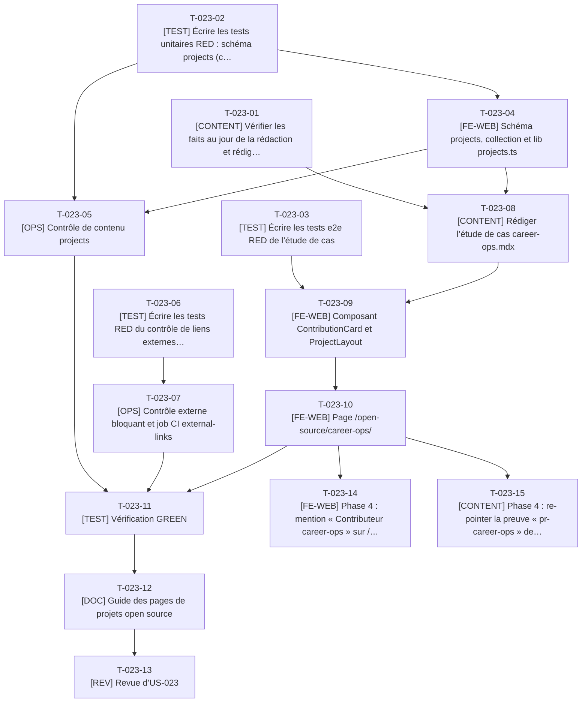

# Tâches - US-023 : Étude de cas des contributions career-ops

## Informations US
- **Epic** : EPIC-005 : Vitrine open source
- **Persona** : P-001 : Claire, DG qui recrute un CTO ou Delivery Manager
- **Story Points** : 2
- **Sprint** : sprint-002-preuves_profil_open_source
- **Lot** : 3
- **Dépendances externes au lot** : US-002 livrée. Phase 4 : mention sur `/parcours/` (après le lot 1) et preuve d’accueil.

## Résumé de la US
**En tant que** P-001 : Claire
**Je veux** lire une étude de cas courte de trois correctifs acceptés dans un projet open source très suivi
**Afin de** vérifier, sans lire de code, que le candidat applique une pratique actuelle, rigoureuse et reconnue par des pairs

## Vue d’ensemble des tâches

| ID | Type | Tâche | Estimation | Dépend de | Lot | Statut |
|----|------|-------|------------|-----------|-----|--------|
| T-023-01 | [CONTENT] | Vérifier les faits au jour de la rédaction et rédiger le résumé | 3h | - | 3 | ✅ |
| T-023-02 | [TEST] | Écrire les tests unitaires RED : schéma `projects` (contribution) et comptage de mots | 3h | - | 3 | ✅ |
| T-023-03 | [TEST] | Écrire les tests e2e RED de l’étude de cas | 3,5h | - | 3 | ✅ |
| T-023-04 | [FE-WEB] | Schéma `projects`, collection et lib `projects.ts` | 3h | T-023-02 | 3 | ✅ |
| T-023-05 | [OPS] | Contrôle de contenu `projects` | 2,5h | T-023-02, T-023-04 | 3 | ✅ |
| T-023-06 | [TEST] | Écrire les tests RED du contrôle de liens externes de la vitrine | 2h | - | 3 | ✅ |
| T-023-07 | [OPS] | Contrôle externe bloquant et job CI `external-links` | 4h | T-023-06 | 3 | ✅ |
| T-023-08 | [CONTENT] | Rédiger l’étude de cas `career-ops.mdx` | 4h | T-023-01, T-023-04 | 3 | ✅ |
| T-023-09 | [FE-WEB] | Composant `ContributionCard` et `ProjectLayout` | 4h | T-023-03, T-023-08 | 3 | ✅ |
| T-023-10 | [FE-WEB] | Page `/open-source/career-ops/` | 2h | T-023-09 | 3 | ✅ |
| T-023-11 | [TEST] | Vérification GREEN | 1,5h | T-023-05, T-023-07, T-023-10 | 3 | ✅ |
| T-023-12 | [DOC] | Guide des pages de projets open source | 1h | T-023-11 | 3 | ✅ |
| T-023-13 | [REV] | Revue d’US-023 | 1,5h | T-023-12 | 3 | 👀 |
| T-023-14 | [FE-WEB] | Phase 4 : mention « Contributeur career-ops » sur `/parcours/` | 1,5h | T-023-10, T-007-13 | 4 | ✅ |
| T-023-15 | [CONTENT] | Phase 4 : re-pointer la preuve « pr-career-ops » de l’accueil vers l’étude de cas | 0,5h | T-023-10, T-019-14 | 4 | ✅ |

**Total estimé** : 37h (15 tâches)

| Type | Tâches | Heures |
|------|--------|--------|
| [CONTENT] | 3 | 7,5h |
| [TEST] | 4 | 10h |
| [FE-WEB] | 4 | 10,5h |
| [OPS] | 2 | 6,5h |
| [DOC] | 1 | 1h |
| [REV] | 1 | 1,5h |

---

## Graphe de dépendances

Dépendances vers d’autres US : T-023-14 dépend de T-007-13, T-023-15 dépend de T-019-14.

---

## Détail des tâches

#### T-023-01 : [CONTENT] Vérifier les faits au jour de la rédaction et rédiger le résumé
- **Type** : [CONTENT]
- **Estimation** : 3h
- **Dépend de** : -
- **Lot** : 3

**Description** :
Avec `gh` : statut « mergée » et dates des PR #3496, #3808, #3866 et des issues liées, nombre d’étoiles du dépôt, appartenance à l’équipe Contributors, chiffre « 128 URL et 61 archétypes perdus sur 224 rapports ». Rédiger le résumé de 3 lignes et le registre non technique. Consigner les valeurs et la date de vérification.

**Fichiers à créer/modifier** :
- `docs/guides/projets-open-source.md (section Sources)`

**Critères de validation** :
- [ ] Les 3 PR sont mergées, liens valides
- [ ] Chiffres datés
- [ ] Aucune information du CV source autre que professionnelle

#### T-023-02 : [TEST] Écrire les tests unitaires RED : schéma `projects` (contribution) et comptage de mots
- **Type** : [TEST]
- **Estimation** : 3h
- **Dépend de** : -
- **Lot** : 3

**Description** :
Message « Étude de cas « career-ops » : la PR #{numéro} n’a pas de tests de non-régression décrits », `kind: contribution` exige au moins une contribution, URL https, statuts, comptage de mots hors encadrés (≤ 900).

**Fichiers à créer/modifier** :
- `tests/unit/content/projects.test.ts`
- `tests/unit/lib/projects.test.ts`

**Critères de validation** :
- [ ] RED constaté
- [ ] Seuil de 900 mots testé

#### T-023-03 : [TEST] Écrire les tests e2e RED de l’étude de cas
- **Type** : [TEST]
- **Estimation** : 3,5h
- **Dépend de** : -
- **Lot** : 3

**Description** :
Résumé de 3 lignes visible sans défilement (1440 × 900 et 375 × 667), quatre blocs par PR, chiffre du cas n°2, encadrés `
` repliés par défaut (aucun extrait de code visible), dépliage clavier Entrée et Espace, lien « Retour au profil », liens sortants `rel="noopener noreferrer"`, axe, impression lisible.

**Fichiers à créer/modifier** :
- `tests/e2e/career-ops.spec.ts`

**Critères de validation** :
- [ ] Aucun test ignoré
- [ ] RED constaté

#### T-023-04 : [FE-WEB] Schéma `projects`, collection et lib `projects.ts`
- **Type** : [FE-WEB]
- **Estimation** : 3h
- **Dépend de** : T-023-02
- **Lot** : 3

**Description** :
Schéma du modèle §3.7 (strict, `safeText` sur les textes), loader `glob` sur `src/content/projects/fr/*.mdx` (append dans `content.config.ts`), comptage de mots.

**Fichiers à créer/modifier** :
- `src/content/schemas/projects.ts`
- `src/content.config.ts (append)`
- `src/lib/projects.ts`

**Critères de validation** :
- [ ] Tests de T-023-02 verts

#### T-023-05 : [OPS] Contrôle de contenu `projects`
- **Type** : [OPS]
- **Estimation** : 2,5h
- **Dépend de** : T-023-02, T-023-04
- **Lot** : 3

**Description** :
`projects.content.check.ts` : schéma, tests de non-régression décrits, longueur ≤ 900 mots hors encadrés, liens https, aucune donnée personnelle.

**Fichiers à créer/modifier** :
- `scripts/checks/projects.content.check.ts`
- `scripts/checks/lib/projects.ts`
- `tests/unit/checks/projects.test.ts`

**Critères de validation** :
- [ ] PR sans bloc « tests » = échec avec le message de l’US

#### T-023-06 : [TEST] Écrire les tests RED du contrôle de liens externes de la vitrine
- **Type** : [TEST]
- **Estimation** : 2h
- **Dépend de** : -
- **Lot** : 3

**Description** :
Sur les pages `/open-source/**` : un lien 404 ou 410 produit « Lien cassé sur /open-source/career-ops/ : {url} (404) » ; 429, 5xx et délais d’attente ne bloquent pas (avertissement) ; reprises ; client HTTP injecté.

**Fichiers à créer/modifier** :
- `tests/unit/checks/external-links.test.ts`

**Critères de validation** :
- [ ] RED constaté
- [ ] Cas 404, 410, 429, 503 et délai testés

#### T-023-07 : [OPS] Contrôle externe bloquant et job CI `external-links`
- **Type** : [OPS]
- **Estimation** : 4h
- **Dépend de** : T-023-06
- **Lot** : 3

**Description** :
`scripts/checks/external-links.ts` exécuté par un job dédié de `ci.yml` (non dans le build Docker ni Railway : un site tiers en panne ne doit pas bloquer un déploiement ; écart E14) à partir de l’artefact `dist`. Job ajouté aux `needs` du job `ci`.

**Fichiers à créer/modifier** :
- `scripts/checks/external-links.ts`
- `scripts/checks/lib/external-links.ts`
- `.github/workflows/ci.yml`
- `Makefile (append)`

**Critères de validation** :
- [ ] Un lien mort sur la vitrine fait échouer la CI
- [ ] Aucun changement du temps du build Docker

#### T-023-08 : [CONTENT] Rédiger l’étude de cas `career-ops.mdx`
- **Type** : [CONTENT]
- **Estimation** : 4h
- **Dépend de** : T-023-01, T-023-04
- **Lot** : 3

**Description** :
Frontmatter (3 contributions : problème, correctif, tests, URL, statut), résumé de 3 lignes, lien avec la thèse du site (un défaut silencieux est un risque de delivery), encadrés techniques repliables, ≤ 900 mots hors encadrés.

**Fichiers à créer/modifier** :
- `src/content/projects/fr/career-ops.mdx`

**Critères de validation** :
- [ ] Validé par le schéma et T-023-05
- [ ] Texte visible sans jargon
- [ ] Relecture typographique

#### T-023-09 : [FE-WEB] Composant `ContributionCard` et `ProjectLayout`
- **Type** : [FE-WEB]
- **Estimation** : 4h
- **Dépend de** : T-023-03, T-023-08
- **Lot** : 3

**Description** :
Carte à quatre blocs (problème, correctif, tests, lien) avec `
` technique, mise en page de projet (en-tête, lien « Retour au profil », liens GitHub), réutilisable par tailsfadmin (US-022).

**Fichiers à créer/modifier** :
- `src/components/oss/ContributionCard.astro`
- `src/layouts/ProjectLayout.astro`

**Critères de validation** :
- [ ] Structure h1 à h3 respectée
- [ ] `
` accessibles au clavier

#### T-023-10 : [FE-WEB] Page `/open-source/career-ops/`
- **Type** : [FE-WEB]
- **Estimation** : 2h
- **Dépend de** : T-023-09
- **Lot** : 3

**Description** :
Page statique à partir de la collection `projects`, Seo (title, description, canonical), liens sortants sécurisés.

**Fichiers à créer/modifier** :
- `src/pages/open-source/career-ops/index.astro`

**Critères de validation** :
- [ ] Scénarios e2e de T-023-03 verts sauf mention depuis le profil

#### T-023-11 : [TEST] Vérification GREEN
- **Type** : [TEST]
- **Estimation** : 1,5h
- **Dépend de** : T-023-05, T-023-07, T-023-10
- **Lot** : 3

**Description** :
`make ci` ; vérification manuelle des liens de PR ; Lighthouse ≥ 95.

**Critères de validation** :
- [ ] CI verte
- [ ] Preuves des scénarios dans la PR

#### T-023-12 : [DOC] Guide des pages de projets open source
- **Type** : [DOC]
- **Estimation** : 1h
- **Dépend de** : T-023-11
- **Lot** : 3

**Description** :
Guide (ajouter une contribution, vérifier les faits, comptage de mots) ; US-022 le complète. Index et CHANGELOG.

**Fichiers à créer/modifier** :
- `docs/guides/projets-open-source.md`
- `docs/guides/README.md (append)`
- `CHANGELOG.md (append)`

**Critères de validation** :
- [ ] Procédure décrite

#### T-023-13 : [REV] Revue d’US-023
- **Type** : [REV]
- **Estimation** : 1,5h
- **Dépend de** : T-023-12
- **Lot** : 3

**Description** :
Revue de code et de contenu (exactitude, registre non technique).

**Critères de validation** :
- [ ] Checklist DoD cochée

#### T-023-14 : [FE-WEB] Phase 4 : mention « Contributeur career-ops » sur `/parcours/`
- **Type** : [FE-WEB]
- **Estimation** : 1,5h
- **Dépend de** : T-023-10, T-007-13
- **Lot** : 4

**Description** :
Ajouter, après la fusion du lot 1, une ligne de preuve open source sur la page Parcours avec lien vers l’étude de cas (scénario « Accès depuis la page profil »). Impression de la page inchangée.

**Fichiers à créer/modifier** :
- `src/pages/parcours.astro`

**Critères de validation** :
- [ ] Scénario e2e vert
- [ ] Page imprimée toujours sur 2 pages A4

#### T-023-15 : [CONTENT] Phase 4 : re-pointer la preuve « pr-career-ops » de l’accueil vers l’étude de cas
- **Type** : [CONTENT]
- **Estimation** : 0,5h
- **Dépend de** : T-023-10, T-019-14
- **Lot** : 4

**Description** :
Remplacer le lien externe provisoire par `/open-source/career-ops/` ; édition séquentielle de `home.yaml` après T-019-14.

**Fichiers à créer/modifier** :
- `src/data/home.yaml`

**Critères de validation** :
- [ ] `proof-links` vert
