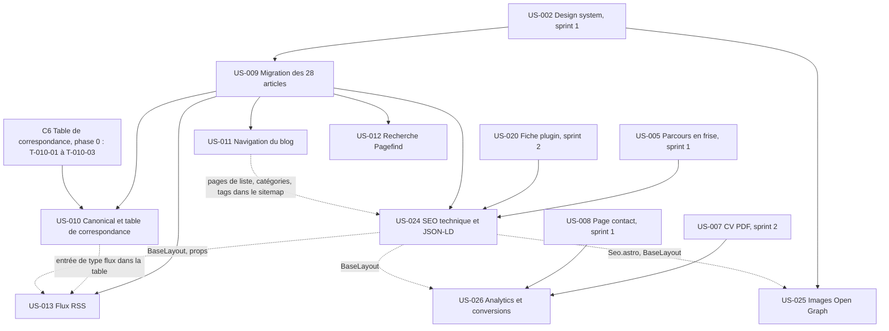

# Sprint 003 : dépendances

Le détail par tâche (graphe Mermaid, chemin critique, contrats entre lots, écarts) est dans `tasks/README.md`.

Traits pleins : dépendances du backlog. Pointillés : contrats techniques ajoutés à la décomposition (aucun cycle).

| US | Bloquée par | Bloque (dans le sprint) | Bloque (hors sprint) |
|----|-------------|-------------------------|----------------------|
| US-009 | US-002 (sprint 1) | US-010, US-011, US-012, US-013, US-024 | — |
| US-010 | US-009 ; US-003 (sprint 1) ; C6 publié en phase 0 (`T-010-01` à `T-010-03`) | — (déployée avec US-009) | future story de redirection 301 de l'ancien site |
| US-011 | US-009 | — (contrat souple : pages de liste dans le sitemap d'US-024) | — |
| US-012 | US-009 | — | — (la recherche rejoindra le labo et les fiches avec leurs EPICs, voir « Report vers le sprint 4 ») |
| US-013 | US-009 ; contrat C5 (props du layout) | — | — |
| US-024 | US-005, US-020 (livrées) ; US-009 | — (contrat souple : `Seo.astro` pour US-025, `BaseLayout` pour US-026) | — |
| US-025 | US-002 (sprint 1) ; `Seo.astro` étendu par US-024 | — | — |
| US-026 | US-007, US-008 (sprint 2 et 1) ; `BaseLayout` étendu par US-024 | — | — |

## Ordre d'exécution

- **Phase 0 (orchestrateur)** : retour de rétro (`no-global-prune`, `make preflight`, liste d'exceptions e2e, guides), dépendances, contrats C1 à C6 (C6 : `T-010-01` à `T-010-03`, publié avant S0), échantillonnage des tests. S0 exige les preuves de `T-900-01`, `T-900-02`, `T-900-04` et `T-900-05` (commande et résultat attendu, voir `tasks/technical-tasks.md`).
- **Lot A (W1)** : US-009 (migration, lot 1 d'articles en premier), puis US-010 (déployées ensemble au jalon n°1), puis US-011, puis US-012.
- **Lot B (W2)** : cœur d'US-024, puis US-026, US-025, US-013 ; tâches « S1 » (données réelles du blog) après le jalon n°1.
- Ordre de fusion des zones partagées : lot A puis lot B ; CHANGELOG, index des guides et des ADR assemblés par l'orchestrateur en phase 4.

## Dépendances entre les deux lots (niveau tâche)

Les seules dépendances A/B ci-dessous sont des synchronisations, jamais des fichiers partagés en écriture :

| Tâche (lot) | Dépend de (lot) | Nature |
|-------------|-----------------|--------|
| T-013-09 (B) | T-009-23 (A) | vérification sur les articles réels du lot A (synchronisation S1) |
| T-024-16 (B) | T-009-23 (A) | vérification sur les articles réels du lot A (synchronisation S1) |
| T-025-11 (B) | T-009-23 (A) | vérification sur les articles réels du lot A (synchronisation S1) |

## Report vers le sprint 4

- Les 6 liens du corps de 3 articles vers des pages non migrées de l'ancien site (`/services/sites-ia`, `/methode`, `/boite-a-outils`, `/boite-a-outils/zsh`) pointent vers l'URL absolue d'agentic-agency.fr tant que le labo n'existe pas (écart E10). **Action du sprint 4** : les re-pointer vers `/labo/…` à la livraison de la Boîte à outils (EPIC-004) et retirer l'exception correspondante du contrôle de liens.
- La recherche (US-012) est limitée aux articles : le labo et les fiches plugins rejoindront l'index avec leurs EPICs (`data-pagefind-body` à ajouter à leurs layouts).
- Les collections `tools`, `toolTests` et `comparisons` déclareront leurs schémas dans `src/content/collections/<nom>.ts` (convention posée par ce sprint).
- Future story hors backlog actuel : appliquer le fichier de redirections `agentic-agency.nginx.conf` sur agentic-agency.fr et déclarer le changement d'adresse dans la Search Console.

## Prérequis hors backlog

Détail et suivi : voir `pre-sprint-checklist.md`.

- [ ] PR n°2 du sprint 2 fusionnée, production à jour, US du sprint 2 validées par le PO
- [ ] Actions 1, 4 et 5 de la rétro du sprint 2 faites avec preuve (`T-900-01`, `T-900-02`, `T-900-03`) ; espace disque relevé (objectif 8 Go, dérogation PO consignée si 6,1 Go)
- [ ] Volumes MySQL Sylius du PO inventoriés
- [x] Forme des URL d'agentic-agency.fr : déduite du dépôt source (sans barre finale), l'ancien site n'étant pas public (401) ; aucune action du PO (`T-010-01`, arbitrage E15)
- [ ] Provenance et droit d'usage des 22 couvertures d'articles déclarés par le PO (`T-009-12`)
- [ ] Validation par le PO des 3 FAQ rédigées par l'agent (`T-009-19`, `validated: false`) et de l'ordre des séries déduit des pieds d'article (`T-011-01`) ; ces tâches ne sont pas bloquées par le PO
- [ ] Compte Umami Cloud créé par le PO et `PUBLIC_UMAMI_WEBSITE_ID` fourni (`T-026-01` ; sans variable : aucun script, repli documenté)
- [ ] Domaine définitif, DNS et `PUBLIC_SITE_URL` (sous-domaine Railway provisoire sinon, écart E23)
- [ ] Validation PO du contenu par lots de 5 au fil du sprint, au plus tard le 2026-11-18 (`contenu-a-valider.md`)
