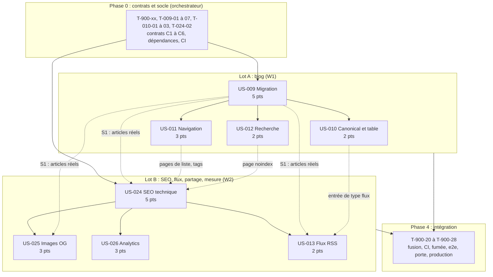

# Tâches du Sprint 003 : Blog migré et SEO

> Sprint Planning partie 2 (le COMMENT). Les sprints 1 et 2 sont livrés sur `main` : la décomposition part du code réel (`src/`, `scripts/checks/`, `tests/`, `Dockerfile`, `compose.yaml`, `Makefile`, `.github/workflows/`) et ne replanifie rien de ce qui existe. Stack : site statique Astro 7.3.8 / TypeScript 6.0.3 / Tailwind 4.3.3, entièrement dockerisé, nginx 1.30.5 sur Railway, CI GitHub Actions. Sources faisant foi : `project-management/tech-spec.md`, `docs/adr/0001` à `0010` (surtout 0004 Umami et Web3Forms, 0008 URL et collections, 0009 CSP), `project-management/architecture/{content-model,integrations,security}.md`, `project-management/definition-of-done.md`, la rétrospective du sprint 2 (`sprint-retro.md`), la checklist de démarrage du sprint 3 (`pre-sprint-checklist.md`) et les formats et arbitrages des sprints 1 et 2. La source du blog (`/Users/tmonier/Projects/blog/`) est lue en lecture seule.

## Existant réutilisé (non replanifié)

| Élément livré aux sprints 1 et 2 | Usage dans ce sprint |
|----------------------------------|----------------------|
| `BaseLayout.astro`, `components/seo/Seo.astro`, `lib/seo.ts` (`buildTitle`, `canonicalUrl` avec barre finale sauf fichier, `buildOpenGraph`) ; `noindex` supprime la canonical | Étendus par le lot B (JSON-LD, Open Graph image, flux, mesure d'audience) ; contrat de props figé en phase 0 (C5) |
| `astro.config.mjs` : `site` lu dans `PUBLIC_SITE_URL` (repli `https://thibaut-monier.fr`), `trailingSlash: 'always'`, i18n fr/en, `inlineStylesheets: 'never'`, MDX 8.0.3 | Bloc `markdown` (phase 0) et bloc `integrations` (sitemap, lot B) |
| `nginx.conf` : `location ^~ /pagefind/` déjà prévue (revalidation), snippet d'en-têtes à réinclure dans chaque `location` ; `nginx/snippets/security-headers.conf` : CSP avec `'wasm-unsafe-eval'`, `cloud.umami.is` en `script-src`, `cloud.umami.is` et `api-gateway.umami.dev` en `connect-src` | Ajout des `location` de `/rss.xml`, `robots.txt`, `llms.txt`, sitemaps, `/og/` ; CSP confirmée pour Umami (T-026-09) |
| `scripts/checks/run.ts` et `lib/runner.ts` (découverte `*.content.check.ts` et `*.dist.check.ts`) ; `internal-links.dist.check.ts` (liens internes et ancres bloquants) ; `external-links` (job CI séparé, limité à `open-source/`) ; `lighthouse.ts` (pages découvertes dans `dist/`, 3 exécutions) ; `smoke.ts` (`OK_PATHS`) | Un contrôle par sujet, sans liste centrale ; `external-links` étendu au blog (T-009-30) ; `OK_PATHS` étendu en phase 4 |
| `tests/e2e/helpers/routes.ts` (découverte en largeur par liens internes terminés par `/`), `a11y.spec.ts` (délai proportionnel), `pages-matrix.spec.ts`, `headers.spec.ts`, mode strict `E2E_EXPECT_FULL_CONFIG` | Une page non liée n'est testée ni par axe ni par la matrice : chaque page du blog est liée. Échantillonnage des gabarits répétés (T-900-12 et T-900-13) |
| `src/components/contact/contact-form.ts` appelle déjà `window.umami?.track('contact_submit', { motif })` ; `CvDownload.astro` porte `data-cv-download` ; `src/content/legal/vie-privee.md` mentionne déjà Umami Cloud | US-026 formalise le contrat, ajoute le chargeur et les contrôles |
| `cv/fonts/Inter-*.ttf` (OFL), `src/data/tokens.json`, `src/lib/contrast.ts` | Police et couleurs des images Open Graph (DRY) |
| `src/lib/privacy.ts` (`detectPii`), `src/content/schemas/common.ts` (`safeText`, `httpsUrl`, `slug`), `src/lib/text.ts` (`countWords`), `src/lib/projects.ts` et `src/content/schemas/projects.ts` (méthode « schéma à fabrique avec `image` injecté ») | Mêmes briques pour la collection `blog` |
| `.github/workflows/scheduled.yml` : redéploiement quotidien à 06:00 UTC | Publication programmée des articles datés (US-009) |
| `Dockerfile` : `ARG PUBLIC_SITE_URL` et `ARG PUBLIC_UMAMI_WEBSITE_ID` déjà passés au build ; `.npmrc` : `ignore-scripts=true`, `save-exact=true` ; `.dockerignore` exclut `.github`, `project-management`, `reports` | Aucune modification du `Dockerfile` prévue ; conséquence pour `no-global-prune` (T-900-01) |
| `src/config/nav.ts` (liens pilotés par `enabled`, arbitrage A4) : ni `blog` ni `recherche` ne sont dans la liste | Entrées ajoutées par le lot A |

## Adaptation de la méthode

Mêmes types que les sprints 1 et 2 : pas de `[DB]`, `[BE]` ni `[FE-MOB]` (ni base de données, ni API, ni application mobile).

| Type | Contenu |
|------|---------|
| `[OPS]` | Dockerfile, nginx, Makefile et `mk/`, CI, scripts de build et de contrôle (`scripts/`), dépendances |
| `[FE-WEB]` | Pages, composants, layouts, scripts navigateur, schémas Zod, bibliothèques TypeScript pures (`src/lib/`) |
| `[CONTENT]` | Articles, textes alternatifs, descriptions, FAQ, tableaux de données (YAML), décisions écrites, vérification des faits |
| `[TEST]` | Vitest, Playwright, axe ; **écrits avant le code (RED)**, e2e **stricts** (aucun `test.skip` hors `tests/e2e/skip-allowlist.json`) |
| `[DOC]` | Guides, ADR, fragments de CHANGELOG |
| `[REV]` | Revue de code et de contenu |

Chaque US reste une tranche verticale : contenu validé par schéma, page rendue, test de bout en bout, déploiement. Les tâches de phase 0 rattachées à une US (`T-009-01` à `T-009-07`, `T-024-02`) fixent des contrats et s'exécutent avant les workers. Aucune dépendance npm n'est ajoutée en dehors de `T-900-07`.

## Synthèse

| Indicateur | Valeur |
|------------|--------|
| User stories | 8 (25 points) |
| Tâches | **142** (dont 22 transverses, voir `technical-tasks.md`) |
| Heures estimées | **409h** |
| Chemin critique de dépendances | 65,5h : T-009-01 → T-009-02 → T-009-03 → T-009-04 → T-009-05 → T-009-10 → T-009-11 → T-009-13 → T-009-23 → T-009-25 → T-009-26 → T-012-08 → T-012-09 → T-012-10 → T-012-12 → T-900-20 → T-900-21 → T-900-25 → T-900-26 → T-900-27 |
| Chemin critique de ressources | lot A (161,5h) et lot B (158h) en parallèle, après 62h de phase 0 et avant 27,5h de phase 4 |
| Taille des tâches | 1h à 7h (idéal 2-4h) |

| US | Titre | Pts | Tâches | Heures | Lot | Fichier |
|----|-------|-----|--------|--------|-----|---------|
| US-009 | Migration des 28 articles d'Agentic Agency | 5 | 30 | 95h | A | [US-009-tasks.md](US-009-tasks.md) |
| US-010 | Canonical sur le nouveau domaine et table de correspondance prête pour les redirections | 2 | 12 | 33,5h | A | [US-010-tasks.md](US-010-tasks.md) |
| US-011 | Navigation du blog : catégories, tags, séries, pagination | 3 | 11 | 31h | A | [US-011-tasks.md](US-011-tasks.md) |
| US-012 | Recherche plein texte côté client (Pagefind) | 2 | 12 | 30,5h | A | [US-012-tasks.md](US-012-tasks.md) |
| US-013 | Flux RSS | 2 | 11 | 24,5h | B | [US-013-tasks.md](US-013-tasks.md) |
| US-024 | SEO technique et données structurées (JSON-LD, sitemap, llms.txt) | 5 | 18 | 63h | B | [US-024-tasks.md](US-024-tasks.md) |
| US-025 | Images Open Graph générées au build | 3 | 13 | 34,5h | B | [US-025-tasks.md](US-025-tasks.md) |
| US-026 | Analytics sans cookie et mesure des conversions | 3 | 13 | 38h | B | [US-026-tasks.md](US-026-tasks.md) |
| Transverse | Phase 0, phase 4 et reprises de rétro | - | 22 | 59h | 0 et 4 | [technical-tasks.md](technical-tasks.md) |
| **Total** | | **25** | **142** | **409h** | | |

| Type | Tâches | Heures |
|------|--------|--------|
| [OPS] | 27 | 74,5h |
| [FE-WEB] | 33 | 116,5h |
| [CONTENT] | 20 | 51,5h |
| [TEST] | 40 | 121h |
| [DOC] | 12 | 21h |
| [REV] | 10 | 24,5h |

Environ 16,4 h par point (sprint 1 : 9,9 h ; sprint 2 : 12,1 h). Le sprint est plus chargé en contrôles et en contenu éditorial qu'en code : 28 articles à relire par lots, environ 13 contrôles de build nouveaux, 5 fichiers techniques générés (flux, sitemap, robots, llms.txt, images de partage). Comme aux sprints précédents, l'exécution est agentique : l'estimation horaire sert d'ordre de grandeur et de découpage, pas d'engagement de calendrier (la checklist de démarrage pilote en points).

## Lots de travail (2 workers au plus)

Contrainte de disque (checklist de démarrage §4.3) : **2 workers maximum**, 1 seul sous 3 Go libres, arrêt de tout build sous 1,5 Go, un seul build d'image à la fois. Les deux lots ci-dessous ne partagent **aucun fichier en écriture** : la colonne « Propriété exclusive » est exhaustive pour les fichiers qu'ils modifient ; tout autre fichier est à la phase 0, à la phase 4 ou à l'orchestrateur. Workers dans des worktrees créés par l'orchestrateur depuis la **branche du sprint** (pas `main`), sans `git`, avec `COMPOSE_PROJECT_NAME` et ports distincts (surcharge locale non versionnée `compose.override.yaml` avec `ports: !override` : W1 en 4322 et 8081, W2 en 4323 et 8082). Pas d'image Playwright en local (disque) : les e2e se vérifient avec le Chromium système (`PW_CHROMIUM_PATH`) contre `preview`, ou dans la CI.

| Lot | US | Heures | Worker | Démarre quand | Propriété exclusive de |
|-----|----|--------|--------|---------------|------------------------|
| **Phase 0 : contrats et socle** | tâches de phase 0 (`T-900-01` à `T-900-13`, `T-009-01` à `T-009-07`, `T-010-01` à `T-010-03`, `T-024-02`) | 62h | orchestrateur | immédiatement | `src/content.config.ts`, `package.json` (scripts et dépendances), `package-lock.json`, `Makefile` (une ligne), `playwright.config.ts`, `.github/workflows/ci.yml`, `tests/e2e/{a11y,pages-matrix}.spec.ts` et `helpers/`, `scripts/checks/lighthouse.ts`, `src/lib/{site-url,page-meta,blog,blog-source,redirects,rehype-article-blocks}.ts`, `tests/unit/lib/redirects.test.ts`, `src/content/{schemas,collections}/blog.ts`, `src/i18n/` (clé `footer.rss`), `astro.config.mjs` (bloc `markdown`), `docs/guides/{worktrees-agents,qualite-ci}.md` |
| **A : blog, redirections, navigation, recherche** | US-009, puis US-010, puis US-011, puis US-012 | 161,5h | W1 | fin de la phase 0 (S0) | `src/content/blog/`, `src/assets/blog/`, `src/data/redirects.yaml`, `src/lib/{blog-taxonomy,blog-migration,search}.ts`, `src/components/blog/`, `src/layouts/ArticleLayout.astro`, `src/styles/article.css`, `src/pages/{blog,recherche}/`, `src/pages/404.astro`, `src/scripts/search.ts`, `src/config/nav.ts`, `scripts/{migrate-blog,build-redirects}.ts`, `scripts/checks/{blog,blog-schedule,canonical,redirects,pagefind}*` et leurs libs, `scripts/checks/lib/external-links.ts`, `tests/e2e/{blog,blog-navigation,blog-canonical,search,layout}.spec.ts`, `tests/e2e/sample-routes.json`, `tests/unit/config/site.test.ts`, `tests/fixtures/{blog-source,redirects}/`, `docs/guides/{blog,recherche,redirections-blog,design-system}.md`, `docs/adr/0013-*`, `mk/lot-a.mk`, `changelog.d/lot-a.md` |
| **B : flux, SEO technique, images de partage, mesure** | US-026, US-024 (cœur), US-025, US-013, puis vérifications dépendantes du blog | 158h | W2 | fin de la phase 0 (S0) ; tâches « S1 » après la synchronisation | `src/layouts/BaseLayout.astro`, `src/components/seo/`, `src/components/ui/Footer.astro`, `src/lib/{seo,breadcrumb,og,rss,sitemap,llms,analytics-events}.ts` et `src/lib/jsonld/`, `src/pages/{rss.xml,robots.txt,llms.txt}.ts`, `src/pages/og/`, `src/pages/{index,parcours}.astro`, `src/pages/open-source/index.astro`, `src/layouts/{PluginLayout,ProjectLayout}.astro`, `src/scripts/analytics.ts`, `src/components/{cv/CvDownload,contact/RdvLink,contact/contact-form}`, `src/content/legal/vie-privee.md`, `src/config/legal.ts`, `astro.config.mjs` (bloc `integrations`), `nginx.conf`, `nginx/snippets/`, `.env.example`, `scripts/checks/{rss,jsonld,meta,sitemap-coherence,no-hardcoded-domain,og,analytics-events}*` et leurs libs, `tests/e2e/{rss,seo,og,analytics,headers}.spec.ts`, `tests/unit/lib/seo.test.ts`, `tests/fixtures/{rss,jsonld}/`, `docs/guides/{flux-rss,seo-technique,images-og,analytics}.md`, `docs/adr/{0011,0012}-*`, `changelog.d/lot-b.md` |
| **Phase 4 : intégration** | tâches `T-900-20` à `T-900-28` | 27,5h | orchestrateur | après fusion des lots A et B | `CHANGELOG.md`, `README.md`, `docs/guides/README.md`, `docs/adr/README.md`, `.github/workflows/ci.yml`, `scripts/checks/lib/smoke.ts`, `tests/e2e/sprint-003.spec.ts`, `task-board.md`, `contenu-a-valider.md` |

Équilibre : le lot A pèse 161,5h (après le passage de `T-010-01` à `T-010-03` en phase 0) et le lot B 158h. Le chemin critique de ressources est celui du lot A, dont les lots d'articles (6 × 2 à 4 h) attendent aussi les validations du PO. Option d'équilibrage sans conflit de fichiers : confier à W2, une fois ses tâches terminées, les lots d'articles 4 à 6 (`T-009-16` à `T-009-18`, fichiers `src/content/blog/fr/*.md` disjoints) après la fusion de `T-009-13` ; le plan reste valable à deux workers.

### Synchronisations

| Point | Quand | Ce qui se passe |
|-------|-------|-----------------|
| **S0** | fin de la phase 0 | Contrats C1 à C6 commités sur la branche du sprint (C6 : `T-010-01` à `T-010-03`) ; **preuves E25 consignées avant toute création de worktree** : `make checks` avec `no-global-prune` (T-900-01), `make preflight` (T-900-02), tests du reporter et `tests/e2e/skip-allowlist.json` (T-900-04), `docs/guides/worktrees-agents.md` (T-900-05) ; commandes et résultats attendus dans `technical-tasks.md` (« Conditions de clôture de la phase 0 ») ; l'orchestrateur crée ensuite les deux worktrees à partir de cette branche |
| **S1** | jalon n°1 (2026-11-17) | Lot A : `T-009-26` et `T-010-10` verts (US-009 et US-010 sont déployées ensemble). L'orchestrateur fusionne le lot A partiel dans la branche du sprint, puis la fusionne dans le worktree de W2. Les vérifications de B qui exigent les articles réels démarrent : `T-013-09`, `T-024-16`, `T-025-11` (dépendances explicites sur `T-009-23`) ; les contrôles `meta`, `jsonld` et `sitemap-coherence` sont aussi relancés sur le site complet |
| **S2** | fin du lot A | US-011 et US-012 fusionnées ; Pagefind et la navigation rejoignent les contrôles de B (sitemap, métadonnées) |
| **S3** | fin du lot B | Fusion de B ; début de la phase 4 |

Revue DoD indépendante à mi-sprint : 2026-11-18 (`T-900-27`, première passe), validation PO des contenus (jalon n°2) le même jour.

### Gabarit de prompt pour un worker

Recopier tel quel dans le prompt de chaque worker (règle issue de la rétro du sprint 2).

```text
Mission : exécuter les tâches <liste d'IDs> de tasks/US-0XX-tasks.md, dans l'ordre des dépendances, en TDD
(tests RED d'abord, constatés rouges, puis code, puis refactor). Lire tasks/README.md (Contrats C1 à C11).

Périmètre : écrire UNIQUEMENT dans les fichiers de la colonne « Propriété exclusive » du lot <A|B>.
Besoin hors périmètre (dépendance npm, ci.yml, Dockerfile, fichier d'un autre lot) : le signaler dans le
rapport final, ne rien contourner. Tu n'as pas accès à git ; ne crée ni branche ni commit.
Ne modifie jamais un contrat C1 à C11 : demande-le à l'orchestrateur.

Source du blog : /Users/tmonier/Projects/blog/ en LECTURE SEULE (montage :ro dans le conteneur, jamais d'écriture).

Docker (interdits, sans exception) : docker system prune, docker volume prune, docker container prune,
docker image prune -a, docker builder prune -a. Des volumes MySQL d'autres projets du PO ont déjà été
perdus ainsi. Autorisés : docker compose -p <ton-projet> down -v, docker builder prune -f.
Toujours COMPOSE_PROJECT_NAME=<tm-w1|tm-w2> et les ports de ton worktree. Un seul build d'image à la
fois. Relever df -h avant et après chaque lot de tâches ; sous 3 Go libres, arrêter et prévenir.
Pas d'image Playwright en local : PW_CHROMIUM_PATH (Chromium système) ou la CI.

Shell : ls, cat, grep, du sont des alias sur ce poste ; utiliser command ls, command cat, command grep,
des chemins absolus, mv -f, command curl.

Qualité : aucune dépendance ajoutée ; aucun marqueur provisoire dans le contenu publié (le contrôle
placeholders bloque) ; aucun test.skip hors tests/e2e/skip-allowlist.json ; tout fait daté ou chiffré est
vérifié et daté ; français correct (accents, espaces insécables avant : ; ? !) ; délais des tests globaux
proportionnels au nombre de pages.

Fin de mission : UN SEUL rapport (tâches faites, fichiers modifiés, commandes de vérification et leurs
résultats, points bloquants), puis arrêt. Pas de relance ni de rapport répété.
```

### Ordre d'exécution

1. **Phase 0** (orchestrateur, séquentielle, avant tout worker) : retour de rétro (`T-900-01` à `T-900-05`, à vérifier s'ils sont déjà faits : `make preflight`, `scripts/checks/no-global-prune.content.check.ts`, `tests/e2e/skip-allowlist.json`, `docs/guides/worktrees-agents.md` ; chacune est close par une commande de preuve et son résultat attendu, voir `technical-tasks.md`, avant S0 et avant la création des worktrees), zones anti-conflit (`T-900-06`), dépendances et vérifications natives (`T-900-07`, `T-900-08`), contrats : `T-900-09`, `T-900-10` (URL absolue), `T-009-01` à `T-009-05` (schéma et lib du blog), `T-010-01` à `T-010-03` (contrat C6), `T-009-06`, `T-009-07` (plugin rehype et config Markdown), `T-024-02` (props du layout), `T-900-11` à `T-900-13` (CI factice et échantillonnage). Parallélisme possible entre `T-900-01` à `T-900-05` et le reste. **Fin : S0.**
2. **Phase 1** : W1 exécute US-009 en commençant par la migration et le lot 1 d'articles (`T-009-08`, `T-009-09`, `T-009-12`, `T-009-13`) pour débloquer les composants, puis US-010 ; W2 exécute le cœur d'US-024 (`T-024-01` à `T-024-06`), puis US-026, puis US-025, puis US-013.
3. **Jalon n°1 / S1** : US-009 et US-010 déployées ensemble (2026-11-17). W2 reprend ses tâches « S1 ».
4. **Phase 2** : W1 enchaîne US-011 puis US-012 ; W2 termine US-024 (contrôles de métadonnées et de sitemap sur données réelles), US-025 et US-013. Validation PO des lots d'articles au fil de l'eau (jalon n°2, 2026-11-18, au plus tard).
5. **Phase 3** (S2 puis S3) : fusions des lots, reprise des contrôles transverses.
6. **Phase 4** : `T-900-20` (fusion, CHANGELOG, index), `T-900-21` (ci.yml final), `T-900-22` et `T-900-23` (fumée), `T-900-24` (e2e inter-US), `T-900-25` (mesure CI), `T-900-26` (porte et déploiement), `T-900-27` (revue DoD), `T-900-28` (production avec le PO).

**Règles de fusion** : une PR par US (`feature/US-XXX-…`, squash merge, Conventional Commits), CI verte ; US-009 et US-010 forment une branche groupée déployée ensemble (la canonical autoréférente n'a de sens qu'avec les articles). Ordre de fusion des zones partagées : lot A puis lot B. Les articles passent à `validated: true` seulement après la validation du PO, jamais par un worker.

## Zones de fichiers partagées et stratégie anti-conflit

Stratégie (leçon n°2 de la rétro) : on ne gère pas les conflits, on les supprime en attribuant chaque fichier à un seul écrivain.

| Zone | Écrivains | Règle |
|------|-----------|-------|
| `src/content.config.ts` | phase 0 seule | Un import et une clé `blog` (T-009-03). Une déclaration par collection dans `src/content/collections/<nom>.ts` : le sprint 4 ajoutera les siennes dans leurs fichiers ; la migration des 8 collections existantes est hors périmètre (YAGNI) |
| `CHANGELOG.md` | phase 4 seule | Fragments `changelog.d/lot-a.md` et `lot-b.md` assemblés à l'intégration (T-900-20) |
| `Makefile` | phase 0 (une ligne) | `-include mk/*.mk` ; cibles de lot dans `mk/lot-a.mk` (`redirects`) et `mk/preflight.mk` ; chaque fichier déclare son `.PHONY` |
| `package.json`, `package-lock.json` | phase 0 seule | Toutes les dépendances (T-900-07) et scripts (T-900-08) en une passe ; besoin imprévu = demande à l'orchestrateur ; le lockfile n'est jamais écrit par un worker |
| `Dockerfile`, `compose.yaml`, `.dockerignore` | personne | Gelés pour les deux lots (aucune tâche n'en a besoin) ; `runtime` reste la dernière étape |
| `.github/workflows/ci.yml` | phase 0 (T-900-04, T-900-11), phase 4 (T-900-21) | Aucun worker ; `scheduled.yml` et `metrics.yml` ne sont pas touchés |
| `astro.config.mjs` | phase 0 : bloc `markdown` ; lot B : bloc `integrations` | Deux blocs séparés par `i18n` et `build` ; les deux parties sont indépendantes |
| `src/layouts/BaseLayout.astro`, `Seo.astro`, `Footer.astro`, `src/i18n/*` | phase 0 (props et clé `footer.rss`), puis lot B seul | Le lot A passe des props au layout via le contrat C5, ne l'édite jamais |
| `src/config/nav.ts` | lot A seul | Entrées `blog` (T-009-24) et `recherche` (T-012-06) ; `enabled: true` seulement quand la page existe |
| `nginx.conf`, `nginx/snippets/security-headers.conf` | lot B seul | Réinclure le snippet dans tout `location` qui ajoute un en-tête ; le lot A signale un besoin (type `wasm`, par exemple) dans son rapport |
| `src/pages/404.astro` | lot A seul | Lien « Retour au blog » |
| `tests/e2e/` | un fichier par US et par lot ; `helpers/`, `a11y.spec.ts`, `pages-matrix.spec.ts` : phase 0 ; `sample-routes.json` : lot A | `skip-allowlist.json` : phase 0 seule |
| `scripts/checks/` | un contrôle par sujet | Convention `<nom>.content.check.ts` / `<nom>.dist.check.ts`, aucune liste centrale ; `lib/html-meta.ts` (lot B) et `lib/blog.ts` (lot A) ne sont pas partagés |
| `docs/guides/README.md`, `docs/adr/README.md`, `README.md` | phase 4 seule | Chaque lot livre ses guides et ADR (numéros réservés : 0011 Umami, 0012 images OG, 0013 recherche) ; l'index est mis à jour par l'orchestrateur |
| `task-board.md`, `contenu-a-valider.md` (statuts) | orchestrateur seul | Jamais par un worker |

## Contrats entre lots (publiés avant les workers)

Les contrats C1 à C6 existent **dans le dépôt, avec leurs tests, avant S0** ; les workers les importent et ne les redéfinissent pas. Un seul module lecteur par donnée partagée (leçon n°1 de la rétro ; N1 et N2 du sprint 2 : doubles lecteurs).

| Contrat | Producteur | Consommateur | Lecteur unique |
|---------|------------|--------------|----------------|
| C1 Schéma `blog` | T-009-03 | A (contenu, contrôles, pages), B (RSS, llms, JSON-LD, OG) | `src/content/schemas/blog.ts` |
| C2 Collection `blog` | T-009-03 | idem | `src/content/collections/blog.ts` |
| C3 Accès aux articles | T-009-05 | idem | `getPublishedPosts()` de `src/lib/blog-source.ts` |
| C4 URL absolue | T-900-10 | A (table de redirections), B (canonical, RSS, sitemap, llms, OG, JSON-LD) | `src/lib/site-url.ts` |
| C5 Métadonnées de page | T-024-02 | A (`ArticleLayout` fournit), B (`Seo` consomme) | `src/lib/page-meta.ts` |
| C6 Table de correspondance | T-010-01 à T-010-03 (phase 0) ; T-010-04 remplit la table (lot A) | A seul (contrôles, artefact nginx) | `src/lib/redirects.ts` |
| C7 Marquage de la recherche | T-012-05 | A seul | `ArticleLayout.astro` (`data-pagefind-*`) |
| C8 Événements d'audience | T-026-03 | B seul (les articles n'ont rien à marquer : motifs d'URL) | `src/lib/analytics-events.ts` |
| C9 URL des images Open Graph | T-025-03 | B seul (`Seo.astro` ; les pages ne l'appellent jamais) | `getOgImageUrl` de `src/lib/og.ts` |
| C10 Conventions de routes | ADR-0008, US-011 | tous | table ci-dessous |
| C11 Règles de test | T-900-04, T-900-12 | tous | `skip-allowlist.json`, `sample-routes.json`, formule de délai |

### C1 : schéma de la collection `blog` (`src/content/schemas/blog.ts`)

```ts
// createBlogSchema(image) : fabrique, comme createProjectSchema ; `image` injecté (image() d'Astro, z.string() en test)
z.strictObject({
  title: safeText.min(1).max(100),                       // maximum relevé dans la source : 86
  seoTitle: safeText.min(20).max(60).optional(),         // <title> ; OBLIGATOIRE si title > 60 caractères
  description: safeText.min(50).max(160),                // meta description et extrait
  pubDate: z.coerce.date(),
  updatedDate: z.coerce.date().optional(),               // jamais avant pubDate
  author: z.literal('Thibaut Monier').default('Thibaut Monier'),
  image: image().optional(), imageAlt: safeText.min(1).optional(),   // ensemble, ou aucun des deux
  excerpt: safeText.optional(),                          // sinon description (RSS)
  tags: z.array(safeText.min(1)).default([]),
  category: z.enum(['Business', 'Méthode', 'Métiers', 'Outils', 'Pilotage']),
  series: safeText.optional(), seriesOrder: z.number().int().positive().optional(), // ensemble, ordre unique par série
  draft: z.boolean().default(false),
  validated: z.boolean().default(false),                 // validation PO du lot (écart E22)
  faq: z.array(z.strictObject({ question: safeText.min(1), answer: safeText.min(1) })).min(1).optional(),
  originalUrl: httpsUrl.optional(),                      // https://agentic-agency.fr/… ; originalPublishedAt requis avec lui
  originalPublishedAt: z.coerce.date().optional(),
})
```

Pas de champ `toolsMentioned` (la collection `tools` n'existe qu'au sprint 4, YAGNI). Fichiers : `src/content/blog/fr/<slug>.md`, entrée d'identifiant `fr/<slug>` ; images : `../../../assets/blog/<fichier>.webp`.

### C3 : API de `src/lib/blog.ts` (pure, testée) et de `blog-source.ts`

```ts
type BlogEntry = { id: string; data: BlogData; body?: string };
slugOf(id: string): string                                  // 'fr/la-spec' -> 'la-spec' (seul convertisseur)
isPublished(data: Pick<BlogData, 'draft' | 'pubDate'>, now: Date): boolean   // !draft && pubDate <= now
sortByDateDesc<T extends BlogEntry>(entries: T[]): T[]      // égalité départagée par slug
readingMinutes(body: string): number                        // 230 mots/min, arrondi supérieur, minimum 1
slugify(value: string): string                              // accents retirés, « L'agence » -> 'l-agence'
postPath(slug): string  categoryPath(slug): string  tagPath(slug): string  seriesPath(slug): string  pagePath(n: number): string
paginate<T>(items: T[], page: number, size = 12): { items: T[]; page: number; pages: number } | null
seriesNeighbors(entries: BlogEntry[], slug: string): { name: string; index: number; total: number; previous?: BlogEntry; next?: BlogEntry } | null
tagsWithPages(entries: BlogEntry[], min = 2): string[]
// src/lib/blog-source.ts : le SEUL appel de getCollection('blog')
getPublishedPosts(now = new Date()): Promise<BlogEntry[]>
```

### C4 : `src/lib/site-url.ts`

```ts
absoluteUrl(path: string, site: string | URL = import.meta.env.SITE): string   // '/blog/x/' -> 'https://<origine>/blog/x/'
originOf(site: string | URL): string
```

L'origine vient de `site` dans `astro.config.mjs` (donc de `PUBLIC_SITE_URL`) ; aucun autre module ne lit la variable. Domaine provisoire (sous-domaine Railway) tant que le DNS n'est pas branché : tout est relatif à cette origine (écart E23).

### C5 : métadonnées de page (`src/lib/page-meta.ts`) et props de `BaseLayout`

```ts
type Crumb = { label: string; href?: string };
type ArticleMeta = {
  slug: string; publishedAt: Date; updatedAt?: Date; category: string; tags: string[];
  wordCount: number; image?: { src: string; alt: string };      // src absolue ou chemin : normalisé par Seo
  faq?: { question: string; answer: string }[];
};
// BaseLayout accepte en plus de title, description, noindex, canonical :
//   ogType?: 'website' | 'article' | 'profile';  article?: ArticleMeta;  breadcrumb?: Crumb[];
// Fil d'Ariane : explicite si fourni, sinon dérivé du chemin par src/lib/breadcrumb.ts (lot B).
// Le libellé d'une catégorie ou d'une série ne se déduit pas du chemin (`methode` -> « Méthode ») : les pages du blog (lot A) passent TOUJOURS `breadcrumb` explicite.
```

### C6 : table de correspondance (`src/data/redirects.yaml`)

```yaml
# chemins seulement : l'origine du nouveau site est injectée par site-url.ts, celle de l'ancien site n'est pas stockée
- { from: /blog/la-spec-est-le-nouveau-code,  to: /blog/la-spec-est-le-nouveau-code/, kind: article }
- { from: /blog/category/methode,             to: /blog/categorie/methode/,           kind: categorie }
- { from: '/blog/tags/IA générative',         to: /blog/tag/ia-generative/,           kind: tag }
- { from: /blog/3,                            to: /blog/page/2/,                      kind: page }    # ancien n = 3 (6 par page) -> page 2 (12 par page)
- { from: /rss.xml,                           to: /rss.xml,                           kind: flux }
```

La forme de `from` est fixée par `T-010-01` (phase 0) et l'arbitrage E15 : **sans barre finale** (`/blog/<slug>`), déduite du dépôt source ; le générateur nginx émet les deux formes pour un article. C6 est publié (schéma, `coverage`, `toNginx` et leurs tests) avant S0.

### C7 à C9 (marquage, événements, images)

- **C7** (lot A) : le corps d'un article porte `data-pagefind-body` ; la catégorie est exposée par `data-pagefind-meta`/filtre ; le module de recherche importe `/pagefind/pagefind.js` à la première interaction ; résultats : `{ url, title, excerptHtml, category }` (`lib/search.ts`).
- **C8** (lot B) : événements `contact_submit{motif}`, `rdv_click`, `cv_download`, `outbound_github{repo}`, `outbound_packagist{package}`, `outbound_linkedin` ; `data-event` explicite, sinon motif d'URL ; aucune propriété de saisie libre.
- **C9** (lot B) : `getOgImageUrl(path)` retourne `/og/<clé>.png` absolue ; les pages n'écrivent jamais `/og/` elles-mêmes ; image de repli `default`.

### C10 : conventions de routes

| Page | URL | Remarques |
|------|-----|-----------|
| Liste du blog | `/blog/`, `/blog/page/<n>/` (n ≥ 2) | 12 articles par page ; `/blog/page/1/` n'existe pas |
| Article | `/blog/<slug>/` | slug de la source conservé (ADR-0008) |
| Catégorie | `/blog/categorie/<slug>/` | slug sans accent : `methode`, `metiers`, `business`, `pilotage`, `outils` ; pas de page vide |
| Tag | `/blog/tag/<slug>/` | seulement les tags à 2 articles ou plus (E7) |
| Série | `/blog/serie/<slug>/` | ordre par `seriesOrder` |
| Recherche | `/recherche/` | `noindex` |
| Flux | `/rss.xml` | sans barre finale, `application/rss+xml` |
| Fichiers techniques | `/sitemap-index.xml`, `/robots.txt`, `/llms.txt`, `/og/<clé>.png` | générés au build |

### C11 : règles de test et de qualité communes

- e2e **stricts** : aucun `test.skip` hors `tests/e2e/skip-allowlist.json` ; le résumé de la CI affiche exécutés et ignorés.
- Tout test global a un **délai proportionnel au nombre de pages** testées (formule de `a11y.spec.ts`) ; les gabarits répétés sont échantillonnés (`tests/e2e/sample-routes.json`, `sampleRoutes`) ; jamais de page non liée.
- Aucun marqueur provisoire dans le contenu publié (contrôle `placeholders`) ; faits datés et vérifiés ; textes en français correct.
- Aucune image Playwright en local ; aucun prune Docker global dans une tâche, un script, un `Makefile` ou un workflow.

## Écarts et décisions à trancher par l'orchestrateur

Chaque ligne indique la proposition retenue par la décomposition. Les tâches `[CONTENT]` de décision (`T-009-01`, `T-010-01`, `T-011-01`, `T-012-01`, `T-013-01`, `T-024-01`, `T-025-01`, `T-026-01`) les consignent dans les guides. Les faits datés du 2026-10-14 viennent de la lecture de la source, du dépôt et de commandes en lecture seule.

| # | Écart constaté | Proposition |
|---|----------------|-------------|
| E1 | Descriptions : 26 des 28 dépassent 160 caractères (de 64 à 252), plusieurs sont coupées par « ... ». Le modèle de contenu autorise 50 à 170, US-024 limite la méta description à 160. | Schéma 50 à 160 ; réécriture à la main, par lots de 5, sans tronquer ; mettre à jour `content-model.md` (T-900-20). |
| E2 | Titres : 18 articles dépassent 60 caractères à eux seuls (maximum 86), 26 dépassent 43 (seuil avec le suffixe « — Thibaut Monier »). US-024 limite le `<title>` à 60. | Champ `seoTitle` (20 à 60 caractères), obligatoire au-delà de 60 ; `title` (h1) inchangé ; `buildTitle` n'ajoute le suffixe que s'il tient (T-024-11). |
| E3 | 19 articles sur 28 n'ont pas de `imageAlt` alors que le schéma l'exige avec `image`. | Rédaction en regardant chaque image, dans les lots d'articles ; contrôle bloquant. |
| E4 | Images (CR-6) : 22 fichiers WebP (1,8 Mo) pour 28 articles, 6 images partagées par deux articles ; 20 en 1200 × 630, deux autres formats (1200 × 943 et 1200 × 900) ; 3 fichiers du dossier source inutilisés ; aucun article n'utilise Unsplash (seule la page `services.astro` du blog source en référence) ; l'origine des couvertures n'est documentée nulle part. | Copier seulement les 22 utilisées ; le PO déclare l'origine et le droit d'usage (tableau dans le guide) ; `aspect-ratio` CSS pour les 2 formats atypiques. |
| E5 | Aucun article n'a de FAQ : les scénarios « Article avec FAQ » (US-009) et `FAQPage` (US-024) ne seraient vérifiables que sur des fixtures. | Rédiger une FAQ de 3 questions pour 3 articles choisis par le PO (T-009-19) ; sinon composant testé en fixture seulement et scénarios réduits. |
| E6 | Séries : 6 séries de 3 à 5 articles (26 articles) ; les `pubDate` ne donnent pas l'ordre de lecture (dates identiques pour 6 articles, pieds d'article annonçant un autre ordre). | Champ `seriesOrder` obligatoire avec `series`, ordre fixé par le PO (T-011-01). |
| E7 | Tags : 56 tags dont 37 portés par un seul article ; synonymes probables (« Méthode » et « Méthodologie », « Gestion de projet » et « Management de projet »). US-011 laisse « noindex à confirmer ». | Pages seulement pour les 19 tags à 2 articles ou plus ; les autres sont du texte non lié (pas de page mince, pas de `noindex`, 62 pages nouvelles au lieu de 99) ; normalisation en T-011-01. |
| E8 | URL des index : la source sert `/blog/category/<c>/`, `/blog/tags/<tag brut>/`, `/blog/<n>/` (6 par page) ; la cible (ADR-0008, US-011) est `/blog/categorie/…`, `/blog/tag/…`, `/blog/page/<n>/` (12 par page). | La table de correspondance couvre articles, index, catégories, tags, pages de liste et flux (T-010-04). |
| E9 | CSP (`style-src 'self'`, sans `unsafe-inline`) : 8 articles contiennent des SVG avec attribut `style` et un autre un `div` stylé par classes de l'ancien thème ; la coloration syntaxique d'Astro (Shiki) produit aussi des styles en ligne (5 articles ont des blocs de code). | Conversion des SVG en classes et attributs avec contrôle bloquant « aucun `style` en ligne » (T-009-09, T-009-11) ; `markdown.syntaxHighlight: false` (T-009-07), blocs de code monospace défilants ; test CSP de la matrice e2e. |
| E10 | Liens du corps : 6 vers des pages non migrées (`/services/sites-ia`, `/methode` ×2, `/boite-a-outils` ×2, `/boite-a-outils/zsh`) dans 3 articles, 1 vers `/blog/category/outils`, 2 vers un article sans barre finale ; 8 URL externes distinctes (7 dépôts GitHub, un article arXiv). Le contrôle de liens internes est bloquant. | Liens vers les pages non migrées : URL absolue de l'ancien site (qui reste intact) tant que la Boîte à outils n'existe pas ; à reprendre vers `/labo/` au sprint 4 (noté dans `sprint-dependencies.md`) ; autres liens réécrits au format cible ; job `external-links` étendu à `blog/` (T-009-30). Variante : retirer le lien et garder le texte. |
| E11 | Pieds biographiques : « Thibaut est Operations Director avec 25 ans d'expérience dont 10 ans d'expertise Symfony » dans 3 articles (3 pieds + une phrase narrative « je suis aussi, depuis plusieurs années, Operations Director dans une agence digitale »). Le profil du site dit « Directeur de projets IT, delivery manager et architecte e-commerce ». | Retirer les 3 pieds (remplacés par `AuthorNote`) ; la phrase narrative d'un récit daté reste, sauf décision contraire du PO. |
| E12 | Composants du blog source non migrés : table des matières, bloc auteur et CTA de marque (« Agentic Agency »), boutons de partage (`astro-social-share`), plugin de temps de lecture. Aucun corps d'article ne cite « Agentic Agency ». | Non migrés (hors AC, partage tiers contraire à la minimisation) ; `AuthorNote` sobre vers `/parcours/` et `/contact/` ; temps de lecture calculé par `readingMinutes`. |
| E13 | 10 fichiers ont un titre ou une description coupé sur deux lignes dans une chaîne entre guillemets, sans indentation (rejeté par le parseur `yaml` 2.x ; comportement de js-yaml, utilisé par Astro, non vérifié). Les 28 fichiers sont des `.md` ; l'ADR-0008 et le modèle parlent de `.mdx`. | Normaliser en une ligne à la migration ; garder `.md` (le glob accepte les deux ; MDX interpréterait les `<` et `{` du texte). |
| E14 | US-009 : l'index liste les 28 articles ; US-011 : 12 par page, soit 3 pages ; la source en servait 6. | US-009 livre une première version complète de l'index, US-011 la remplace par la pagination ; l'assertion « 28 au total » passe sur les 3 pages (T-011-04). |
| E15 | URL réelles de l'ancien site : `HEAD https://agentic-agency.fr/blog/la-spec-est-le-nouveau-code/` répond 308 vers l'adresse sans barre finale, puis `401 Authentication required` sans identifiants (relevé du 2026-10-14). Le `dist/` du dépôt source est périmé (4 pages de liste, 4 catégories, environ 22 articles). | Le PO confirme la forme publique et le périmètre (T-010-01) ; la table stocke la forme observée et le générateur nginx émet les deux formes. |
| E16 | Types JSON-LD : l'US demande `BlogPosting`, le blog source émettait `TechArticle` ; le sprint 2 avait reporté `ItemList`, `SoftwareSourceCode`, `BreadcrumbList` et `Article`. | `BlogPosting` ; `ItemList` sur `/open-source/` ; pas d'`Article` pour career-ops (YAGNI) ; `BreadcrumbList` sur toutes les pages, accueil compris (T-024-01). |
| E17 | Images Open Graph : la tech-spec et la checklist disent `astro-og-canvas`, les notes d'US-025 disent Satori + resvg. | `astro-og-canvas` 0.13.2 (`canvaskit-wasm`, pas de binaire natif, pair `astro ^7`, relevé le 2026-10-14) ; police Inter déjà dans `cv/fonts/` (ADR-0012). |
| E18 | `lastmod` du sitemap exigé pour toutes les pages, mais seuls articles et pages légales ont une date. | Date du contenu quand elle existe, sinon date du build ; à documenter. |
| E19 | Recherche : l'interface par défaut de Pagefind n'est pas établie comme compatible avec une CSP sans style en ligne. | Interface maison sur l'API JavaScript de Pagefind, index limité aux articles, page `/recherche/` en `noindex` (ADR-0013). |
| E20 | Types de contenu nginx : l'extension `xml` est servie avec le type par défaut du fichier `mime.types` et sans charset (à relever en T-900-07), ce qui peut contredire `application/rss+xml` exigé par US-013 ; `.wasm` doit être `application/wasm` pour Pagefind. | `location` dédiées avec `default_type` et charset (T-013-07, T-024-14) ; relevé des types dans l'image épinglée avant écriture. |
| E21 | Volume : 30 pages au sprint 2, environ 62 de plus ici (28 articles, 3 pages de liste, 5 catégories, 19 tags, 6 séries, `/recherche/`). La CI a pris 15 min 51 s (plafond e2e 20 min) ; axe tourne en 2 thèmes × 2 projets, Lighthouse en 3 exécutions. | Échantillonnage des gabarits répétés (T-900-12, T-900-13), job Lighthouse séparé (T-900-21), mesure en T-900-25 ; jamais de skip pour gagner du temps. |
| E22 | Rétro, action 5 : le build doit exiger que les contenus publiés soient « validés ». | Champ `validated` ; le contrôle compte les articles validés et ne bloque que si `REQUIRE_VALIDATED_CONTENT=1` (activé pour les builds de `main`, T-900-21), pour ne pas bloquer les PR avant la validation du PO. |
| E23 | Domaine provisoire (sous-domaine Railway) tant que le DNS n'est pas branché. | Tout est relatif à `PUBLIC_SITE_URL` ; la table de correspondance ne contient que des chemins ; un contrôle interdit tout domaine en dur (T-024-13). |
| E24 | Charge : 142 tâches et 409 h pour 25 points (16,4 h par point, sprint 2 : 12,1 h). Poids éditorial (28 articles, FAQ, alt) et contrôle des faits. Capacité engagée 25 points. | Les 3 US « Should » écartables restent US-012, US-025 et US-026 (8 points) ; l'estimation sert au découpage, pas au calendrier (exécution agentique). |
| E25 | Les actions 1, 4 et 5 de la rétro du sprint 2 devaient précéder `/workflow:start 3` : le dépôt ne contient ni `no-global-prune`, ni cible `preflight`, ni `skip-allowlist`, ni `worktrees-agents.md` (relevé du 2026-10-14). | Reprises en phase 0 (T-900-01 à T-900-05) ; à clore par la preuve (commande) avant S0. |
| E26 | `.env.example` n'a pas pu être lu pendant la décomposition (lecture refusée par l'outil). | Les tâches qui le modifient (T-024-17, T-026-11) commencent par relever son contenu. |

## Points d'attention techniques

- **Ordre du build** : `checks:content` → `astro build` → `build:cv` → `build:search` (Pagefind sur `dist/`) → `checks:dist`. L'index de recherche n'existe qu'après le build : les e2e de recherche tournent sur `preview`, jamais sur `astro dev`.
- **Pagefind sur Alpine** : binaire natif en dépendance optionnelle ; à vérifier sur `node:26-alpine` avant tout développement (T-900-07) ; repli à trancher si le binaire musl manque.
- **CSP** : rien d'inline exécutable ni de `style` en ligne ; JSON-LD est un bloc de données (`type="application/ld+json"`), non concerné par `script-src` (vérifié par la console de la matrice e2e) ; WebAssembly de Pagefind couvert par `'wasm-unsafe-eval'` (ADR-0009).
- **Publication programmée** : comparaison de `pubDate` à la date du build, redéploiement quotidien à 06:00 UTC (`scheduled.yml`) ; `pubDate` sans heure vaut minuit UTC ; un article futur ne crée ni page, ni entrée de flux, ni entrée de sitemap, ni image (contrôle `blog-schedule`).
- **Confidentialité** : `detectPii` sur titres et corps ; pieds biographiques retirés ; événements d'audience sans donnée saisie ; JSON-LD `Person` en liste blanche.
- **Mesure d'audience** : le script Umami n'est jamais appelé en CI (simulé par `page.route`) ; l'absence de cookie et de stockage du vrai script se contrôle en production (T-900-28).
- **Contenu dupliqué** : sans objet (arbitrage E15) : agentic-agency.fr répond 401, il n'est pas public et R-01 est caduc ; la canonical reste autoréférente sur le nouveau domaine ; aucune redirection 301 n'est appliquée à l'ancien site dans ce sprint.
- **Durée de la CI** : voir E21 ; chaque lot mesure la durée de ses ajouts (génération des images OG, Pagefind) dans son guide.
- **Disque et environnement** : `make preflight` avant chaque lot ; images de build par worker avec `COMPOSE_PROJECT_NAME` distinct ; nettoyage limité au projet ; jamais de prune global ; relevé minimal de l'espace libre consigné dans le journal du sprint.
- **Validation PO du contenu** : 6 lots d'articles de 5, 5, 5, 5, 5 et 3, jamais plus de 5 éléments d'un coup ; `contenu-a-valider.md` ; jalon n°2 le 2026-11-18.
- **Search Console** : soumission du domaine et du sitemap par le PO (T-900-28) ; pas d'outil de changement d'adresse tant que l'ancien site n'est pas redirigé.

## Graphe de dépendances

### Vue par US et par lot



Traits pleins : dépendances du backlog ou de la décomposition. Pointillés : contrats et synchronisations (aucun cycle).

### Vue par tâche

Les arêtes redondantes (transitives) sont retirées pour la lisibilité. Surlignées : tâches du chemin critique de dépendances. Les tâches de phase 0 sont regroupées en haut, quelle que soit leur US.

```mermaid
graph TD
    subgraph P0["Phase 0 et transverses"]
        T90001["T-900-01<br/>[OPS] Contrôle no-global-prune (prompts, scripts, Makefile, w…"]
        T90002["T-900-02<br/>[OPS] Cible make preflight (disque, sans prune global)"]
        T90003["T-900-03<br/>[DOC] Créer contenu-a-valider.md (28 articles par lots de 5,…"]
        T90004["T-900-04<br/>[OPS] Liste d'exceptions e2e versionnée et compte exécutés/ig…"]
        T90005["T-900-05<br/>[DOC] Guide worktrees-agents et section « Pièges d'environnem…"]
        T90006["T-900-06<br/>[OPS] Zones anti-conflit : mk/, changelog.d/, propriété des f…"]
        T90007["T-900-07<br/>[OPS] Dépendances du sprint en une passe et vérifications nat…"]
        T90008["T-900-08<br/>[OPS] Chaîne de build : étape Pagefind après le build, avant…"]
        T90009["T-900-09<br/>[TEST] Écrire les tests RED du module d'URL absolue (site-url)"]
        T90010["T-900-10<br/>[FE-WEB] Module unique d'URL absolue : src/lib/site-url.ts"]
        T90011["T-900-11<br/>[OPS] CI : variables factices PUBLIC_SITE_URL et PUBLIC_UMAMI…"]
        T90012["T-900-12<br/>[TEST] Écrire les tests RED de l'échantillonnage des gabarits…"]
        T90013["T-900-13<br/>[FE-WEB] Échantillonnage dans axe, matrice responsive et Lightho…"]
        T00901["T-009-01<br/>[CONTENT] Inventaire de la source et décisions de migration"]
        T00902["T-009-02<br/>[TEST] Écrire les tests unitaires RED : schéma blog (contrat C…"]
        T00903["T-009-03<br/>[FE-WEB] Schéma blog et collection enregistrée (contrat C1, C2)"]
        T00904["T-009-04<br/>[TEST] Écrire les tests unitaires RED : lib/blog.ts (contrat C…"]
        T00905["T-009-05<br/>[FE-WEB] lib/blog.ts et blog-source.ts : un seul lecteur de la c…"]
        T00906["T-009-06<br/>[TEST] Écrire les tests RED du plugin rehype des blocs défilan…"]
        T00907["T-009-07<br/>[FE-WEB] Plugin rehype des blocs défilants et configuration Mark…"]
        T02402["T-024-02<br/>[FE-WEB] Contrat C5 : types de métadonnées de page et props de B…"]
    end
    subgraph SUS009["US-009"]
        T00908["T-009-08<br/>[TEST] Écrire les tests RED : bibliothèque de migration des ar…"]
        T00909["T-009-09<br/>[FE-WEB] Bibliothèque et script de migration idempotent"]
        T00910["T-009-10<br/>[TEST] Écrire les tests RED : contrôles de contenu du blog"]
        T00911["T-009-11<br/>[OPS] Contrôle de contenu blog.content.check.ts"]
        T00912["T-009-12<br/>[CONTENT] Images : copie, provenance et licences (CR-6)"]
        T00913["T-009-13<br/>[CONTENT] Lot 1 de 5 articles (pilotes) : normalisation et relect…"]
        T00914["T-009-14<br/>[CONTENT] Lot 2 de 5 articles : série « L'agence digitale augment…"]
        T00915["T-009-15<br/>[CONTENT] Lot 3 de 5 articles : série « Les métiers à l'ère agent…"]
        T00916["T-009-16<br/>[CONTENT] Lot 4 de 5 articles : série « Transformer l'agence »"]
        T00917["T-009-17<br/>[CONTENT] Lot 5 de 5 articles : méthode SDD, outils et risques"]
        T00918["T-009-18<br/>[CONTENT] Lot 6 de 3 articles : série « Les nouveaux risques proj…"]
        T00919["T-009-19<br/>[CONTENT] Rédiger la FAQ de 3 articles"]
        T00920["T-009-20<br/>[TEST] Écrire les tests e2e RED du blog (article, index, FAQ,…"]
        T00921["T-009-21<br/>[FE-WEB] Composants ArticleCard, Faq et AuthorNote"]
        T00922["T-009-22<br/>[FE-WEB] ArticleLayout et styles de lecture"]
        T00923["T-009-23<br/>[FE-WEB] Routes /blog/ et /blog/[slug]/"]
        T00924["T-009-24<br/>[FE-WEB] Navigation : ajouter Blog et adapter les tests qui supp…"]
        T00925["T-009-25<br/>[OPS] Contrôle dist de la publication programmée"]
        T00926["T-009-26<br/>[TEST] Vérification GREEN d'US-009 et liste d'échantillonnage"]
        T00927["T-009-27<br/>[DOC] Guide du blog et fragment de CHANGELOG"]
        T00928["T-009-28<br/>[REV] Revue de code d'US-009"]
        T00929["T-009-29<br/>[REV] Relecture éditoriale des 28 articles par lots et valida…"]
        T00930["T-009-30<br/>[OPS] Étendre le contrôle des liens externes de la CI aux art…"]
    end
    subgraph SUS010["US-010"]
        T01001["T-010-01<br/>[CONTENT] Relever les URL d'origine sur agentic-agency.fr (lectur…"]
        T01002["T-010-02<br/>[TEST] Écrire les tests unitaires RED : lib/redirects.ts (cont…"]
        T01003["T-010-03<br/>[FE-WEB] src/lib/redirects.ts : schéma, couverture et génération…"]
        T01004["T-010-04<br/>[CONTENT] Table de correspondance versionnée (articles et index)"]
        T01005["T-010-05<br/>[TEST] Écrire les tests RED : contrôles canonical, redirection…"]
        T01006["T-010-06<br/>[OPS] Contrôles canonical, redirects (content et dist) et pag…"]
        T01007["T-010-07<br/>[OPS] build-redirects.ts et cible make redirects (artefact no…"]
        T01008["T-010-08<br/>[TEST] Écrire les tests e2e RED : canonical autoréférent et me…"]
        T01009["T-010-09<br/>[FE-WEB] Composant OriginalNotice dans ArticleLayout"]
        T01010["T-010-10<br/>[TEST] Vérification GREEN d'US-010"]
        T01011["T-010-11<br/>[DOC] Guide redirections-blog"]
        T01012["T-010-12<br/>[REV] Revue d'US-010"]
    end
    subgraph SUS011["US-011"]
        T01101["T-011-01<br/>[CONTENT] Décisions de navigation : tags, taille de page, séries"]
        T01102["T-011-02<br/>[TEST] Écrire les tests unitaires RED : taxonomies du blog"]
        T01103["T-011-03<br/>[FE-WEB] src/lib/blog-taxonomy.ts"]
        T01104["T-011-04<br/>[TEST] Écrire les tests e2e RED : navigation du blog"]
        T01105["T-011-05<br/>[FE-WEB] Composants Pagination, TaxonomyList, SeriesNav et TagLi…"]
        T01106["T-011-06<br/>[FE-WEB] Routes : index paginé, catégories, tags, séries"]
        T01107["T-011-07<br/>[FE-WEB] ArticleLayout : encart de série, catégorie et tags liés"]
        T01108["T-011-08<br/>[FE-WEB] Page 404 : lien « Retour au blog » et tests de la 404"]
        T01109["T-011-09<br/>[TEST] Vérification GREEN d'US-011"]
        T01110["T-011-10<br/>[DOC] Guide de navigation du blog"]
        T01111["T-011-11<br/>[REV] Revue d'US-011"]
    end
    subgraph SUS012["US-012"]
        T01201["T-012-01<br/>[CONTENT] Décisions de la recherche : page dédiée, périmètre, int…"]
        T01202["T-012-02<br/>[TEST] Écrire les tests unitaires RED : lib/search.ts"]
        T01203["T-012-03<br/>[FE-WEB] lib/search.ts et script de recherche chargé à la demande"]
        T01204["T-012-04<br/>[TEST] Écrire les tests e2e RED : recherche"]
        T01205["T-012-05<br/>[FE-WEB] Marquage Pagefind dans ArticleLayout et titre focalisab…"]
        T01206["T-012-06<br/>[FE-WEB] Page /recherche/, composant SearchBox et entrée de navi…"]
        T01207["T-012-07<br/>[TEST] Écrire les tests RED du contrôle dist de l'index Pagefi…"]
        T01208["T-012-08<br/>[OPS] Contrôle dist de l'index Pagefind"]
        T01209["T-012-09<br/>[TEST] Vérification GREEN d'US-012"]
        T01210["T-012-10<br/>[DOC] ADR-0013 : recherche Pagefind avec interface maison"]
        T01211["T-012-11<br/>[DOC] Guide de la recherche et fragment de CHANGELOG"]
        T01212["T-012-12<br/>[REV] Revue d'US-012"]
    end
    subgraph SUS013["US-013"]
        T01301["T-013-01<br/>[CONTENT] Décisions du flux RSS"]
        T01302["T-013-02<br/>[TEST] Écrire les tests unitaires RED : lib/rss.ts"]
        T01303["T-013-03<br/>[FE-WEB] lib/rss.ts et endpoint /rss.xml"]
        T01304["T-013-04<br/>[TEST] Écrire les tests RED du contrôle dist du flux"]
        T01305["T-013-05<br/>[OPS] Contrôle dist rss.dist.check.ts"]
        T01306["T-013-06<br/>[FE-WEB] Découverte automatique et lien « S'abonner (RSS) » du p…"]
        T01307["T-013-07<br/>[OPS] nginx : type de contenu et cache de /rss.xml"]
        T01308["T-013-08<br/>[TEST] Écrire les tests e2e RED : flux RSS"]
        T01309["T-013-09<br/>[TEST] Vérification GREEN d'US-013"]
        T01310["T-013-10<br/>[DOC] Guide du flux RSS et fragment de CHANGELOG"]
        T01311["T-013-11<br/>[REV] Revue d'US-013"]
    end
    subgraph SUS024["US-024"]
        T02401["T-024-01<br/>[CONTENT] Décisions SEO technique : types JSON-LD, sitemap, llms.…"]
        T02403["T-024-03<br/>[TEST] Écrire les tests unitaires RED : générateurs JSON-LD et…"]
        T02404["T-024-04<br/>[FE-WEB] Générateurs JSON-LD typés : src/lib/jsonld/"]
        T02405["T-024-05<br/>[FE-WEB] Composant JsonLd, intégration à Seo et fil d'Ariane aut…"]
        T02406["T-024-06<br/>[FE-WEB] Brancher JSON-LD sur les pages existantes (accueil, par…"]
        T02407["T-024-07<br/>[TEST] Écrire les tests RED du contrôle dist JSON-LD"]
        T02408["T-024-08<br/>[OPS] Contrôle dist jsonld.dist.check.ts"]
        T02409["T-024-09<br/>[TEST] Écrire les tests RED du contrôle des métadonnées"]
        T02410["T-024-10<br/>[OPS] Contrôle dist des métadonnées"]
        T02411["T-024-11<br/>[CONTENT] Corriger les titres et descriptions hors limites des pa…"]
        T02412["T-024-12<br/>[TEST] Écrire les tests RED : sitemap, robots.txt, llms.txt et…"]
        T02413["T-024-13<br/>[FE-WEB] Sitemap, robots.txt, llms.txt et leurs contrôles"]
        T02414["T-024-14<br/>[OPS] nginx : robots.txt, llms.txt et sitemaps (type, charset…"]
        T02415["T-024-15<br/>[TEST] Écrire les tests e2e RED : SEO technique"]
        T02416["T-024-16<br/>[TEST] Vérification GREEN d'US-024"]
        T02417["T-024-17<br/>[DOC] Guide du SEO technique, variables et fragment de CHANGE…"]
        T02418["T-024-18<br/>[REV] Revue d'US-024"]
    end
    subgraph SUS025["US-025"]
        T02501["T-025-01<br/>[CONTENT] Décisions Open Graph : bibliothèque, gabarit, couverture"]
        T02502["T-025-02<br/>[TEST] Écrire les tests unitaires RED : lib/og.ts"]
        T02503["T-025-03<br/>[FE-WEB] lib/og.ts : registre des pages et URL des images"]
        T02504["T-025-04<br/>[FE-WEB] Endpoint d'images /og/[...route].png et gabarit"]
        T02505["T-025-05<br/>[FE-WEB] Seo.astro : balises og:image, twitter:* et texte altern…"]
        T02506["T-025-06<br/>[TEST] Écrire les tests RED du contrôle dist des images Open G…"]
        T02507["T-025-07<br/>[OPS] Contrôle dist og.dist.check.ts"]
        T02508["T-025-08<br/>[TEST] Écrire les tests e2e RED : partage et images Open Graph"]
        T02509["T-025-09<br/>[CONTENT] Revue visuelle des images générées"]
        T02510["T-025-10<br/>[OPS] Durée de génération, cache et nginx pour /og/"]
        T02511["T-025-11<br/>[TEST] Vérification GREEN d'US-025"]
        T02512["T-025-12<br/>[DOC] Guide des images Open Graph, ADR-0012 et fragment de CH…"]
        T02513["T-025-13<br/>[REV] Revue d'US-025"]
    end
    subgraph SUS026["US-026"]
        T02601["T-026-01<br/>[CONTENT] ADR-0011 : chargement d'Umami et contrat des événements…"]
        T02602["T-026-02<br/>[TEST] Écrire les tests unitaires RED : lib/analytics-events.ts"]
        T02603["T-026-03<br/>[FE-WEB] src/lib/analytics-events.ts : seul lecteur de la config…"]
        T02604["T-026-04<br/>[TEST] Écrire les tests RED du contrôle de contrat des événeme…"]
        T02605["T-026-05<br/>[OPS] Contrôle de contrat analytics-events.content.check.ts"]
        T02606["T-026-06<br/>[FE-WEB] Analytics.astro, chargeur différé et délégation des cli…"]
        T02607["T-026-07<br/>[FE-WEB] Marquage des liens et de l'envoi du formulaire"]
        T02608["T-026-08<br/>[TEST] Écrire les tests e2e RED : audience sans cookie et évén…"]
        T02609["T-026-09<br/>[OPS] CSP et domaines d'Umami : confirmation et test d'en-têt…"]
        T02610["T-026-10<br/>[CONTENT] Vérifier et compléter la section mesure d'audience de /…"]
        T02611["T-026-11<br/>[DOC] Guide d'analytics, variable et fragment de CHANGELOG"]
        T02612["T-026-12<br/>[TEST] Vérification GREEN d'US-026"]
        T02613["T-026-13<br/>[REV] Revue d'US-026"]
    end
    subgraph P4["Phase 4"]
        T90020["T-900-20<br/>[DOC] Phase 4 : fusion des lots, CHANGELOG, index des guides…"]
        T90021["T-900-21<br/>[OPS] Phase 4 : ci.yml final (artefact de redirections, garde…"]
        T90022["T-900-22<br/>[TEST] Phase 4 : tests RED du contrôle de fumée étendu"]
        T90023["T-900-23<br/>[OPS] Phase 4 : contrôle de fumée étendu (OK_PATHS)"]
        T90024["T-900-24<br/>[TEST] Phase 4 : scénarios e2e inter-US du sprint 3"]
        T90025["T-900-25<br/>[OPS] Phase 4 : mesure de la durée de la CI et ajustements"]
        T90026["T-900-26<br/>[OPS] Phase 4 : porte du sprint, build à blanc Railway et run…"]
        T90027["T-900-27<br/>[REV] Phase 4 : revue DoD indépendante transverse"]
        T90028["T-900-28<br/>[OPS] Phase 4 : actions en production avec le PO (Search Cons…"]
    end
    T90006 --> T90002
    T90001 --> T90005
    T90006 --> T90007
    T90007 --> T90008
    T90009 --> T90010
    T90004 --> T90011
    T90012 --> T90013
    T00929 --> T90020
    T00930 --> T90020
    T01012 --> T90020
    T01111 --> T90020
    T01212 --> T90020
    T01311 --> T90020
    T02418 --> T90020
    T02513 --> T90020
    T02613 --> T90020
    T90020 --> T90021
    T90020 --> T90022
    T90022 --> T90023
    T90020 --> T90024
    T90021 --> T90025
    T90024 --> T90026
    T90025 --> T90026
    T90026 --> T90027
    T90026 --> T90028
    T00901 --> T00902
    T00902 --> T00903
    T00903 --> T00904
    T00904 --> T00905
    T00903 --> T00906
    T00906 --> T00907
    T90007 --> T00907
    T00903 --> T00908
    T00908 --> T00909
    T00905 --> T00910
    T00910 --> T00911
    T00901 --> T00912
    T00909 --> T00913
    T00911 --> T00913
    T00912 --> T00913
    T01101 --> T00913
    T00913 --> T00914
    T00913 --> T00915
    T00913 --> T00916
    T00913 --> T00917
    T00913 --> T00918
    T00914 --> T00919
    T00915 --> T00919
    T00903 --> T00920
    T00920 --> T00921
    T00905 --> T00921
    T00921 --> T00922
    T00907 --> T00922
    T02402 --> T00922
    T00922 --> T00923
    T00913 --> T00923
    T00923 --> T00924
    T00923 --> T00925
    T00924 --> T00926
    T00925 --> T00926
    T00916 --> T00926
    T00917 --> T00926
    T00918 --> T00926
    T00919 --> T00926
    T00926 --> T00927
    T00927 --> T00928
    T00928 --> T00929
    T00923 --> T00930
    T01001 --> T01002
    T00905 --> T01002
    T01002 --> T01003
    T01003 --> T01004
    T01101 --> T01004
    T01003 --> T01005
    T01005 --> T01006
    T01004 --> T01006
    T00923 --> T01006
    T01004 --> T01007
    T00903 --> T01008
    T01008 --> T01009
    T00922 --> T01009
    T01006 --> T01010
    T01007 --> T01010
    T01009 --> T01010
    T01010 --> T01011
    T01011 --> T01012
    T00901 --> T01101
    T00905 --> T01102
    T01102 --> T01103
    T01101 --> T01103
    T01101 --> T01104
    T00920 --> T01104
    T01103 --> T01105
    T00921 --> T01105
    T01105 --> T01106
    T00923 --> T01106
    T01105 --> T01107
    T01009 --> T01107
    T00924 --> T01108
    T01106 --> T01109
    T01107 --> T01109
    T01108 --> T01109
    T00926 --> T01109
    T01109 --> T01110
    T01110 --> T01111
    T00901 --> T01201
    T01201 --> T01202
    T01202 --> T01203
    T01201 --> T01204
    T01204 --> T01205
    T01107 --> T01205
    T01203 --> T01206
    T01205 --> T01206
    T00924 --> T01206
    T01201 --> T01207
    T01207 --> T01208
    T01205 --> T01208
    T00926 --> T01208
    T01206 --> T01209
    T01208 --> T01209
    T01209 --> T01210
    T01209 --> T01211
    T01210 --> T01212
    T01211 --> T01212
    T01301 --> T01302
    T01302 --> T01303
    T00905 --> T01303
    T90007 --> T01303
    T01301 --> T01304
    T01304 --> T01305
    T01303 --> T01305
    T01303 --> T01306
    T02402 --> T01306
    T01303 --> T01307
    T01301 --> T01308
    T01305 --> T01309
    T01306 --> T01309
    T01307 --> T01309
    T01308 --> T01309
    T00923 --> T01309
    T01309 --> T01310
    T01310 --> T01311
    T90010 --> T02402
    T02401 --> T02403
    T02402 --> T02403
    T02403 --> T02404
    T02404 --> T02405
    T02405 --> T02406
    T02401 --> T02407
    T02407 --> T02408
    T02406 --> T02408
    T02401 --> T02409
    T02409 --> T02410
    T02410 --> T02411
    T02505 --> T02411
    T02401 --> T02412
    T02412 --> T02413
    T90007 --> T02413
    T01307 --> T02414
    T02401 --> T02415
    T02408 --> T02416
    T02411 --> T02416
    T02413 --> T02416
    T02414 --> T02416
    T02415 --> T02416
    T00923 --> T02416
    T02416 --> T02417
    T02417 --> T02418
    T02501 --> T02502
    T90010 --> T02502
    T02502 --> T02503
    T00905 --> T02503
    T02503 --> T02504
    T90007 --> T02504
    T02503 --> T02505
    T02405 --> T02505
    T02501 --> T02506
    T02506 --> T02507
    T02504 --> T02507
    T02505 --> T02507
    T02501 --> T02508
    T02504 --> T02509
    T02504 --> T02510
    T02414 --> T02510
    T02507 --> T02511
    T02508 --> T02511
    T02509 --> T02511
    T02510 --> T02511
    T00923 --> T02511
    T02511 --> T02512
    T02512 --> T02513
    T02601 --> T02602
    T02602 --> T02603
    T02603 --> T02604
    T02604 --> T02605
    T02603 --> T02606
    T02405 --> T02606
    T01306 --> T02606
    T02606 --> T02607
    T02601 --> T02608
    T02606 --> T02609
    T02601 --> T02610
    T02607 --> T02611
    T02605 --> T02612
    T02607 --> T02612
    T02608 --> T02612
    T02609 --> T02612
    T02610 --> T02612
    T02611 --> T02613
    T02612 --> T02613
    T01104 --> T01105
    T01104 --> T01106
    T01104 --> T01107
    T01104 --> T01108
    T01308 --> T01306
    T01308 --> T01307
    T02415 --> T02405
    T02415 --> T02406
    T02412 --> T02414
    T02508 --> T02504
    T02508 --> T02505
    T02608 --> T02606
    T02608 --> T02607
    T90004 --> T00920
    T90005 --> T00908
    T90005 --> T02401
    classDef crit fill:#fde68a,stroke:#b45309;
    class T00901,T00902,T00903,T00904,T00905,T00910,T00911,T00913,T00923,T00925,T00926,T01208,T01209,T01210,T01212,T90020,T90021,T90025,T90026,T90027 crit;
```


## Arbitrages de l'orchestrateur et du PO (2026-10-14, avant le gate)

Les résolutions proposées pour E1 à E26 sont **retenues**, avec les décisions suivantes :

| # | Décision |
|---|----------|
| E5 | **L'agent rédige 3 FAQ** de 3 questions chacune, pour 3 articles qu'il choisit, à partir du contenu de l'article uniquement. Elles sont marquées à valider par le PO (champ `validated: false`) (décision du PO) |
| E6 | **Ordre des séries déduit des pieds d'article** (« prochain article : … »), à valider par le PO (décision du PO) |
| E11 | **Bio alignée sur le profil du site** : note d'auteur sobre (COO/CTO, Delivery Manager, architecte e-commerce, IA appliquée au delivery) renvoyant vers `/parcours/`. La phrase narrative est adaptée. Aucune mention d'« Operations Director » (décision du PO) |
| E15 | **agentic-agency.fr répond 401** (site protégé par authentification, vérifié le 2026-10-14) : il n'est pas public, donc le risque de contenu dupliqué R-01 disparaît. Forme des URL d'origine **déduite du dépôt source** (`site: https://agentic-agency.fr/` ; la redirection 308 observée indique la forme **sans barre finale**, `/blog/<slug>`). La table de correspondance couvre les deux formes (avec et sans barre finale) |
| E24 | Capacité maintenue à 25 points ; si le temps manque, US-012, US-025 et US-026 (8 points) passent au sprint suivant, dans cet ordre inverse de priorité |
| E25 | Phase 0 : `no-global-prune` (contrôle et règle dans les prompts), `make preflight` (contrôle disque ≥ 5 Go), `skip-allowlist` e2e et `docs/guides/worktrees-agents.md` sont **livrés et prouvés avant le lancement des workers** |
| Workers | **2 workers au maximum** (disque à environ 6 Go), surveillance continue, séquencement sous 1,5 Go |
