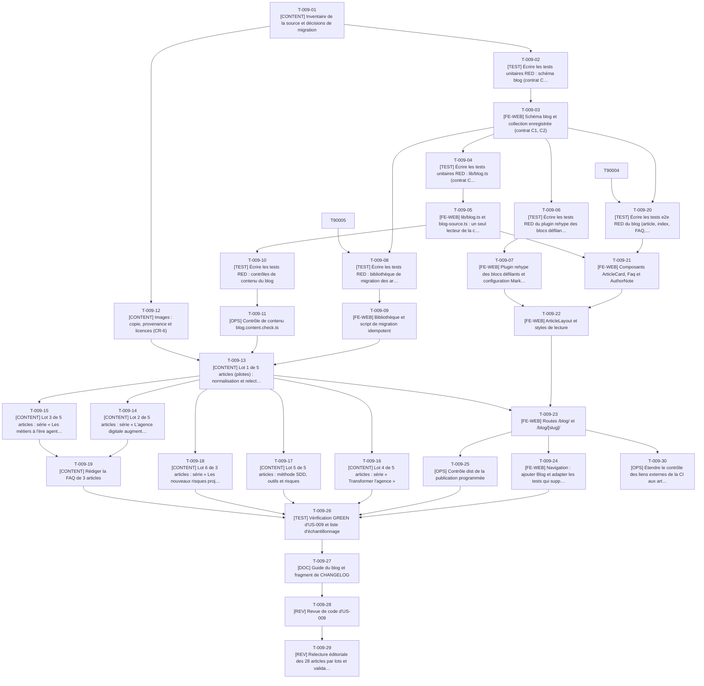

# Tâches - US-009 : Migration des 28 articles d'Agentic Agency

## Informations US
- **Epic** : EPIC-003 : Blog migré
- **Persona** : P-004 : Sophie, tech lead qui pratique l'agentic engineering
- **Story Points** : 5
- **Sprint** : sprint-003-blog_migre_seo
- **Lot** : A (tâches de contrat en phase 0 : T-009-01, T-009-02, T-009-03, T-009-04, T-009-05, T-009-06, T-009-07)
- **Dépendances externes au lot** : Contrats C1 à C3 et plugin rehype produits en phase 0 (T-009-01 à T-009-07) ; dépend de T-900-07 (dépendances) et de T-024-02 (props du layout) ; US-002 livrée.

## Résumé de la US
**En tant que** P-004 : Sophie
**Je veux** retrouver les 28 articles du blog avec leur contenu, leurs images et leur FAQ à une adresse stable
**Afin de** relire, citer et partager les retours d'expérience sans perte de contenu ni lien cassé

## Vue d'ensemble des tâches

| ID | Type | Tâche | Estimation | Dépend de | Lot | Statut |
|----|------|-------|------------|-----------|-----|--------|
| T-009-01 | [CONTENT] | Inventaire de la source et décisions de migration | 3h | - | Phase 0 | ✅ |
| T-009-02 | [TEST] | Écrire les tests unitaires RED : schéma blog (contrat C1) | 3h | T-009-01 | Phase 0 | ✅ |
| T-009-03 | [FE-WEB] | Schéma blog et collection enregistrée (contrat C1, C2) | 3h | T-009-02 | Phase 0 | ✅ |
| T-009-04 | [TEST] | Écrire les tests unitaires RED : lib/blog.ts (contrat C3) | 3h | T-009-03 | Phase 0 | ✅ |
| T-009-05 | [FE-WEB] | lib/blog.ts et blog-source.ts : un seul lecteur de la collection (contrat C3) | 4h | T-009-04 | Phase 0 | ✅ |
| T-009-06 | [TEST] | Écrire les tests RED du plugin rehype des blocs défilants | 1,5h | T-009-03 | Phase 0 | ✅ |
| T-009-07 | [FE-WEB] | Plugin rehype des blocs défilants et configuration Markdown d'Astro | 2,5h | T-009-06, T-900-07 | Phase 0 | ✅ |
| T-009-08 | [TEST] | Écrire les tests RED : bibliothèque de migration des articles | 4h | T-009-01, T-009-03, T-900-05 | A | 🔲 |
| T-009-09 | [FE-WEB] | Bibliothèque et script de migration idempotent | 5h | T-009-08 | A | 🔲 |
| T-009-10 | [TEST] | Écrire les tests RED : contrôles de contenu du blog | 4h | T-009-03, T-009-05 | A | 🔲 |
| T-009-11 | [OPS] | Contrôle de contenu blog.content.check.ts | 5h | T-009-10 | A | 🔲 |
| T-009-12 | [CONTENT] | Images : copie, provenance et licences (CR-6) | 3h | T-009-01 | A | 🔲 |
| T-009-13 | [CONTENT] | Lot 1 de 5 articles (pilotes) : normalisation et relecture | 4h | T-009-09, T-009-11, T-009-12, T-011-01 | A | 🔲 |
| T-009-14 | [CONTENT] | Lot 2 de 5 articles : série « L'agence digitale augmentée » et outils | 3h | T-009-13 | A | 🔲 |
| T-009-15 | [CONTENT] | Lot 3 de 5 articles : série « Les métiers à l'ère agentic » | 3h | T-009-13 | A | 🔲 |
| T-009-16 | [CONTENT] | Lot 4 de 5 articles : série « Transformer l'agence » | 3h | T-009-13 | A | 🔲 |
| T-009-17 | [CONTENT] | Lot 5 de 5 articles : méthode SDD, outils et risques | 3h | T-009-13 | A | 🔲 |
| T-009-18 | [CONTENT] | Lot 6 de 3 articles : série « Les nouveaux risques projet » | 2h | T-009-13 | A | 🔲 |
| T-009-19 | [CONTENT] | Rédiger la FAQ de 3 articles | 3h | T-009-13, T-009-14, T-009-15 | A | 🔲 |
| T-009-20 | [TEST] | Écrire les tests e2e RED du blog (article, index, FAQ, 404) | 4h | T-009-03, T-900-04 | A | 🔲 |
| T-009-21 | [FE-WEB] | Composants ArticleCard, Faq et AuthorNote | 3,5h | T-009-20, T-009-05 | A | 🔲 |
| T-009-22 | [FE-WEB] | ArticleLayout et styles de lecture | 5h | T-009-21, T-009-07, T-024-02 | A | 🔲 |
| T-009-23 | [FE-WEB] | Routes /blog/ et /blog/[slug]/ | 4h | T-009-22, T-009-13, T-009-11 | A | 🔲 |
| T-009-24 | [FE-WEB] | Navigation : ajouter Blog et adapter les tests qui supposaient le blog absent | 1h | T-009-23 | A | 🔲 |
| T-009-25 | [OPS] | Contrôle dist de la publication programmée | 2,5h | T-009-23, T-009-10, T-009-11 | A | 🔲 |
| T-009-26 | [TEST] | Vérification GREEN d'US-009 et liste d'échantillonnage | 3h | T-009-24, T-009-25, T-009-14, T-009-15, T-009-16, T-009-17, T-009-18, T-009-19 | A | 🔲 |
| T-009-27 | [DOC] | Guide du blog et fragment de CHANGELOG | 2h | T-009-26 | A | 🔲 |
| T-009-28 | [REV] | Revue de code d'US-009 | 3h | T-009-27 | A | 🔲 |
| T-009-29 | [REV] | Relecture éditoriale des 28 articles par lots et validation PO | 3h | T-009-18, T-009-28 | A | 🔲 |
| T-009-30 | [OPS] | Étendre le contrôle des liens externes de la CI aux articles | 2h | T-009-23 | A | 🔲 |

**Total estimé** : 95h (30 tâches)

| Type | Tâches | Heures |
|------|--------|--------|
| [OPS] | 3 | 9,5h |
| [FE-WEB] | 8 | 28h |
| [CONTENT] | 9 | 27h |
| [TEST] | 7 | 22,5h |
| [DOC] | 1 | 2h |
| [REV] | 2 | 6h |

---

## Graphe de dépendances



Dépendances vers d'autres US : T-009-07 dépend de T-900-07, T-009-13 dépend de T-011-01, T-009-22 dépend de T-024-02, T-009-08 dépend de T-900-05, T-009-20 dépend de T-900-04.

---

## Détail des tâches

#### T-009-01 : [CONTENT] Inventaire de la source et décisions de migration
- **Type** : [CONTENT]
- **Estimation** : 3h
- **Dépend de** : -
- **Lot** : Phase 0

**Description** :
Relever et consigner dans `docs/guides/blog.md` (section « Inventaire du 2026-10-14 ») les faits de la source en lecture seule (`/Users/tmonier/Projects/blog/src/content/blog/`) et appliquer les décisions des écarts E1 à E12 de `tasks/README.md` telles qu'arbitrées le 2026-10-14 (section « Arbitrages de l'orchestrateur et du PO »), sans attendre le PO ; les contenus restent à valider par lots (`contenu-a-valider.md`). Faits relevés : 28 fichiers `.md` (pas de MDX), environ 38 000 mots (871 à 2 424 mots par article, soit 4 à 11 min de lecture), 0 `draft`, 0 date future (dernier `pubDate` : 2026-09-22), 0 `faq`, 0 `excerpt`, 0 `updatedDate`, 5 catégories (Business 4, Méthode 5, Métiers 7, Pilotage 7, Outils 5), 56 tags (37 sur un seul article), 6 séries pour 26 articles, 22 images distinctes sur 28 articles (6 partagées par deux articles), 19 articles sans `imageAlt`, 26 descriptions de plus de 160 caractères, 18 titres de plus de 60 caractères, 10 fichiers au titre ou à la description coupés sur deux lignes, 9 articles avec SVG intégré (8 avec attribut `style`), 4 avec tableau, 5 avec bloc de code, 4 occurrences de « Operations Director » dans 3 articles. Décisions à obtenir : pieds biographiques (E11), liens vers les pages non migrées (E10), FAQ des 3 articles (E5), provenance des images (E4).

**Fichiers à créer/modifier** :
- `docs/guides/blog.md`
- `project-management/sprints/sprint-003-blog_migre_seo/contenu-a-valider.md` (lecture)

**Critères de validation** :
- [ ] Chaque fait est reproductible par une commande indiquée dans le guide
- [ ] Les décisions E1 à E12 sont consignées avec la date et la réponse du PO
- [ ] Aucune écriture dans `/Users/tmonier/Projects/blog/`

#### T-009-02 : [TEST] Écrire les tests unitaires RED : schéma blog (contrat C1)
- **Type** : [TEST]
- **Estimation** : 3h
- **Dépend de** : T-009-01
- **Lot** : Phase 0

**Description** :
Schéma Zod `createBlogSchema(image)` testé avec une fonction `image` factice (méthode des schémas `plugins` et `projects`). Cas : frontmatter valide minimal ; `title` de 1 à 100 caractères (maximum relevé : 86) ; `description` de 50 à 160 caractères ; `category` hors de Business, Méthode, Métiers, Outils, Pilotage rejetée avec le champ fautif ; `image` et `imageAlt` obligatoires ensemble ; `seoTitle` de 20 à 60 caractères, obligatoire si `title` dépasse 60 ; `series` impose `seriesOrder` (entier ≥ 1) et inversement ; `originalUrl` en https sur le domaine `agentic-agency.fr`, `originalPublishedAt` requis avec lui ; `updatedDate` jamais avant `pubDate` ; `faq` : au moins 1 question, réponses non vides ; `validated` à `false` par défaut ; champs inconnus refusés (`strictObject`) ; `safeText` sur titres et FAQ (données personnelles).

**Fichiers à créer/modifier** :
- `tests/unit/content/blog.test.ts`

**Critères de validation** :
- [ ] RED constaté (schéma absent)
- [ ] Au moins un test par règle ci-dessus

#### T-009-03 : [FE-WEB] Schéma blog et collection enregistrée (contrat C1, C2)
- **Type** : [FE-WEB]
- **Estimation** : 3h
- **Dépend de** : T-009-02
- **Lot** : Phase 0

**Description** :
Créer `src/content/schemas/blog.ts` (`createBlogSchema`, type `BlogData`) et `src/content/collections/blog.ts` (déclaration de la collection : `glob({ pattern: 'fr/*.{md,mdx}', base: './src/content/blog' })`, schéma avec l'`image()` d'Astro). `src/content.config.ts` reçoit un seul import et une seule clé `blog` (dernière modification de ce fichier dans le sprint). Une collection vide ne fait pas échouer le build : le décompte de 28 est contrôlé par `T-009-11`. Les identifiants d'entrée sont de la forme `fr/<slug>` : `slugOf` (T-009-05) est le seul à les convertir.

**Fichiers à créer/modifier** :
- `src/content/schemas/blog.ts`
- `src/content/collections/blog.ts`
- `src/content.config.ts`

**Critères de validation** :
- [ ] Tests T-009-02 verts
- [ ] `make check` (astro check) et `make build` verts avec la collection vide

#### T-009-04 : [TEST] Écrire les tests unitaires RED : lib/blog.ts (contrat C3)
- **Type** : [TEST]
- **Estimation** : 3h
- **Dépend de** : T-009-03
- **Lot** : Phase 0

**Description** :
Fonctions pures sur des entrées `{ id, data, body }` : `slugOf`, `isPublished(data, now)` (pas de `draft`, `pubDate <= now`, comparaison à la date de build), `sortByDateDesc` (égalité départagée par slug pour un ordre stable), `readingMinutes(body)` (230 mots par minute, arrondi supérieur, minimum 1, mots comptés avec `countWords`), `slugify` (accents retirés, `L'agence digitale augmentée` → `l-agence-digitale-augmentee`), `categoryPath`, `tagPath`, `seriesPath`, `postPath`, `pagePath` (page 1 = `/blog/`), `paginate(items, page, size)`, `seriesNeighbors(entries, slug)`, `tagsWithPages(entries, min = 2)`. Cas limites : `pubDate` futur, article du jour même à minuit UTC, collision de deux tags sur le même slug (erreur citant les deux libellés), page hors bornes.

**Fichiers à créer/modifier** :
- `tests/unit/lib/blog.test.ts`

**Critères de validation** :
- [ ] RED constaté
- [ ] Tests d'ordre et de bornes inclus

#### T-009-05 : [FE-WEB] lib/blog.ts et blog-source.ts : un seul lecteur de la collection (contrat C3)
- **Type** : [FE-WEB]
- **Estimation** : 4h
- **Dépend de** : T-009-04
- **Lot** : Phase 0

**Description** :
`src/lib/blog.ts` : fonctions pures de T-009-04, sans import d'`astro:content` (testables). `src/lib/blog-source.ts` : `getPublishedPosts(now = new Date())`, seul module du dépôt à appeler `getCollection('blog')`, qui filtre avec `isPublished` et trie avec `sortByDateDesc`. Un contrôle de contenu (T-009-11) échoue si un autre fichier de `src/` appelle `getCollection('blog')`. Réutiliser `countWords` (`src/lib/text.ts`) et `canonicalUrl` (`src/lib/seo.ts`) : pas de seconde implémentation.

**Fichiers à créer/modifier** :
- `src/lib/blog.ts`
- `src/lib/blog-source.ts`

**Critères de validation** :
- [ ] Tests T-009-04 verts, couverture de `src/lib/blog.ts` ≥ 90 %
- [ ] `getPublishedPosts` est le seul appelant de `getCollection('blog')`

#### T-009-06 : [TEST] Écrire les tests RED du plugin rehype des blocs défilants
- **Type** : [TEST]
- **Estimation** : 1,5h
- **Dépend de** : T-009-03
- **Lot** : Phase 0

**Description** :
Les blocs de code (`pre`) et les tableaux (`table`) des articles débordent à 360 px : l'accessibilité exige qu'une zone défilante soit atteignable au clavier. Le plugin enveloppe chaque tableau dans un `div` avec `tabindex="0"`, `role="region"` et un nom accessible, et ajoute `tabindex="0"` aux `pre`. Tests sur un arbre HTML minimal : `pre` focalisable, tableau enveloppé une seule fois (idempotent), arbre sans bloc inchangé, aucun attribut `style`.

**Fichiers à créer/modifier** :
- `tests/unit/lib/rehype-article-blocks.test.ts`

**Critères de validation** :
- [ ] RED constaté

#### T-009-07 : [FE-WEB] Plugin rehype des blocs défilants et configuration Markdown d'Astro
- **Type** : [FE-WEB]
- **Estimation** : 2,5h
- **Dépend de** : T-009-06, T-900-07
- **Lot** : Phase 0

**Description** :
Implémenter `src/lib/rehype-article-blocks.ts` (parcours récursif de l'arbre, sans nouvelle dépendance) et déclarer dans `astro.config.mjs`, bloc `markdown` placé après `build` : `syntaxHighlight: false` et ce plugin (forme exacte de l'option à vérifier dans la documentation d'Astro 7.3.8 avant de l'écrire). Raison de `syntaxHighlight: false` : la coloration par défaut produit des attributs `style` en ligne, que la CSP `style-src 'self'` bloque (écart E9) ; les blocs de code restent lisibles en monospace défilant. Le bloc `integrations` du même fichier appartient au lot B : ne pas y toucher.

**Fichiers à créer/modifier** :
- `src/lib/rehype-article-blocks.ts`
- `astro.config.mjs` (bloc `markdown` uniquement)

**Critères de validation** :
- [ ] Tests T-009-06 verts
- [ ] Un bloc de code Markdown de test ne produit aucun attribut `style` dans `dist/`

#### T-009-08 : [TEST] Écrire les tests RED : bibliothèque de migration des articles
- **Type** : [TEST]
- **Estimation** : 4h
- **Dépend de** : T-009-01, T-009-03, T-900-05
- **Lot** : A

**Description** :
Fonctions pures de `src/lib/blog-migration.ts`, testées sur des extraits réels réduits de 4 articles (copiés dans `tests/fixtures/blog-source/`, jamais le dossier source) : (1) frontmatter à titre ou description sur deux lignes → une ligne ; (2) `image: "/blog/x.webp"` → `../../../assets/blog/x.webp` ; (3) ajout de `originalUrl` (`https://agentic-agency.fr/blog/<slug>`, forme exacte fixée par T-010-01) et `originalPublishedAt = pubDate` ; (4) réécriture des liens : `/blog/<slug>` → `/blog/<slug>/`, `/blog/category/outils` → `/blog/categorie/outils/`, pages non migrées (`/services/sites-ia`, `/methode`, `/boite-a-outils…`) → URL absolue de l'ancien site selon la décision E10 ; (5) SVG intégré : `style="width:100%;height:auto;font-family:…"` → classes `w-full h-auto` et attribut `font-family`, ajout de `role="img"` et d'un `<title>` si absents ; une déclaration CSS inconnue est une erreur explicite, pas un abandon silencieux ; (6) pied biographique en italique « Thibaut est Operations Director… » retiré selon E11 ; (7) idempotence : deuxième passage sans effet.

**Fichiers à créer/modifier** :
- `tests/unit/lib/blog-migration.test.ts`
- `tests/fixtures/blog-source/`

**Critères de validation** :
- [ ] RED constaté
- [ ] Un test par transformation, plus le test d'idempotence

#### T-009-09 : [FE-WEB] Bibliothèque et script de migration idempotent
- **Type** : [FE-WEB]
- **Estimation** : 5h
- **Dépend de** : T-009-08
- **Lot** : A

**Description** :
`src/lib/blog-migration.ts` (transformations pures de T-009-08) et `scripts/migrate-blog.ts` : lit un dossier source passé en argument, écrit `src/content/blog/fr/<slug>.md` et copie les images utilisées vers `src/assets/blog/`, sans jamais écrire dans la source. Le script accepte une liste de slugs (migration par lots de 5) et affiche pour chaque article les modifications appliquées et ce qui reste à la main (description, `seoTitle`, `imageAlt`, tags, `seriesOrder`). Exécution : la source est montée en lecture seule dans le conteneur `tools`. Le script n'est pas dans `make ci` (outil de migration, conservé comme trace reproductible).

**Commandes** :
```bash
docker compose -p tm-w1 run --rm -v /Users/tmonier/Projects/blog:/blog-source:ro tools \
  node scripts/migrate-blog.ts /blog-source --slugs la-spec-est-le-nouveau-code
```

**Fichiers à créer/modifier** :
- `src/lib/blog-migration.ts`
- `scripts/migrate-blog.ts`

**Critères de validation** :
- [ ] Tests T-009-08 verts
- [ ] Deuxième exécution : aucune différence (`git diff` vide)
- [ ] Le montage de la source est en `:ro` ; aucune commande de nettoyage globale

#### T-009-10 : [TEST] Écrire les tests RED : contrôles de contenu du blog
- **Type** : [TEST]
- **Estimation** : 4h
- **Dépend de** : T-009-03, T-009-05
- **Lot** : A

**Description** :
Fonctions de `scripts/checks/lib/blog.ts`. Cas : décompte attendu de 28 articles (« Blog : 27 articles trouvés, 28 attendus ») ; message « Image introuvable : <chemin> (article <slug>) » exact ; catégorie hors énumération avec fichier et champ cités ; titre SEO manquant quand `title` dépasse 60 ; unicité des slugs ; aucun attribut `style` ni balise `<script>` dans le corps Markdown ; aucun titre de niveau 1 dans le corps et pas de saut de niveau (h2 vers h4) ; liens internes du corps au format cible (barre finale, `/blog/categorie/…`) ; poids de chaque image ≤ 250 Ko et absence de bloc EXIF (WebP) ; compteur « articles validés N/28 » et erreur seulement si `REQUIRE_VALIDATED_CONTENT=1` ; seul `blog-source.ts` appelle `getCollection('blog')` ; données personnelles dans le corps (`detectPii`). Un article futur ou `draft` est ignoré du décompte mais signalé.

**Fichiers à créer/modifier** :
- `tests/unit/checks/blog.test.ts`

**Critères de validation** :
- [ ] RED constaté
- [ ] Les messages d'erreur des scénarios de l'US sont testés mot pour mot

#### T-009-11 : [OPS] Contrôle de contenu blog.content.check.ts
- **Type** : [OPS]
- **Estimation** : 5h
- **Dépend de** : T-009-10
- **Lot** : A

**Description** :
Implémenter `scripts/checks/lib/blog.ts` et `scripts/checks/blog.content.check.ts` (découverte automatique par `run.ts`, aucune liste centrale à éditer). Lecture du frontmatter avec la bibliothèque `yaml` déjà installée, sans passer par `astro:content` (le contrôle précède `astro build`). Le décompte (28) est une constante nommée dans le module, mise à jour avec la source de vérité unique de `content-model.md` V8.

**Fichiers à créer/modifier** :
- `scripts/checks/blog.content.check.ts`
- `scripts/checks/lib/blog.ts`

**Critères de validation** :
- [ ] Tests T-009-10 verts
- [ ] `make checks` échoue avec le message exact sur une image supprimée puis réussit après restauration

#### T-009-12 : [CONTENT] Images : copie, provenance et licences (CR-6)
- **Type** : [CONTENT]
- **Estimation** : 3h
- **Dépend de** : T-009-01
- **Lot** : A

**Description** :
Copier les 22 images utilisées (`public/blog/*.webp` de la source, 1,8 Mo) vers `src/assets/blog/` sans les modifier ; ne pas migrer les 3 fichiers inutilisés (`blog_post_12_*.webp`, `markdown.webp`, `welcome.webp`) ni `src/assets/og-image.png` du blog (visuel de marque d'Agentic Agency). Contrôle de licence CR-6 : aucune image d'article ne vient d'Unsplash (les références Unsplash de la source sont dans `src/pages/services.astro`, non migré) ; l'origine des 22 couvertures (noms `blog_post_N_<horodatage>.webp`, `outils-etabli.webp`…) n'est documentée nulle part dans la source : le PO la déclare (création, génération, achat) et le guide enregistre un tableau fichier, origine, droit d'usage, date. Deux fichiers ne sont pas en 1200 × 630 (`kanban-timelines-methodes.webp` 1200 × 943, `team-equipes-humaines.webp` 1200 × 900) : cadrage par CSS (`aspect-ratio`), pas de recadrage destructif.

**Fichiers à créer/modifier** :
- `src/assets/blog/*.webp`
- `docs/guides/blog.md` (section Images et licences)

**Critères de validation** :
- [ ] 22 fichiers copiés, sommes de contrôle identiques à la source
- [ ] Tableau de provenance rempli pour 22 / 22, confirmé par le PO
- [ ] Aucun fichier de `/Users/tmonier/Projects/blog/` modifié

#### T-009-13 : [CONTENT] Lot 1 de 5 articles (pilotes) : normalisation et relecture
- **Type** : [CONTENT]
- **Estimation** : 4h
- **Dépend de** : T-009-09, T-009-11, T-009-12, T-011-01
- **Lot** : A

**Description** :
Articles : `reduire-la-facture-token-caveman-codegraph` (bloc de code, tableau, SVG à `style`), `cycle-en-v-agile-sdd-comparaison-timelines` (tableau, SVG dans un `div class="not-prose…"`, liens vers `/services/sites-ia` et `/methode`), `le-vrai-developpeur-augmente-c-est-le-chef` (titre sur deux lignes, pied biographique, phrase narrative « Operations Director »), `certifications-ia-signal-ou-bruit-au-recrutement` (SVG, sans série), `la-boite-a-outils-du-poweruser` (liens vers `/boite-a-outils`, sans série). Ce lot couvre toutes les particularités techniques : il débloque les composants et valide le pipeline. Par article : exécuter le script, réécrire la `description` en 50 à 160 caractères en reprenant l'argument de l'article (ne rien inventer), ajouter `seoTitle` si `title` > 60, rédiger `imageAlt` en regardant l'image, normaliser les tags selon T-011-01, fixer `series` et `seriesOrder`, vérifier le corps (liens, SVG, tableau) contre la source. Soumettre le lot au PO ; l'orchestrateur met à jour `contenu-a-valider.md` et `validated`.

**Fichiers à créer/modifier** :
- `src/content/blog/fr/*.md` (5 articles)

**Critères de validation** :
- [ ] `make checks` vert pour ces 5 articles
- [ ] Corps identique à la source, hors liens, SVG, pied biographique (diff relu)
- [ ] Lot soumis au PO (5 articles au plus)

#### T-009-14 : [CONTENT] Lot 2 de 5 articles : série « L'agence digitale augmentée » et outils
- **Type** : [CONTENT]
- **Estimation** : 3h
- **Dépend de** : T-009-13
- **Lot** : A

**Description** :
Articles : `ce-que-l-ia-ne-fera-jamais-a-votre-place`, `agence-digitale-le-binome-augmente-remplace-t-il`, `le-junior-n-est-pas-le-probleme-le`, `la-spec-est-le-nouveau-code`, `donner-a-lire-a-un-agent-markitdown-et-mq`. Mêmes opérations que le lot 1 ; le premier et le deuxième portent un titre sur deux lignes ; le premier a un pied biographique ; le dernier contient bloc de code et SVG. Vérifier que les mentions « Dernier article de la série… » et « Prochain article… » du corps restent exactes avec le `seriesOrder` retenu par le PO.

**Fichiers à créer/modifier** :
- `src/content/blog/fr/*.md` (5 articles)

**Critères de validation** :
- [ ] `make checks` vert
- [ ] Phrases d'enchaînement de série cohérentes avec `seriesOrder`
- [ ] Lot soumis au PO

#### T-009-15 : [CONTENT] Lot 3 de 5 articles : série « Les métiers à l'ère agentic »
- **Type** : [CONTENT]
- **Estimation** : 3h
- **Dépend de** : T-009-13
- **Lot** : A

**Description** :
Articles : `amorcer-un-projet-agentic-coding-le-role-amoa`, `chiffrer-et-rassurer-autour-de-l-agentic-coding`, `mesurer-le-gain-reel-de-l-agentic-coding`, `piloter-un-projet-agentic-les-nouveaux-indicateurs`, `securite-agentic-rassurer-le-client-et-prouver-la-qualite`. Mêmes opérations. Les descriptions de ce lot dépassent 200 caractères (204 à 252 selon l'article) : les réécrire sans perdre l'idée, jamais en tronquant.

**Fichiers à créer/modifier** :
- `src/content/blog/fr/*.md` (5 articles)

**Critères de validation** :
- [ ] `make checks` vert
- [ ] Lot soumis au PO

#### T-009-16 : [CONTENT] Lot 4 de 5 articles : série « Transformer l'agence »
- **Type** : [CONTENT]
- **Estimation** : 3h
- **Dépend de** : T-009-13
- **Lot** : A

**Description** :
Articles : `esn-agence-freelance-augmente-qui-survit-a-l-ia`, `ce-que-le-client-doit-savoir-sur-l`, `la-gestion-de-projet-ia-est-une-discipline`, `recruter-et-evaluer-un-developpeur-a-l-ere-de-l-ia`, `comment-mesurer-le-roi-reel-d-un-workflow`. Cinq titres sur plusieurs lignes ou à plus de 60 caractères (jusqu'à 85) : `seoTitle` pour chacun. Le slug `ce-que-le-client-doit-savoir-sur-l` est tronqué dans la source : le conserver (ADR-0008 : aucun changement de slug), sans le corriger.

**Fichiers à créer/modifier** :
- `src/content/blog/fr/*.md` (5 articles)

**Critères de validation** :
- [ ] `make checks` vert
- [ ] Slugs identiques à la source
- [ ] Lot soumis au PO

#### T-009-17 : [CONTENT] Lot 5 de 5 articles : méthode SDD, outils et risques
- **Type** : [CONTENT]
- **Estimation** : 3h
- **Dépend de** : T-009-13
- **Lot** : A

**Description** :
Articles : `projet-classique-vs-sdd-ia-quelles-equipes-humaines` (tableau, liens `/blog/cycle-en-v…` sans barre finale et `/methode`), `du-vibe-coding-a-l-agentic-engineering`, `outils-agentic-engineering-qui-meritent-un-essai` (blocs de code, tableau, SVG), `sortir-du-rendu-generique-hallmark-designmd-modern-web-guidance` (bloc de code, SVG), `la-dette-de-contexte-le-nouveau-risque-cache` (titre sur deux lignes, pied biographique). Mêmes opérations.

**Fichiers à créer/modifier** :
- `src/content/blog/fr/*.md` (5 articles)

**Critères de validation** :
- [ ] `make checks` vert
- [ ] Lot soumis au PO

#### T-009-18 : [CONTENT] Lot 6 de 3 articles : série « Les nouveaux risques projet »
- **Type** : [CONTENT]
- **Estimation** : 2h
- **Dépend de** : T-009-13
- **Lot** : A

**Description** :
Articles : `shadow-it-agentique-perdre-la-trace-de-ses-agents`, `l-ia-vous-accelere-t-elle-ou-vous-precipite-t-elle`, `le-cout-cache-de-la-supervision-agentique` (trois SVG à `style`). Mêmes opérations. Avec ce lot, la collection compte 28 articles : le contrôle de décompte passe de l'avertissement à l'erreur.

**Fichiers à créer/modifier** :
- `src/content/blog/fr/*.md` (3 articles)

**Critères de validation** :
- [ ] `make checks` vert avec 28 articles
- [ ] Lot soumis au PO

#### T-009-19 : [CONTENT] Rédiger la FAQ de 3 articles
- **Type** : [CONTENT]
- **Estimation** : 3h
- **Dépend de** : T-009-13, T-009-14, T-009-15
- **Lot** : A

**Description** :
Aucun des 28 articles n'a de FAQ (écart E5) : sans elle, le scénario « Article avec FAQ » d'US-009 et le `FAQPage` d'US-024 ne sont vérifiables que sur des données factices. Rédiger 3 questions et réponses (réponse de 2 à 4 phrases, reprenant des affirmations de l'article, rien de nouveau) pour 3 articles que l'agent choisit (arbitrage E5, aucune attente du PO) ; choix par défaut : `la-spec-est-le-nouveau-code`, `reduire-la-facture-token-caveman-codegraph`, `chiffrer-et-rassurer-autour-de-l-agentic-coding`. Champ `faq` du frontmatter ; questions au format de requête réelle d'un lecteur.

**Fichiers à créer/modifier** :
- `src/content/blog/fr/<3 articles>.md`

**Critères de validation** :
- [ ] 3 articles avec 3 questions chacun, schéma valide
- [ ] Chaque réponse est traçable à un passage de l'article (indiqué dans la PR)
- [ ] FAQ marquées `validated: false` et inscrites dans `contenu-a-valider.md` pour validation ultérieure par le PO (l'agent ne passe jamais `validated` à `true`)

#### T-009-20 : [TEST] Écrire les tests e2e RED du blog (article, index, FAQ, 404)
- **Type** : [TEST]
- **Estimation** : 4h
- **Dépend de** : T-009-03, T-900-04
- **Lot** : A

**Description** :
`tests/e2e/blog.spec.ts`, strict. Scénarios : un article de référence affiche titre (h1 unique), date lisible, catégorie, image avec texte alternatif non vide, temps de lecture, dates `datePublished` ; l'index liste les articles par date décroissante (le décompte de 28 au total, parcourus par la pagination, est ajouté par `T-011-04`) ; article avec FAQ : N questions repliables, ouvertes et fermées au clavier ; l'adresse d'un slug inexistant renvoie 404 ; largeur de lecture ≤ 75 caractères ; aucun défilement horizontal à 360 px sur l'article le plus large (tableau + SVG) ; blocs `pre` et tableaux atteignables au clavier ; aucune violation CSP en console (SVG intégrés, images). Le scénario de publication programmée est couvert par `T-009-25` (contrôle de `dist/`) et les tests unitaires de `isPublished`, un test e2e ne pouvant pas fabriquer un article futur dans le site de production.

**Fichiers à créer/modifier** :
- `tests/e2e/blog.spec.ts`

**Critères de validation** :
- [ ] RED constaté
- [ ] Aucun `test.skip`

#### T-009-21 : [FE-WEB] Composants ArticleCard, Faq et AuthorNote
- **Type** : [FE-WEB]
- **Estimation** : 3,5h
- **Dépend de** : T-009-20, T-009-05
- **Lot** : A

**Description** :
`ArticleCard` (titre, date, catégorie, extrait = `description`, image avec `<Image>` d'`astro:assets`, dimensions explicites, `loading="lazy"`), `Faq` (éléments `details`/`summary`, accessibles au clavier, question comme titre h3), `AuthorNote` (« Écrit par Thibaut Monier », liens vers `/parcours/` et `/contact/` : remplace les pieds biographiques et les composants de marque `PostCTA` et `AuthorBlock` du blog source, non migrés). Composants de moins de 150 lignes ; aucun attribut `style`.

**Fichiers à créer/modifier** :
- `src/components/blog/ArticleCard.astro`
- `src/components/blog/Faq.astro`
- `src/components/blog/AuthorNote.astro`

**Critères de validation** :
- [ ] Rendu vérifié à 360, 768 et 1280 px
- [ ] Contrastes conformes dans les deux thèmes

#### T-009-22 : [FE-WEB] ArticleLayout et styles de lecture
- **Type** : [FE-WEB]
- **Estimation** : 5h
- **Dépend de** : T-009-21, T-009-07, T-024-02
- **Lot** : A

**Description** :
`src/layouts/ArticleLayout.astro` : fil d'Ariane visible, en-tête (catégorie, date, temps de lecture, `<time datetime>`), image de couverture (aspect-ratio fixe, `fetchpriority="high"` sans `loading="lazy"` pour l'image du LCP), corps (`render(entry)`) dans un conteneur `max-w` de 75 caractères, `Faq`, `AuthorNote`. Il passe à `BaseLayout` les props de contrat C5 : `ogType="article"`, `article={{ slug, publishedAt, updatedAt, category, tags, wordCount, image, faq }}` et une description. Styles de lecture dans `src/styles/article.css` importé par le layout (titres, listes, citations, code, tableaux, SVG `max-width:100%`), sans modifier `global.css`. La mention d'origine (US-010) et l'encart de série (US-011) s'ajoutent à ce fichier plus tard : emplacements nommés dans le gabarit.

**Fichiers à créer/modifier** :
- `src/layouts/ArticleLayout.astro`
- `src/styles/article.css`

**Critères de validation** :
- [ ] Un article de référence rendu sans erreur CSP
- [ ] Hiérarchie de titres correcte (un h1, corps en h2/h3)
- [ ] `astro check` vert

#### T-009-23 : [FE-WEB] Routes /blog/ et /blog/[slug]/
- **Type** : [FE-WEB]
- **Estimation** : 4h
- **Dépend de** : T-009-22, T-009-13, T-009-11
- **Lot** : A

**Description** :
`src/pages/blog/index.astro` : première version de l'index, qui liste tous les articles publiés par date décroissante (critère littéral d'US-009), remplacée par la version paginée en `T-011-06`. `src/pages/blog/[slug]/index.astro` : `getStaticPaths` depuis `getPublishedPosts()`, titre de page = `seoTitle ?? title`, description = `description`. Barre finale partout (ADR-0008). Les articles non publiés (`draft`, date future) ne génèrent aucune route.

**Fichiers à créer/modifier** :
- `src/pages/blog/index.astro`
- `src/pages/blog/[slug]/index.astro`

**Critères de validation** :
- [ ] Les articles des lots déjà intégrés sont servis sous `/blog/<slug>/`
- [ ] Aucune route pour un article `draft` de test unitaire

#### T-009-24 : [FE-WEB] Navigation : ajouter Blog et adapter les tests qui supposaient le blog absent
- **Type** : [FE-WEB]
- **Estimation** : 1h
- **Dépend de** : T-009-23
- **Lot** : A

**Description** :
Dans `src/config/nav.ts`, ajouter l'entrée `blog` (`/blog/`, libellé « Blog », `enabled: true`) : elle n'existe pas encore dans la liste, seul le commentaire d'en-tête la mentionne ; actualiser ce commentaire. Adapter deux tests existants qui supposent le blog désactivé : `tests/unit/config/site.test.ts` (le test « ne publie ni Blog ni Labo » affirme que `blog` est absent de la liste : ne garder que Labo) et `tests/e2e/layout.spec.ts` (test d'absence des liens désactivés : retirer `/blog/`). Le lot A est l'unique propriétaire de `nav.ts` ; `docs/guides/design-system.md` est mis à jour ici.

**Fichiers à créer/modifier** :
- `src/config/nav.ts`
- `tests/unit/config/site.test.ts`
- `tests/e2e/layout.spec.ts`
- `docs/guides/design-system.md`

**Critères de validation** :
- [ ] Le lien Blog est visible dans l'en-tête, actif sur `/blog/` et sur les articles
- [ ] Tests existants verts, aucun test supprimé sans remplacement

#### T-009-25 : [OPS] Contrôle dist de la publication programmée
- **Type** : [OPS]
- **Estimation** : 2,5h
- **Dépend de** : T-009-23, T-009-10, T-009-11
- **Lot** : A

**Description** :
`scripts/checks/blog-schedule.dist.check.ts` : relit les sources, calcule avec `isPublished` les articles non publiés (brouillon, date future) et échoue si `dist/` contient une page, une entrée de sitemap ou une entrée de flux pour l'un d'eux ; message avec le slug. Documenter dans le guide que la publication d'un article daté demain dépend du redéploiement quotidien de 06:00 UTC (`scheduled.yml`) et que `pubDate` sans heure vaut minuit UTC.

**Fichiers à créer/modifier** :
- `scripts/checks/blog-schedule.dist.check.ts`
- `scripts/checks/lib/blog.ts` (partagé avec T-009-11, même lot)

**Critères de validation** :
- [ ] Un article de test de date future dans un dossier de fixtures est détecté par le test unitaire
- [ ] Le contrôle réussit sur le site complet

#### T-009-26 : [TEST] Vérification GREEN d'US-009 et liste d'échantillonnage
- **Type** : [TEST]
- **Estimation** : 3h
- **Dépend de** : T-009-24, T-009-25, T-009-14, T-009-15, T-009-16, T-009-17, T-009-18, T-009-19
- **Lot** : A

**Description** :
`make checks`, tests e2e du blog sur `preview` (Chromium système ou CI), Lighthouse ≥ 95 sur 4 axes pour un article type (échantillon d'un seul article en local). Remplir `tests/e2e/sample-routes.json` avec les articles à particularités : SVG à `style` (`certifications-ia-signal-ou-bruit-au-recrutement`), tableau (`cycle-en-v-agile-sdd-comparaison-timelines`), bloc de code (`reduire-la-facture-token-caveman-codegraph`), FAQ (`la-spec-est-le-nouveau-code`), sans série (`la-boite-a-outils-du-poweruser`), le plus long. Vérifier que les 28 articles sont des routes de `dist/`.

**Fichiers à créer/modifier** :
- `tests/e2e/sample-routes.json`

**Critères de validation** :
- [ ] Scénarios de `blog.spec.ts` verts, aucun skip
- [ ] 28 pages d'article dans `dist/`
- [ ] Lighthouse ≥ 0,95 sur un article

#### T-009-27 : [DOC] Guide du blog et fragment de CHANGELOG
- **Type** : [DOC]
- **Estimation** : 2h
- **Dépend de** : T-009-26
- **Lot** : A

**Description** :
Compléter `docs/guides/blog.md` : structure de la collection, schéma champ par champ, ajouter un article (checklist : description 50 à 160, `seoTitle`, `imageAlt`, tags, série), publication programmée, images et licences, ce que le script de migration fait et ne fait pas, rappel CSP (pas de `style` en ligne, pas de coloration). Écrire `changelog.d/lot-a.md` (une ligne par US) ; l'index des guides est complété par l'orchestrateur (T-900-20).

**Fichiers à créer/modifier** :
- `docs/guides/blog.md`
- `changelog.d/lot-a.md`

**Critères de validation** :
- [ ] Un nouvel article peut être ajouté en suivant le guide seul (essai à blanc)

#### T-009-28 : [REV] Revue de code d'US-009
- **Type** : [REV]
- **Estimation** : 3h
- **Dépend de** : T-009-27
- **Lot** : A

**Description** :
Revue par un agent à contexte neuf : SOLID, un seul lecteur de la collection, aucun attribut `style`, couverture de `src/lib/blog.ts` et de la migration, conformité aux contrats C1 à C3, DoD (accessibilité, responsive, CSP).

**Fichiers à créer/modifier** :
- `project-management/sprints/sprint-003-blog_migre_seo/dod-review.md` (section US-009)

**Critères de validation** :
- [ ] Findings consignés et corrigés ou reportés par décision PO

#### T-009-29 : [REV] Relecture éditoriale des 28 articles par lots et validation PO
- **Type** : [REV]
- **Estimation** : 3h
- **Dépend de** : T-009-18, T-009-28
- **Lot** : A

**Description** :
Relecture indépendante des 6 lots : exactitude des affirmations chiffrées (dates, versions, étoiles GitHub des projets cités dans les articles d'outils : à vérifier au jour de la relecture, pas recopiées), cohérence description / article, textes alternatifs, absence de donnée personnelle, orthographe. Le PO valide lot par lot (jalon n°2) : l'orchestrateur passe `validated: true`. Les liens externes des articles (8 URL distinctes relevées : 7 dépôts GitHub et un article arXiv) sont vérifiés par le job `external-links` étendu au blog (E10).

**Fichiers à créer/modifier** :
- `project-management/sprints/sprint-003-blog_migre_seo/contenu-a-valider.md`

**Critères de validation** :
- [ ] 28 / 28 articles « validé » ou écarts consignés avec décision
- [ ] Aucun fait daté non revérifié

#### T-009-30 : [OPS] Étendre le contrôle des liens externes de la CI aux articles
- **Type** : [OPS]
- **Estimation** : 2h
- **Dépend de** : T-009-23
- **Lot** : A

**Description** :
`scripts/checks/lib/external-links.ts` ne parcourt que `open-source/` (constante `SHOWCASE_PREFIX`, 404 et 410 bloquants, 429 et 5xx en avertissement, hors build Docker). Remplacer la constante par une liste de préfixes (`open-source/`, `blog/`) avec test unitaire, pour que les 8 URL externes des articles soient vérifiées par le job existant `external-links`. Le job n'est pas modifié (le script prend `dist` en argument). Pas de nouvelle dépendance ; le job reste hors build Docker et Railway.

**Fichiers à créer/modifier** :
- `scripts/checks/lib/external-links.ts`
- `tests/unit/checks/external-links.test.ts`

**Critères de validation** :
- [ ] Test : un lien mort dans une page de `blog/` est signalé, un 429 reste un avertissement
- [ ] `make external-links` vert sur `dist/` complet
