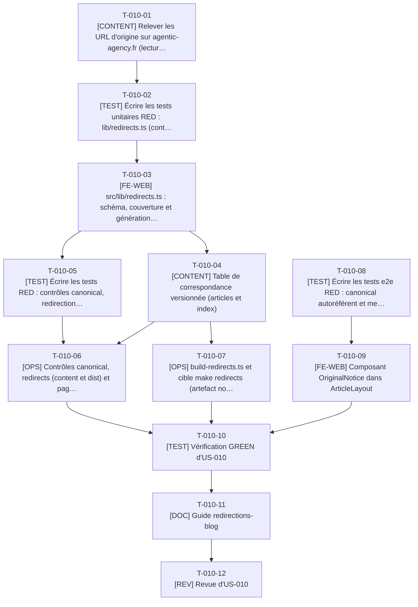

# Tâches - US-010 : Canonical sur le nouveau domaine et table de correspondance prête pour les redirections

## Informations US
- **Epic** : EPIC-003 : Blog migré
- **Persona** : P-004 : Sophie, tech lead qui pratique l'agentic engineering
- **Story Points** : 2
- **Sprint** : sprint-003-blog_migre_seo
- **Lot** : A
- **Dépendances externes au lot** : US-009 (articles, `ArticleLayout`), US-003 livrée (emplacement des contrôles). Déployée avec US-009.

## Résumé de la US
**En tant que** P-004 : Sophie
**Je veux** que chaque article migré déclare le nouveau site (origine `PUBLIC_SITE_URL`) comme version de référence, et que le lien vers l'article d'origine soit tracé
**Afin de** citer et partager une URL stable et faisant autorité, et permettre plus tard une bascule sans perte quand agentic-agency.fr sera redirigé

## Vue d'ensemble des tâches

| ID | Type | Tâche | Estimation | Dépend de | Lot | Statut |
|----|------|-------|------------|-----------|-----|--------|
| T-010-01 | [CONTENT] | Relever les URL d'origine sur agentic-agency.fr (lecture seule) | 2h | - | Phase 0 | ✅ |
| T-010-02 | [TEST] | Écrire les tests unitaires RED : lib/redirects.ts (contrat C6) | 3,5h | T-010-01, T-009-05 | Phase 0 | ✅ |
| T-010-03 | [FE-WEB] | src/lib/redirects.ts : schéma, couverture et génération nginx | 3h | T-010-02 | Phase 0 | ✅ |
| T-010-04 | [CONTENT] | Table de correspondance versionnée (articles et index) | 3h | T-010-03, T-011-01 | A | ✅ |
| T-010-05 | [TEST] | Écrire les tests RED : contrôles canonical, redirections et pages orphelines | 4h | T-010-03 | A | ✅ |
| T-010-06 | [OPS] | Contrôles canonical, redirects (content et dist) et pages orphelines | 5,5h | T-010-05, T-010-04, T-009-23 | A | ✅ |
| T-010-07 | [OPS] | build-redirects.ts et cible make redirects (artefact non déployé) | 2,5h | T-010-03, T-010-04 | A | ✅ |
| T-010-08 | [TEST] | Écrire les tests e2e RED : canonical autoréférent et mention d'origine | 2,5h | T-009-03 | A | ✅ |
| T-010-09 | [FE-WEB] | Composant OriginalNotice dans ArticleLayout | 2h | T-010-08, T-009-22 | A | ✅ |
| T-010-10 | [TEST] | Vérification GREEN d'US-010 | 2h | T-010-06, T-010-07, T-010-09 | A | ✅ |
| T-010-11 | [DOC] | Guide redirections-blog | 1,5h | T-010-10 | A | ✅ |
| T-010-12 | [REV] | Revue d'US-010 | 2h | T-010-11 | A | ✅ |

**Total estimé** : 33,5h (12 tâches)

| Type | Tâches | Heures |
|------|--------|--------|
| [OPS] | 2 | 8h |
| [FE-WEB] | 2 | 5h |
| [CONTENT] | 2 | 5h |
| [TEST] | 4 | 12h |
| [DOC] | 1 | 1,5h |
| [REV] | 1 | 2h |

---

## Graphe de dépendances

Dépendances vers d'autres US : T-010-02 dépend de T-009-05, T-010-04 dépend de T-011-01, T-010-06 dépend de T-009-23, T-010-08 dépend de T-009-03, T-010-09 dépend de T-009-22.

---

## Détail des tâches

#### T-010-01 : [CONTENT] Relever les URL d'origine sur agentic-agency.fr (lecture seule)
- **Type** : [CONTENT]
- **Estimation** : 2h
- **Dépend de** : -
- **Lot** : Phase 0 (contrat C6, publié avant S0)

**Description** :
Relever, sans aucune requête d'écriture, la forme réelle des URL de l'ancien site. Constats du 2026-10-14 : le `dist/` du dépôt source est périmé (4 pages de liste, 4 catégories, environ 22 articles dans son sitemap) et ne sert pas de référence ; les routes du code source sont `/blog/<slug>/`, `/blog/category/<catégorie>/`, `/blog/tags/<tag brut, accents et espaces encodés>/`, pagination `/blog/<n>/` à 6 articles par page, `/rss.xml` ; en ligne, une requête `HEAD https://agentic-agency.fr/blog/la-spec-est-le-nouveau-code/` répond `308` vers la même adresse sans barre finale, puis les adresses répondent `401 Authentication required` sans identifiants. Arbitrage du 2026-10-14 (E15) : agentic-agency.fr n'est pas public (401), le risque de contenu dupliqué R-01 est caduc et cette tâche ne dépend d'aucune action du PO. La forme des URL d'origine est déduite du dépôt source (`site: https://agentic-agency.fr/`) et de la redirection 308 observée : forme sans barre finale (`/blog/<slug>`) ; la table couvre les deux formes. Un HEAD de contrôle (`command curl -I`) sur un article et un index suffit ; consigner la forme retenue et la date. Tâche de phase 0 : elle fixe le contrat C6 avant S0.

**Fichiers à créer/modifier** :
- `docs/guides/redirections-blog.md` (section Constats)

**Critères de validation** :
- [ ] Forme des 28 URL d'articles déduite du dépôt source (sans barre finale) et consignée avec la date, HEAD de contrôle réalisé ; aucune attente du PO
- [ ] Aucune requête autre que GET et HEAD

#### T-010-02 : [TEST] Écrire les tests unitaires RED : lib/redirects.ts (contrat C6)
- **Type** : [TEST]
- **Estimation** : 3,5h
- **Dépend de** : T-010-01, T-009-05
- **Lot** : Phase 0 (contrat C6, publié avant S0)

**Description** :
`redirectsSchema` (Zod strict) : entrée `{ from, to, kind }` avec `kind` ∈ `article`, `index`, `categorie`, `tag`, `page`, `flux` ; `from` est un chemin de l'ancien site (sans domaine, sans barre finale selon T-010-01 et E15 : `/blog/<slug>`, encodage pour les tags), `to` un chemin du nouveau site avec barre finale (sauf fichier). Doublons de `from` refusés. `coverage(articles, table)` : message exact « Correspondance manquante : <slug> (couverture 27/28) ». `toNginx(table, origin)` : un bloc `location = <from> { return 301 <origin><to>; }` par entrée, les deux formes (avec et sans barre) pour un article, accents UTF-8 décodés pour les tags, aucun caractère de contrôle ni retour à la ligne injectable depuis la table (la table est de la donnée versionnée, mais le générateur échappe quand même). Les règles sont des chemins : l'origine cible vient de `site-url.ts` (E23), jamais du fichier.

**Fichiers à créer/modifier** :
- `tests/unit/lib/redirects.test.ts`

**Critères de validation** :
- [ ] RED constaté
- [ ] Message de couverture testé mot pour mot

#### T-010-03 : [FE-WEB] src/lib/redirects.ts : schéma, couverture et génération nginx
- **Type** : [FE-WEB]
- **Estimation** : 3h
- **Dépend de** : T-010-02
- **Lot** : Phase 0 (contrat C6, publié avant S0)

**Description** :
Fonctions pures du contrat C6 : `redirectsSchema`, `parseRedirects(yamlText)`, `coverage`, `toNginx`. Seul lecteur de `src/data/redirects.yaml` (`loadRedirects(root)` pour les scripts, via la bibliothèque `yaml`). Aucune dépendance à `astro:content`.

**Fichiers à créer/modifier** :
- `src/lib/redirects.ts`

**Critères de validation** :
- [ ] Tests T-010-02 verts
- [ ] Un seul module lit `redirects.yaml`

#### T-010-04 : [CONTENT] Table de correspondance versionnée (articles et index)
- **Type** : [CONTENT]
- **Estimation** : 3h
- **Dépend de** : T-010-03, T-011-01
- **Lot** : A

**Description** :
`src/data/redirects.yaml` : 28 articles (identité de chemin selon la forme relevée en T-010-01), `/blog/` (index), anciennes pages de liste `/blog/<n>/` (n de 2 à 5) vers la page nouvelle `ceil(n × 6 / 12)` (6 articles par page avant, 12 après ; le résultat 1 correspond à `/blog/`, les autres à `/blog/page/<k>/`), 5 catégories `/blog/category/<c>/` vers `/blog/categorie/<c>/`, tags `/blog/tags/<tag>/` vers `/blog/tag/<slug>/` pour les 19 tags qui conservent une page et vers `/blog/` pour les 37 autres (écart E7), `/rss.xml` vers `/rss.xml` (flux). La Boîte à outils est exclue (EPIC-004). Chaque cible doit exister dans `dist/` (contrôlé en T-010-06). Le tableau est complété à la main à partir de la liste des slugs et de la décision T-011-01, pas généré silencieusement.

**Fichiers à créer/modifier** :
- `src/data/redirects.yaml`

**Critères de validation** :
- [ ] 28 entrées d'articles, 5 catégories, un chemin par tag de la source (56 avant normalisation), 4 pages de liste, 1 index, 1 flux
- [ ] Schéma valide (`parseRedirects`)

#### T-010-05 : [TEST] Écrire les tests RED : contrôles canonical, redirections et pages orphelines
- **Type** : [TEST]
- **Estimation** : 4h
- **Dépend de** : T-010-03
- **Lot** : A

**Description** :
(1) `canonical.dist.check.ts` : sur chaque page indexable de `dist/`, exactement une balise `<link rel="canonical">`, URL absolue, origine égale à celle de `PUBLIC_SITE_URL` (défaut du site) ; message « Canonical invalide : <URL> (attendu <origine du site>/…) » pour une URL relative, une autre origine (dont agentic-agency.fr) ou deux balises. Les pages `noindex` sont exclues et ne portent aucune canonical (comportement actuel de `Seo.astro`). (2) `redirects.dist.check.ts` : chaque cible de la table répond 200 dans `dist/` ; message avec la ligne fautive. (3) `orphans.dist.check.ts` : toute page de `dist/` (hors 404 et pages `noindex`) est la cible d'au moins un lien interne d'une autre page (« aucune page orpheline », critère d'US-010) ; message avec la route. Fixtures HTML dans `tests/fixtures/`.

**Fichiers à créer/modifier** :
- `tests/unit/checks/canonical.test.ts`
- `tests/unit/checks/redirects-check.test.ts`
- `tests/unit/checks/orphans.test.ts`

**Critères de validation** :
- [ ] RED constaté
- [ ] Cas : 0 canonical, 2 canonical, URL relative, domaine de l'ancien site, page noindex, page orpheline

#### T-010-06 : [OPS] Contrôles canonical, redirects (content et dist) et pages orphelines
- **Type** : [OPS]
- **Estimation** : 5,5h
- **Dépend de** : T-010-05, T-010-04, T-009-23
- **Lot** : A

**Description** :
Implémenter `scripts/checks/orphans.dist.check.ts`, `scripts/checks/canonical.dist.check.ts`, `redirects.content.check.ts` (schéma et couverture des articles, avant le build) et `redirects.dist.check.ts` (cibles joignables). Origine attendue lue par `site-url.ts` / l'environnement du build (un seul lecteur), pas recodée. Le contrôle s'applique à toutes les pages indexables du site (les 30 pages existantes y comprises) : corriger tout écart relevé sur ces pages avant fusion.

**Fichiers à créer/modifier** :
- `scripts/checks/canonical.dist.check.ts`
- `scripts/checks/redirects.content.check.ts`
- `scripts/checks/redirects.dist.check.ts`
- `scripts/checks/lib/canonical.ts`
- `scripts/checks/lib/orphans.ts`

**Critères de validation** :
- [ ] Tests T-010-05 verts
- [ ] `make checks` vert sur le site complet
- [ ] Retirer un article de la table fait échouer avec « couverture 27/28 »

#### T-010-07 : [OPS] build-redirects.ts et cible make redirects (artefact non déployé)
- **Type** : [OPS]
- **Estimation** : 2,5h
- **Dépend de** : T-010-03, T-010-04
- **Lot** : A

**Description** :
`scripts/build-redirects.ts` : lit la table, valide, écrit `agentic-agency.nginx.conf` dans un dossier de sortie passé en argument (`reports/redirects/` par défaut, ignoré par Git et Docker), jamais dans `dist/` : le fichier n'est pas déployé. `mk/lot-a.mk` : cible `redirects` (`$(TOOLS) node scripts/build-redirects.ts`) avec `.PHONY`. Le job CI qui publie l'artefact est ajouté en phase 4 (T-900-21).

**Fichiers à créer/modifier** :
- `scripts/build-redirects.ts`
- `mk/lot-a.mk`

**Critères de validation** :
- [ ] `make redirects` produit le fichier, 28 articles x 2 formes de chemin au moins
- [ ] Aucun fichier produit sous `dist/`

#### T-010-08 : [TEST] Écrire les tests e2e RED : canonical autoréférent et mention d'origine
- **Type** : [TEST]
- **Estimation** : 2,5h
- **Dépend de** : T-009-03
- **Lot** : A

**Description** :
`tests/e2e/blog-canonical.spec.ts`, strict. Pour 3 articles de l'échantillon : exactement une balise canonical, absolue, égale à l'URL de la page sur le nouveau domaine ; aucune canonical vers `agentic-agency.fr` ; mention « Initialement publié sur Agentic Agency le <date> » en texte lisible dans le pied de l'article, la date égale au `pubDate` d'origine, lien vers l'article d'origine avec `rel="noopener noreferrer"` ; le contrôle de la balise en `noindex` des pages sans canonical. Délai proportionnel au nombre d'articles testés.

**Fichiers à créer/modifier** :
- `tests/e2e/blog-canonical.spec.ts`

**Critères de validation** :
- [ ] RED constaté

#### T-010-09 : [FE-WEB] Composant OriginalNotice dans ArticleLayout
- **Type** : [FE-WEB]
- **Estimation** : 2h
- **Dépend de** : T-010-08, T-009-22
- **Lot** : A

**Description** :
`src/components/blog/OriginalNotice.astro` : « Initialement publié sur Agentic Agency le <time> » (texte, jamais une icône seule), lien vers `originalUrl` ; rendu seulement si `originalUrl` est renseigné. Inclusion à l'emplacement nommé du pied de `ArticleLayout`. Le lien vers l'ancien site est conservé tant qu'il existe ; sa suppression est à reconsidérer dans la future story de redirection (note dans le guide).

**Fichiers à créer/modifier** :
- `src/components/blog/OriginalNotice.astro`
- `src/layouts/ArticleLayout.astro` (inclusion)

**Critères de validation** :
- [ ] Tests T-010-08 partiellement verts (mention)
- [ ] Texte lu correctement par un lecteur d'écran (pas d'icône seule)

#### T-010-10 : [TEST] Vérification GREEN d'US-010
- **Type** : [TEST]
- **Estimation** : 2h
- **Dépend de** : T-010-06, T-010-07, T-010-09
- **Lot** : A

**Description** :
`make checks`, `make redirects`, e2e `blog-canonical.spec.ts` sur `preview`. Vérifier qu'aucune page du site ne porte de canonical vers l'ancien domaine et que le sitemap (US-024, après fusion) contient les mêmes pages indexables que `canonical.dist.check.ts` (comparaison faite en phase 4).

**Fichiers à créer/modifier** :
- aucun nouveau fichier

**Critères de validation** :
- [ ] Contrôles et scénarios verts, aucun skip

#### T-010-11 : [DOC] Guide redirections-blog
- **Type** : [DOC]
- **Estimation** : 1,5h
- **Dépend de** : T-010-10
- **Lot** : A

**Description** :
`docs/guides/redirections-blog.md` : décision PO du 2026-10-14 (ancien site intact, doublon de contenu accepté), forme des URL, format de la table, comment régénérer le fichier nginx, comment appliquer la future bascule (hors périmètre : redirections 301 sur agentic-agency.fr, changement d'adresse Search Console), ligne dans `changelog.d/lot-a.md`.

**Fichiers à créer/modifier** :
- `docs/guides/redirections-blog.md`
- `changelog.d/lot-a.md`

**Critères de validation** :
- [ ] Procédure de bascule relue de bout en bout

#### T-010-12 : [REV] Revue d'US-010
- **Type** : [REV]
- **Estimation** : 2h
- **Dépend de** : T-010-11
- **Lot** : A

**Description** :
Revue : un seul lecteur de la table, générateur sans injection, canonical vérifiée sur toutes les pages, cibles toutes en 200, artefact jamais déployé (`dist/` sans `.conf`).

**Fichiers à créer/modifier** :
- `project-management/sprints/sprint-003-blog_migre_seo/dod-review.md` (section US-010)

**Critères de validation** :
- [ ] Findings consignés et traités
