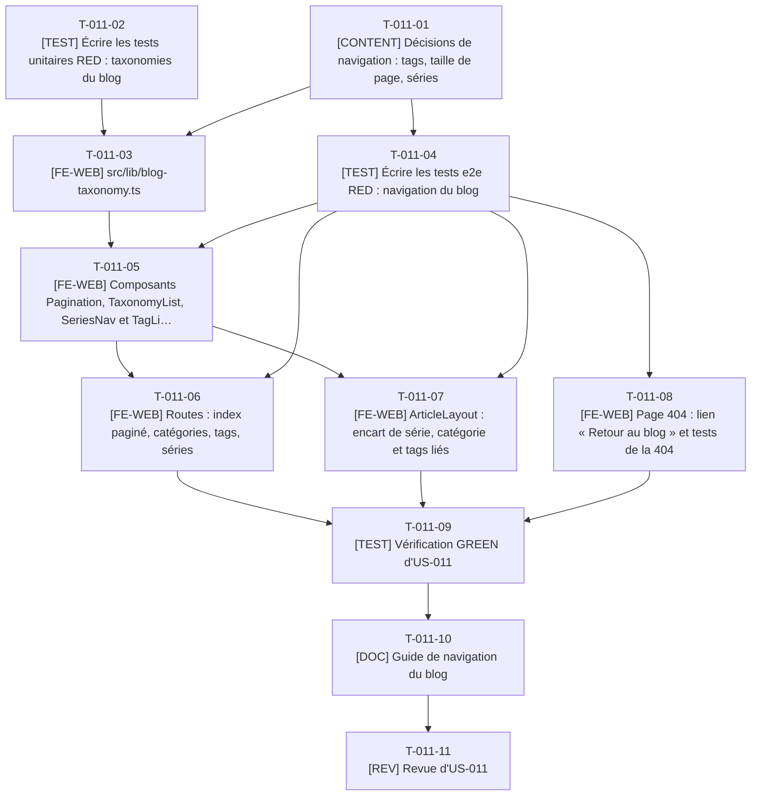

# Tâches - US-011 : Navigation du blog : catégories, tags, séries, pagination

## Informations US
- **Epic** : EPIC-003 : Blog migré
- **Persona** : P-004 : Sophie, tech lead qui pratique l'agentic engineering
- **Story Points** : 3
- **Sprint** : sprint-003-blog_migre_seo
- **Lot** : A
- **Dépendances externes au lot** : US-009 (collection, `ArticleLayout`, routes de base).

## Résumé de la US
**En tant que** P-004 : Sophie
**Je veux** parcourir le blog par catégorie, tag et série, avec une pagination claire
**Afin de** retrouver en moins de 3 clics les articles d'une même thématique ou lire une série dans l'ordre

## Vue d'ensemble des tâches

| ID | Type | Tâche | Estimation | Dépend de | Lot | Statut |
|----|------|-------|------------|-----------|-----|--------|
| T-011-01 | [CONTENT] | Décisions de navigation : tags, taille de page, séries | 2,5h | T-009-01 | A | 🔲 |
| T-011-02 | [TEST] | Écrire les tests unitaires RED : taxonomies du blog | 3h | T-009-05 | A | 🔲 |
| T-011-03 | [FE-WEB] | src/lib/blog-taxonomy.ts | 3h | T-011-02, T-011-01 | A | 🔲 |
| T-011-04 | [TEST] | Écrire les tests e2e RED : navigation du blog | 3,5h | T-009-03, T-011-01, T-009-20 | A | 🔲 |
| T-011-05 | [FE-WEB] | Composants Pagination, TaxonomyList, SeriesNav et TagList | 5h | T-011-03, T-009-21, T-011-04 | A | 🔲 |
| T-011-06 | [FE-WEB] | Routes : index paginé, catégories, tags, séries | 5h | T-011-05, T-009-23, T-011-04 | A | 🔲 |
| T-011-07 | [FE-WEB] | ArticleLayout : encart de série, catégorie et tags liés | 2,5h | T-011-05, T-009-22, T-010-09, T-011-04 | A | 🔲 |
| T-011-08 | [FE-WEB] | Page 404 : lien « Retour au blog » et tests de la 404 | 1h | T-009-24, T-011-04 | A | 🔲 |
| T-011-09 | [TEST] | Vérification GREEN d'US-011 | 2,5h | T-011-06, T-011-07, T-011-08, T-009-26 | A | 🔲 |
| T-011-10 | [DOC] | Guide de navigation du blog | 1h | T-011-09 | A | 🔲 |
| T-011-11 | [REV] | Revue d'US-011 | 2h | T-011-10 | A | 🔲 |

**Total estimé** : 31h (11 tâches)

| Type | Tâches | Heures |
|------|--------|--------|
| [FE-WEB] | 5 | 16,5h |
| [CONTENT] | 1 | 2,5h |
| [TEST] | 3 | 9h |
| [DOC] | 1 | 1h |
| [REV] | 1 | 2h |

---

## Graphe de dépendances

Dépendances vers d'autres US : T-011-01 dépend de T-009-01, T-011-02 dépend de T-009-05, T-011-04 dépend de T-009-03, T-011-04 dépend de T-009-20, T-011-05 dépend de T-009-21, T-011-06 dépend de T-009-23, T-011-07 dépend de T-009-22, T-011-07 dépend de T-010-09, T-011-08 dépend de T-009-24, T-011-09 dépend de T-009-26.

---

## Détail des tâches

#### T-011-01 : [CONTENT] Décisions de navigation : tags, taille de page, séries
- **Type** : [CONTENT]
- **Estimation** : 2,5h
- **Dépend de** : T-009-01
- **Lot** : A

**Description** :
À décider par l'agent selon les arbitrages du 2026-10-14 (aucune attente du PO) et consigner dans `docs/guides/blog.md` : (1) taille de page 12 (US-011 : 28 articles = 3 pages) ; (2) 56 tags dont 37 sur un seul article : pages de tag pour les 19 tags à 2 articles ou plus, les autres affichés en texte sans lien (aucune page mince, aucun `noindex` à gérer), écart E7 ; (3) normalisation des tags avant migration, par exemple « Méthodologie » et « Méthode », « Management de projet » et « Gestion de projet » (les tags « Outils », « Méthode » et « Pilotage » homonymes de catégories restent des tags) ; (4) ordre de lecture des 6 séries (`seriesOrder`) : les `pubDate` ne le donnent pas (4 articles de « La boîte à outils agentic » et 2 de « Les nouveaux risques projet » partagent une date, et les pieds d'article annoncent « Dernier article de la série » ou « Prochain article » dans un autre ordre que les dates) ; (5) libellés des catégories et description de chaque catégorie. Table des 26 articles en série remplie par l'agent à partir des pieds d'article (« Prochain article : … », arbitrage E6), puis inscrite dans `contenu-a-valider.md` pour validation par le PO.

**Fichiers à créer/modifier** :
- `docs/guides/blog.md` (section Navigation)

**Critères de validation** :
- [ ] Table `seriesOrder` complète pour 26 articles
- [ ] Liste des tags normalisés (56 vers N) validée

#### T-011-02 : [TEST] Écrire les tests unitaires RED : taxonomies du blog
- **Type** : [TEST]
- **Estimation** : 3h
- **Dépend de** : T-009-05
- **Lot** : A

**Description** :
`src/lib/blog-taxonomy.ts` (fonctions pures sur les entrées) : `categories(entries)` (sans catégorie vide, comptes, ordre alphabétique français), `tagPages(entries)` (tags à 2 articles ou plus, slug unique, erreur sur collision), `seriesList(entries)`, `seriesPosition(entries, slug)` → `{ name, index, total, previous, next }` (premier sans précédent, dernier sans suivant), `categoryTitle(name, count)` → « Méthode (5 articles) » (« 1 article » au singulier), `paginationItems(page, total)` (libellés « Page 1 sur 3 »). Une catégorie du schéma sans article publié ne produit aucune page.

**Fichiers à créer/modifier** :
- `tests/unit/lib/blog-taxonomy.test.ts`

**Critères de validation** :
- [ ] RED constaté
- [ ] Pluriel et singulier testés

#### T-011-03 : [FE-WEB] src/lib/blog-taxonomy.ts
- **Type** : [FE-WEB]
- **Estimation** : 3h
- **Dépend de** : T-011-02, T-011-01
- **Lot** : A

**Description** :
Implémenter les fonctions de T-011-02 en s'appuyant sur `slugify`, `paginate` et `seriesNeighbors` de `src/lib/blog.ts` (pas de second `slugify`). Une taxonomie dont le nombre d'articles dépasse la taille de page déclenche une erreur de build explicite (« pagination de taxonomie non prévue »), plutôt qu'une page tronquée : le maximum actuel est de 7 articles (Métiers, Pilotage).

**Fichiers à créer/modifier** :
- `src/lib/blog-taxonomy.ts`

**Critères de validation** :
- [ ] Tests T-011-02 verts
- [ ] Aucun import d'`astro:content`

#### T-011-04 : [TEST] Écrire les tests e2e RED : navigation du blog
- **Type** : [TEST]
- **Estimation** : 3,5h
- **Dépend de** : T-009-03, T-011-01, T-009-20
- **Lot** : A

**Description** :
`tests/e2e/blog-navigation.spec.ts`, strict. Catégorie « Méthode » : seuls ses articles, du plus récent au plus ancien, titre « Méthode (5 articles) » ; pagination : `/blog/` 12 articles et « Page 1 sur 3 », `/blog/page/2/` articles 13 à 24, 28 articles au total sur les 3 pages ; `/blog/page/9/` et `/blog/page/1/` : statut 404 et message « Cette page n'existe pas » avec lien « Retour au blog » ; série : encart « Série : <nom> (article 2 sur 4) » avec liens Précédent et Suivant, et premier et dernier de série ; page de tag (un tag à 2 articles ou plus) ; un tag à un article n'est pas un lien ; `nav` étiquetée, page courante en `aria-current="page"`, filtre repliable sous 768 px, aucun JavaScript requis. Le compte de 28 articles remplace le critère d'index complet de `blog.spec.ts`.

**Fichiers à créer/modifier** :
- `tests/e2e/blog-navigation.spec.ts`
- `tests/e2e/blog.spec.ts` (assertion du compte total)

**Critères de validation** :
- [ ] RED constaté
- [ ] Aucun `test.skip`

#### T-011-05 : [FE-WEB] Composants Pagination, TaxonomyList, SeriesNav et TagList
- **Type** : [FE-WEB]
- **Estimation** : 5h
- **Dépend de** : T-011-03, T-009-21, T-011-04
- **Lot** : A

**Description** :
`Pagination` (`nav` « Pagination », « Page n sur N », `aria-current`, liens précédent et suivant explicites), `TaxonomyList` (catégories et tags en liste de liens, repliable sous 768 px par `
`, ouvert au-dessus), `SeriesNav` (encart de série), `TagList` (tags liés si page, sinon texte). Tout est rendu côté serveur, sans JavaScript ; cibles tactiles ≥ 44 px comme le reste du site ; pas de `rel="prev"` ni `rel="next"` (facultatif et sans effet documenté dans l'US).

**Fichiers à créer/modifier** :
- `src/components/blog/Pagination.astro`
- `src/components/blog/TaxonomyList.astro`
- `src/components/blog/SeriesNav.astro`
- `src/components/blog/TagList.astro`

**Critères de validation** :
- [ ] Rendu vérifié à 360, 768 et 1280 px
- [ ] Noms accessibles uniques pour les `nav` d'une même page

#### T-011-06 : [FE-WEB] Routes : index paginé, catégories, tags, séries
- **Type** : [FE-WEB]
- **Estimation** : 5h
- **Dépend de** : T-011-05, T-009-23, T-011-04
- **Lot** : A

**Description** :
`src/pages/blog/index.astro` (page 1, remplace la première version de T-009-23), `src/pages/blog/page/[page]/index.astro` (pages 2 et suivantes), `src/pages/blog/categorie/[categorie]/index.astro`, `src/pages/blog/tag/[tag]/index.astro`, `src/pages/blog/serie/[serie]/index.astro`. `getStaticPaths` depuis les fonctions de `blog-taxonomy.ts`. Chaque page porte un titre et une description uniques (limites de US-024) et sa canonical par `Seo`. `/blog/page/1/` n'existe pas (doublon de `/blog/`). Chaque page est liée depuis l'index ou un article (découverte par la matrice e2e).

**Fichiers à créer/modifier** :
- `src/pages/blog/index.astro`
- `src/pages/blog/page/[page]/index.astro`
- `src/pages/blog/categorie/[categorie]/index.astro`
- `src/pages/blog/tag/[tag]/index.astro`
- `src/pages/blog/serie/[serie]/index.astro`

**Critères de validation** :
- [ ] 3 pages de liste, 5 catégories, les tags à 2 articles ou plus (19 avant la normalisation de T-011-01) et 6 séries générés
- [ ] Aucune page vide

#### T-011-07 : [FE-WEB] ArticleLayout : encart de série, catégorie et tags liés
- **Type** : [FE-WEB]
- **Estimation** : 2,5h
- **Dépend de** : T-011-05, T-009-22, T-010-09, T-011-04
- **Lot** : A

**Description** :
Dans `ArticleLayout.astro` : catégorie liée à sa page, tags (`TagList`), encart `SeriesNav` « Série : <nom> (article N sur M) » avec Précédent et Suivant, emplacement nommé après l'article et avant `AuthorNote`.

**Fichiers à créer/modifier** :
- `src/layouts/ArticleLayout.astro`

**Critères de validation** :
- [ ] Série de 4 articles : « article 2 sur 4 », liens vérifiés
- [ ] Article sans série : aucun encart

#### T-011-08 : [FE-WEB] Page 404 : lien « Retour au blog » et tests de la 404
- **Type** : [FE-WEB]
- **Estimation** : 1h
- **Dépend de** : T-009-24, T-011-04
- **Lot** : A

**Description** :
`src/pages/404.astro` affiche, en plus de « Retour à l'accueil », un lien « Retour au blog » quand l'entrée de navigation `blog` est active. La 404 reste unique pour tout le site (nginx sert `/404.html` pour toute adresse inconnue).

**Fichiers à créer/modifier** :
- `src/pages/404.astro`

**Critères de validation** :
- [ ] `/blog/page/9/` : statut 404, texte « Cette page n'existe pas », lien « Retour au blog »

#### T-011-09 : [TEST] Vérification GREEN d'US-011
- **Type** : [TEST]
- **Estimation** : 2,5h
- **Dépend de** : T-011-06, T-011-07, T-011-08, T-009-26
- **Lot** : A

**Description** :
`make checks`, `blog-navigation.spec.ts` et la matrice responsive/axe (échantillonnée) sur `preview` ; Lighthouse ≥ 95 sur la page 2 de la liste, une catégorie, un tag et une série (échantillon).

**Fichiers à créer/modifier** :
- aucun nouveau fichier

**Critères de validation** :
- [ ] Scénarios verts, aucun skip
- [ ] Lighthouse ≥ 0,95 sur les 4 pages de l'échantillon

#### T-011-10 : [DOC] Guide de navigation du blog
- **Type** : [DOC]
- **Estimation** : 1h
- **Dépend de** : T-011-09
- **Lot** : A

**Description** :
Section « Navigation » de `docs/guides/blog.md` : routes, règle des tags à 2 articles ou plus, `seriesOrder`, comment ajouter une catégorie (énumération du schéma), erreur de pagination de taxonomie ; fragment dans `changelog.d/lot-a.md`.

**Fichiers à créer/modifier** :
- `docs/guides/blog.md`
- `changelog.d/lot-a.md`

**Critères de validation** :
- [ ] Guide relu

#### T-011-11 : [REV] Revue d'US-011
- **Type** : [REV]
- **Estimation** : 2h
- **Dépend de** : T-011-10
- **Lot** : A

**Description** :
Revue : réutilisation de `slugify` et `paginate`, aucune page vide ou mince, accessibilité des `nav`, SSR sans JavaScript, pas de doublon `/blog/page/1/`.

**Fichiers à créer/modifier** :
- `project-management/sprints/sprint-003-blog_migre_seo/dod-review.md` (section US-011)

**Critères de validation** :
- [ ] Findings consignés et traités
