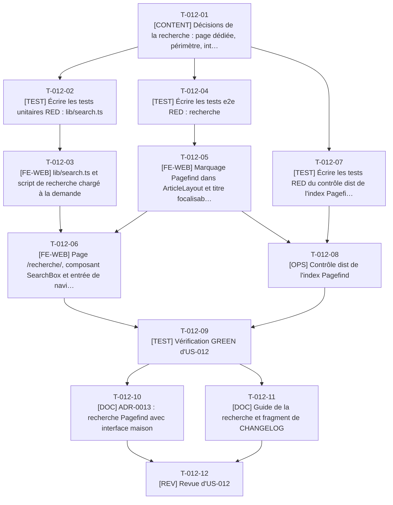

# Tâches - US-012 : Recherche plein texte côté client (Pagefind)

## Informations US
- **Epic** : EPIC-003 : Blog migré
- **Persona** : P-004 : Sophie, tech lead qui pratique l'agentic engineering
- **Story Points** : 2
- **Sprint** : sprint-003-blog_migre_seo
- **Lot** : A
- **Dépendances externes au lot** : US-009 (contenu à indexer) ; `build:search` et dépendance Pagefind produits en phase 0 (T-900-07, T-900-08) ; `nginx.conf` appartient au lot B.

## Résumé de la US
**En tant que** P-004 : Sophie
**Je veux** chercher un mot (par exemple « tokens ») dans tout le contenu du blog
**Afin de** trouver en moins de 10 secondes l'article pertinent pour mon problème, sans parcourir les 28 articles

## Vue d'ensemble des tâches

| ID | Type | Tâche | Estimation | Dépend de | Lot | Statut |
|----|------|-------|------------|-----------|-----|--------|
| T-012-01 | [CONTENT] | Décisions de la recherche : page dédiée, périmètre, interface | 1,5h | T-009-01 | A | 🔲 |
| T-012-02 | [TEST] | Écrire les tests unitaires RED : lib/search.ts | 3h | T-012-01 | A | 🔲 |
| T-012-03 | [FE-WEB] | lib/search.ts et script de recherche chargé à la demande | 5h | T-012-02 | A | 🔲 |
| T-012-04 | [TEST] | Écrire les tests e2e RED : recherche | 4h | T-012-01 | A | 🔲 |
| T-012-05 | [FE-WEB] | Marquage Pagefind dans ArticleLayout et titre focalisable | 1,5h | T-009-22, T-012-04, T-011-07 | A | 🔲 |
| T-012-06 | [FE-WEB] | Page /recherche/, composant SearchBox et entrée de navigation | 4h | T-012-03, T-012-05, T-009-24 | A | 🔲 |
| T-012-07 | [TEST] | Écrire les tests RED du contrôle dist de l'index Pagefind | 2h | T-012-01 | A | 🔲 |
| T-012-08 | [OPS] | Contrôle dist de l'index Pagefind | 2,5h | T-012-07, T-012-05, T-009-26 | A | 🔲 |
| T-012-09 | [TEST] | Vérification GREEN d'US-012 | 2,5h | T-012-06, T-012-08 | A | 🔲 |
| T-012-10 | [DOC] | ADR-0013 : recherche Pagefind avec interface maison | 1,5h | T-012-09 | A | 🔲 |
| T-012-11 | [DOC] | Guide de la recherche et fragment de CHANGELOG | 1h | T-012-09 | A | 🔲 |
| T-012-12 | [REV] | Revue d'US-012 | 2h | T-012-10, T-012-11 | A | 🔲 |

**Total estimé** : 30,5h (12 tâches)

| Type | Tâches | Heures |
|------|--------|--------|
| [OPS] | 1 | 2,5h |
| [FE-WEB] | 3 | 10,5h |
| [CONTENT] | 1 | 1,5h |
| [TEST] | 4 | 11,5h |
| [DOC] | 2 | 2,5h |
| [REV] | 1 | 2h |

---

## Graphe de dépendances

Dépendances vers d'autres US : T-012-01 dépend de T-009-01, T-012-05 dépend de T-009-22, T-012-05 dépend de T-011-07, T-012-06 dépend de T-009-24, T-012-08 dépend de T-009-26.

---

## Détail des tâches

#### T-012-01 : [CONTENT] Décisions de la recherche : page dédiée, périmètre, interface
- **Type** : [CONTENT]
- **Estimation** : 1,5h
- **Dépend de** : T-009-01
- **Lot** : A

**Description** :
À consigner dans `docs/guides/recherche.md` : page dédiée `/recherche/` (plutôt qu'une fenêtre modale : pas de piège de focus à maintenir), lien « Recherche » dans la navigation principale, périmètre limité aux articles (`data-pagefind-body` sur le corps d'article seulement ; le labo et les fiches plugins rejoindront l'index avec leurs EPICs), articles `draft` et futurs absents de `dist/` donc de l'index, page `/recherche/` en `noindex`, interface maison construite sur l'API JavaScript de `/pagefind/pagefind.js` plutôt que sur `pagefind-ui` (écart E19 : compatibilité de l'interface par défaut avec une CSP sans style en ligne non établie ; le test CSP de la matrice e2e tranche), repli sans JavaScript.

**Fichiers à créer/modifier** :
- `docs/guides/recherche.md`

**Critères de validation** :
- [ ] Décisions datées et validées par le PO

#### T-012-02 : [TEST] Écrire les tests unitaires RED : lib/search.ts
- **Type** : [TEST]
- **Estimation** : 3h
- **Dépend de** : T-012-01
- **Lot** : A

**Description** :
Fonctions pures indépendantes de Pagefind : `toResult(raw)` (résultat → `{ url, title, excerptHtml, category }`), nettoyage de l'extrait (seules les balises `<mark>` sont conservées, tout le reste échappé : l'extrait vient de contenu, il est inséré en HTML), `debounce` testable avec une horloge injectée (délai 150 ms pour tenir le critère « moins de 300 ms après la dernière frappe »), machine d'états (`idle` → `loading` → `results` | `empty` | `unavailable`), message vide exact « Aucun résultat pour « zzzzqq ». Essayez un autre mot ou parcourez les catégories. », message d'indisponibilité exact « La recherche est momentanément indisponible. », navigation clavier (indice suivant, précédent, bornes).

**Fichiers à créer/modifier** :
- `tests/unit/lib/search.test.ts`

**Critères de validation** :
- [ ] RED constaté
- [ ] Échappement HTML testé avec un extrait hostile

#### T-012-03 : [FE-WEB] lib/search.ts et script de recherche chargé à la demande
- **Type** : [FE-WEB]
- **Estimation** : 5h
- **Dépend de** : T-012-02
- **Lot** : A

**Description** :
`src/lib/search.ts` (T-012-02) et `src/scripts/search.ts` : import dynamique de `/pagefind/pagefind.js` à la première interaction (focus ou saisie), pas au chargement de la page ; rendu avec `textContent` et nœuds DOM (l'extrait nettoyé seul passe par un fragment contrôlé) ; région `aria-live="polite"` pour le nombre de résultats ; flèches haut/bas puis Entrée ; à l'ouverture d'un résultat le focus va au titre (h1 avec `tabindex="-1"` de l'article, voir T-012-05). Échec du chargement de l'index : état `unavailable` avec lien vers `/blog/`. Aucun cookie, aucun stockage local. Script de moins de 5 Ko hors Pagefind (règle de la tech-spec).

**Fichiers à créer/modifier** :
- `src/lib/search.ts`
- `src/scripts/search.ts`

**Critères de validation** :
- [ ] Tests T-012-02 verts
- [ ] Aucune requête vers `/pagefind/` avant la première interaction

#### T-012-04 : [TEST] Écrire les tests e2e RED : recherche
- **Type** : [TEST]
- **Estimation** : 4h
- **Dépend de** : T-012-01
- **Lot** : A

**Description** :
`tests/e2e/search.spec.ts`, strict, sur `preview` (l'index n'existe qu'après le build : documenté, pas de test sur `astro dev`). Scénarios : « tokens » renvoie des résultats avec titre, extrait surligné (`mark`) et catégorie, mesure du délai après la dernière frappe < 300 ms ; « methode » trouve un article contenant « méthode » ; flèches puis Entrée ouvrent l'article et placent le focus sur son titre ; « zzzzqq » : message exact et lien vers les catégories ; blocage de `/pagefind/**` par `page.route` : message d'indisponibilité et lien vers `/blog/` ; JavaScript désactivé : la page affiche un message utile et le lien vers la liste du blog ; `/recherche/` en `noindex` ; aucune violation CSP en console (WebAssembly compris) ; le type MIME de `pagefind.js` et du `.wasm` est correct et leur cache est `no-cache`.

**Fichiers à créer/modifier** :
- `tests/e2e/search.spec.ts`

**Critères de validation** :
- [ ] RED constaté
- [ ] Aucun `test.skip`

#### T-012-05 : [FE-WEB] Marquage Pagefind dans ArticleLayout et titre focalisable
- **Type** : [FE-WEB]
- **Estimation** : 1,5h
- **Dépend de** : T-009-22, T-012-04, T-011-07
- **Lot** : A

**Description** :
Dans `ArticleLayout.astro` : `data-pagefind-body` sur le conteneur du corps et du titre, `data-pagefind-meta="category"` et filtre de catégorie, `data-pagefind-ignore` sur les éléments de navigation internes à l'article (encart de série, auteur) ; le h1 reçoit `tabindex="-1"` pour recevoir le focus à l'arrivée depuis un résultat. Dès qu'un `data-pagefind-body` existe, Pagefind n'indexe que les pages qui en portent : l'index ne contient que les articles.

**Fichiers à créer/modifier** :
- `src/layouts/ArticleLayout.astro`

**Critères de validation** :
- [ ] `dist/pagefind/` indexe 28 pages après le build complet

#### T-012-06 : [FE-WEB] Page /recherche/, composant SearchBox et entrée de navigation
- **Type** : [FE-WEB]
- **Estimation** : 4h
- **Dépend de** : T-012-03, T-012-05, T-009-24
- **Lot** : A

**Description** :
`src/pages/recherche/index.astro` (`noindex`, un seul h1, champ étiqueté pleine largeur sur mobile, zone de résultats `aria-live`, repli `<noscript>` avec lien vers `/blog/` et les catégories), `src/components/blog/SearchBox.astro`, entrée `recherche` (`/recherche/`, « Recherche ») dans `src/config/nav.ts`. La page est liée depuis la navigation : la découverte des routes de la matrice e2e la couvre.

**Fichiers à créer/modifier** :
- `src/pages/recherche/index.astro`
- `src/components/blog/SearchBox.astro`
- `src/config/nav.ts`

**Critères de validation** :
- [ ] Rendu à 360, 768 et 1280 px
- [ ] Contraste et focus visibles dans les deux thèmes

#### T-012-07 : [TEST] Écrire les tests RED du contrôle dist de l'index Pagefind
- **Type** : [TEST]
- **Estimation** : 2h
- **Dépend de** : T-012-01
- **Lot** : A

**Description** :
`scripts/checks/lib/pagefind.ts` : lecture de `dist/pagefind/pagefind-entry.json` (le nom et la structure du fichier sont à relever dans la sortie réelle de Pagefind 1.5.2 avant d'écrire le test), échec si l'index est vide (« Index Pagefind vide »), si le nombre de pages indexées diffère du nombre d'articles publiés, si le poids total des fichiers d'index dépasse 500 Ko (budget d'US-012) ; fixtures de dossier `pagefind/` minimales.

**Fichiers à créer/modifier** :
- `tests/unit/checks/pagefind.test.ts`

**Critères de validation** :
- [ ] RED constaté

#### T-012-08 : [OPS] Contrôle dist de l'index Pagefind
- **Type** : [OPS]
- **Estimation** : 2,5h
- **Dépend de** : T-012-07, T-012-05, T-009-26
- **Lot** : A

**Description** :
`scripts/checks/pagefind.dist.check.ts` : l'index existe, n'est pas vide, indexe exactement les articles publiés, pèse moins de 500 Ko (somme des fichiers du dossier `pagefind/` à l'exception de `pagefind.js` et de `.wasm`, dont le poids est mesuré à part et noté dans le guide).

**Fichiers à créer/modifier** :
- `scripts/checks/pagefind.dist.check.ts`
- `scripts/checks/lib/pagefind.ts`

**Critères de validation** :
- [ ] Tests T-012-07 verts
- [ ] Contrôle vert sur le build complet ; poids relevé

#### T-012-09 : [TEST] Vérification GREEN d'US-012
- **Type** : [TEST]
- **Estimation** : 2,5h
- **Dépend de** : T-012-06, T-012-08
- **Lot** : A

**Description** :
`make checks`, `search.spec.ts` sur `preview` et matrice e2e (page `/recherche/` découverte), Lighthouse ≥ 95 sur `/recherche/` (index chargé à la première interaction seulement). Relever le poids de l'index et du module.

**Fichiers à créer/modifier** :
- aucun nouveau fichier

**Critères de validation** :
- [ ] Scénarios verts, aucun skip
- [ ] Poids de l'index < 500 Ko

#### T-012-10 : [DOC] ADR-0013 : recherche Pagefind avec interface maison
- **Type** : [DOC]
- **Estimation** : 1,5h
- **Dépend de** : T-012-09
- **Lot** : A

**Description** :
`docs/adr/0013-recherche-pagefind-interface-maison.md` : contexte (CSP stricte, `'wasm-unsafe-eval'` déjà autorisé par ADR-0009), décision (API JavaScript, index limité aux articles), alternatives (`pagefind-ui`, modale, autre moteur), conséquences. L'index des ADR est complété par l'orchestrateur.

**Fichiers à créer/modifier** :
- `docs/adr/0013-recherche-pagefind-interface-maison.md`

**Critères de validation** :
- [ ] ADR au format des ADR existants

#### T-012-11 : [DOC] Guide de la recherche et fragment de CHANGELOG
- **Type** : [DOC]
- **Estimation** : 1h
- **Dépend de** : T-012-09
- **Lot** : A

**Description** :
Compléter `docs/guides/recherche.md` : test en local (`make preview`), ajout d'un contenu à l'index, budget de poids, dépannage (index absent sur `astro dev`), ligne dans `changelog.d/lot-a.md`.

**Fichiers à créer/modifier** :
- `docs/guides/recherche.md`
- `changelog.d/lot-a.md`

**Critères de validation** :
- [ ] Guide relu

#### T-012-12 : [REV] Revue d'US-012
- **Type** : [REV]
- **Estimation** : 2h
- **Dépend de** : T-012-10, T-012-11
- **Lot** : A

**Description** :
Revue : échappement des extraits, chargement différé, aucun stockage, accessibilité (étiquette, aria-live, clavier), CSP, poids.

**Fichiers à créer/modifier** :
- `project-management/sprints/sprint-003-blog_migre_seo/dod-review.md` (section US-012)

**Critères de validation** :
- [ ] Findings consignés et traités
