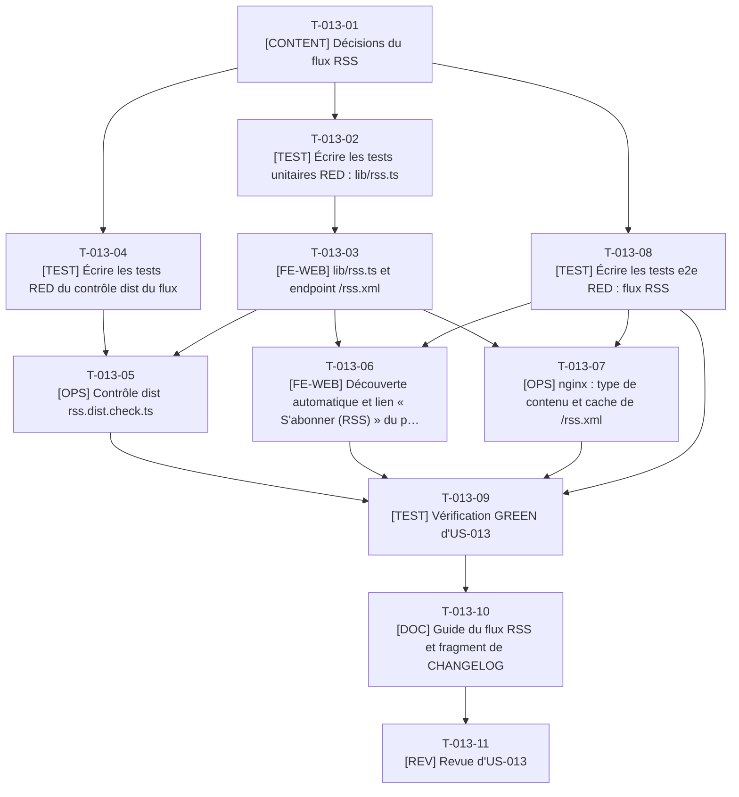

# Tâches - US-013 : Flux RSS

## Informations US
- **Epic** : EPIC-003 : Blog migré
- **Persona** : P-004 : Sophie, tech lead qui pratique l'agentic engineering
- **Story Points** : 2
- **Sprint** : sprint-003-blog_migre_seo
- **Lot** : B
- **Dépendances externes au lot** : Contrats C1 à C5 (phase 0) ; vérifications sur données réelles après la synchronisation S1 (articles du lot A).

## Résumé de la US
**En tant que** P-004 : Sophie
**Je veux** m'abonner au blog avec mon lecteur RSS
**Afin de** suivre chaque nouvel article sans effort, sans compte ni newsletter

## Vue d'ensemble des tâches

| ID | Type | Tâche | Estimation | Dépend de | Lot | Statut |
|----|------|-------|------------|-----------|-----|--------|
| T-013-01 | [CONTENT] | Décisions du flux RSS | 1,5h | - | B | 🔲 |
| T-013-02 | [TEST] | Écrire les tests unitaires RED : lib/rss.ts | 3h | T-013-01 | B | 🔲 |
| T-013-03 | [FE-WEB] | lib/rss.ts et endpoint /rss.xml | 3,5h | T-013-02, T-009-05, T-900-07 | B | 🔲 |
| T-013-04 | [TEST] | Écrire les tests RED du contrôle dist du flux | 2h | T-013-01 | B | 🔲 |
| T-013-05 | [OPS] | Contrôle dist rss.dist.check.ts | 3h | T-013-04, T-013-03 | B | 🔲 |
| T-013-06 | [FE-WEB] | Découverte automatique et lien « S'abonner (RSS) » du pied de page | 2h | T-013-03, T-024-02, T-013-08 | B | 🔲 |
| T-013-07 | [OPS] | nginx : type de contenu et cache de /rss.xml | 2h | T-900-07, T-013-03, T-013-08 | B | 🔲 |
| T-013-08 | [TEST] | Écrire les tests e2e RED : flux RSS | 3h | T-013-01 | B | 🔲 |
| T-013-09 | [TEST] | Vérification GREEN d'US-013 | 2h | T-013-05, T-013-06, T-013-07, T-013-08, T-009-23 | B | 🔲 |
| T-013-10 | [DOC] | Guide du flux RSS et fragment de CHANGELOG | 1h | T-013-09 | B | 🔲 |
| T-013-11 | [REV] | Revue d'US-013 | 1,5h | T-013-10 | B | 🔲 |

**Total estimé** : 24,5h (11 tâches)

| Type | Tâches | Heures |
|------|--------|--------|
| [OPS] | 2 | 5h |
| [FE-WEB] | 2 | 5,5h |
| [CONTENT] | 1 | 1,5h |
| [TEST] | 4 | 10h |
| [DOC] | 1 | 1h |
| [REV] | 1 | 1,5h |

---

## Graphe de dépendances

Dépendances vers d'autres US : T-013-03 dépend de T-009-05, T-013-03 dépend de T-900-07, T-013-06 dépend de T-024-02, T-013-07 dépend de T-900-07, T-013-09 dépend de T-009-23.

---

## Détail des tâches

#### T-013-01 : [CONTENT] Décisions du flux RSS
- **Type** : [CONTENT]
- **Estimation** : 1,5h
- **Dépend de** : -
- **Lot** : B

**Description** :
À consigner dans `docs/guides/flux-rss.md` : flux unique `/rss.xml` (YAGNI : pas de flux par catégorie), 20 articles les plus récents, contenu = `description` (extrait) et non l'article complet (conserve la visite du site), catégorie en `<category>`, `<language>` `fr`, auteur Thibaut Monier, `lastBuildDate` à la date du build, ancien flux `/rss.xml` de l'ancien site à la même adresse (entrée de type `flux` dans la table d'US-010, produite par le lot A). Le champ `excerpt` du schéma est facultatif : le flux utilise `excerpt ?? description` et échoue si les deux manquent (« Flux RSS : description manquante pour <slug> »).

**Fichiers à créer/modifier** :
- `docs/guides/flux-rss.md`

**Critères de validation** :
- [ ] Décisions datées et validées par le PO

#### T-013-02 : [TEST] Écrire les tests unitaires RED : lib/rss.ts
- **Type** : [TEST]
- **Estimation** : 3h
- **Dépend de** : T-013-01
- **Lot** : B

**Description** :
`buildRssItems(entries, now)` : tri par date décroissante, limite à 20, exclusion des brouillons et des articles à date future (même `isPublished` que la liste du blog, importé de `src/lib/blog.ts`), URL absolues par `absoluteUrl`, description `excerpt ?? description`, erreur citant le slug si les deux manquent, catégorie. Caractères spéciaux : un titre contenant `&`, `<` et des guillemets reste un XML valide (échappement délégué à `@astrojs/rss`, vérifié par un test sur le XML produit).

**Fichiers à créer/modifier** :
- `tests/unit/lib/rss.test.ts`

**Critères de validation** :
- [ ] RED constaté
- [ ] Échappement testé sur le XML produit, pas sur l'objet intermédiaire

#### T-013-03 : [FE-WEB] lib/rss.ts et endpoint /rss.xml
- **Type** : [FE-WEB]
- **Estimation** : 3,5h
- **Dépend de** : T-013-02, T-009-05, T-900-07
- **Lot** : B

**Description** :
`src/lib/rss.ts` (T-013-02) et `src/pages/rss.xml.ts` : `rss()` de `@astrojs/rss`, `site` lu par le module d'URL, `customData` pour `<language>fr</language>` et `<lastBuildDate>`, `getPublishedPosts()` comme seule source. Fichier statique `dist/rss.xml` (sans barre finale : `canonicalUrl` gère déjà les fichiers).

**Fichiers à créer/modifier** :
- `src/lib/rss.ts`
- `src/pages/rss.xml.ts`

**Critères de validation** :
- [ ] Tests T-013-02 verts
- [ ] `dist/rss.xml` présent après le build

#### T-013-04 : [TEST] Écrire les tests RED du contrôle dist du flux
- **Type** : [TEST]
- **Estimation** : 2h
- **Dépend de** : T-013-01
- **Lot** : B

**Description** :
`rss.dist.check.ts` et sa lib : racine `<rss version="2.0">`, un canal avec `title`, `link`, `description`, `language`, `lastBuildDate`, 1 à 20 `item` avec `title`, `link` absolu, `guid`, `pubDate` au format RFC 822, `description` non vide ; poids < 100 Ko ; aucun `item` correspondant à un article non publié. Pas de bibliothèque XML (aucune n'est installée) : analyse par expressions régulières bornées sur la sortie connue de `@astrojs/rss`, la validité de forme (bien formé) étant vérifiée par le navigateur dans le test e2e (T-013-08).

**Fichiers à créer/modifier** :
- `tests/unit/checks/rss.test.ts`
- `tests/fixtures/rss/`

**Critères de validation** :
- [ ] RED constaté
- [ ] Cas : flux valide, `item` sans `guid`, lien relatif, 21 items, flux de 120 Ko

#### T-013-05 : [OPS] Contrôle dist rss.dist.check.ts
- **Type** : [OPS]
- **Estimation** : 3h
- **Dépend de** : T-013-04, T-013-03
- **Lot** : B

**Description** :
Implémenter `scripts/checks/rss.dist.check.ts` et `scripts/checks/lib/rss.ts` (découverte automatique). Comparer le nombre d'items à `min(20, articles publiés)`.

**Fichiers à créer/modifier** :
- `scripts/checks/rss.dist.check.ts`
- `scripts/checks/lib/rss.ts`

**Critères de validation** :
- [ ] Tests T-013-04 verts
- [ ] `make checks` vert

#### T-013-06 : [FE-WEB] Découverte automatique et lien « S'abonner (RSS) » du pied de page
- **Type** : [FE-WEB]
- **Estimation** : 2h
- **Dépend de** : T-013-03, T-024-02, T-013-08
- **Lot** : B

**Description** :
`<link rel="alternate" type="application/rss+xml" title="…" href="/rss.xml">` dans `BaseLayout.astro` (propriétaire : lot B), lien visible « S'abonner (RSS) » dans `Footer.astro` avec la clé `footer.rss` pré-créée en phase 0 dans `src/i18n/fr.ts` et `en.ts` (ajoutée par l'orchestrateur avec le contrat C5), cible ≥ 24 px, libellé explicite. Le lien du pied de page est un vrai `<a>` interne : le contrôle de liens internes vérifie sa cible.

**Fichiers à créer/modifier** :
- `src/layouts/BaseLayout.astro`
- `src/components/ui/Footer.astro`

**Critères de validation** :
- [ ] Lien présent dans le pied de page de chaque page
- [ ] Contrôle de liens internes vert

#### T-013-07 : [OPS] nginx : type de contenu et cache de /rss.xml
- **Type** : [OPS]
- **Estimation** : 2h
- **Dépend de** : T-900-07, T-013-03, T-013-08
- **Lot** : B

**Description** :
`nginx.conf` (propriétaire : lot B) : `location = /rss.xml` avec `default_type application/rss+xml`, charset UTF-8, `Cache-Control: no-cache` (revalidation) et réinclusion du snippet d'en-têtes de sécurité (un `add_header` dans un `location` annule ceux du `server`). Le type par défaut de l'extension `xml` et l'absence de charset ont été relevés en T-900-07.

**Fichiers à créer/modifier** :
- `nginx.conf`

**Critères de validation** :
- [ ] `curl -I` sur `preview` : `Content-Type: application/rss+xml`, charset, CSP présente
- [ ] Test d'en-têtes ajouté à `headers.spec.ts` ou `rss.spec.ts`

#### T-013-08 : [TEST] Écrire les tests e2e RED : flux RSS
- **Type** : [TEST]
- **Estimation** : 3h
- **Dépend de** : T-013-01
- **Lot** : B

**Description** :
`tests/e2e/rss.spec.ts`, strict. `/rss.xml` : statut 200, `Content-Type` `application/rss+xml`, document bien formé analysé par `DOMParser` dans la page (aucun `parsererror`), 20 articles les plus récents avec titre, lien absolu, date, description et catégorie ; la liste ne contient aucun article hors du blog publié ; le lien de découverte est présent sur un échantillon de pages (accueil, article, fiche plugin) ; le lien de pied de page a le libellé « S'abonner (RSS) » et une cible de 24 px au moins ; poids < 100 Ko ; aucune violation CSP. Le scénario sur les 20 articles exige les articles du lot A (synchronisation S1).

**Fichiers à créer/modifier** :
- `tests/e2e/rss.spec.ts`

**Critères de validation** :
- [ ] RED constaté
- [ ] Aucun `test.skip`

#### T-013-09 : [TEST] Vérification GREEN d'US-013
- **Type** : [TEST]
- **Estimation** : 2h
- **Dépend de** : T-013-05, T-013-06, T-013-07, T-013-08, T-009-23
- **Lot** : B

**Description** :
`make checks`, `rss.spec.ts` sur `preview` après la synchronisation S1 (articles réels). Lighthouse non concerné (fichier non HTML) ; vérifier que le pied de page modifié n'altère pas les scores de l'échantillon.

**Fichiers à créer/modifier** :
- aucun nouveau fichier

**Critères de validation** :
- [ ] Scénarios verts sur les 28 articles du lot A, aucun skip

#### T-013-10 : [DOC] Guide du flux RSS et fragment de CHANGELOG
- **Type** : [DOC]
- **Estimation** : 1h
- **Dépend de** : T-013-09
- **Lot** : B

**Description** :
Compléter `docs/guides/flux-rss.md` (contenu, tri, limite, validation, ajout d'un champ) ; ligne dans `changelog.d/lot-b.md`.

**Fichiers à créer/modifier** :
- `docs/guides/flux-rss.md`
- `changelog.d/lot-b.md`

**Critères de validation** :
- [ ] Guide relu

#### T-013-11 : [REV] Revue d'US-013
- **Type** : [REV]
- **Estimation** : 1,5h
- **Dépend de** : T-013-10
- **Lot** : B

**Description** :
Revue : filtre de publication identique à la liste du blog (un seul `isPublished`), échappement, URL absolues par le module unique, nginx (snippet réinclus), accessibilité du lien.

**Fichiers à créer/modifier** :
- `project-management/sprints/sprint-003-blog_migre_seo/dod-review.md` (section US-013)

**Critères de validation** :
- [ ] Findings consignés et traités
