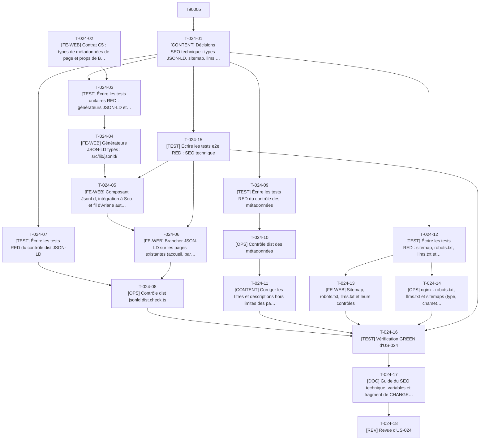

# Tâches - US-024 : SEO technique et données structurées (JSON-LD, sitemap, llms.txt)

## Informations US
- **Epic** : EPIC-006 : SEO, GEO et mesure
- **Persona** : P-002 : Marc, dirigeant e-commerce B2B qui cherche un expert en mission
- **Story Points** : 5
- **Sprint** : sprint-003-blog_migre_seo
- **Lot** : B (tâches de contrat en phase 0 : T-024-02)
- **Dépendances externes au lot** : US-005 (profil), US-020 (fiches) livrées ; US-009 (articles) via le contrat C3 et la synchronisation S1.

## Résumé de la US
**En tant que** P-002 : Marc
**Je veux** trouver par Google (ou par un assistant IA) les fiches plugins, les articles et le profil de Thibaut avec des résultats enrichis
**Afin de** arriver directement sur la page qui répond à mon besoin (par exemple « Factur-X Sylius ») et contacter l'expert en moins de 2 minutes

## Vue d'ensemble des tâches

| ID | Type | Tâche | Estimation | Dépend de | Lot | Statut |
|----|------|-------|------------|-----------|-----|--------|
| T-024-01 | [CONTENT] | Décisions SEO technique : types JSON-LD, sitemap, llms.txt | 2,5h | T-900-05 | B | 🔲 |
| T-024-02 | [FE-WEB] | Contrat C5 : types de métadonnées de page et props de BaseLayout (sans comportement) | 2h | T-900-10 | Phase 0 | 🔲 |
| T-024-03 | [TEST] | Écrire les tests unitaires RED : générateurs JSON-LD et fil d'Ariane | 5h | T-024-01, T-024-02 | B | 🔲 |
| T-024-04 | [FE-WEB] | Générateurs JSON-LD typés : src/lib/jsonld/ | 6h | T-024-03 | B | 🔲 |
| T-024-05 | [FE-WEB] | Composant JsonLd, intégration à Seo et fil d'Ariane automatique | 4h | T-024-04, T-024-15 | B | 🔲 |
| T-024-06 | [FE-WEB] | Brancher JSON-LD sur les pages existantes (accueil, parcours, fiches, catalogue) | 4h | T-024-05, T-024-15 | B | 🔲 |
| T-024-07 | [TEST] | Écrire les tests RED du contrôle dist JSON-LD | 3h | T-024-01 | B | 🔲 |
| T-024-08 | [OPS] | Contrôle dist jsonld.dist.check.ts | 4h | T-024-07, T-024-06 | B | 🔲 |
| T-024-09 | [TEST] | Écrire les tests RED du contrôle des métadonnées | 2h | T-024-01 | B | 🔲 |
| T-024-10 | [OPS] | Contrôle dist des métadonnées | 2,5h | T-024-09 | B | 🔲 |
| T-024-11 | [CONTENT] | Corriger les titres et descriptions hors limites des pages existantes | 3h | T-024-10, T-025-05 | B | 🔲 |
| T-024-12 | [TEST] | Écrire les tests RED : sitemap, robots.txt, llms.txt et garde-fous | 5h | T-024-01 | B | 🔲 |
| T-024-13 | [FE-WEB] | Sitemap, robots.txt, llms.txt et leurs contrôles | 7h | T-024-12, T-900-07 | B | 🔲 |
| T-024-14 | [OPS] | nginx : robots.txt, llms.txt et sitemaps (type, charset, cache) | 2h | T-013-07, T-900-07, T-024-12 | B | 🔲 |
| T-024-15 | [TEST] | Écrire les tests e2e RED : SEO technique | 4h | T-024-01 | B | 🔲 |
| T-024-16 | [TEST] | Vérification GREEN d'US-024 | 3h | T-024-08, T-024-10, T-024-11, T-024-13, T-024-14, T-024-15, T-009-23 | B | 🔲 |
| T-024-17 | [DOC] | Guide du SEO technique, variables et fragment de CHANGELOG | 1,5h | T-024-16 | B | 🔲 |
| T-024-18 | [REV] | Revue d'US-024 | 2,5h | T-024-17 | B | 🔲 |

**Total estimé** : 63h (18 tâches)

| Type | Tâches | Heures |
|------|--------|--------|
| [OPS] | 3 | 8,5h |
| [FE-WEB] | 5 | 23h |
| [CONTENT] | 2 | 5,5h |
| [TEST] | 6 | 22h |
| [DOC] | 1 | 1,5h |
| [REV] | 1 | 2,5h |

---

## Graphe de dépendances

Dépendances vers d'autres US : T-024-02 dépend de T-900-10, T-024-11 dépend de T-025-05, T-024-13 dépend de T-900-07, T-024-14 dépend de T-013-07, T-024-14 dépend de T-900-07, T-024-16 dépend de T-009-23, T-024-01 dépend de T-900-05.

---

## Détail des tâches

#### T-024-01 : [CONTENT] Décisions SEO technique : types JSON-LD, sitemap, llms.txt
- **Type** : [CONTENT]
- **Estimation** : 2,5h
- **Dépend de** : T-900-05
- **Lot** : B

**Description** :
À consigner dans `docs/guides/seo-technique.md` et faire valider par le PO : (1) types par page : `Person` sur l'accueil, `ProfilePage` (avec `Person` en `mainEntity`) sur `/parcours/`, `BlogPosting` sur les articles (le blog source émettait `TechArticle` ; l'US demande `BlogPosting`), `FAQPage` sur les articles qui ont une FAQ, `SoftwareSourceCode` sur les 20 fiches de plugins, `ItemList` sur `/open-source/` (reporté du sprint 2, écart E15 de ce sprint-là), `BreadcrumbList` partout y compris l'accueil (un seul élément) ; pas d'`Article` pour l'étude de cas career-ops ni pour tailsfadmin (YAGNI) ; (2) liste blanche de `Person` : `name`, `jobTitle`, `url`, `sameAs` (LinkedIn, GitHub), localisation générale (le pays) ; aucune autre propriété ; (3) `lastmod` du sitemap : date du contenu quand elle existe (`updatedDate ?? pubDate`, date des pages légales), sinon date du build (écart E18) ; (4) `llms.txt` généré au build selon le format llmstxt.org (titre, résumé, sections de liens) avec au moins 10 liens (profil, parcours, 20 plugins, projets, articles) ; (5) pages `noindex` exclues du sitemap : `/contact/merci/`, `/recherche/`, la 404 ; (6) pas de `hreflang` tant que l'anglais n'est pas activé (sprint 5).

**Fichiers à créer/modifier** :
- `docs/guides/seo-technique.md`

**Critères de validation** :
- [ ] Décisions datées et validées par le PO
- [ ] Liste blanche de `Person` arrêtée propriété par propriété

#### T-024-02 : [FE-WEB] Contrat C5 : types de métadonnées de page et props de BaseLayout (sans comportement)
- **Type** : [FE-WEB]
- **Estimation** : 2h
- **Dépend de** : T-900-10
- **Lot** : Phase 0

**Description** :
Publier avant les workers le contrat entre `ArticleLayout` (lot A) et le layout (lot B). `src/lib/page-meta.ts` : types `Crumb { label; href? }`, `ArticleMeta { slug; publishedAt: Date; updatedAt?: Date; category; tags: string[]; wordCount: number; image?: { src: string; alt: string }; faq?: { question; answer }[] }`. `BaseLayout.astro` accepte en plus `ogType?: 'website' | 'article' | 'profile'`, `article?: ArticleMeta`, `breadcrumb?: Crumb[]` et les transmet à `Seo.astro`, qui les accepte et ne les exploite pas encore (le comportement arrive avec les tâches du lot B : `T-024-05`, `T-025-05`). Ajouter aussi les clés d'interface partagées, seule modification de `src/i18n/` du sprint : `footer.rss` (« S'abonner (RSS) ») dans `fr.ts` et `en.ts`. Après cette tâche, `BaseLayout`, `Seo`, `Footer`, `src/i18n/` et `nginx.conf` appartiennent au lot B.

**Fichiers à créer/modifier** :
- `src/lib/page-meta.ts`
- `src/layouts/BaseLayout.astro`
- `src/components/seo/Seo.astro`
- `src/i18n/fr.ts`
- `src/i18n/en.ts`

**Critères de validation** :
- [ ] `make check` (astro check) vert ; les 30 pages existantes se construisent sans changement de HTML (comparaison `dist/` avant et après)
- [ ] Contrat C5 recopié tel quel dans `tasks/README.md`

#### T-024-03 : [TEST] Écrire les tests unitaires RED : générateurs JSON-LD et fil d'Ariane
- **Type** : [TEST]
- **Estimation** : 5h
- **Dépend de** : T-024-01, T-024-02
- **Lot** : B

**Description** :
Un fichier de test par type dans `tests/unit/lib/jsonld/` : `person` (liste blanche stricte ; message « JSON-LD Person : propriété interdite 'telephone' » pour `telephone`, `birthDate`, `address` précise), `profilePage`, `blogPosting` (`headline`, `datePublished`, `dateModified` = `updatedAt ?? publishedAt`, `author`, `image` absolue, `keywords`, `articleSection`, `wordCount`, `inLanguage: fr`, `mainEntityOfPage`), `faqPage` (uniquement si FAQ), `softwareSourceCode` (nom, dépôt, licence, langage PHP, version si connue), `itemList`, `breadcrumbList` (positions, URL absolues par `absoluteUrl`). `lib/breadcrumb.ts` : fil d'Ariane automatique à partir du chemin (segments connus ; segment sans page ignoré, par exemple `/blog/categorie/` n'a pas de page) avec dernier maillon = titre de la page, ou fil explicite fourni par la page. Sérialisation : `<`, `>` et `&` échappés dans le JSON inséré dans `` ne ferme pas la balise

#### T-024-04 : [FE-WEB] Générateurs JSON-LD typés : src/lib/jsonld/
- **Type** : [FE-WEB]
- **Estimation** : 6h
- **Dépend de** : T-024-03
- **Lot** : B

**Description** :
Un fichier par type dans `src/lib/jsonld/` (`person.ts`, `profile-page.ts`, `blog-posting.ts`, `faq-page.ts`, `software-source-code.ts`, `item-list.ts`, `breadcrumb-list.ts`) et un point d'entrée `index.ts` (`serializeJsonLd(objects)`), plus `src/lib/breadcrumb.ts`. Types écrits à la main (pas de dépendance `schema-dts` : aucune dépendance n'est ajoutée en dehors de la phase 0). Les URL passent toutes par `absoluteUrl`. Un module unique de construction : aucune page n'assemble de JSON-LD à la main.

**Fichiers à créer/modifier** :
- `src/lib/jsonld/*.ts`
- `src/lib/breadcrumb.ts`

**Critères de validation** :
- [ ] Tests T-024-03 verts, couverture ≥ 90 % de `src/lib/jsonld/`
- [ ] Aucune propriété hors liste blanche dans `Person`

#### T-024-05 : [FE-WEB] Composant JsonLd, intégration à Seo et fil d'Ariane automatique
- **Type** : [FE-WEB]
- **Estimation** : 4h
- **Dépend de** : T-024-04, T-024-15
- **Lot** : B

**Description** :
`src/components/seo/JsonLd.astro` générique (`<script type="application/ld+json" set:html={…}>` du JSON sérialisé et échappé). `Seo.astro` assemble les objets selon `article`, `ogType` et `breadcrumb` (automatique par défaut) et rend un `BreadcrumbList` sur chaque page, y compris l'accueil. Les blocs de données non exécutables ne sont pas concernés par `script-src` : à vérifier par le test de console sans violation CSP de la matrice e2e.

**Fichiers à créer/modifier** :
- `src/components/seo/JsonLd.astro`
- `src/components/seo/Seo.astro`
- `src/layouts/BaseLayout.astro`

**Critères de validation** :
- [ ] Une page quelconque expose un `BreadcrumbList` valide
- [ ] Aucune violation CSP en console

#### T-024-06 : [FE-WEB] Brancher JSON-LD sur les pages existantes (accueil, parcours, fiches, catalogue)
- **Type** : [FE-WEB]
- **Estimation** : 4h
- **Dépend de** : T-024-05, T-024-15
- **Lot** : B

**Description** :
Accueil : `Person` ; `/parcours/` : `ProfilePage` ; chaque fiche plugin : `SoftwareSourceCode` depuis les champs déjà validés du schéma `plugins` ; `/open-source/` : `ItemList` des plugins ; autres pages : fil d'Ariane seul. Fichiers du sprint 1 et 2 appartenant au lot B pour ce sprint ; aucune modification de leur contenu visible.

**Fichiers à créer/modifier** :
- `src/pages/index.astro`
- `src/pages/parcours.astro`
- `src/pages/open-source/index.astro`
- `src/layouts/PluginLayout.astro`
- `src/layouts/ProjectLayout.astro`

**Critères de validation** :
- [ ] Types attendus présents sur chaque type de page (vérifié par `T-024-08`)
- [ ] Rendu visible inchangé (capture avant et après)

#### T-024-07 : [TEST] Écrire les tests RED du contrôle dist JSON-LD
- **Type** : [TEST]
- **Estimation** : 3h
- **Dépend de** : T-024-01
- **Lot** : B

**Description** :
`jsonld.dist.check.ts` et sa lib sur des pages de fixtures : chaque script JSON-LD est un JSON valide ; propriétés obligatoires par type (`BlogPosting` : `headline`, `datePublished`, `author`, `image` ; message exact « JSON-LD BlogPosting invalide : datePublished requis (<slug>) ») ; `Person` n'a que les propriétés de la liste blanche ; chaque page indexable a un `BreadcrumbList` ; un `FAQPage` n'existe que si la page contient la FAQ visible ; poids < 5 Ko par page.

**Fichiers à créer/modifier** :
- `tests/unit/checks/jsonld.test.ts`
- `tests/fixtures/jsonld/`

**Critères de validation** :
- [ ] RED constaté
- [ ] Messages d'erreur des scénarios de l'US testés mot pour mot

#### T-024-08 : [OPS] Contrôle dist jsonld.dist.check.ts
- **Type** : [OPS]
- **Estimation** : 4h
- **Dépend de** : T-024-07, T-024-06
- **Lot** : B

**Description** :
Implémenter `scripts/checks/jsonld.dist.check.ts` et sa lib. Le contrôle s'applique à toutes les pages de `dist/` (hors 404 et pages `noindex`) ; l'échec cite la page et le type.

**Fichiers à créer/modifier** :
- `scripts/checks/jsonld.dist.check.ts`
- `scripts/checks/lib/jsonld.ts`

**Critères de validation** :
- [ ] Tests T-024-07 verts
- [ ] `make checks` vert sur le site complet (30 pages existantes + blog)

#### T-024-09 : [TEST] Écrire les tests RED du contrôle des métadonnées
- **Type** : [TEST]
- **Estimation** : 2h
- **Dépend de** : T-024-01
- **Lot** : B

**Description** :
`meta.dist.check.ts` : `<title>` ≤ 60 caractères, `meta description` entre 50 et 160, unicité des titres et des descriptions sur le site, pages `noindex` exclues de l'unicité. Message citant la page et la valeur (« Titre trop long (72 > 60) : /blog/x/ »).

**Fichiers à créer/modifier** :
- `tests/unit/checks/meta.test.ts`

**Critères de validation** :
- [ ] RED constaté
- [ ] Cas : titre de 61 caractères, doublon, description de 49 et 161 caractères

#### T-024-10 : [OPS] Contrôle dist des métadonnées
- **Type** : [OPS]
- **Estimation** : 2,5h
- **Dépend de** : T-024-09
- **Lot** : B

**Description** :
Implémenter `scripts/checks/meta.dist.check.ts` (lib partagée avec le contrôle JSON-LD pour l'extraction HTML, pas de seconde analyse). Le contrôle des titres d'articles dépend du travail éditorial du lot A (`seoTitle`) : tant que ses lots d'articles ne sont pas fusionnés, l'exécuter sur les seules pages hors blog.

**Fichiers à créer/modifier** :
- `scripts/checks/meta.dist.check.ts`
- `scripts/checks/lib/html-meta.ts`

**Critères de validation** :
- [ ] Tests T-024-09 verts
- [ ] Rapport des pages hors limites établi sur le site existant

#### T-024-11 : [CONTENT] Corriger les titres et descriptions hors limites des pages existantes
- **Type** : [CONTENT]
- **Estimation** : 3h
- **Dépend de** : T-024-10, T-025-05
- **Lot** : B

**Description** :
Les 30 pages des sprints 1 et 2 n'ont jamais été contrôlées sur l'unicité et la longueur des métadonnées (la limite de titre des projets est déjà de 43 caractères, mais pas celle des fiches ni des autres pages). Corriger chaque écart relevé par T-024-10 dans les contenus (YAML, MDX, frontmatter, pages Astro) sans changer le sens ; la nouvelle fonction de titre n'ajoute le suffixe « — Thibaut Monier » que s'il tient dans les 60 caractères (adaptation de `buildTitle` dans `src/lib/seo.ts`, test unitaire). L'estimation de 3 h est à reconsidérer après le premier rapport.

**Fichiers à créer/modifier** :
- `src/lib/seo.ts`
- `tests/unit/lib/seo.test.ts`
- contenus des pages signalées par le rapport

**Critères de validation** :
- [ ] Le contrôle des métadonnées est vert sur les pages hors blog
- [ ] Le texte visible ne change que si la correction l'exige (liste des changements dans la PR)

#### T-024-12 : [TEST] Écrire les tests RED : sitemap, robots.txt, llms.txt et garde-fous
- **Type** : [TEST]
- **Estimation** : 5h
- **Dépend de** : T-024-01
- **Lot** : B

**Description** :
Libs pures testées : `lastmodFor(path, sources)` (date du contenu sinon date du build, jamais le futur), `isSitemapIndexable(path, html)`, `buildRobots(origin)` (autorise tout, référence `<origin>/sitemap-index.xml`), `buildLlmsTxt(entries, origin)` (format llmstxt.org : H1, citation de résumé, sections de liens `- [titre](url): description`, au moins 10 liens, URL absolues). Contrôles de build : `sitemap-coherence.dist.check.ts` (toutes les pages indexables de `dist/` sont dans le sitemap et aucune page `noindex` ne l'est) ; `no-hardcoded-domain.content.check.ts` (le domaine du site n'apparaît nulle part dans `src/` hors `astro.config.mjs` et d'une liste blanche motivée : les pages légales).

**Fichiers à créer/modifier** :
- `tests/unit/lib/sitemap.test.ts`
- `tests/unit/lib/llms.test.ts`
- `tests/unit/checks/sitemap-coherence.test.ts`
- `tests/unit/checks/no-hardcoded-domain.test.ts`

**Critères de validation** :
- [ ] RED constaté
- [ ] Cas : page noindex dans le sitemap, page indexable absente, domaine en dur

#### T-024-13 : [FE-WEB] Sitemap, robots.txt, llms.txt et leurs contrôles
- **Type** : [FE-WEB]
- **Estimation** : 7h
- **Dépend de** : T-024-12, T-900-07
- **Lot** : B

**Description** :
`@astrojs/sitemap` dans le bloc `integrations` d'`astro.config.mjs` (propriété du lot B ; `filter` des pages `noindex`, `serialize` pour `lastmod` par `lastmodFor`), `src/pages/robots.txt.ts`, `src/pages/llms.txt.ts` (généré depuis `getPublishedPosts()`, les collections `plugins` et `projects` et les pages principales), libs `src/lib/sitemap.ts` et `src/lib/llms.ts`, contrôles `sitemap-coherence.dist.check.ts` et `no-hardcoded-domain.content.check.ts`. Le fichier est servi en `text/plain` UTF-8.

**Fichiers à créer/modifier** :
- `astro.config.mjs` (bloc `integrations`)
- `src/pages/robots.txt.ts`
- `src/pages/llms.txt.ts`
- `src/lib/sitemap.ts`
- `src/lib/llms.ts`
- `scripts/checks/sitemap-coherence.dist.check.ts`
- `scripts/checks/no-hardcoded-domain.content.check.ts`

**Critères de validation** :
- [ ] Tests T-024-12 verts
- [ ] `dist/sitemap-index.xml` référence un sitemap contenant toutes les pages indexables, avec URL absolues et `lastmod`
- [ ] `llms.txt` contient au moins 10 liens et passe le contrôle

#### T-024-14 : [OPS] nginx : robots.txt, llms.txt et sitemaps (type, charset, cache)
- **Type** : [OPS]
- **Estimation** : 2h
- **Dépend de** : T-013-07, T-900-07, T-024-12
- **Lot** : B

**Description** :
`nginx.conf` : types et charset UTF-8 des fichiers `.txt` et du sitemap selon les relevés de T-900-07 (`text/plain; charset=utf-8` pour `robots.txt` et `llms.txt`, `application/xml` pour le sitemap), `Cache-Control: no-cache` (revalidation), snippet de sécurité réinclus dans chaque `location`. Les images Open Graph ont leur `location` en `T-025-10` (même fichier, même lot, séquentiel).

**Fichiers à créer/modifier** :
- `nginx.conf`

**Critères de validation** :
- [ ] `curl -I` sur `preview` pour les trois fichiers : type, charset et CSP corrects
- [ ] Test d'en-têtes ajouté à `seo.spec.ts`

#### T-024-15 : [TEST] Écrire les tests e2e RED : SEO technique
- **Type** : [TEST]
- **Estimation** : 4h
- **Dépend de** : T-024-01
- **Lot** : B

**Description** :
`tests/e2e/seo.spec.ts`, strict. Page profil : `Person` et `ProfilePage` ; article : `BlogPosting` et, si FAQ, `FAQPage` ; fiche plugin : `SoftwareSourceCode` ; toutes les pages d'un échantillon : `BreadcrumbList` ; `/sitemap-index.xml` joignable, chaque URL absolue, pages `noindex` absentes, nombre d'URL égal au nombre de routes indexables découvertes ; `/robots.txt` référence le sitemap ; `/llms.txt` : 200, `text/plain`, au moins 10 liens ; aucun `hreflang` ; JSON-LD < 5 Ko ; aucune violation CSP. Délai proportionnel au nombre de pages testées. Les scénarios blog exigent la synchronisation S1.

**Fichiers à créer/modifier** :
- `tests/e2e/seo.spec.ts`

**Critères de validation** :
- [ ] RED constaté
- [ ] Aucun `test.skip`

#### T-024-16 : [TEST] Vérification GREEN d'US-024
- **Type** : [TEST]
- **Estimation** : 3h
- **Dépend de** : T-024-08, T-024-10, T-024-11, T-024-13, T-024-14, T-024-15, T-009-23
- **Lot** : B

**Description** :
`make checks`, `seo.spec.ts` sur `preview` après S1, Lighthouse SEO = 100 et autres axes ≥ 95 sur l'accueil, `/parcours/`, un article, une fiche plugin, `/open-source/`. Contrôle manuel du JSON-LD sur 3 pages (accueil, article, fiche) avec l'outil d'aperçu hors ligne disponible ; la validation Rich Results en ligne est faite en production (T-900-28).

**Fichiers à créer/modifier** :
- aucun nouveau fichier

**Critères de validation** :
- [ ] Scénarios verts, aucun skip
- [ ] Lighthouse SEO = 1,00 sur l'échantillon

#### T-024-17 : [DOC] Guide du SEO technique, variables et fragment de CHANGELOG
- **Type** : [DOC]
- **Estimation** : 1,5h
- **Dépend de** : T-024-16
- **Lot** : B

**Description** :
Compléter `docs/guides/seo-technique.md` (types par page, ajouter un type, liste blanche, `lastmod`, `llms.txt`, contrôles et messages) ; documenter `PUBLIC_SITE_URL` dans `.env.example` et le README (fichier d'exemple : la lecture automatique de ce fichier était refusée pendant la décomposition, relever son contenu avant d'éditer) ; ligne dans `changelog.d/lot-b.md`.

**Fichiers à créer/modifier** :
- `docs/guides/seo-technique.md`
- `.env.example`
- `changelog.d/lot-b.md`

**Critères de validation** :
- [ ] Variable documentée avec valeur par défaut et effet

#### T-024-18 : [REV] Revue d'US-024
- **Type** : [REV]
- **Estimation** : 2,5h
- **Dépend de** : T-024-17
- **Lot** : B

**Description** :
Revue : un seul module de construction JSON-LD, échappement de la sérialisation, liste blanche, absence de domaine en dur, cohérence sitemap et `noindex`, ADR-0009 respecté (rien d'inline exécutable).

**Fichiers à créer/modifier** :
- `project-management/sprints/sprint-003-blog_migre_seo/dod-review.md` (section US-024)

**Critères de validation** :
- [ ] Findings consignés et traités
