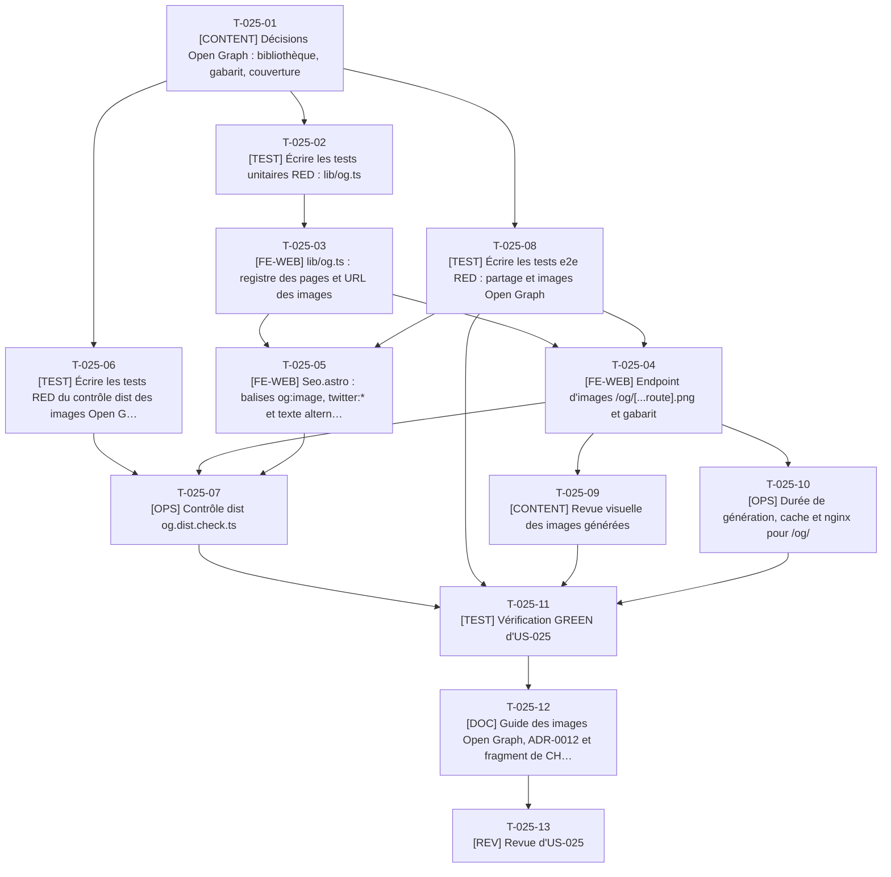

# Tâches - US-025 : Images Open Graph générées au build

## Informations US
- **Epic** : EPIC-006 : SEO, GEO et mesure
- **Persona** : P-001 : Claire, DG d'une scale-up qui recrute
- **Story Points** : 3
- **Sprint** : sprint-003-blog_migre_seo
- **Lot** : B
- **Dépendances externes au lot** : US-002 livrée (tokens de design) ; `Seo.astro` étendu par `T-024-05` ; registre alimenté par le contrat C3.

## Résumé de la US
**En tant que** P-001 : Claire
**Je veux** voir une vignette soignée avec le titre de la page lorsqu'un lien du site est partagé (LinkedIn, e-mail, messagerie)
**Afin de** identifier tout de suite de quoi il s'agit et accorder du crédit au lien reçu d'un cabinet

## Vue d'ensemble des tâches

| ID | Type | Tâche | Estimation | Dépend de | Lot | Statut |
|----|------|-------|------------|-----------|-----|--------|
| T-025-01 | [CONTENT] | Décisions Open Graph : bibliothèque, gabarit, couverture | 2h | - | B | 👀 |
| T-025-02 | [TEST] | Écrire les tests unitaires RED : lib/og.ts | 4h | T-025-01, T-900-10 | B | ✅ |
| T-025-03 | [FE-WEB] | lib/og.ts : registre des pages et URL des images | 4h | T-025-02, T-009-05 | B | ✅ |
| T-025-04 | [FE-WEB] | Endpoint d'images /og/[...route].png et gabarit | 5h | T-025-03, T-900-07, T-025-08 | B | ✅ |
| T-025-05 | [FE-WEB] | Seo.astro : balises og:image, twitter:* et texte alternatif | 2h | T-025-03, T-024-05, T-025-08 | B | ✅ |
| T-025-06 | [TEST] | Écrire les tests RED du contrôle dist des images Open Graph | 3h | T-025-01 | B | ✅ |
| T-025-07 | [OPS] | Contrôle dist og.dist.check.ts | 3h | T-025-06, T-025-04, T-025-05 | B | ✅ |
| T-025-08 | [TEST] | Écrire les tests e2e RED : partage et images Open Graph | 2,5h | T-025-01 | B | ✅ |
| T-025-09 | [CONTENT] | Revue visuelle des images générées | 1,5h | T-025-04 | B | 🔄 |
| T-025-10 | [OPS] | Durée de génération, cache et nginx pour /og/ | 2h | T-025-04, T-024-14 | B | ✅ |
| T-025-11 | [TEST] | Vérification GREEN d'US-025 | 2h | T-025-07, T-025-08, T-025-09, T-025-10, T-009-23 | B | ✅ |
| T-025-12 | [DOC] | Guide des images Open Graph, ADR-0012 et fragment de CHANGELOG | 2h | T-025-11 | B | 🔄 |
| T-025-13 | [REV] | Revue d'US-025 | 1,5h | T-025-12 | B | ✅ |

**Total estimé** : 34,5h (13 tâches)

| Type | Tâches | Heures |
|------|--------|--------|
| [OPS] | 2 | 5h |
| [FE-WEB] | 3 | 11h |
| [CONTENT] | 2 | 3,5h |
| [TEST] | 4 | 11,5h |
| [DOC] | 1 | 2h |
| [REV] | 1 | 1,5h |

---

## Graphe de dépendances

Dépendances vers d'autres US : T-025-02 dépend de T-900-10, T-025-03 dépend de T-009-05, T-025-04 dépend de T-900-07, T-025-05 dépend de T-024-05, T-025-10 dépend de T-024-14, T-025-11 dépend de T-009-23.

---

## Détail des tâches

#### T-025-01 : [CONTENT] Décisions Open Graph : bibliothèque, gabarit, couverture
- **Type** : [CONTENT]
- **Estimation** : 2h
- **Dépend de** : -
- **Lot** : B

**Description** :
À consigner dans `docs/guides/images-og.md` et valider avec le PO : (1) bibliothèque `astro-og-canvas` 0.13.2 (tech-spec et checklist de démarrage) plutôt que Satori + resvg (note d'US-025) : dépendances relevées le 2026-10-14 `canvaskit-wasm` et `deterministic-object-hash`, aucun binaire natif, pair `astro ^7` satisfait (écart E17) ; (2) un gabarit unique : nom du site, titre de la page (3 lignes au plus, ellipse au-delà de 90 caractères), catégorie ou type de contenu, dégradé sobre issu de `src/data/tokens.json` avec texte à contraste ≥ 4,5:1 (calcul par `src/lib/contrast.ts` existant) ; (3) police : `cv/fonts/Inter-*.ttf` (OFL, déjà dans le dépôt pour le CV) réutilisée, pas de seconde copie ; (4) couverture : une image pour chaque page indexable (articles, fiches, projets, pages principales, listes du blog) et une image de repli `default` ; l'image de couverture d'un article n'est pas reprise (formats variés, droits non établis) ; (5) caractère hors police : omis sans échec.

**Fichiers à créer/modifier** :
- `docs/guides/images-og.md`

**Critères de validation** :
- [ ] Décisions datées et validées par le PO
- [ ] Choix de la police justifié par sa licence

#### T-025-02 : [TEST] Écrire les tests unitaires RED : lib/og.ts
- **Type** : [TEST]
- **Estimation** : 4h
- **Dépend de** : T-025-01, T-900-10
- **Lot** : B

**Description** :
`ogRouteKey(path)` (clé stable et sûre de chemin, `/` → `index`), `getOgImageUrl(path)` (URL absolue `/og/<clé>.png`, repli `default` pour une page sans entrée), `truncateTitle(title, max = 90)` (ellipse, 3 lignes maximum), `stripUnsupported(text, glyphs)` (accents et « œ » conservés, caractère hors police retiré), `buildOgPages(sources)` (registre `{ clé → { title, description, kind } }` construit depuis les pages principales, `getPublishedPosts()`, `plugins`, `projects` et les listes du blog), erreur sur deux pages de même clé ; contraste du texte du gabarit sur son fond ≥ 4,5:1 (calcul avec `src/lib/contrast.ts` sur les couleurs retenues, thème clair des tokens).

**Fichiers à créer/modifier** :
- `tests/unit/lib/og.test.ts`

**Critères de validation** :
- [ ] RED constaté
- [ ] Cas : titre de 91 caractères, « é », « œ », émoji, collision de clés, couleurs à contraste insuffisant

#### T-025-03 : [FE-WEB] lib/og.ts : registre des pages et URL des images
- **Type** : [FE-WEB]
- **Estimation** : 4h
- **Dépend de** : T-025-02, T-009-05
- **Lot** : B

**Description** :
Implémenter `src/lib/og.ts` : seul module qui sait où est l'image d'une page (`getOgImageUrl(path)`), consommé par `Seo.astro` (aucun autre module n'écrit `/og/`). Registre construit à partir des mêmes sources que le sitemap et `llms.txt`, sans seconde liste de pages (DRY avec `src/lib/sitemap.ts`, T-024-13 : extraire un module commun si le besoin apparaît).

**Fichiers à créer/modifier** :
- `src/lib/og.ts`

**Critères de validation** :
- [ ] Tests T-025-02 verts
- [ ] Une page ajoutée à une collection reçoit son image sans éditer le registre

#### T-025-04 : [FE-WEB] Endpoint d'images /og/[...route].png et gabarit
- **Type** : [FE-WEB]
- **Estimation** : 5h
- **Dépend de** : T-025-03, T-900-07, T-025-08
- **Lot** : B

**Description** :
`src/pages/og/[...route].png.ts` avec `OGImageRoute` d'`astro-og-canvas` : `pages` depuis le registre, `getImageOptions` (titre, description, dégradé, polices `cv/fonts/Inter-*.ttf`, logo discret facultatif). Police introuvable : erreur de build « Génération Open Graph : police introuvable (<chemin>) ». Vérifier dans la documentation de la bibliothèque (version épinglée) l'API exacte avant d'écrire le code ; ne pas la supposer. Image de repli `default` pour l'accueil et les pages sans gabarit.

**Fichiers à créer/modifier** :
- `src/pages/og/[...route].png.ts`

**Critères de validation** :
- [ ] Une image PNG de 1200 × 630 générée par page du registre
- [ ] Police absente : message exact et build en échec (test sur copie temporaire)

#### T-025-05 : [FE-WEB] Seo.astro : balises og:image, twitter:* et texte alternatif
- **Type** : [FE-WEB]
- **Estimation** : 2h
- **Dépend de** : T-025-03, T-024-05, T-025-08
- **Lot** : B

**Description** :
Ajouter à `Seo.astro` : `og:image` (URL absolue), `og:image:width` 1200, `og:image:height` 630, `og:image:alt` (titre de la page), `twitter:card` `summary_large_image`, `twitter:title`, `twitter:description`, `twitter:image`. Les pages `noindex` conservent leurs balises de partage (un lien reçu par e-mail se partage même si la page n'est pas indexée), sauf décision contraire.

**Fichiers à créer/modifier** :
- `src/components/seo/Seo.astro`
- `src/lib/seo.ts` (fonction pure `buildTwitterCard`)

**Critères de validation** :
- [ ] Balises présentes sur l'accueil, un article, une fiche, une liste du blog
- [ ] Test unitaire de `buildTwitterCard`

#### T-025-06 : [TEST] Écrire les tests RED du contrôle dist des images Open Graph
- **Type** : [TEST]
- **Estimation** : 3h
- **Dépend de** : T-025-01
- **Lot** : B

**Description** :
`og.dist.check.ts` et sa lib : l'URL `og:image` de chaque page indexable est absolue, joignable dans `dist/`, un PNG de 1200 × 630 (lecture des 24 premiers octets, en-tête IHDR), de moins de 300 Ko ; `og:image:width` et `og:image:height` valent 1200 et 630 ; `og:image:alt` non vide. Fixtures PNG minimales générées par le test.

**Fichiers à créer/modifier** :
- `tests/unit/checks/og.test.ts`

**Critères de validation** :
- [ ] RED constaté
- [ ] Cas : PNG 1200 × 600, PNG de 301 Ko, balise manquante, image absente

#### T-025-07 : [OPS] Contrôle dist og.dist.check.ts
- **Type** : [OPS]
- **Estimation** : 3h
- **Dépend de** : T-025-06, T-025-04, T-025-05
- **Lot** : B

**Description** :
Implémenter `scripts/checks/og.dist.check.ts` et `scripts/checks/lib/og.ts`. Compter les images et relever le poids total et le plus lourd. Aucune image Open Graph ne doit être référencée par un lien visible de la page (les visiteurs ne les chargent pas).

**Fichiers à créer/modifier** :
- `scripts/checks/og.dist.check.ts`
- `scripts/checks/lib/og.ts`

**Critères de validation** :
- [ ] Tests T-025-06 verts
- [ ] `make checks` vert sur le site complet

#### T-025-08 : [TEST] Écrire les tests e2e RED : partage et images Open Graph
- **Type** : [TEST]
- **Estimation** : 2,5h
- **Dépend de** : T-025-01
- **Lot** : B

**Description** :
`tests/e2e/og.spec.ts`, strict. Sur l'accueil, un article, une fiche plugin et une page de liste : `og:title`, `og:description`, `og:image` absolue, `og:image:width` et `height`, `twitter:card` `summary_large_image` ; la requête vers l'image répond 200 `image/png` ; les dimensions lues dans l'en-tête PNG valent 1200 × 630 ; poids < 300 Ko ; l'image est servie avec un cache raisonnable. Titre long (86 caractères, article réel) : image générée sans erreur.

**Fichiers à créer/modifier** :
- `tests/e2e/og.spec.ts`

**Critères de validation** :
- [ ] RED constaté
- [ ] Aucun `test.skip`

#### T-025-09 : [CONTENT] Revue visuelle des images générées
- **Type** : [CONTENT]
- **Estimation** : 1,5h
- **Dépend de** : T-025-04
- **Lot** : B

**Description** :
Examiner à l'œil un échantillon (accueil, article au titre le plus long, article avec accents et « œ », fiche plugin, page de liste, image de repli) : lisibilité, débordement, contraste dans le rendu final, cohérence avec la charte. Aucune capture n'utilise l'image Playwright (disque) : ouvrir les PNG de `dist/og/` directement. Consigner les ajustements de gabarit.

**Fichiers à créer/modifier** :
- `docs/guides/images-og.md`

**Critères de validation** :
- [ ] 6 images examinées, remarques traitées ou consignées

#### T-025-10 : [OPS] Durée de génération, cache et nginx pour /og/
- **Type** : [OPS]
- **Estimation** : 2h
- **Dépend de** : T-025-04, T-024-14
- **Lot** : B

**Description** :
Mesurer la durée de génération sur le site complet (budget US-025 : moins de 3 minutes) et son effet sur la durée du build Docker ; si le budget est menacé, réduire le nombre d'images aux pages indexables distinctes (pas de cache fragile dans une image reconstruite à chaque fois). `nginx.conf` : `location ^~ /og/` avec `Cache-Control` à durée limitée (fichiers non hachés : revalidation ou un jour), snippet réinclus.

**Fichiers à créer/modifier** :
- `nginx.conf`
- `docs/guides/images-og.md` (mesures)

**Critères de validation** :
- [ ] Durée mesurée et notée avec le nombre d'images
- [ ] En-têtes des images vérifiés par `og.spec.ts`

#### T-025-11 : [TEST] Vérification GREEN d'US-025
- **Type** : [TEST]
- **Estimation** : 2h
- **Dépend de** : T-025-07, T-025-08, T-025-09, T-025-10, T-009-23
- **Lot** : B

**Description** :
`make checks`, `og.spec.ts` sur `preview` après S1, Lighthouse sur l'échantillon (les images OG ne doivent pas dégrader les scores), poids total de `dist/og/`.

**Fichiers à créer/modifier** :
- aucun nouveau fichier

**Critères de validation** :
- [ ] Scénarios verts, aucun skip
- [ ] Toutes les images < 300 Ko

#### T-025-12 : [DOC] Guide des images Open Graph, ADR-0012 et fragment de CHANGELOG
- **Type** : [DOC]
- **Estimation** : 2h
- **Dépend de** : T-025-11
- **Lot** : B

**Description** :
`docs/guides/images-og.md` (ajouter un type de page, modifier le gabarit, police, dépannage) ; `docs/adr/0012-images-og-astro-og-canvas.md` (décision, alternative Satori + resvg, conséquences) ; ligne dans `changelog.d/lot-b.md`.

**Fichiers à créer/modifier** :
- `docs/guides/images-og.md`
- `docs/adr/0012-images-og-astro-og-canvas.md`
- `changelog.d/lot-b.md`

**Critères de validation** :
- [ ] ADR au format des ADR existants

#### T-025-13 : [REV] Revue d'US-025
- **Type** : [REV]
- **Estimation** : 1,5h
- **Dépend de** : T-025-12
- **Lot** : B

**Description** :
Revue : un seul module d'URL d'image, polices non dupliquées, erreurs de build explicites, poids et dimensions contrôlés, contraste du gabarit, aucun chargement par les visiteurs.

**Fichiers à créer/modifier** :
- `project-management/sprints/sprint-003-blog_migre_seo/dod-review.md` (section US-025)

**Critères de validation** :
- [ ] Findings consignés et traités
