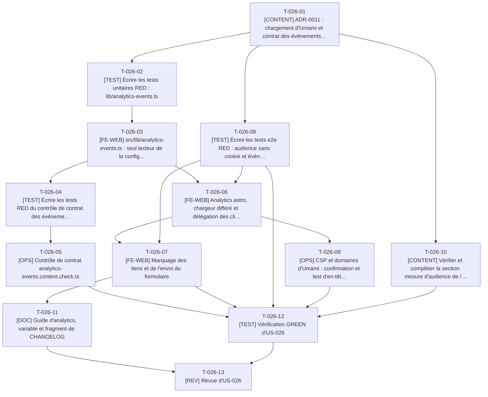

# Tâches - US-026 : Analytics sans cookie et mesure des conversions

## Informations US
- **Epic** : EPIC-006 : SEO, GEO et mesure
- **Persona** : P-001 : Claire, DG d'une scale-up qui recrute (visiteuse respectueuse de sa vie privée)
- **Story Points** : 3
- **Sprint** : sprint-003-blog_migre_seo
- **Lot** : B
- **Dépendances externes au lot** : US-007 et US-008 livrées (CV, formulaire) ; compte Umami Cloud et `PUBLIC_UMAMI_WEBSITE_ID` fournis par le PO (sans variable : aucun script).

## Résumé de la US
**En tant que** P-001 : Claire
**Je veux** consulter le site sans bandeau de cookies ni pistage individuel, tout en permettant au propriétaire de mesurer les actions clés
**Afin de** naviguer sans friction pendant que le PO suit les contacts qualifiés (objectif O2 : au moins 4 par mois) et les clics sortants (O3 : au moins 15 %)

## Vue d'ensemble des tâches

| ID | Type | Tâche | Estimation | Dépend de | Lot | Statut |
|----|------|-------|------------|-----------|-----|--------|
| T-026-01 | [CONTENT] | ADR-0011 : chargement d'Umami et contrat des événements (avant le code) | 3h | - | B | 🔲 |
| T-026-02 | [TEST] | Écrire les tests unitaires RED : lib/analytics-events.ts | 4h | T-026-01 | B | 🔲 |
| T-026-03 | [FE-WEB] | src/lib/analytics-events.ts : seul lecteur de la configuration et du contrat | 4h | T-026-02 | B | 🔲 |
| T-026-04 | [TEST] | Écrire les tests RED du contrôle de contrat des événements | 2,5h | T-026-03 | B | 🔲 |
| T-026-05 | [OPS] | Contrôle de contrat analytics-events.content.check.ts | 3h | T-026-04 | B | 🔲 |
| T-026-06 | [FE-WEB] | Analytics.astro, chargeur différé et délégation des clics | 5h | T-026-03, T-024-05, T-013-06, T-026-08 | B | 🔲 |
| T-026-07 | [FE-WEB] | Marquage des liens et de l'envoi du formulaire | 3h | T-026-06, T-026-08 | B | 🔲 |
| T-026-08 | [TEST] | Écrire les tests e2e RED : audience sans cookie et événements | 4,5h | T-026-01 | B | 🔲 |
| T-026-09 | [OPS] | CSP et domaines d'Umami : confirmation et test d'en-têtes | 1,5h | T-026-06 | B | 🔲 |
| T-026-10 | [CONTENT] | Vérifier et compléter la section mesure d'audience de /vie-privee/ | 2h | T-026-01 | B | 🔲 |
| T-026-11 | [DOC] | Guide d'analytics, variable et fragment de CHANGELOG | 1,5h | T-026-07 | B | 🔲 |
| T-026-12 | [TEST] | Vérification GREEN d'US-026 | 2h | T-026-05, T-026-07, T-026-08, T-026-09, T-026-10 | B | 🔲 |
| T-026-13 | [REV] | Revue d'US-026 | 2h | T-026-11, T-026-12 | B | 🔲 |

**Total estimé** : 38h (13 tâches)

| Type | Tâches | Heures |
|------|--------|--------|
| [OPS] | 2 | 4,5h |
| [FE-WEB] | 3 | 12h |
| [CONTENT] | 2 | 5h |
| [TEST] | 4 | 13h |
| [DOC] | 1 | 1,5h |
| [REV] | 1 | 2h |

---

## Graphe de dépendances

Dépendances vers d'autres US : T-026-06 dépend de T-024-05, T-026-06 dépend de T-013-06.

---

## Détail des tâches

#### T-026-01 : [CONTENT] ADR-0011 : chargement d'Umami et contrat des événements (avant le code)
- **Type** : [CONTENT]
- **Estimation** : 3h
- **Dépend de** : -
- **Lot** : B

**Description** :
La checklist de démarrage exige une décision écrite avant le code. `docs/adr/0011-umami-chargement-et-evenements.md` (complète ADR-0004) : chargeur externe qui n'injecte le script que si `PUBLIC_UMAMI_WEBSITE_ID` est défini et si ni DNT (`navigator.doNotTrack === '1'`) ni GPC (`navigator.globalPrivacyControl === true`) ne sont actifs (la prise en charge de GPC par le script d'Umami est à vérifier dans sa documentation ; le chargeur du site applique de toute façon les deux signaux) ; domaines réels du script et de l'envoi à relever dans la documentation d'Umami Cloud et dans l'onglet réseau d'un essai avec l'identifiant du PO, puis comparés à la CSP actuelle (`cloud.umami.is` en `script-src` ; `cloud.umami.is`, `api-gateway.umami.dev` et `api.web3forms.com` en `connect-src`) ; région UE si l'offre Hobby la permet, sinon mention dans `/vie-privee/` ; liste fermée des événements d'ADR-0004 (`contact_submit{motif}`, `rdv_click`, `cv_download`, `outbound_github{repo}`, `outbound_packagist{package}`, `outbound_linkedin`), propriétés autorisées par événement, marquage par `data-event` avec repli par motif d'URL pour les liens sortants des contenus ; ce qui reste invérifiable en intégration continue (le script réel d'Umami n'est jamais appelé : la CI le simule, le comportement réel est contrôlé en production par le PO, T-900-28).

**Fichiers à créer/modifier** :
- `docs/adr/0011-umami-chargement-et-evenements.md`

**Critères de validation** :
- [ ] ADR validé par le PO avant tout code
- [ ] Domaines relevés avec date et source

#### T-026-02 : [TEST] Écrire les tests unitaires RED : lib/analytics-events.ts
- **Type** : [TEST]
- **Estimation** : 4h
- **Dépend de** : T-026-01
- **Lot** : B

**Description** :
`EVENTS` (liste fermée et propriétés autorisées), `eventForLink({ href, dataEvent })` (priorité à `data-event`, sinon motif d'URL : `github.com/<owner>/<repo>` → `outbound_github{repo}`, `packagist.org/packages/<vendor>/<nom>` → `outbound_packagist{package}`, `linkedin.com` → `outbound_linkedin`, sinon aucun événement), `assertEventPayload(name, props)` (message « Événement <nom> : propriété interdite '<propriété>' » pour toute propriété hors liste, dont `email` et `message`), `shouldLoadAnalytics({ websiteId, dnt, gpc })` (aucun script sans identifiant, avec DNT ou avec GPC), `motifValue(motif)` borné aux motifs du formulaire (aucun texte libre).

**Fichiers à créer/modifier** :
- `tests/unit/lib/analytics-events.test.ts`

**Critères de validation** :
- [ ] RED constaté
- [ ] Cas : e-mail dans une propriété, nom d'événement inconnu, lien GitHub avec sous-chemin, DNT et GPC

#### T-026-03 : [FE-WEB] src/lib/analytics-events.ts : seul lecteur de la configuration et du contrat
- **Type** : [FE-WEB]
- **Estimation** : 4h
- **Dépend de** : T-026-02
- **Lot** : B

**Description** :
Implémenter le module typé du contrat (liste fermée, validation des charges, détection de lien, décision de chargement). `PUBLIC_UMAMI_WEBSITE_ID` n'est lu qu'ici (via `Analytics.astro` qui l'injecte dans un attribut de données). Le contact (`src/components/contact/contact-form.ts`, qui appelle déjà `window.umami?.track('contact_submit', { motif })`) passe par ce module en `T-026-07`.

**Fichiers à créer/modifier** :
- `src/lib/analytics-events.ts`

**Critères de validation** :
- [ ] Tests T-026-02 verts
- [ ] Un seul lecteur de `PUBLIC_UMAMI_WEBSITE_ID` dans `src/`

#### T-026-04 : [TEST] Écrire les tests RED du contrôle de contrat des événements
- **Type** : [TEST]
- **Estimation** : 2,5h
- **Dépend de** : T-026-03
- **Lot** : B

**Description** :
`analytics-events.content.check.ts` : parcourt `src/` et échoue si un `data-event`, un `data-umami-event` ou un appel `track(` utilise un nom hors liste ou une propriété hors liste (« Événement <nom> : propriété interdite '<propriété>' »). Cas : nom inconnu, propriété `email`, appel valide, `data-event` valide.

**Fichiers à créer/modifier** :
- `tests/unit/checks/analytics-events-check.test.ts`

**Critères de validation** :
- [ ] RED constaté

#### T-026-05 : [OPS] Contrôle de contrat analytics-events.content.check.ts
- **Type** : [OPS]
- **Estimation** : 3h
- **Dépend de** : T-026-04
- **Lot** : B

**Description** :
Implémenter le contrôle et sa lib (découverte automatique). Il s'applique aussi aux contenus Markdown des articles (un lien `data-event` en HTML brut dans un article serait contrôlé).

**Fichiers à créer/modifier** :
- `scripts/checks/analytics-events.content.check.ts`
- `scripts/checks/lib/analytics-events.ts`

**Critères de validation** :
- [ ] Tests T-026-04 verts
- [ ] `make checks` vert

#### T-026-06 : [FE-WEB] Analytics.astro, chargeur différé et délégation des clics
- **Type** : [FE-WEB]
- **Estimation** : 5h
- **Dépend de** : T-026-03, T-024-05, T-013-06, T-026-08
- **Lot** : B

**Description** :
`src/components/seo/Analytics.astro` (rendu seulement si l'identifiant est défini : balise de données portant l'identifiant, aucun script sinon), `src/scripts/analytics.ts` (module externe, `defer`, sans cookie ni stockage) : vérifie `shouldLoadAnalytics`, injecte le script Umami en différé, écoute les clics par délégation (`eventForLink`) et appelle `window.umami?.track` dans un `try/catch` (un script bloqué ou en échec ne produit aucune erreur de console), un événement par clic. Intégré dans `BaseLayout.astro` (lot B). La CSP n'est pas élargie sans la décision de T-026-01.

**Fichiers à créer/modifier** :
- `src/components/seo/Analytics.astro`
- `src/scripts/analytics.ts`
- `src/layouts/BaseLayout.astro`

**Critères de validation** :
- [ ] Sans identifiant : aucun script ni requête
- [ ] Script bloqué : aucune erreur dans la console

#### T-026-07 : [FE-WEB] Marquage des liens et de l'envoi du formulaire
- **Type** : [FE-WEB]
- **Estimation** : 3h
- **Dépend de** : T-026-06, T-026-08
- **Lot** : B

**Description** :
`CvDownload.astro` (`data-cv-download` existe déjà : ajouter `data-event="cv_download"`), `RdvLink.astro` (`data-event="rdv_click"`), `contact-form.ts` (passer par le module du contrat : `contact_submit` avec `motif` seulement, jamais le nom, l'e-mail ni le message), liens LinkedIn et GitHub du pied de page (repli par motif d'URL, ou `data-event` explicite). Les liens sortants des fiches plugins et des projets (GitHub, Packagist) sont couverts par le motif d'URL sans toucher à leurs composants.

**Fichiers à créer/modifier** :
- `src/components/cv/CvDownload.astro`
- `src/components/contact/RdvLink.astro`
- `src/components/contact/contact-form.ts`
- `src/components/ui/Footer.astro`

**Critères de validation** :
- [ ] Aucune charge d'événement ne contient de donnée saisie (test unitaire et e2e)
- [ ] Tests existants du formulaire et du CV toujours verts

#### T-026-08 : [TEST] Écrire les tests e2e RED : audience sans cookie et événements
- **Type** : [TEST]
- **Estimation** : 4,5h
- **Dépend de** : T-026-01
- **Lot** : B

**Description** :
`tests/e2e/analytics.spec.ts`, strict, script Umami simulé par `page.route` (la CI ne contacte jamais Umami). Scénarios : avec identifiant factice, le script est injecté en différé ; `contact_submit` avec `motif` (poste, mission, autre) à l'envoi (Web3Forms simulé comme dans `contact.spec.ts`), sans nom ni e-mail ni message ; `cv_download`, `rdv_click`, `outbound_github`, `outbound_packagist` une fois par clic ; DNT simulé (`navigator.doNotTrack`) puis GPC (`navigator.globalPrivacyControl`) : aucune requête vers le domaine d'audience ; script bloqué (`route.abort`) : navigation et formulaire normaux, aucune erreur bloquante en console ; aucun cookie ni entrée `localStorage` / `sessionStorage` sur le parcours ; aucun bandeau de consentement ; en-tête CSP : domaines Umami présents dans `script-src` et `connect-src`. Le comportement du vrai script Umami (cookies, stockage) n'est pas testable ici : contrôlé en production (T-900-28).

**Fichiers à créer/modifier** :
- `tests/e2e/analytics.spec.ts`

**Critères de validation** :
- [ ] RED constaté
- [ ] Aucun `test.skip`

#### T-026-09 : [OPS] CSP et domaines d'Umami : confirmation et test d'en-têtes
- **Type** : [OPS]
- **Estimation** : 1,5h
- **Dépend de** : T-026-06
- **Lot** : B

**Description** :
Comparer les domaines retenus en T-026-01 à `nginx/snippets/security-headers.conf` (déjà : `cloud.umami.is` en `script-src` ; `cloud.umami.is` et `api-gateway.umami.dev` en `connect-src`) ; ajuster seulement si la décision l'exige, mettre à jour le commentaire d'en-tête (les domaines ne sont plus « à confirmer ») et compléter `tests/e2e/headers.spec.ts` (domaines attendus, absence d'`unsafe-inline`). Amender ADR-0009 en une ligne si la CSP change.

**Fichiers à créer/modifier** :
- `nginx/snippets/security-headers.conf`
- `tests/e2e/headers.spec.ts`

**Critères de validation** :
- [ ] `headers.spec.ts` vert, CSP sans `unsafe-inline`
- [ ] Commentaire du snippet à jour

#### T-026-10 : [CONTENT] Vérifier et compléter la section mesure d'audience de /vie-privee/
- **Type** : [CONTENT]
- **Estimation** : 2h
- **Dépend de** : T-026-01
- **Lot** : B

**Description** :
`src/content/legal/vie-privee.md` mentionne déjà Umami Cloud (sprint 1). Vérifier avec l'ADR-0011 : outil, absence de cookie, région des données, base légale (intérêt légitime, mesure agrégée), DNT et GPC respectés, liste des événements sans donnée saisie, durée de conservation de l'offre (6 mois), date de mise à jour. Modifier le texte uniquement si l'un de ces points est inexact ou absent, et mettre à jour la date de la page. Validation PO (texte juridique).

**Fichiers à créer/modifier** :
- `src/content/legal/vie-privee.md`
- `src/config/legal.ts` (date de mise à jour)

**Critères de validation** :
- [ ] Chaque point ci-dessus vérifié (liste cochée dans la PR)
- [ ] Contrôle de contenu légal (`legal-pii`) vert

#### T-026-11 : [DOC] Guide d'analytics, variable et fragment de CHANGELOG
- **Type** : [DOC]
- **Estimation** : 1,5h
- **Dépend de** : T-026-07
- **Lot** : B

**Description** :
`docs/guides/analytics.md` : contrat des événements, ajouter un événement (contrôle de contrat), DNT et GPC, test local avec script simulé, tableau de bord O2 et O3 ; documenter `PUBLIC_UMAMI_WEBSITE_ID` dans `.env.example` (fichier à relever avant édition) ; ligne dans `changelog.d/lot-b.md`.

**Fichiers à créer/modifier** :
- `docs/guides/analytics.md`
- `.env.example`
- `changelog.d/lot-b.md`

**Critères de validation** :
- [ ] Variable documentée ; sans elle, aucun script (comportement décrit)

#### T-026-12 : [TEST] Vérification GREEN d'US-026
- **Type** : [TEST]
- **Estimation** : 2h
- **Dépend de** : T-026-05, T-026-07, T-026-08, T-026-09, T-026-10
- **Lot** : B

**Description** :
`make checks`, `analytics.spec.ts`, `headers.spec.ts` et `contact.spec.ts` sur `preview` ; Lighthouse ≥ 95 conservé sur l'accueil et `/contact/` avec un identifiant factice (script bloqué dans l'environnement de test : le LCP réel est mesuré en production).

**Fichiers à créer/modifier** :
- aucun nouveau fichier

**Critères de validation** :
- [ ] Scénarios verts, aucun skip
- [ ] Aucune dégradation des scores de l'échantillon

#### T-026-13 : [REV] Revue d'US-026
- **Type** : [REV]
- **Estimation** : 2h
- **Dépend de** : T-026-11, T-026-12
- **Lot** : B

**Description** :
Revue : minimisation (aucune donnée saisie), un seul lecteur de l'identifiant, DNT et GPC, `try/catch`, CSP, texte de `/vie-privee/` exact, aucune dépendance ajoutée.

**Fichiers à créer/modifier** :
- `project-management/sprints/sprint-003-blog_migre_seo/dod-review.md` (section US-026)

**Critères de validation** :
- [ ] Findings consignés et traités
