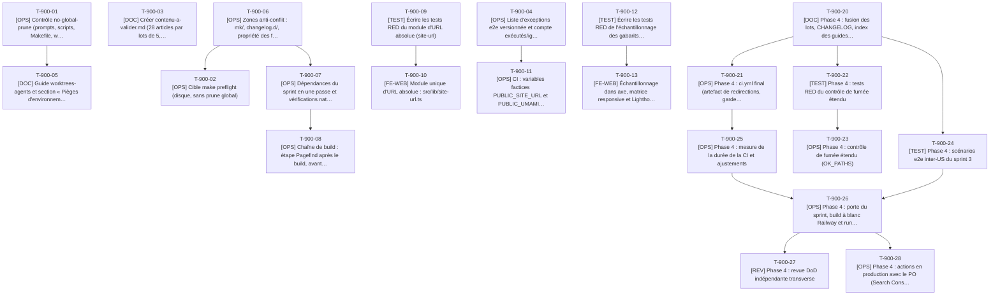

# Tâches transverses - Sprint 003

> Tâches qui ne relèvent d'aucune US : reprise des actions de la rétrospective du sprint 2 (`T-900-01` à `T-900-05`, à vérifier avant le démarrage : celles déjà faites sont closes par leur commande de preuve), socle et contrats de phase 0, et intégration de phase 4. Elles sont exécutées par l'orchestrateur. Les tâches de contrat rattachées à une US (`T-009-01` à `T-009-07`, `T-024-02`) sont dans le fichier de leur US.

## Vue d'ensemble

| ID | Type | Tâche | Estimation | Dépend de | Lot | Statut |
|----|------|-------|------------|-----------|-----|--------|
| T-900-01 | [OPS] | Contrôle no-global-prune (prompts, scripts, Makefile, workflows) | 3h | - | Phase 0 | ✅ |
| T-900-02 | [OPS] | Cible make preflight (disque, sans prune global) | 2h | T-900-06 | Phase 0 | ✅ |
| T-900-03 | [DOC] | Créer contenu-a-valider.md (28 articles par lots de 5, sprints 1 et 2) | 2h | - | Phase 0 | ✅ |
| T-900-04 | [OPS] | Liste d'exceptions e2e versionnée et compte exécutés/ignorés dans la CI | 4h | - | Phase 0 | ✅ |
| T-900-05 | [DOC] | Guide worktrees-agents et section « Pièges d'environnement » | 3h | T-900-01 | Phase 0 | ✅ |
| T-900-06 | [OPS] | Zones anti-conflit : mk/, changelog.d/, propriété des fichiers | 1,5h | - | Phase 0 | ✅ |
| T-900-07 | [OPS] | Dépendances du sprint en une passe et vérifications natives (Pagefind, MIME nginx) | 4h | T-900-06 | Phase 0 | ✅ |
| T-900-08 | [OPS] | Chaîne de build : étape Pagefind après le build, avant les contrôles dist | 1,5h | T-900-07 | Phase 0 | ✅ |
| T-900-09 | [TEST] | Écrire les tests RED du module d'URL absolue (site-url) | 1,5h | - | Phase 0 | ✅ |
| T-900-10 | [FE-WEB] | Module unique d'URL absolue : src/lib/site-url.ts | 1,5h | T-900-09 | Phase 0 | ✅ |
| T-900-11 | [OPS] | CI : variables factices PUBLIC_SITE_URL et PUBLIC_UMAMI_WEBSITE_ID | 1,5h | T-900-04 | Phase 0 | ✅ |
| T-900-12 | [TEST] | Écrire les tests RED de l'échantillonnage des gabarits répétés | 2,5h | - | Phase 0 | ✅ |
| T-900-13 | [FE-WEB] | Échantillonnage dans axe, matrice responsive et Lighthouse (délai proportionnel) | 3,5h | T-900-12 | Phase 0 | ✅ |
| T-900-20 | [DOC] | Phase 4 : fusion des lots, CHANGELOG, index des guides et des ADR | 3h | T-009-29, T-009-30, T-010-12, T-011-11, T-012-12, T-013-11, T-024-18, T-025-13, T-026-13 | Phase 4 | 🔲 |
| T-900-21 | [OPS] | Phase 4 : ci.yml final (artefact de redirections, garde du dépôt, Lighthouse séparé, durées) | 3,5h | T-900-20, T-010-07 | Phase 4 | 🔄 |
| T-900-22 | [TEST] | Phase 4 : tests RED du contrôle de fumée étendu | 1,5h | T-900-20 | Phase 4 | ✅ |
| T-900-23 | [OPS] | Phase 4 : contrôle de fumée étendu (OK_PATHS) | 1h | T-900-22 | Phase 4 | ✅ |
| T-900-24 | [TEST] | Phase 4 : scénarios e2e inter-US du sprint 3 | 4h | T-900-20 | Phase 4 | 👀 |
| T-900-25 | [OPS] | Phase 4 : mesure de la durée de la CI et ajustements | 3h | T-900-21 | Phase 4 | 🔲 |
| T-900-26 | [OPS] | Phase 4 : porte du sprint, build à blanc Railway et runner, déploiement | 4h | T-900-21, T-900-24, T-900-25 | Phase 4 | 🔲 |
| T-900-27 | [REV] | Phase 4 : revue DoD indépendante transverse | 5h | T-900-26 | Phase 4 | 🔄 |
| T-900-28 | [OPS] | Phase 4 : actions en production avec le PO (Search Console, Rich Results, Umami) | 2,5h | T-900-26 | Phase 4 | 🔲 |

**Total estimé** : 59h (22 tâches ; phase 0 : 31,5h, phase 4 : 27,5h)

| Type | Tâches | Heures |
|------|--------|--------|
| [OPS] | 12 | 31,5h |
| [FE-WEB] | 2 | 5h |
| [TEST] | 4 | 9,5h |
| [DOC] | 3 | 8h |
| [REV] | 1 | 5h |

### Conditions de clôture de la phase 0 (S0)

Les workers ne démarrent pas avant que les preuves ci-dessous aient été produites et consignées dans le journal du sprint. Règle de l'arbitrage E25 : « livrés et prouvés avant le lancement des workers ».

| Preuve | Tâche | Commande | Résultat attendu |
|--------|-------|----------|------------------|
| `no-global-prune` | T-900-01 | `make checks` | code 0 ; un fichier contenant `docker system prune` fait échouer le contrôle |
| `make preflight` | T-900-02 | `make preflight` | code 0 avec espace libre et plafond de workers affichés (ou échec clair et dérogation PO consignée) |
| `skip-allowlist` | T-900-04 | `npx vitest run tests/unit/checks/strict-skips.test.ts` (dans le conteneur `tools`) | tests verts ; `tests/e2e/skip-allowlist.json` présent avec les 3 ignorés du sprint 2 |
| `worktrees-agents.md` | T-900-05 | `test -f docs/guides/worktrees-agents.md` | code 0 ; lien depuis l'index des guides |
| Contrats C1 à C6 | T-009-03, T-009-05, T-900-10, T-024-02, T-010-03 | `make test` | tests verts : schéma blog, `blog.ts`, `site-url.ts`, types de `page-meta.ts`, `redirects.ts` |
| Dépendances et chaîne de build | T-900-07, T-900-08 | `make build` | code 0 ; `dist/pagefind/pagefind.js` présent |

Enchaînement : T-900-01, T-900-02, T-900-04 et T-900-05 précèdent la création des worktrees. T-900-04 est prérequis de `T-009-20` (premier e2e strict) et T-900-05 de `T-009-08` et `T-024-01` (premières tâches des lots A et B).

---

## Graphe de dépendances



Dépendances vers d'autres US : T-900-20 dépend de T-009-29, T-900-20 dépend de T-009-30, T-900-20 dépend de T-010-12, T-900-20 dépend de T-011-11, T-900-20 dépend de T-012-12, T-900-20 dépend de T-013-11, T-900-20 dépend de T-024-18, T-900-20 dépend de T-025-13, T-900-20 dépend de T-026-13, T-900-21 dépend de T-010-07.

---

## Détail des tâches

#### T-900-01 : [OPS] Contrôle no-global-prune (prompts, scripts, Makefile, workflows)
- **Type** : [OPS]
- **Estimation** : 3h
- **Dépend de** : -
- **Lot** : Phase 0

**Description** :
Action 1 de la rétro du sprint 2. Un contrôle de contenu `no-global-prune` échoue si un fichier du dépôt (`Makefile`, `mk/`, `scripts/`, `.github/workflows/`, `docs/`) ou un prompt de sprint (`project-management/sprints/**/tasks/`) contient `docker system prune`, `docker volume prune`, `docker container prune`, `docker image prune -a` ou `docker builder prune -a`. Le nettoyage autorisé est `docker compose -p <projet> down -v` et `docker builder prune -f`. Le contrôle ignore les dossiers absents du contexte Docker (`.dockerignore` exclut `.github` et `project-management`) : il est donc exécuté par `make checks` (dépôt monté dans le conteneur `tools`), pas par la seule construction de l'image. Écrire le test d'abord (fichier de test contenant `docker system prune` = échec).

**Fichiers à créer/modifier** :
- `scripts/checks/no-global-prune.content.check.ts`
- `scripts/checks/lib/no-global-prune.ts`
- `tests/unit/checks/no-global-prune.test.ts`
- `docs/guides/qualite-ci.md` (règle)

**Critères de validation** :
- [ ] Le test échoue sur une entrée contenant `docker system prune` (RED puis GREEN)
- [ ] Le contrôle réussit sur le dépôt actuel
- [ ] La règle figure dans `docs/guides/qualite-ci.md` et dans le gabarit de prompt de `tasks/README.md`
- [ ] **Preuve avant S0 (E25)** : `docker compose -p tm-p0 run --rm tools npx vitest run tests/unit/checks/no-global-prune.test.ts` affiche tous les tests verts, puis `make checks` se termine avec le code 0 et la ligne `no-global-prune` en succès ; un fichier temporaire contenant `docker system prune` fait échouer `make checks` (code différent de 0, message citant le fichier), puis est supprimé

#### T-900-02 : [OPS] Cible make preflight (disque, sans prune global)
- **Type** : [OPS]
- **Estimation** : 2h
- **Dépend de** : T-900-06
- **Lot** : Phase 0

**Description** :
Action 4 de la rétro. `mk/preflight.mk` : `make preflight` échoue sous 8 Go libres (message clair), affiche `df` et `docker system df`, suggère uniquement un nettoyage limité au projet (`docker compose -p <projet> down -v`, `docker builder prune -f`), jamais un prune global. Plafond de workers selon l'espace libre : 2 si au moins 3 Go libres, 1 sinon, arrêt de tout build sous 1,5 Go (valeurs de la checklist de démarrage §4.3). Le seuil est paramétrable (`PREFLIGHT_MIN_GB`) pour tester les deux branches sans toucher au disque.

**Fichiers à créer/modifier** :
- `mk/preflight.mk`
- `docs/guides/qualite-ci.md` (section Préflight)

**Critères de validation** :
- [ ] `make preflight PREFLIGHT_MIN_GB=9999` échoue avec un message clair ; `make preflight PREFLIGHT_MIN_GB=1` réussit
- [ ] Aucun prune global dans la cible (contrôle T-900-01 vert)
- [ ] Espace libre relevé et consigné dans le journal du sprint
- [ ] **Preuve avant S0 (E25)** : `make preflight` se termine avec le code 0 et affiche l'espace libre, le plafond de workers et `docker system df` (ou, si le disque est sous le seuil de 8 Go, échoue avec le message clair et la dérogation PO est consignée) ; `grep -rn "prune" Makefile mk/` ne montre que `docker builder prune -f`

#### T-900-03 : [DOC] Créer contenu-a-valider.md (28 articles par lots de 5, sprints 1 et 2)
- **Type** : [DOC]
- **Estimation** : 2h
- **Dépend de** : -
- **Lot** : Phase 0

**Description** :
Action 5 de la rétro. Créer `contenu-a-valider.md` dans le dossier du sprint : un tableau par élément rédigé par un agent, statut `à valider` / `validé` / `à corriger`. Pour le sprint 3 : les 28 articles en 6 lots de 5, 5, 5, 5, 5 et 3 (lot 1 = articles pilotes, voir `T-009-13`), plus les décisions éditoriales (descriptions, titres SEO, textes alternatifs, FAQ, pieds biographiques). Reprendre les éléments restants des sprints 1 et 2 (accroche, expériences, 20 fiches par lots de 5, career-ops, tailsfadmin, années des réalisations) sans en modifier le statut.

**Fichiers à créer/modifier** :
- `project-management/sprints/sprint-003-blog_migre_seo/contenu-a-valider.md`

**Critères de validation** :
- [ ] Chaque lot de contenu du sprint contient 5 éléments au plus
- [ ] Chaque ligne cite le fichier concerné et le statut

#### T-900-04 : [OPS] Liste d'exceptions e2e versionnée et compte exécutés/ignorés dans la CI
- **Type** : [OPS]
- **Estimation** : 4h
- **Dépend de** : -
- **Lot** : Phase 0

**Description** :
Action S1-1 reportée. Un fichier `tests/e2e/skip-allowlist.json` recense les `test.skip` autorisés (test, raison, date). Un reporter Playwright échoue si un test ignoré est absent de la liste et écrit « exécutés / ignorés » dans le résumé de l'étape (`$GITHUB_STEP_SUMMARY`) et sur la sortie standard. Le mode strict `E2E_EXPECT_FULL_CONFIG=1` reste inchangé. Reprendre les 3 ignorés attendus du sprint 2 (rapport DoD) dans la liste, chacun avec sa raison. Ce fichier est le seul endroit où un skip peut être justifié : les lots n'y touchent pas sans demande à l'orchestrateur.

**Fichiers à créer/modifier** :
- `tests/e2e/skip-allowlist.json`
- `tests/e2e/reporters/strict-skips.ts`
- `playwright.config.ts`
- `.github/workflows/ci.yml` (étape e2e)
- `tests/unit/checks/strict-skips.test.ts`

**Critères de validation** :
- [ ] Un test ignoré hors liste fait échouer l'exécution (test unitaire du reporter)
- [ ] Le résumé CI affiche le compte exécutés/ignorés
- [ ] Les 3 ignorés du sprint 2 sont listés avec raison
- [ ] **Preuve avant S0 (E25)** : `docker compose -p tm-p0 run --rm tools npx vitest run tests/unit/checks/strict-skips.test.ts` vert, et `test -f tests/e2e/skip-allowlist.json` (code 0) ; le résumé de l'étape e2e de la CI du dernier push affiche « exécutés / ignorés » avec 3 ignorés, tous présents dans la liste

#### T-900-05 : [DOC] Guide worktrees-agents et section « Pièges d'environnement »
- **Type** : [DOC]
- **Estimation** : 3h
- **Dépend de** : T-900-01
- **Lot** : Phase 0

**Description** :
Actions S1-3 et S1-6 reportées. `docs/guides/worktrees-agents.md` : création des worktrees par l'orchestrateur depuis la branche du sprint (pas `main`), workers sans `git`, `COMPOSE_PROJECT_NAME` et ports distincts (W1 : 4322/8081, W2 : 4323/8082, surcharge locale `compose.override.yaml` avec `ports: !override`, non versionnée), 2 workers au plus, pas d'image Playwright en local (Chromium système via `PW_CHROMIUM_PATH` ou CI), gabarit de prompt (interdiction des prune globaux, lecture seule de `/Users/tmonier/Projects/blog`, un seul rapport puis arrêt). Section « Pièges d'environnement » dans `qualite-ci.md` : aliases interactifs (`ls`, `cat`, `grep`, `du` détournés : utiliser `command ls`, chemins absolus, `mv -f`), `command curl`, `--mount=type=cache` sans `id` interdit sur Railway, `--no-build`.

**Fichiers à créer/modifier** :
- `docs/guides/worktrees-agents.md`
- `docs/guides/qualite-ci.md`
- `docs/guides/README.md` (index : ajout d'une ligne par l'orchestrateur)

**Critères de validation** :
- [ ] `test -f docs/guides/worktrees-agents.md` et lien depuis `docs/guides/README.md`
- [ ] Section « Pièges d'environnement » présente dans `qualite-ci.md`
- [ ] **Preuve avant S0 (E25)** : `test -f docs/guides/worktrees-agents.md && grep -c "COMPOSE_PROJECT_NAME" docs/guides/worktrees-agents.md` affiche un nombre supérieur ou égal à 1 (code 0) ; `grep -n "Pièges d'environnement" docs/guides/qualite-ci.md` renvoie une ligne ; la création des worktrees W1 et W2 n'a lieu qu'après cette tâche

#### T-900-06 : [OPS] Zones anti-conflit : mk/, changelog.d/, propriété des fichiers
- **Type** : [OPS]
- **Estimation** : 1,5h
- **Dépend de** : -
- **Lot** : Phase 0

**Description** :
Action 3 de la rétro. Ajouter au `Makefile` la ligne `-include mk/*.mk` (les cibles de lot vivent dans des fichiers `mk/<nom>.mk` : `mk/lot-a.mk` pour `make redirects`, `mk/preflight.mk` ; chaque fichier déclare son `.PHONY`). Créer `changelog.d/README.md` : un fragment par lot (`changelog.d/lot-a.md`, `changelog.d/lot-b.md`), assemblé dans `CHANGELOG.md` par l'orchestrateur en phase 4. Consigner dans `docs/guides/worktrees-agents.md` (section « Propriété des fichiers ») la table de propriété de `tasks/README.md`.

**Fichiers à créer/modifier** :
- `Makefile` (une ligne)
- `changelog.d/README.md`

**Critères de validation** :
- [ ] `make help` fonctionne toujours avec et sans fichier `mk/`
- [ ] Une cible définie dans `mk/essai.mk` est appelable (vérifié puis supprimé)

#### T-900-07 : [OPS] Dépendances du sprint en une passe et vérifications natives (Pagefind, MIME nginx)
- **Type** : [OPS]
- **Estimation** : 4h
- **Dépend de** : T-900-06
- **Lot** : Phase 0

**Description** :
Seul écrivain du lockfile du sprint. Installer en versions exactes (relevées sur le registre npm le 2026-10-14, à revérifier au moment de l'installation avec `npm view <paquet> version`) : `pagefind` 1.5.2 (ADR-0001), `@astrojs/rss` 4.0.19, `@astrojs/sitemap` 3.7.4, `astro-og-canvas` 0.13.2 (dépendances : `canvaskit-wasm`, pas de binaire natif ; pair `astro ^7` satisfait). Installation avec `--ignore-scripts` (voir `.npmrc`). Vérifier : (1) le binaire Pagefind démarre sur `node:26-alpine` (musl) via le conteneur `tools` : `docker compose -p tm-p0 run --rm tools npx pagefind --version`, sinon repli documenté (écart à trancher) ; (2) dans l'image nginx épinglée du `Dockerfile`, `/etc/nginx/mime.types` : types de `wasm`, `xml`, `txt`, `png` et présence de `charset` (conditionne les `location` de `T-013-07` et `T-024-14`) ; (3) `@astrojs/sitemap` et `astro-og-canvas` se chargent avec Astro 7.3.8 (`astro check`). Consigner les résultats dans `docs/guides/qualite-ci.md`.

**Commandes** :
```bash
docker compose -p tm-p0 run --rm tools npm install --save-exact --ignore-scripts pagefind@1.5.2 @astrojs/rss@4.0.19 @astrojs/sitemap@3.7.4 astro-og-canvas@0.13.2
docker compose -p tm-p0 run --rm tools npx pagefind --version
# nettoyage limité au projet, jamais de prune global
docker compose -p tm-p0 down -v
```

**Fichiers à créer/modifier** :
- `package.json`
- `package-lock.json`
- `docs/guides/qualite-ci.md`

**Critères de validation** :
- [ ] Versions exactes, lockfile commité, `npm ci --ignore-scripts` vert
- [ ] Binaire Pagefind exécutable sur Alpine (ou repli décidé)
- [ ] Résultat des 3 vérifications consigné avec la date

#### T-900-08 : [OPS] Chaîne de build : étape Pagefind après le build, avant les contrôles dist
- **Type** : [OPS]
- **Estimation** : 1,5h
- **Dépend de** : T-900-07
- **Lot** : Phase 0

**Description** :
Dans `package.json` : `build:search` = `pagefind --site dist` ; la chaîne `build` devient `checks:content` → `astro build` → `build:cv` → `build:search` → `checks:dist`. Pagefind n'indexe aucun fichier non HTML et son dossier `dist/pagefind/` ne gêne ni `internal-links.dist.check.ts` (HTML seulement) ni Lighthouse. Vérifier sur le site actuel (30 pages) que l'étape réussit et note la durée. Le `Dockerfile` n'est pas modifié (le binaire vient de `node_modules`).

**Fichiers à créer/modifier** :
- `package.json` (scripts)

**Critères de validation** :
- [ ] `make build` vert avec l'étape ajoutée
- [ ] `dist/pagefind/pagefind.js` présent ; durée de l'étape notée

#### T-900-09 : [TEST] Écrire les tests RED du module d'URL absolue (site-url)
- **Type** : [TEST]
- **Estimation** : 1,5h
- **Dépend de** : -
- **Lot** : Phase 0

**Description** :
Contrat C4. `absoluteUrl('/blog/x/')` renvoie l'URL absolue à partir de l'origine du site ; `originOf(site)` ; la barre finale est conservée ; un chemin qui contient déjà un domaine est refusé ; les fichiers (`/rss.xml`) n'ont pas de barre finale ajoutée ; une origine invalide fait échouer. Tests qui n'importent pas `astro:content`.

**Fichiers à créer/modifier** :
- `tests/unit/lib/site-url.test.ts`

**Critères de validation** :
- [ ] RED constaté (module absent)

#### T-900-10 : [FE-WEB] Module unique d'URL absolue : src/lib/site-url.ts
- **Type** : [FE-WEB]
- **Estimation** : 1,5h
- **Dépend de** : T-900-09
- **Lot** : Phase 0

**Description** :
Implémenter `absoluteUrl(path, site)` et `originOf(site)` en fonctions pures ; l'origine est lue à un seul endroit : `import.meta.env.SITE` (valeur de `site` dans `astro.config.mjs`, qui lit `PUBLIC_SITE_URL`). `src/lib/seo.ts` (`canonicalUrl`) reste le seul à normaliser la barre finale : `absoluteUrl` s'appuie dessus (DRY). Aucun autre module ne lit `PUBLIC_SITE_URL`.

**Fichiers à créer/modifier** :
- `src/lib/site-url.ts`

**Critères de validation** :
- [ ] Tests T-900-09 verts
- [ ] `grep` de `PUBLIC_SITE_URL` dans `src/` : un seul lecteur (`astro.config.mjs` hors `src/`)

#### T-900-11 : [OPS] CI : variables factices PUBLIC_SITE_URL et PUBLIC_UMAMI_WEBSITE_ID
- **Type** : [OPS]
- **Estimation** : 1,5h
- **Dépend de** : T-900-04
- **Lot** : Phase 0

**Description** :
Dans `.github/workflows/ci.yml`, ajouter aux `env` et aux `build-args` des 4 étapes de build : `PUBLIC_SITE_URL: https://thibaut-monier.fr` (la valeur par défaut d'`astro.config.mjs`, rendue explicite) et `PUBLIC_UMAMI_WEBSITE_ID` factice (UUID de test) pour exercer le chargement du script en e2e (le script tiers est simulé par `page.route`, jamais appelé). Seule modification de `ci.yml` avant la phase 4 ; les lots ne touchent pas à ce fichier.

**Fichiers à créer/modifier** :
- `.github/workflows/ci.yml`

**Critères de validation** :
- [ ] Les 4 builds reçoivent les deux arguments
- [ ] `E2E_EXPECT_FULL_CONFIG` inchangé

#### T-900-12 : [TEST] Écrire les tests RED de l'échantillonnage des gabarits répétés
- **Type** : [TEST]
- **Estimation** : 2,5h
- **Dépend de** : -
- **Lot** : Phase 0

**Description** :
Le blog ajoute environ 62 pages aux 30 de `dist/` (28 articles, 3 pages d'index, 5 catégories, 19 tags, 6 séries, 1 recherche). Sans échantillonnage, axe (2 thèmes × 2 projets), la matrice responsive et Lighthouse (3 exécutions) triplent leur durée, alors que le job `e2e` a déjà pris 15 min 51 s pour un plafond de 20 min. `sampleRoutes(routes, rules)` (fonction pure) garde toutes les pages uniques et, pour une famille répétée (préfixe), N pages au plus (2 par défaut) plus une liste d'inclusions explicites ; la liste est lue dans `tests/e2e/sample-routes.json` (articles à particularités : SVG, tableau, code, FAQ, sans série, série la plus longue). Les articles sont les routes `/blog/<segment>/` hors segments réservés (`page`, `categorie`, `tag`, `serie`) ; une liste d'articles vide ne réduit rien (tous les articles sont testés). Une règle inconnue ou une inclusion absente de `dist/` est une erreur (pas d'échantillon silencieusement vide).

**Fichiers à créer/modifier** :
- `tests/unit/checks/sample-routes.test.ts`

**Critères de validation** :
- [ ] RED constaté
- [ ] Cas : famille répétée réduite, inclusion explicite conservée, inclusion inexistante en erreur, pages uniques intactes

#### T-900-13 : [FE-WEB] Échantillonnage dans axe, matrice responsive et Lighthouse (délai proportionnel)
- **Type** : [FE-WEB]
- **Estimation** : 3,5h
- **Dépend de** : T-900-12
- **Lot** : Phase 0

**Description** :
Implémenter `scripts/checks/lib/sample-routes.ts` (importé par les tests e2e et par `lighthouse.ts`) et l'utiliser dans `a11y.spec.ts`, `pages-matrix.spec.ts` et `scripts/checks/lighthouse.ts`. Les délais restent proportionnels au nombre de pages réellement testées (formule de `a11y.spec.ts` conservée). Famille répétée au sprint 3 : `/blog/tag/`, `/blog/serie/`, `/blog/page/` (2 chacune), `/blog/categorie/` (toutes, 5), `/blog/<article>/` (échantillon de `sample-routes.json`) ; fiches plugins du sprint 2 inchangées. Le fichier `sample-routes.json` est créé avec une liste vide d'articles et complété par `T-009-26` (liste validée par le contrôle de l'intégration).

**Fichiers à créer/modifier** :
- `scripts/checks/lib/sample-routes.ts`
- `tests/e2e/helpers/sample.ts`
- `tests/e2e/a11y.spec.ts`
- `tests/e2e/pages-matrix.spec.ts`
- `scripts/checks/lighthouse.ts`
- `tests/e2e/sample-routes.json`

**Critères de validation** :
- [ ] Tests T-900-12 verts
- [ ] Les 30 pages actuelles restent toutes testées (aucune famille répétée sans règle)
- [ ] Aucun `test.skip` ajouté

#### T-900-20 : [DOC] Phase 4 : fusion des lots, CHANGELOG, index des guides et des ADR
- **Type** : [DOC]
- **Estimation** : 3h
- **Dépend de** : T-009-29, T-009-30, T-010-12, T-011-11, T-012-12, T-013-11, T-024-18, T-025-13, T-026-13
- **Lot** : Phase 4

**Description** :
Fusion dans l'ordre : lot A (US-009, 010, 011, 012) puis lot B (US-013, 024, 025, 026), un commit `merge: lot X` chacun, sans résolution manuelle attendue (cible : 0 marqueur de conflit). Assembler `changelog.d/lot-a.md` et `lot-b.md` dans `CHANGELOG.md` (zone `[Unreleased]`, ajout seul) puis les supprimer. Compléter `docs/guides/README.md` (une ligne par guide : blog, redirections-blog, recherche, flux-rss, seo-technique, images-og, analytics), `docs/adr/README.md` (ADR-0011 à 0013) et le `README.md` (variables `PUBLIC_SITE_URL`, `PUBLIC_UMAMI_WEBSITE_ID`, commandes `make redirects`). Corriger `content-model.md` (description 50 à 160, `seoTitle`, `seriesOrder`, `validated`, `.md`) et les stories (US-010 : 28 articles vérifiés, US-009 : index paginé) dans `project-management/`.

**Fichiers à créer/modifier** :
- `CHANGELOG.md`
- `docs/guides/README.md`
- `docs/adr/README.md`
- `README.md`
- `project-management/architecture/content-model.md`

**Critères de validation** :
- [ ] 0 marqueur de conflit dans les fusions de lots
- [ ] `changelog.d/` vidé, fragments assemblés
- [ ] Chaque guide du sprint est indexé

#### T-900-21 : [OPS] Phase 4 : ci.yml final (artefact de redirections, garde du dépôt, Lighthouse séparé, durées)
- **Type** : [OPS]
- **Estimation** : 3,5h
- **Dépend de** : T-900-20, T-010-07
- **Lot** : Phase 4

**Description** :
Dans `ci.yml` : (1) job `redirects` : exécute `scripts/build-redirects.ts` dans l'image Node épinglée (dépôt monté en lecture seule, sortie vers un dossier temporaire du runner) et publie `agentic-agency.nginx.conf` en artefact, sans déploiement ; (2) job `repo-guards` : `no-global-prune` sur le dépôt monté (le build Docker n'a ni `.github` ni `project-management`) ; (3) l'étape Lighthouse devient un job `lighthouse` (timeout 25 min, échantillonnage T-900-13) pour que le job `e2e` garde son plafond de 20 min ; (4) tous ajoutés aux `needs` du job `ci` et à ses `test` ; (5) `REQUIRE_VALIDATED_CONTENT=1` pour les builds de `main` uniquement (écart E22). Actions épinglées par SHA comme les existantes.

**Fichiers à créer/modifier** :
- `.github/workflows/ci.yml`

**Critères de validation** :
- [ ] Artefact `agentic-agency.nginx.conf` téléchargeable sur une PR
- [ ] Le job `ci` échoue si un des nouveaux jobs échoue (vérifié par une exécution en échec volontaire sur branche)
- [ ] Aucune action non épinglée

#### T-900-22 : [TEST] Phase 4 : tests RED du contrôle de fumée étendu
- **Type** : [TEST]
- **Estimation** : 1,5h
- **Dépend de** : T-900-20
- **Lot** : Phase 4

**Description** :
`OK_PATHS` de `scripts/checks/lib/smoke.ts` doit couvrir : `/blog/`, `/blog/page/2/`, un article, `/recherche/`, `/rss.xml`, `/sitemap-index.xml`, `/robots.txt`, `/llms.txt`. Le test unitaire vérifie la liste et le comportement avec `fetch` injecté (statut attendu, en-têtes de sécurité sur chaque réponse, type de contenu de `/rss.xml`).

**Fichiers à créer/modifier** :
- `tests/unit/checks/smoke.test.ts`

**Critères de validation** :
- [ ] RED constaté

#### T-900-23 : [OPS] Phase 4 : contrôle de fumée étendu (OK_PATHS)
- **Type** : [OPS]
- **Estimation** : 1h
- **Dépend de** : T-900-22
- **Lot** : Phase 4

**Description** :
Étendre `OK_PATHS` et, pour `/rss.xml`, vérifier le type de contenu. Le slug de l'article de référence est lu dans un seul endroit du script (constante commentée), pas dérivé du réseau.

**Fichiers à créer/modifier** :
- `scripts/checks/lib/smoke.ts`

**Critères de validation** :
- [ ] Tests T-900-22 verts
- [ ] `make smoke URL=<preview>` vert en local

#### T-900-24 : [TEST] Phase 4 : scénarios e2e inter-US du sprint 3
- **Type** : [TEST]
- **Estimation** : 4h
- **Dépend de** : T-900-20
- **Lot** : Phase 4

**Description** :
`tests/e2e/sprint-003.spec.ts`, strict (aucun skip). Parcours : accueil → blog → catégorie → article avec série → article suivant ; recherche d'un terme → ouverture d'un résultat ; lien RSS du pied de page ; chaque type de page (accueil, parcours, article, fiche plugin, index blog) expose à la fois canonical absolue, `og:image` joignable en 1200 × 630, JSON-LD valide et BreadcrumbList ; sur un article, un clic sur un lien GitHub appelle l'événement `outbound_github` (script Umami simulé) ; aucun cookie, aucune entrée de stockage local sur tout le parcours. Délai proportionnel au nombre de pages parcourues.

**Fichiers à créer/modifier** :
- `tests/e2e/sprint-003.spec.ts`

**Critères de validation** :
- [ ] Scénarios verts sur `preview`
- [ ] Aucun `test.skip`

#### T-900-25 : [OPS] Phase 4 : mesure de la durée de la CI et ajustements
- **Type** : [OPS]
- **Estimation** : 3h
- **Dépend de** : T-900-21
- **Lot** : Phase 4

**Description** :
Mesurer sur une PR réelle : durée des jobs `quality`, `e2e`, `lighthouse`, `supply-chain`, taille de l'image `runtime` (Pagefind et `canvaskit-wasm` n'y entrent pas, sauf `dist/pagefind` et `dist/og`), durée de la génération des images OG et de l'étape Pagefind. Comparer au sprint 2 (15 min 51 s, plafond e2e 20 min). Si un plafond est dépassé : élargir l'échantillonnage (jamais un skip), consigner dans `qualite-ci.md`.

**Fichiers à créer/modifier** :
- `docs/guides/qualite-ci.md` (section Mesures)

**Critères de validation** :
- [ ] Durées mesurées et consignées avec le numéro de run
- [ ] Aucun job au-dessus de son plafond

#### T-900-26 : [OPS] Phase 4 : porte du sprint, build à blanc Railway et runner, déploiement
- **Type** : [OPS]
- **Estimation** : 4h
- **Dépend de** : T-900-21, T-900-24, T-900-25
- **Lot** : Phase 4

**Description** :
`/gate:validate-sprint 003`. Build à blanc de l'étape `runtime` sur Railway et sur le runner avant le premier merge sur `main` (pas de `--mount=type=cache` sans `id`, pas de `--no-build`, aucune écriture hors `dist/`). Vérifier que la sortie de l'étape Pagefind et des images OG entre bien dans `dist/` du build Railway (sans réseau). Déployer via la CI, `make smoke URL=...` en production. Nettoyage limité au projet.

**Fichiers à créer/modifier** :
- `reports/ (artefacts)`

**Critères de validation** :
- [ ] Rapport de porte archivé
- [ ] Build Railway vert, production à jour, fumée verte

#### T-900-27 : [REV] Phase 4 : revue DoD indépendante transverse
- **Type** : [REV]
- **Estimation** : 5h
- **Dépend de** : T-900-26
- **Lot** : Phase 4

**Description** :
Revue indépendante (contexte neuf) à mi-sprint (après la synchronisation S1, 2026-11-18) puis en fin de sprint : DoD complète, un seul lecteur par donnée partagée (0 finding de type N1/N2), 0 conflit de fusion, 0 prune global dans le journal, e2e sans skip hors liste, faits publiés vérifiés (liens externes des articles : 8 URL distinctes relevées le 2026-10-14 ; dates et versions citées), cohérence des 28 articles avec `contenu-a-valider.md`. Chaque finding devient un test ou un contrôle de build.

**Fichiers à créer/modifier** :
- `project-management/sprints/sprint-003-blog_migre_seo/dod-review.md`

**Critères de validation** :
- [ ] Score et findings consignés
- [ ] Chaque finding bloquant est corrigé avec un contrôle automatique

#### T-900-28 : [OPS] Phase 4 : actions en production avec le PO (Search Console, Rich Results, Umami)
- **Type** : [OPS]
- **Estimation** : 2,5h
- **Dépend de** : T-900-26
- **Lot** : Phase 4

**Description** :
Actions humaines à ne pas déléguer : soumission du nouveau domaine et de `sitemap-index.xml` à la Search Console (US-010), vérification manuelle Rich Results d'un article, d'une fiche plugin et du profil (US-024), contrôle en production qu'aucun cookie ni stockage local n'est créé et que les 5 événements arrivent dans Umami (US-026), tableau de bord O2 et O3. Validation PO sur la production, passage des US de « Done sous réserve PO » à `done`.

**Fichiers à créer/modifier** :
- `project-management/sprints/sprint-003-blog_migre_seo/sprint-review.md`

**Critères de validation** :
- [ ] Preuves (captures ou URL) consignées
- [ ] Statuts du sprint mis à jour par l'orchestrateur
